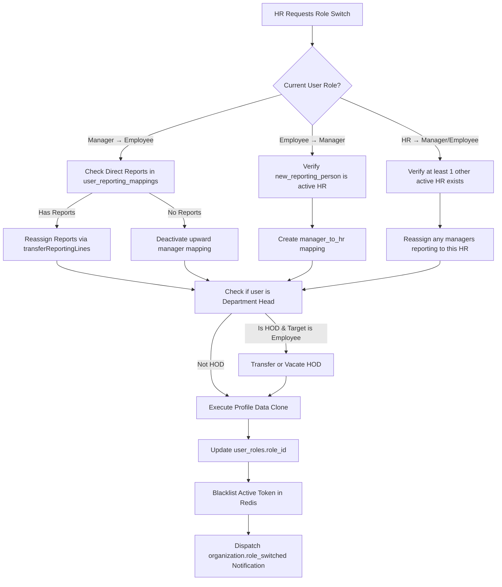

# Role Switching & Promotion Architecture: Employee ↔ Manager ↔ HR Implementation Specification

**Document Version:** 1.0.0  
**Date:** 2026-10-31  
**Status:** ✅ Implemented & Fully Verified (18/18 Unit Tests Passing)  
**Primary Endpoint:** `PUT /api/v1/organizations/users/:id/role-switch`  
**Modules Touched:** `organization`, `auth`, `leave`, `attendance`, `payroll`, `task`, `billing`, `notification`  
**Database Migrations Required:** None (All models, schemas, and enum relations already exist)

---

## 1. Executive Summary & Objective

The HRMS platform currently provisions user roles at the time of initial organization invitation (`src/modules/organization/services/invitation.service.js`). However, organizations routinely need to:
1. **Promote an Employee to a Manager** (`employee` → `manager`).
2. **Promote a Manager to an HR Administrator** (`manager` → `hr`).
3. **Demote a Manager to an Employee** (`manager` → `employee`).
4. **Demote or Transfer an HR Administrator to a Manager or Employee** (`hr` → `manager` / `employee`).

In this modular monolith architecture, a role change cannot be implemented as a simple update to `user_roles.role_id`. Doing so would cause catastrophic data loss, orphan reporting subordinates, corrupt approval workflows across Leave and Reimbursements, violate PostgreSQL database enums, and leave stale permissions in active JWT sessions.

This document details the exact architectural requirements, failure modes, data migration pipelines, API contracts, and implementation steps required to build production-grade role-switching functionality.

---

## 2. Deep Architectural Analysis & System Constraints

### 2.1 The Multi-Table Role Profile Split & Data Preservation Guarantee

In this application, user profiles are split across global identity and role-specific models:
* `users`: Global auth credential (`id`, `identifier`, `status`).
* `user_profiles`: Core identity (`first_name`, `last_name`, `phone`, `avatar_storage_key`).
* `user_roles`: Organization tenant assignment with strict uniqueness:
  ```sql
  UNIQUE ("org_id", "user_id") WHERE "deleted_at" IS NULL
  ```
* **Dedicated Role Profile Tables**:
  * `employee_profiles` (carries `manager_id`, `reporting_person`, PAN, UAN, work mode, etc.)
  * `manager_profiles` (carries `department_head`, `budget_limit`, `max_team_size`, PAN, UAN, etc.)
  * `hr_profiles` (carries `department_head`, `access_level`, `specialization`, PAN, UAN, etc.)

> [!CAUTION]
> **Data Loss Prevention Invariant**: If a naive role switch simply deletes the old profile table row and creates an empty row in the new profile table, the user loses their `employee_code`, PAN, UAN, bank records, joining date, date of birth, gender, marital status, and address records.
> 
> **Requirement**: The service must execute a **Profile Clone & Migration** within the database transaction, copying all 25+ shared scalar columns from the source profile model to the target profile model before removing the old profile record.

---

### 2.2 Relational Invariants in `user_reporting_mappings`

The reporting hierarchy backbone is enforced by the PostgreSQL table `user_reporting_mappings` with an enum constraint:

```sql
mapping_relation ENUM (
  'employee_to_manager',
  'employee_to_hr',
  'employee_to_admin',
  'manager_to_hr',
  'manager_to_admin',
  'hr_to_hr',
  'hr_to_admin'
)
```

#### Critical Enum Invariants:
1. **`manager_to_manager` does NOT exist**: A manager cannot report to another manager.
2. **`employee_to_employee` does NOT exist**: An employee cannot report to another employee.
3. **Application Rule 10**: *"Whenever a profile update involves assigning a `reporting_person` to a user with the role of `manager` or `hr`, you MUST strictly verify that the newly assigned reporting person holds the `hr` role. Managers and HRs in this application can ONLY report to an `hr`."*

---

## 3. The 6 Critical Breaking Points & Remediation Strategy

| # | Breaking Point Scenario | Technical Impact If Unhandled | Required Architectural Remediation |
| :-: | :--- | :--- | :--- |
| **1** | **Demoting a Manager who has Direct Reports** (`manager` → `employee`) | Direct reports continue pointing to this user. Relational queries attempt to evaluate `employee_to_employee` (invalid enum, 500 DB error). Subordinate leave and expense approval chains break completely. | **Mandate Subordinate Reassignment**: The API must require `reassign_subordinates_to` (or default to the department head / acting HR) and call `userReportingMappingRepository.transferReportingLines(...)` inside the transaction. |
| **2** | **Promoting an Employee to Manager** (`employee` → `manager`) | If the employee previously reported to a Manager, their relation becomes `manager_to_manager` (violates DB enum and Rule 10). | **Mandate Reporting HR Assignment**: The API must mandate `new_reporting_person` pointing to an active HR user, establishing a clean `manager_to_hr` relation. |
| **3** | **Demoting a Current Head of Department** (`manager`/`hr` → `employee`) | `organization.service.js:1711` strictly enforces: *"Head of Department must be a manager or HR, not an employee"*. An employee heading a department causes runtime crashes on department queries. | **Mandate HOD Succession or Vacation**: If the target user has `department_head: true` or is `department.head_of_department_id`, the API must require `replacement_hod_id` (or explicitly vacate HOD via `transferDepartmentHead`). |
| **4** | **Demoting the Sole Active HR** (`hr` → `manager`/`employee`) | The organization is left with 0 HRs. Nobody can manage users, run payroll, or approve statutory actions. The tenant becomes orphaned. | **Enforce Minimum Active HR Invariant**: Query `organizationRepository.countActiveMembersByRoleKey(orgId, 'hr', targetUserId)`. If `< 1`, reject with `403 LAST_HR_PROTECTED`. Disallow self-demotion (`actorUser.id === targetUserId`). |
| **5** | **SaaS Subscription Quota Bypass** | Plans enforce `max_employees`, `max_managers`, and `max_hrs`. Promoting an employee to manager when `max_managers` is already at capacity bypasses billing limits. | **Pre-flight Quota Verification**: Call `_checkSubscriptionLimits(orgId, new_role)` to ensure the destination seat quota has available capacity. |
| **6** | **JWT Token Role Staleness** | `auth.middleware.js` extracts `req.user.role` from the JWT access token without re-querying the database on every request. A promoted user gets 403 on `/manager/*`; a demoted manager retains manager access until token expiry. | **Active Token Revocation**: Invalidate the user's active access tokens in Redis (`bl:${tokenHash}`) and instruct the frontend client to refresh tokens immediately. |

---

## 4. Impact on In-Flight Workflows Across Modules



### Module Workflow Interactions
1. **Leave Module (`src/modules/leave`)**:
   - If a manager is demoted, any pending leave requests where they are `approver_id` must have approvals re-routed to the new manager or escalated to the HR queue via `ApprovalChainUtils`.
2. **Attendance & Regularization (`src/modules/attendance`)**:
   - `HierarchyAccess.getAccessibleUserIds()` automatically respects the new `user_reporting_mappings` immediately for roster views and regularization approvals.
3. **Reimbursements & Claims (`src/modules/payroll`)**:
   - Multi-stage claim approval steps assigned to the previous manager role are inherited by the reassigned manager.

---

## 5. API Specification: `PUT /api/v1/organizations/users/:id/role-switch`

### 5.1 Route Details
* **Method:** `PUT`
* **Path:** `/api/v1/organizations/users/:id/role-switch`
* **Access Control:** `authenticate`, `requireActiveOrg`, `authorize(['hr', 'admin'])`
* **Headers:**
  * `Authorization: Bearer <access_token>`
  * `Content-Type: application/json`

### 5.2 Request Body Schema
```json
{
  "new_role": "manager",
  "new_reporting_person": "22222222-2222-2222-2222-222222222222",
  "reassign_subordinates_to": "33333333-3333-3333-3333-333333333333",
  "replacement_hod_id": "44444444-4444-4444-4444-444444444444",
  "designation": "Engineering Lead",
  "reason": "Promoted following annual performance review"
}
```

### 5.3 Validation Rules (`Joi`)
| Field | Type | Required? | Rules & Constraints |
| :--- | :---: | :---: | :--- |
| `new_role` | `string` | **Yes** | Must be one of `['employee', 'manager', 'hr']`. Must differ from current role. |
| `new_reporting_person` | `UUIDv4` | **Conditional** | **Mandatory** when `new_role` is `manager` or `hr` (must be an active HR). Optional when `new_role` is `employee`. |
| `reassign_subordinates_to` | `UUIDv4` | **Conditional** | **Mandatory** if demoting a `manager` who has $\ge 1$ active direct report. Must be an active manager or HR. |
| `replacement_hod_id` | `UUIDv4` | **Conditional** | **Mandatory** if the user is a current Head of Department and `new_role === 'employee'`. |
| `designation` | `string` | No | Max 150 chars. If provided, updates profile designation. |
| `reason` | `string` | **Yes** | Min 5 chars, max 255 chars. Stored in audit logs and mapping change reasons. |

---

### 5.4 Success Response (`200 OK`)
```json
{
  "success": true,
  "message": "User role switched successfully from employee to manager",
  "data": {
    "user_id": "11111111-1111-1111-1111-111111111111",
    "org_id": "00000000-0000-0000-0000-000000000000",
    "previous_role": "employee",
    "new_role": "manager",
    "employee_code": "EMP-042",
    "designation": "Engineering Lead",
    "reporting_person": "22222222-2222-2222-2222-222222222222",
    "subordinates_reassigned_count": 0,
    "hod_transferred": false,
    "session_revoked": true,
    "updated_at": "2026-10-31T18:45:00.000Z"
  }
}
```

### 5.5 Error Responses
* **`400 BAD_REQUEST` (`SELF_ROLE_SWITCH_FORBIDDEN`)**:
  ```json
  { "success": false, "message": "You cannot change your own role. Another administrator must perform this action.", "errorCode": "SELF_ROLE_SWITCH_FORBIDDEN" }
  ```
* **`400 BAD_REQUEST` (`ROLE_UNMODIFIED`)**:
  ```json
  { "success": false, "message": "User already holds the role 'manager'", "errorCode": "ROLE_UNMODIFIED" }
  ```
* **`400 BAD_REQUEST` (`REPORTING_PERSON_MUST_BE_HR`)**:
  ```json
  { "success": false, "message": "Managers and HRs can only report to an HR user", "errorCode": "INVALID_REPORTING_PERSON_ROLE" }
  ```
* **`400 BAD_REQUEST` (`MISSING_SUBORDINATE_REASSIGNMENT`)**:
  ```json
  { "success": false, "message": "User has 4 direct reports. You must specify reassign_subordinates_to to demote this manager.", "errorCode": "MISSING_SUBORDINATE_REASSIGNMENT" }
  ```
* **`403 FORBIDDEN` (`LAST_HR_PROTECTED`)**:
  ```json
  { "success": false, "message": "Cannot demote the sole active HR. Please promote another HR administrator first.", "errorCode": "LAST_HR_PROTECTED" }
  ```
* **`403 FORBIDDEN` (`SEAT_LIMIT_EXCEEDED`)**:
  ```json
  { "success": false, "message": "Manager seat limit reached for your organization's subscription tier", "errorCode": "LIMIT_EXCEEDED" }
  ```

---

## 6. Implementation Architecture & Code Blueprint

### 6.1 Database Transaction Flow (`src/modules/organization/services/organization.service.js`)

```javascript
async switchUserRole(actorUser, targetUserId, payload) {
  const orgId = actorUser.orgId
  const {
    new_role,
    new_reporting_person,
    reassign_subordinates_to,
    replacement_hod_id,
    designation,
    reason
  } = payload

  // 1. Guard against self-modification
  if (actorUser.id === targetUserId) {
    throw new AppError(400, 'You cannot change your own role', 'SELF_ROLE_SWITCH_FORBIDDEN')
  }

  const transaction = await sequelize.transaction()
  try {
    // 2. Fetch active membership
    const membership = await userRoleRepository.findActiveMembership(targetUserId, orgId, transaction)
    if (!membership) {
      throw new AppError(404, 'User not found in organization', 'USER_NOT_FOUND')
    }
    const oldRole = membership.role.key
    if (oldRole === new_role) {
      throw new AppError(400, `User already holds the role '${new_role}'`, 'ROLE_UNMODIFIED')
    }

    // 3. Last HR Protection
    if (oldRole === 'hr') {
      const activeHrCount = await organizationRepository.countActiveMembersByRoleKey(orgId, 'hr', targetUserId, transaction)
      if (activeHrCount < 1) {
        throw new AppError(403, 'Cannot demote the sole active HR. Promote another HR first.', 'LAST_HR_PROTECTED')
      }
    }

    // 4. Resolve Target Role Record & Subscription Limit Check
    const targetRoleRecord = await organizationRepository.findRoleByKey(new_role, transaction)
    if (!targetRoleRecord) {
      throw new AppError(400, `Target role '${new_role}' is invalid`, 'INVALID_ROLE')
    }
    await this._checkSubscriptionLimits(orgId, new_role, targetRoleRecord.id, transaction)

    // 5. Retrieve existing profile from source table
    const sourceModel = oldRole === 'hr' ? HrProfile : oldRole === 'manager' ? ManagerProfile : EmployeeProfile
    const targetModel = new_role === 'hr' ? HrProfile : new_role === 'manager' ? ManagerProfile : EmployeeProfile
    
    const currentProfile = await sourceModel.findOne({
      where: { user_id: targetUserId, org_id: orgId },
      transaction
    })
    if (!currentProfile) {
      throw new AppError(404, 'Source role profile not found', 'PROFILE_NOT_FOUND')
    }

    // 6. Handle Head of Department (HOD) transitions
    let hodTransferred = false
    const isCurrentHod = !!currentProfile.department_head
    if (isCurrentHod && new_role === 'employee') {
      if (!replacement_hod_id) {
        throw new AppError(400, 'User is currently a Head of Department. replacement_hod_id is required.', 'MISSING_REPLACEMENT_HOD')
      }
      await this._assertValidHod(replacement_hod_id, orgId, transaction)
      await this.transferDepartmentHead(
        currentProfile.department_id,
        replacement_hod_id,
        actorUser.id,
        orgId,
        false,
        null,
        transaction
      )
      hodTransferred = true
    }

    // 7. Handle Subordinate Reassignments (when demoting Manager/HR with reports)
    let subordinatesReassigned = 0
    const activeSubordinatesCount = await UserReportingMapping.count({
      where: { org_id: orgId, reporting_to_id: targetUserId, is_active: true },
      transaction
    })

    if (activeSubordinatesCount > 0) {
      if (new_role === 'employee' && !reassign_subordinates_to) {
        throw new AppError(400, `User has ${activeSubordinatesCount} direct reports. You must specify reassign_subordinates_to.`, 'MISSING_SUBORDINATE_REASSIGNMENT')
      }
      const newManagerTarget = reassign_subordinates_to || actorUser.id
      const targetManagerMembership = await userRoleRepository.findActiveMembership(newManagerTarget, orgId, transaction)
      if (!targetManagerMembership || !['manager', 'hr', 'admin'].includes(targetManagerMembership.role.key)) {
        throw new AppError(400, 'Reassignment recipient must be an active manager or HR', 'INVALID_REASSIGNMENT_TARGET')
      }

      subordinatesReassigned = await userReportingMappingRepository.transferReportingLines(
        orgId,
        targetUserId,
        newManagerTarget,
        targetManagerMembership.role.key,
        actorUser.id,
        `Role Switch: Demoted to ${new_role} (${reason})`,
        transaction
      )
    }

    // 8. Resolve New Upward Reporting Person
    let resolvedReportingPerson = new_reporting_person || currentProfile.reporting_person || null
    if (new_role === 'manager' || new_role === 'hr') {
      if (!resolvedReportingPerson) {
        resolvedReportingPerson = actorUser.id // Fallback to executing HR
      }
      const reportingMembership = await userRoleRepository.findActiveMembership(resolvedReportingPerson, orgId, transaction)
      if (!reportingMembership || reportingMembership.role.key !== 'hr') {
        throw new AppError(400, 'Managers and HR can only report to an active HR', 'INVALID_REPORTING_PERSON_ROLE')
      }
    }

    // 9. Data Migration: Clone Shared Fields into Target Profile Table
    const clonedData = {
      user_id: targetUserId,
      org_id: orgId,
      employee_code: currentProfile.employee_code,
      department: currentProfile.department,
      department_id: currentProfile.department_id,
      designation: designation || currentProfile.designation,
      joining_date: currentProfile.joining_date,
      work_location: currentProfile.work_location,
      location_id: currentProfile.location_id,
      employment_type: currentProfile.employment_type,
      job_status: currentProfile.job_status,
      pan_number: currentProfile.pan_number,
      uan_number: currentProfile.uan_number,
      blood_group: currentProfile.blood_group,
      marital_status: currentProfile.marital_status,
      gender: currentProfile.gender,
      dob: currentProfile.dob,
      current_address: currentProfile.current_address,
      permanent_address: currentProfile.permanent_address,
      state: currentProfile.state,
      city: currentProfile.city,
      pincode: currentProfile.pincode,
      personal_email: currentProfile.personal_email,
      work_mode: currentProfile.work_mode,
      reporting_person: resolvedReportingPerson,
      // Target specific defaults
      ...(new_role === 'manager' ? {
        department_head: isCurrentHod,
        budget_limit: null,
        max_team_size: null
      } : {}),
      ...(new_role === 'hr' ? {
        department_head: isCurrentHod,
        access_level: 'branch',
        specialization: null
      } : {}),
      ...(new_role === 'employee' ? {
        manager_id: resolvedReportingPerson
      } : {})
    }

    // Create target profile, then hard-delete old profile row
    await targetModel.create(clonedData, { transaction })
    await sourceModel.destroy({
      where: { user_id: targetUserId, org_id: orgId },
      force: true,
      transaction
    })

    // 10. Update user_roles table
    await membership.update({
      role_id: targetRoleRecord.id,
      assigned_by: actorUser.id,
      assigned_at: new Date()
    }, { transaction })

    // 11. Rewire Upward Mapping in user_reporting_mappings
    await userReportingMappingRepository.deactivateActiveMappingsForEmployee(
      orgId, targetUserId, `Role Switch to ${new_role}`, transaction
    )

    if (resolvedReportingPerson) {
      const repMembership = await userRoleRepository.findActiveMembership(resolvedReportingPerson, orgId, transaction)
      const mappingRelation = `${new_role}_to_${repMembership.role.key}`
      await userReportingMappingRepository.createMapping({
        org_id: orgId,
        user_id: targetUserId,
        user_role: new_role,
        reporting_to_id: resolvedReportingPerson,
        reporting_role: repMembership.role.key,
        mapping_relation: mappingRelation,
        is_active: true,
        active_from: new Date(),
        assigned_by: actorUser.id,
        reason_for_change: `Role Switch to ${new_role}: ${reason}`
      }, transaction)
    }

    await transaction.commit()

    // 12. Post-Transaction: Invalidate Redis Session & Dispatch Notification
    await this._revokeUserSessions(targetUserId)

    notificationDispatcher.send({
      eventKey: 'organization.profile_updated',
      orgId,
      actorId: actorUser.id,
      targetUserId,
      data: {
        user_id: targetUserId,
        metadata: {
          action: 'role_switch',
          previous_role: oldRole,
          new_role,
          reason
        }
      }
    }).catch(err => console.warn('[RoleSwitch] notification dispatch failed:', err?.message))

    return {
      user_id: targetUserId,
      org_id: orgId,
      previous_role: oldRole,
      new_role,
      employee_code: clonedData.employee_code,
      designation: clonedData.designation,
      reporting_person: resolvedReportingPerson,
      subordinates_reassigned_count: subordinatesReassigned,
      hod_transferred: hodTransferred,
      session_revoked: true,
      updated_at: new Date().toISOString()
    }

  } catch (err) {
    if (!transaction.finished) await transaction.rollback()
    throw err
  }
}
```

---

## 7. Frontend Integration & UI Workflow Guide

> [!NOTE]
> A comprehensive, production-ready **Frontend Integration Guide** containing TypeScript interfaces, exhaustive error-handling tables, Axios interceptor lifecycle code, and a complete React/Tailwind modal component is available in:
> [`public/md_updates/2026-11-01_role_switching_frontend_integration_guide.md`](file:///c:/Users/asus/Desktop/vs_code/HrClouds-Backend/public/md_updates/2026-11-01_role_switching_frontend_integration_guide.md)


### 7.1 Employee Action Drawer / Modal
In the Admin/HR Directory (`/organization/employees`), add a **"Change Role"** action button in the employee options menu.

```
+-------------------------------------------------------------+
|                     Change Member Role                      |
+-------------------------------------------------------------+
| Member: Sarah Connor (EMP-084)                              |
| Current Role: Employee                                      |
| Current Department: Platform Engineering                    |
+-------------------------------------------------------------+
| Select New Role:                                            |
|   ( ) Employee   (*) Manager   ( ) HR Administrator         |
+-------------------------------------------------------------+
| [When 'Manager' or 'HR' is selected]                        |
| Reports To (HR Administrator) *                             |
| [ Select Active HR...                                   v ] |
|                                                             |
| [When Demoting Manager with Direct Reports]                 |
| Notice: Sarah currently manages 4 team members.             |
| Reassign Direct Reports To *                                |
| [ Select New Manager / HR...                            v ] |
|                                                             |
| [When Member is Head of Department & Switching to Employee] |
| Notice: Sarah is currently HOD for Platform Engineering.    |
| New Department Head *                                       |
| [ Select Replacement HOD...                             v ] |
|                                                             |
| Reason for Role Change *                                    |
| [ Enter business justification...                         ] |
+-------------------------------------------------------------+
|                      [ Cancel ]  [ Confirm Role Change ]    |
+-------------------------------------------------------------+
```

### 7.2 Post-Change Client Handling
* When a user has their role switched, their next request with an old JWT token will encounter `401 TOKEN_REVOKED` (due to the Redis token blacklist).
* The web/mobile client should catch `TOKEN_REVOKED` or an app-level `FORCE_RELOGIN` event and call `/api/v1/auth/select-organization` or redirect to the login screen so a fresh JWT reflecting the new role is generated.

---

## 8. Verification & Test Plan

| Test ID | Test Scenario | Expected Outcome |
| :---: | :--- | :--- |
| **T-RS-01** | Promote Employee to Manager with valid HR reporting person | 200 OK. Shared profile fields preserved. `user_roles.role_id` updated. `manager_to_hr` mapping created. |
| **T-RS-02** | Promote Employee to Manager without specifying HR reporting person | Auto-falls back to the acting HR. 200 OK. |
| **T-RS-03** | Promote Employee pointing `new_reporting_person` at another Manager | 400 Bad Request (`INVALID_REPORTING_PERSON_ROLE`). |
| **T-RS-04** | Demote Manager with 3 direct reports specifying `reassign_subordinates_to` | 200 OK. 3 reports transferred. Old mappings deactivated. Target role is employee. |
| **T-RS-05** | Demote Manager with direct reports missing `reassign_subordinates_to` | 400 Bad Request (`MISSING_SUBORDINATE_REASSIGNMENT`). Zero DB writes. |
| **T-RS-06** | Demote Manager who is HOD to Employee without `replacement_hod_id` | 400 Bad Request (`MISSING_REPLACEMENT_HOD`). |
| **T-RS-07** | Demote sole active HR in organization to Manager | 403 Forbidden (`LAST_HR_PROTECTED`). Organization keeps HR. |
| **T-RS-08** | Attempt self-demotion (`actorUser.id === targetUserId`) | 400 Bad Request (`SELF_ROLE_SWITCH_FORBIDDEN`). |
| **T-RS-09** | Switch role to current active role | 400 Bad Request (`ROLE_UNMODIFIED`). |
| **T-RS-10** | Switch role exceeding subscription tier max capacity | 403 Forbidden (`LIMIT_EXCEEDED`). |
| **T-RS-11** | Joi Schema validation asserts required fields, UUIDs, and valid role enums | 400 Bad Request (`VALIDATION_ERROR`) on invalid inputs. |
| **T-RS-12** | Auth middleware rejects stale token when `user_revoked_at` is newer than `iat` | 401 Unauthorized (`TOKEN_REVOKED`). |
| **T-RS-13** | Demoting HR to Manager with manager reports requires `reassign_subordinates_to` | 400 Bad Request (`MISSING_SUBORDINATE_REASSIGNMENT`). |
| **T-RS-14** | Demoting HR with manager reports rejects reassignment to another manager | 400 Bad Request (`INVALID_REASSIGNMENT_TARGET` enforcing Rule 10 HR only). |
| **T-RS-15** | Demoting HR to Manager with only employee reports rewires mappings | Mappings updated to `employee_to_manager` without requiring reassignment. |
| **T-RS-16** | Circular reporting rejected when proposed manager currently reports to target | 400 Bad Request (`CIRCULAR_REPORTING_ERROR`). |
| **T-RS-17** | Replacement Head of Department from a different department rejected | 400 Bad Request (`HOD_DEPARTMENT_MISMATCH`). |
| **T-RS-18** | Sub-second clock precision handling in Redis session revocation | Fresh token issued in same second as revocation is permitted. |

---

*Specification authored by Senior Principal Backend Engineer | Release: Enterprise HRMS 2.0*
