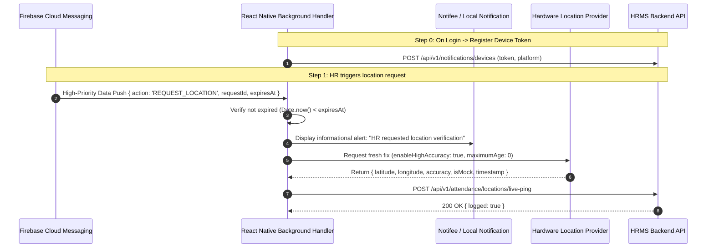

# On-Demand Location Tracking: Mobile App Implementation Guide (Employee Only)

**Audience:** Mobile App Engineers (React Native / iOS / Android)  
**Date:** 2026-10-23  
**Status:** Approved Backend API Contract & Mobile Implementation Recommendations  
**Module:** Attendance (`/api/v1/attendance`) & Notifications (`/api/v1/notifications`)  
**Companion Documents:**  
* Technical Plan: [`on_demand_location_tracking_implementation_plan.md`](file:///C:/Users/91930/Desktop/Vs_Code/HRMS/public/md_attendance/new_implementations/on_demand_location_tracking_implementation_plan.md)  
* Web / Overview Guide: [`2026-10-23_on_demand_location_tracking_frontend_guide.md`](file:///C:/Users/91930/Desktop/Vs_Code/HRMS/public/md_updates/2026-10-23_on_demand_location_tracking_frontend_guide.md)  

---

## 1. Executive Summary for Mobile Developers

The on-demand location tracking feature allows authorized HR or reporting managers to request an employee's live location verification **during active work shifts**. 

### Core Mobile Principles:
1. **Pull Model (Zero Battery Drain):** The app does **not** run persistent GPS tracking in the background. It only wakes up when a high-priority FCM data push arrives.
2. **Zero In-Shift UI Blocking:** The employee does **not** need to tap, approve, or interact with a modal during their work. 
3. **Transparency Notification:** When a request is processed, the mobile app posts a standard local notification to the phone’s notification bar (*"📍 Location Verification: HR has requested your location"*), informing the employee transparently.
4. **Fast SLA:** The entire cycle (Push arrival → Local notification → GPS fix → API transmit) should complete within **5 to 15 seconds**.

---

## 2. Architecture & Mobile Lifecycle Overview



---

## 3. Endpoints & API Specifications

All endpoints require the standard Bearer header:  
`Authorization: Bearer <employee_jwt_access_token>`

---

### 3.1 Device Registration (Mandatory Prerequisite)

You must register the employee’s FCM token so the backend knows where to push.

* **When to call:**
  1. Immediately after successful employee login.
  2. Whenever the FCM token refreshes (`messaging().onTokenRefresh`).
* **Endpoint:** `POST /api/v1/notifications/devices`
* **Request Body:**
  ```json
  {
    "platform": "android",
    "push_token": "fcm_token_string_here...",
    "device_name": "Samsung Galaxy S23",
    "app_version": "1.4.2"
  }
  ```
  *(Platform must be `'android'` or `'ios'`)*
* **Response (201 Created):**
  ```json
  {
    "success": true,
    "message": "Device registered",
    "data": {
      "id": "b782fd72-493e-415d-8b5b-9194b81d294e",
      "platform": "android",
      "device_name": "Samsung Galaxy S23",
      "app_version": "1.4.2",
      "is_active": true
    }
  }
  ```
* **On Logout:** Call `DELETE /api/v1/notifications/devices/:deviceId` to unbind the device so notifications don't go to logged-out handsets.

---

### 3.2 One-Time Consent Acknowledgement (If Enabled by Org)

If the organization's policy requires one-time employee consent (`consent_mode: 'acknowledgement'`), any locate request by HR will return `422 EMPLOYEE_CONSENT_PENDING` until the employee acknowledges.

* **Endpoint:** `POST /api/v1/attendance/locations/consent`
* **Request Body:**
  ```json
  {
    "version": "v1.0"
  }
  ```
* **Response (200 OK):**
  ```json
  {
    "success": true,
    "message": "Location tracking acknowledged",
    "data": {
      "acknowledged_at": "2026-10-23T08:00:00.000Z",
      "consent_version": "v1.0"
    }
  }
  ```
* **UX Suggestion:** Present a one-time dialog or banner on the Attendance/Shift dashboard:  
  *"Location Verification Notice: Your location may be verified periodically during active shifts for attendance safety and branch accountability. [I Acknowledge]"*

---

### 3.3 Reporting Coordinates (`live-ping`)

* **Endpoint:** `POST /api/v1/attendance/locations/live-ping`
* **Request Body:**
  ```json
  {
    "request_id": "c7a8b42e-68e1-4562-b529-673c683b5f79",
    "latitude": 28.61412055,
    "longitude": 77.20915012,
    "accuracy_meters": 12.5,
    "is_mock": false,
    "battery_level": 82,
    "captured_at": "2026-10-23T13:40:15.123Z",
    "platform": "android"
  }
  ```

#### Field Details:
| Field | Type | Validation / Rules | Notes |
|---|---|---|---|
| `request_id` | UUID | Required | The `requestId` received from the FCM data payload. |
| `latitude` | Number | Required, `-90` to `90` | Up to 8 decimal places. |
| `longitude` | Number | Required, `-180` to `180` | Up to 8 decimal places. |
| `accuracy_meters`| Number | Required, `> 0` and `<= 100000` | Horizontal accuracy radius reported by OS. |
| `is_mock` | Boolean | Required | `true` if GPS was generated by a mock location app. |
| `battery_level` | Integer | Optional, `0` to `100` | Current battery percentage. |
| `captured_at` | ISO-8601 | Required | Hardware GPS timestamp (`location.timestamp`). |
| `platform` | String | Required | `'android'` or `'ios'`. |

#### Response:
* **`200 OK`**:
  ```json
  { "success": true, "message": "Location logged", "data": { "logged": true } }
  ```
* **`409 Conflict` (`LOCATION_REQUEST_EXPIRED`)**: The request passed its 60s TTL. Ignore and discard.
* **`404 Not Found` (`LOCATION_REQUEST_NOT_FOUND`)**: Invalid or foreign request ID.
* **Idempotency:** If cellular network glitches cause a retry, the backend's partial unique index catches it and safely returns `200 { logged: true }` without throwing errors.

---

### 3.4 Employee "Who Located Me" Audit View (Self-Service)

Under privacy standards (GDPR Art. 15 / Indian DPDP 2023), employees have the legal right to see who accessed their location and why.

* **Endpoint:** `GET /api/v1/attendance/locations/mine?page=1&limit=20`
* **Response (200 OK):**
  ```json
  {
    "success": true,
    "message": "Your location history fetched",
    "data": {
      "requests": [
        {
          "id": "c7a8b42e-68e1-4562-b529-673c683b5f79",
          "reason": "Client site visit check",
          "requested_by": "Abhishek (HR)",
          "requester_role": "hr",
          "created_at": "2026-10-23T11:42:01.000Z",
          "responded_at": "2026-10-23T11:42:12.000Z",
          "fix_returned": true
        }
      ],
      "pagination": { "total": 1, "page": 1, "limit": 20 }
    }
  }
  ```
  *(Note: Backend automatically hides internal anti-spoofing flags on this endpoint to prevent reverse-engineering).*

---

## 4. Step-by-Step Implementation Guide (React Native)

### Step 1: Install Required Packages

```bash
npm install @react-native-firebase/app @react-native-firebase/messaging
npm install react-native-geolocation-service
npm install @notifee/react-native
npm install react-native-device-info
```

---

### Step 2: Push Background Handler (`index.js` or `App.js`)

> [!IMPORTANT]
> `setBackgroundMessageHandler` must be registered **at the top-level root file** (`index.js`), outside of any React Component lifecycle.

```javascript
// index.js
import { AppRegistry } from 'react-native';
import App from './App';
import { name as appName } from './app.json';
import messaging from '@react-native-firebase/messaging';
import { handleLocationRequestPush } from './src/services/LocationTrackingService';

// Background & Quit-state message receiver
messaging().setBackgroundMessageHandler(async (remoteMessage) => {
  console.log('[FCM] Background message received:', remoteMessage);
  
  if (remoteMessage.data?.action === 'REQUEST_LOCATION') {
    await handleLocationRequestPush(remoteMessage.data);
  }
});

AppRegistry.registerComponent(appName, () => App);
```

---

### Step 3: Location Service Implementation (`LocationTrackingService.ts`)

```typescript
import Geolocation from 'react-native-geolocation-service';
import notifee, { AndroidImportance } from '@notifee/react-native';
import DeviceInfo from 'react-native-device-info';
import { Platform } from 'react-native';
import apiClient from './apiClient'; // Your Axios instance with Bearer token

interface PushPayload {
  action: string;
  requestId: string;
  expiresAt: string;
}

export async function handleLocationRequestPush(payload: PushPayload) {
  const { requestId, expiresAt } = payload;

  // 1. Check if request has already expired
  if (expiresAt && new Date(expiresAt).getTime() < Date.now()) {
    console.warn('[LocationTracking] Push arrived after expiry window, ignoring');
    return;
  }

  // 2. Display Transparency Notification (Legal & Trust requirement)
  try {
    const channelId = await notifee.createChannel({
      id: 'attendance_location_channel',
      name: 'Attendance & Safety Alerts',
      importance: AndroidImportance.HIGH,
    });

    await notifee.displayNotification({
      title: '📍 Location Verification',
      body: 'HR has requested your current location verification during duty hours.',
      android: {
        channelId,
        importance: AndroidImportance.HIGH,
        pressAction: { id: 'default' },
      },
    });
  } catch (notifErr) {
    console.error('[LocationTracking] Failed to show local notification:', notifErr);
  }

  // 3. Acquire Hardware GPS Fix
  Geolocation.getCurrentPosition(
    async (position) => {
      try {
        const batteryLevel = Math.round((await DeviceInfo.getBatteryLevel()) * 100);

        // 4. Send Ping to Backend API
        await apiClient.post('/api/v1/attendance/locations/live-ping', {
          request_id: requestId,
          latitude: position.coords.latitude,
          longitude: position.coords.longitude,
          accuracy_meters: position.coords.accuracy,
          is_mock: position.mocked || false, // Crucial for anti-spoof checks
          battery_level: batteryLevel >= 0 ? batteryLevel : null,
          captured_at: new Date(position.timestamp).toISOString(),
          platform: Platform.OS,
        });

        console.log('[LocationTracking] Live location successfully transmitted');
      } catch (err: any) {
        console.error('[LocationTracking] Failed to report live-ping:', err?.response?.data || err.message);
      }
    },
    (error) => {
      console.error('[LocationTracking] Geolocation error:', error);
    },
    {
      enableHighAccuracy: true,
      timeout: 10000,   // 10s timeout
      maximumAge: 0,    // DO NOT USE CACHED LOCATION: forces fresh satellite/cell fix
    }
  );
}
```

---

## 5. Mobile OS Permissions & Gotchas

### Android Permissions & Battery Optimizations

1. **`AndroidManifest.xml`:**
   ```xml
   <uses-permission android:name="android.permission.ACCESS_FINE_LOCATION" />
   <uses-permission android:name="android.permission.ACCESS_COARSE_LOCATION" />
   <uses-permission android:name="android.permission.POST_NOTIFICATIONS" />
   <uses-permission android:name="android.permission.WAKE_LOCK" />
   ```
2. **Android 13+ (API 33) Notification Permission:**  
   Prompt for notification permissions at login using `notifee.requestPermission()`. If notifications are disabled, local alerts cannot be posted.
3. **OEM Battery Killers (Samsung, Xiaomi, OnePlus):**  
   Aggressive OEM battery managers put background apps into deep sleep. For field employees, suggest prompting to exempt the app from battery optimization:
   ```javascript
   import { NativeModules } from 'react-native';
   // Intent: Settings.ACTION_REQUEST_IGNORE_BATTERY_OPTIMIZATIONS
   ```

---

### iOS Configuration (`Info.plist`)

1. **`Info.plist` Descriptions:**
   ```xml
   <key>NSLocationWhenInUseUsageDescription</key>
   <string>Your location is verified for duty attendance and branch accountability.</string>
   ```
2. **Background Modes:**  
   In Xcode → Target → **Signing & Capabilities** → **+ Capability** → **Background Modes**:
   * Check: **Remote notifications**
3. **The iOS Force-Quit Rule (Crucial to Know):**  
   If an iOS user **swipes away / force-quits** the app from the App Switcher, iOS **suspends all silent background notifications** until the user taps and re-opens the app.  
   *The backend already derives `timed_out` for this case—it will cleanly report "Device Unreachable" to HR rather than throwing a system error.*

---

## 6. Anti-Spoofing & Integrity Guardrails

The backend contains a **6-signal anti-spoofing engine**. Mobile engineers should be aware of these rules to ensure legitimate fixes aren't flagged as anomalies:

1. **Do Not Send Cached Coordinates (`maximumAge: 0`):**  
   Sending coordinates older than the request creation time triggers the backend `stale_fix` spoof signal. Always query a fresh fix.
2. **Report `position.mocked` Accurately:**  
   Always map `is_mock: position.mocked || false`.
3. **Do Not Fake Timestamps:**  
   `captured_at` must be the exact `position.timestamp` from the GPS hardware. A device clock skewed by more than 2 minutes from real UTC will trigger `future_fix` or `stale_fix`.

---

## 7. Mobile QA & Verification Checklist

- [ ] Device registers token to `POST /api/v1/notifications/devices` on login.
- [ ] Device deletes token from server on logout.
- [ ] Send test push when app is **minimized / in background** → Notification appears in tray and GPS ping sends within 10s.
- [ ] Send test push when phone screen is **locked** → Ping successfully dispatches.
- [ ] Check `GET /api/v1/attendance/locations/mine` → Correctly reflects the test request.
- [ ] Verify `is_mock` flag is set to `true` when tested with Fake GPS developer options enabled.
