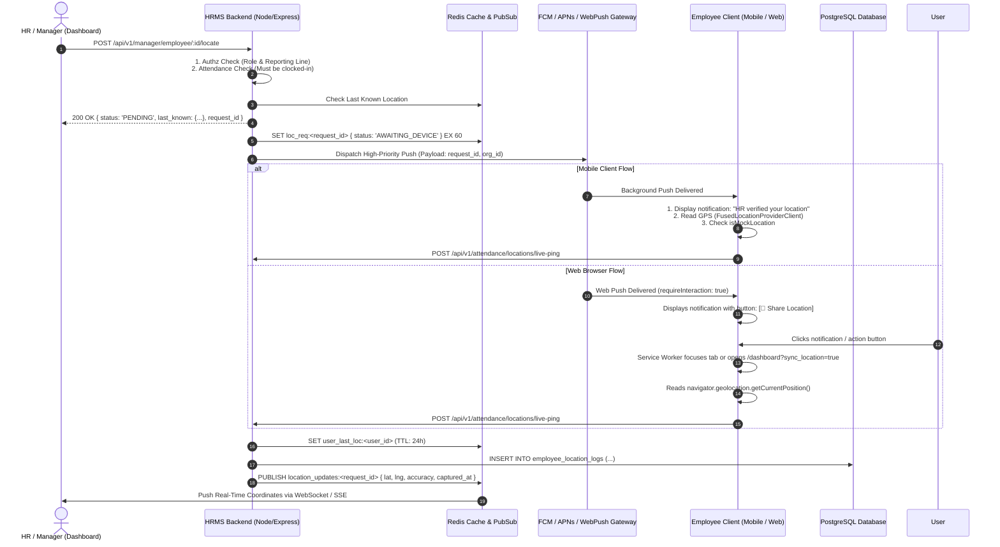

# On-Demand Employee Location Tracking — Technical Specification & Implementation Architecture

**Status:** ⚠️ SUPERSEDED by the shipped implementation (2026-10-23). This early draft is retained
for history only.
**Module:** `src/modules/attendance` (the notification device registry lives in `src/modules/notification`, **not** `src/modules/organization`)
**Target Clients:** Mobile Application (React Native / Android / iOS) & Web Application (SPA / React)
**Date:** 2026-10-23

---

> ## Correction banner — read before trusting anything below
>
> This document was written before the implementation plan and has known defects and text
> corruption (see plan §Part E). The **authoritative** sources are now:
> - `public/md_system/ATTENDANCE_API_CONTRACT.md` §14 — the contract of record.
> - `public/md_updates/2026-10-23_on_demand_location_tracking_frontend_guide.md` — frontend companion.
> - `public/md_attendance/new_implementations/on_demand_location_tracking_rollout_runbook.md` — ops.
>
> **What shipped differently from this draft:**
> 1. **Routes.** Locate is `POST /api/v1/attendance/hr/employees/:userId/locate` and
>    `POST /api/v1/attendance/manager/team/member/:userId/locate`; ingest is
>    `POST /api/v1/attendance/locations/live-ping`. (§6.1/§6.2/§9 paths here are wrong.)
> 2. **Device registry.** The push-device table is `notification_devices` in the notification
>    module (not `user_devices` in organization), with a `token_hash` UNIQUE. Registration is
>    `POST /api/v1/notifications/devices` and is a hard prerequisite.
> 3. **Result delivery is a poll, not SSE/WebSocket.** `GET .../location-requests/:requestId` with
>    four terminal states: `dispatched`, `reported`, `timed_out`, `failed`.
> 4. **Nothing is "verified".** The server tests plausibility; the UI says "Reported". The
>    employee notification says "requested", not "verified".
> 5. **`NO_ACTIVE_DEVICE` is `422`, not `404`.** Full locate error table in the contract §14.2.
> 6. **Preconditions** added beyond this draft: a `reason` (when `require_reason`), a consent
>    acknowledgement (under `acknowledgement` mode), a cooldown, a per-day cap, a self-locate guard,
>    and an overnight-safe open-shift lookup.
> 7. **No settings-catalog entry.** The org policy is `attendance_location_policies`, owned by the
>    attendance module and listed in `org_settings_registry.md` #124 (plan §B.4).
> 8. **Retention.** Coordinate rows are purged per org at `log_retention_days` by the 04:55 IST
>    sweeper; the request audit row survives. Positions are not "permanent".
>
> Where the prose below contradicts the banner, the banner wins. Sections §2.2, §3.2, §5.2 and §7.2
> additionally contain mangled/partially-deleted text and should be read from the contract instead.

---

## 1. Executive Summary & Context

During operational oversight, HR administrators and reporting managers need the ability to obtain the verified live location of an employee or subordinate on demand. 

### Key Technical Conclusions from Architectural Review
1. **Zero New UI Screen Mandate:** The system will not require developing dedicated employee-facing UI views or location approval screens.
2. **Platform Architectural Divergence:**
   * **Mobile Apps (Android & iOS):** Can execute **100% automatically** in the background upon receiving a high-priority push notification. For transparency and legal compliance, an informational notification is displayed in the notification tray (*"HR has verified your current location"*), but the employee does not need to click or interact.
   * **Web Browsers (Chrome / Edge / Safari / Firefox):** W3C browser security specifications strictly forbid Service Workers from accessing `navigator.geolocation` in the background. Geolocation can only be accessed within an active `Window` context. Therefore, on Web, the browser displays a Web Push notification with an interactive action button (**[📍 Share Location]**). Clicking the button focuses or opens the existing HRMS dashboard in the background to capture coordinates without requiring any new screen.
3. **Shift Boundary Enforcement:** For employee privacy, legal compliance, and liability management, location pings must be strictly rejected if the employee is not actively clocked in or is on approved leave.

---

## 2. Problem Statement & Functional Requirements

### 2.1 Problem Statement
Managers and HR leaders managing field agents, hybrid staff, or branch employees need immediate location verification to:
* Validate geofenced attendance authenticity.
* Confirm on-ground client visits and field operations.
* Ensure employee safety and emergency response.

Currently, location is only captured during attendance punch events (`clock-in` / `clock-out`). When an employee is on duty, HR has no mechanism to verify where they are without calling them.

### 2.2 Functional Requirements (FR)
* **FR-1 (HR / Manager Trigger):** An authorized HR or Manager can click a "Locate Employee" button on the employee's attendance/profile view.
* **FR-2 (Immediate Feedback / Cached Location):** The dashboard immediately displays the "Last Known Location" (from Redis cache) along with timestamp and accuracy radius, while actively pinging for fresh real-time coordinates.
* **FR-3 (Mobile Execution):** A high-priority push message arrives on the employee's mobile device, posts an informational notification for transparency, samples the GPS fix in the background, and reports back within 5–15 seconds without user intervention.
* **FR-4 (Web Execution):** A desktop Web Push notification arrives with a `[Share Location]` action button. Clicking it activates the tab, queries `navigator.geolocation`, and transmits coordinates.
* **FR-5 (Real-Time Push to HR):** The HR dashboard automatically updates via WebSocket or Server-Sent Events (SSE) as soon as the fresh coordinates arrive at the backend.
* **FR-6 (Audit Trail):** Every location request, timestamp, requesting manager ID, employee ID, coordinates, accuracy, and mock-location status are permanently logged in PostgreSQL for audit and dispute resolution.

---

## 3. Platform Capabilities & Operating System Constraints

### 3.1 Web Browser Limitations & The Solution

| Browser Capability | Support Status | Technical Reality |
| :--- | :--- | :--- |
| **Service Worker Geolocation** | ❌ **Strictly Prohibited** | `navigator.geolocation` is `undefined` in `ServiceWorkerGlobalScope`. |
| **Background Web Push** | ✅ **Supported** | Service worker wakes up and triggers `self.registration.showNotification()`. |
| **Notification Action Buttons** | ✅ **Supported** | Supported in Chrome, Edge, and modern desktop browsers via the `actions` array. |
| **Window Activation from Notification** | ✅ **Supported** | `clients.matchAll()` can focus an existing open HRMS tab or `clients.openWindow()` can launch the dashboard. |

#### Web Solution Design
* If an HRMS tab is already open (even minimized), the Service Worker communicates via `client.postMessage()` to trigger location capture silently without opening a new tab.
* If no tab is open, clicking **[📍 Share Location]** or the notification body opens `/dashboard?sync_location=true&request_id=xxx`. A 5-line global hook in the root layout captures GPS and closes/redirects without user effort.

---

### 3.2 Mobile OS (Android & iOS) Constraints

| Mobile OS Feature | Android | iOS |
| :--- | :--- | :--- |
| **Background Location Access** | Requires `ACCESS_FINE_LOCATION` and `ACCESS_BACKGROUND_LOCATION` ("Allow all the time"). | Requires `NSLocationAlwaysAndWhenInUseUsageDescription` ("Always"). |
| **Silent Wakeup** | FCM High-Priority Data Message wakes background broadcast receiver. | APNs remote push with `"content-available": 1` wakes `didReceiveRemoteNotification`. |
| **User Force-Quit Behavior** | Background services usually restart via FCM. | If user swiped app closed from App Switcher, iOS **will not** deliver silent push until app is opened again. |
| **Aggressive Battery Optimization** | Samsung/Xiaomi/OnePlus doze modes kill background apps unless exempted. | iOS throttles silent push frequency if power budget is exceeded. |
| **Spoofing / Mock Location** | Detectable via `location.isMock()` / `isFromMockProvider()`. | Detectable via CoreLocation speed/accuracy heuristics. |

---

## 4. End-to-End System Architecture



---

## 5. Database Schema & Models

### 5.1 `user_devices` (Table: `user_devices`)
Tracks all registered mobile apps and web browser push subscriptions per user.

| Column | Type | Constraints | Description |
| :--- | :--- | :--- | :--- |
| `id` | UUID | PK, default gen_random_uuid() | Unique record ID |
| `org_id` | UUID | FK -> organizations(id), NOT NULL | Organization scope |
| `user_id` | UUID | FK -> users(id), NOT NULL | Employee owning the device |
| `platform` | ENUM | `'android'`, `'ios'`, `'web'`, NOT NULL | Client runtime platform |
| `push_token` | TEXT | NOT NULL | FCM token, APNs token, or Web Push subscription JSON |
| `device_name` | VARCHAR(100) | NULL | e.g., "Samsung Galaxy S23", "Chrome Windows" |
| `app_version` | VARCHAR(50) | NULL | App or PWA version |
| `is_active` | BOOLEAN | default true, NOT NULL | Set to false on logout or token invalidation |
| `last_seen_at` | TIMESTAMPTZ | NULL | Timestamp of last API interaction |
| `created_at` | TIMESTAMPTZ | NOT NULL, default NOW() | Created timestamp |
| `updated_at` | TIMESTAMPTZ | NOT NULL, default NOW() | Updated timestamp |

### 5.2 `employee_location_logs` (Table: `employee_location_logs`)
Permanent audit trail of all location records (punches, periodic heartbeats, and on-demand pings).

| Column | Type | Constraints | Description |
| :--- | :--- | :--- | :--- |
| `id` | UUID | PK, default gen_random_uuid() | Unique log ID |
| `org_id` | UUID | FK -> organizations(id), NOT NULL | Multi-tenant organization ID |
| `user_id` | UUID | FK -> users(id), NOT NULL | Employee located |
| `request_id` | UUID | NULL | Matches the specific on-demand request ID |
| `requested_by` | UUID | FK -> users(id), NULL | Manager/HR who triggered the request (NULL if automated) |
| `trigger_type` | ENUM | `'on_demand'`, `'clock_in'`, `'clock_out'`, `'heartbeat'` | Source of the location capture |
| `latitude` | DECIMAL(10, 7) | NOT NULL | Latitude coordinate |
| `longitude` | DECIMAL(10, 7) | NOT NULL | Longitude coordinate |
| `accuracy_meters`| DECIMAL(8, 2) | NOT NULL | GPS horizontal accuracy radius in meters |
| `is_mock` | BOOLEAN | default false, NOT NULL | Android mock provider or fake GPS indicator |
| `battery_level` | SMALLINT | NULL | Device battery percentage (0-100) |
| `captured_at` | TIMESTAMPTZ | NOT NULL | Hardware GPS fix timestamp reported by device |
| `received_at` | TIMESTAMPTZ | NOT NULL, default NOW() | UTC timestamp when backend received payload |
| `created_at` | TIMESTAMPTZ | NOT NULL, default NOW() | Record creation timestamp |

---

## 6. Backend API Specifications

### 6.1 Trigger On-Demand Location (Manager / HR)
* **Endpoint:** `POST /api/v1/manager/employee/:employeeId/locate` (or `/api/v1/hr/employee/:employeeId/locate`)
* **Auth:** Bearer Token (Manager or HR role)
* **Pre-conditions & Validations:**
  1. `employeeId` must exist within caller's organization.
  2. If called by Manager: `employeeId` must report to this manager (direct or indirect).
  3. **Shift Validation:** Employee must have an active, open attendance session (`status = 'clocked_in'`) for today. If not clocked in, returns `422 Unprocessable Entity` (`"EMPLOYEE_NOT_CLOCKED_IN"`).
  4. Employee must have at least one active device registered in `user_devices`.
* **Success Response (200 OK):**
  ```json
  {
    "success": true,
    "message": "Location request dispatched to employee device",
    "data": {
      "request_id": "c7a8b42e-68e1-4562-b529-673c683b5f79",
      "status": "DISPATCHED",
      "timeout_seconds": 60,
      "last_known_location": {
        "latitude": 28.613939,
        "longitude": 77.209021,
        "accuracy_meters": 14.5,
        "recorded_at": "2026-10-23T08:05:00.000Z"
      }
    }
  }
  ```

---

### 6.2 Ingest Location Ping (Client App / Browser)
* **Endpoint:** `POST /api/v1/attendance/locations/live-ping`
* **Auth:** Bearer Token (Employee user)
* **Request Payload (Joi Validated):**
  ```json
  {
    "request_id": "c7a8b42e-68e1-4562-b529-673c683b5f79",
    "latitude": 28.614120,
    "longitude": 77.209150,
    "accuracy_meters": 8.2,
    "is_mock": false,
    "battery_level": 78,
    "captured_at": "2026-10-23T08:12:35.000Z"
  }
  ```
* **Processing Logic:**
  1. Validate Joi schema via `validateOrThrow`.
  2. Verify `request_id` exists in Redis (`loc_req:<request_id>`).
  3. If `is_mock === true`, flag anomaly in attendance tracking.
  4. Store in `employee_location_logs`.
  5. Cache latest location in Redis: `SET user_last_loc:<user_id>` with TTL 24 hours.
  6. Publish to Redis channel `location_updates:<request_id>` to notify HR WebSocket client.
* **Success Response (200 OK):**
  ```json
  {
    "success": true,
    "message": "Location synchronized successfully",
    "data": {
      "logged": true
    }
  }
  ```

---

## 7. Frontend & Client Implementation

### 7.1 Web Service Worker (`service-worker.js`)
Handles background Web Push and coordinates with the browser tabs.

```javascript
// Web Push Event Handler
self.addEventListener('push', (event) => {
  if (!event.data) return;
  const payload = event.data.json();

  if (payload.type === 'LOCATION_REQUEST') {
    const notificationOptions = {
      body: payload.message || 'HR has requested your current location verification.',
      icon: '/assets/icons/hrms-logo.png',
      badge: '/assets/icons/badge.png',
      tag: `loc-req-${payload.requestId}`,
      requireInteraction: true, // Keep notification visible until dismissed/clicked
      data: {
        requestId: payload.requestId,
        targetUrl: `/dashboard?sync_location=true&request_id=${payload.requestId}`
      },
      actions: [
        { action: 'share_location', title: '📍 Share Location' },
        { action: 'dismiss', title: 'Dismiss' }
      ]
    };

    event.waitUntil(
      self.registration.showNotification('Location Verification Request', notificationOptions)
    );
  }
});

// Notification Click Handler
self.addEventListener('notificationclick', (event) => {
  event.notification.close();

  if (event.action === 'dismiss') return;

  const requestId = event.notification.data.requestId;
  const targetUrl = event.notification.data.targetUrl;

  event.waitUntil(
    clients.matchAll({ type: 'window', includeUncontrolled: true }).then((windowClients) => {
      // 1. If an HRMS tab is already open, focus it and trigger fetch via postMessage
      for (const client of windowClients) {
        if (client.url.includes('/dashboard') && 'focus' in client) {
          client.postMessage({
            type: 'TRIGGER_LOCATION_SYNC',
            requestId: requestId
          });
          return client.focus();
        }
      }
      // 2. If no tab is open, open the dashboard with query flag
      if (clients.openWindow) {
        return clients.openWindow(targetUrl);
      }
    })
  );
});
```

---

### 7.2 Web Root Layout Hook (`useLocationSync.js`)
Zero-UI execution logic running in the root layout or dashboard.

```javascript
import { useEffect } from 'react';

export function useLocationSync() {
  useEffect(() => {
    // Handler function to capture and send location
    const sendLocation = (requestId) => {
      if (!navigator.geolocation) return;

      navigator.geolocation.getCurrentPosition(
        async (position) => {
          try {
            await fetch('/api/v1/attendance/locations/live-ping', {
              method: 'POST',
              headers: {
                'Content-Type': 'application/json',
                'Authorization': `Bearer ${localStorage.getItem('token')}`
              },
              body: JSON.stringify({
                request_id: requestId,
                latitude: position.coords.latitude,
                longitude: position.coords.longitude,
                accuracy_meters: position.coords.accuracy,
                is_mock: false,
                captured_at: new Date(position.timestamp).toISOString()
              })
            });
            console.log('Location synced successfully');
          } catch (err) {
            console.error('Failed to report location:', err);
          }
        },
        (error) => console.error('Geolocation error:', error),
        { enableHighAccuracy: true, timeout: 15000, maximumAge: 0 }
      );
    };

    // Case 1: Listen for postMessage from Service Worker (when tab is already open)
    const handleServiceWorkerMessage = (event) => {
      if (event.data?.type === 'TRIGGER_LOCATION_SYNC' && event.data.requestId) {
        sendLocation(event.data.requestId);
      }
    };
    navigator.serviceWorker?.addEventListener('message', handleServiceWorkerMessage);

    // Case 2: Opened from notification click via URL param (?sync_location=true)
    const params = new URLSearchParams(window.location.search);
    if (params.get('sync_location') === 'true' && params.get('request_id')) {
      sendLocation(params.get('request_id'));
      // Clean up URL query parameters without reloading
      window.history.replaceState({}, document.title, window.location.pathname);
    }

    return () => {
      navigator.serviceWorker?.removeEventListener('message', handleServiceWorkerMessage);
    };
  }, []);
}
```

---

### 7.3 Mobile Background Handler (React Native / Android)

```javascript
import messaging from '@react-native-firebase/messaging';
import Geolocation from 'react-native-geolocation-service';
import notifee, { AndroidImportance } from '@notifee/react-native';
import apiClient from '../services/apiClient';

// Background Message Handler
messaging().setBackgroundMessageHandler(async (remoteMessage) => {
  if (remoteMessage.data?.action === 'REQUEST_LOCATION') {
    const requestId = remoteMessage.data.requestId;

    // 1. Post informational notification for transparency
    await notifee.displayNotification({
      title: '📍 Location Verification',
      body: 'HR has verified your current location during active shift hours.',
      android: {
        channelId: 'attendance_alerts',
        importance: AndroidImportance.HIGH,
        smallIcon: 'ic_stat_location'
      }
    });

    // 2. Fetch current GPS position silently
    Geolocation.getCurrentPosition(
      async (pos) => {
        await apiClient.post('/api/v1/attendance/locations/live-ping', {
          request_id: requestId,
          latitude: pos.coords.latitude,
          longitude: pos.coords.longitude,
          accuracy_meters: pos.coords.accuracy,
          is_mock: pos.mocked || false,
          battery_level: await getBatteryPercentage(),
          captured_at: new Date(pos.timestamp).toISOString()
        });
      },
      (error) => console.log('Location error:', error),
      { enableHighAccuracy: true, timeout: 10000, maximumAge: 0 }
    );
  }
});
```

---

## 8. Edge Cases, Failure Modes & Handling

| Edge Case | Failure Mode | Mitigation / System Handling |
| :--- | :--- | :--- |
| **Employee is Clocked Out** | HR attempts to locate off-duty staff. | Backend rejects request with `422 UNPROCESSABLE_ENTITY` (`"EMPLOYEE_NOT_CLOCKED_IN"`). No push is sent. |
| **Employee Device Offline / Dead Battery** | Push notification cannot reach device. | Request expires in Redis after 60s. HR dashboard shows: *"Device unreachable. Displaying last known location from [timestamp]."* |
| **Web User Ignores Notification** | User is away from desk or dismisses banner. | `requireInteraction: true` keeps banner visible. If unclicked after 60s, HR UI marks request timed out. |
| **Mock Location / GPS Spoofer** | Employee uses fake GPS app to fake office location. | Mobile SDK reads `isMock` / `mocked` flag. Backend flags record as `is_mock: true` and logs an HR attendance anomaly. |
| **Simultaneous Duplicate Pings** | HR and Manager both click "Locate" within seconds. | Backend uses Redis distributed lock `loc_lock:<user_id>`. Second caller reuses the active `request_id` or receives the freshly updated cache. |
| **Low GPS Accuracy (Indoors)** | Satellite signal weak; accuracy radius > 500m. | Backend records `accuracy_meters`. HR dashboard map shows coordinate with a translucent accuracy circle. |
| **Revoked Permissions** | Employee disabled location in OS settings. | Mobile/Web reports error payload `PERMISSION_DENIED`. Backend notifies HR to instruct employee to re-enable location. |

---

## 9. Phased Implementation Plan

```text
Phase 1: Database & Device Registration
├── 1.1 Create Sequelize migration for `user_devices` table.
├── 1.2 Create Sequelize migration for `employee_location_logs` table.
├── 1.3 Add device registration endpoint: POST /api/v1/auth/devices/register.
└── 1.4 Update settings catalog surfaces for attendance tracking permissions.

Phase 2: Backend Core Services & Ingestion
├── 2.1 Implement `location_tracking.service.js` with Redis request tracking & caching.
├── 2.2 Implement FCM / WebPush dispatcher service.
├── 2.3 Implement POST /api/v1/manager/employee/:employeeId/locate with shift check.
├── 2.4 Implement POST /api/v1/attendance/locations/live-ping with mock detection.
└── 2.5 Add WebSocket / SSE event broadcaster for real-time dashboard updates.

Phase 3: Web Client (Zero-UI Integration)
├── 3.1 Update `service-worker.js` with `LOCATION_REQUEST` push & click action handlers.
├── 3.2 Add `useLocationSync` hook in frontend root layout.
└── 3.3 Prompt for Notification + Geolocation permissions during initial login / clock-in.

Phase 4: Mobile Client (React Native / Android / iOS)
├── 4.1 Implement FCM BackgroundMessageHandler for silent execution.
├── 4.2 Display local informational notification via Notifee.
└── 4.3 Configure Android Foreground Service / iOS Background Modes.

Phase 5: Manager/HR Dashboard UI
├── 5.1 Add "Locate Now" action button in Employee Attendance Detail view.
├── 5.2 Display Last Known Location with timestamp badge.
└── 5.3 Implement live map pin update upon receiving WebSocket coordinate event.
```
