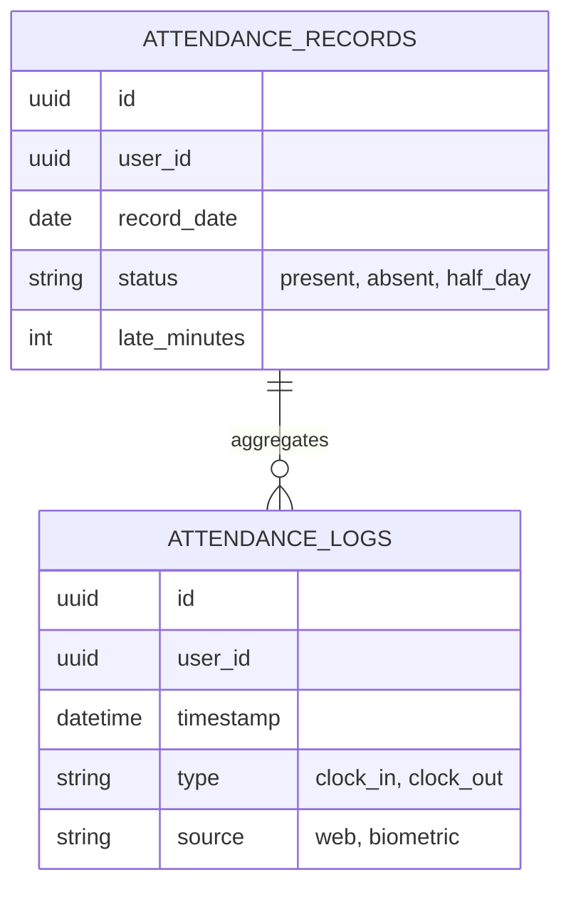
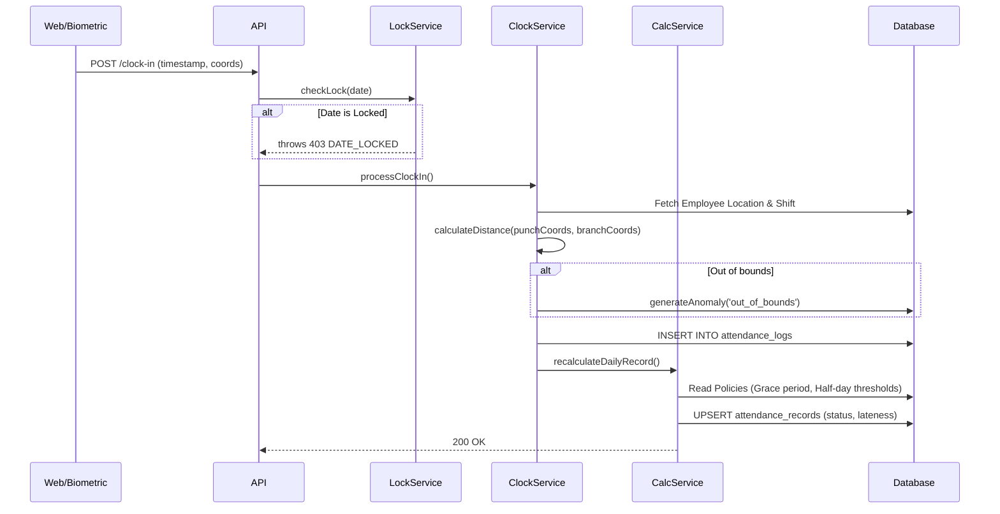

# Attendance Calculation & Enforcement Workflow

## Overview
The Attendance module is the largest and most complex sub-system. It is responsible for processing immutable punches from physical biometrics and web portals, determining lateness/overtime based on dynamic policies, enforcing geofences, and generating anomalies for managerial review.

## Key Files & Implementation Locations
- **Core Services**: `clock.service.js`, `attendance_calculation.service.js`, `device.service.js`
- **Models**: `attendance_logs.model.js` (immutable punches), `attendance_records.model.js` (daily aggregates).
- **Webhooks**: `device_webhook.controller.js`

## 1. The Core Architecture (Logs vs. Records)

### The Invariant
> The system NEVER deletes an `attendance_logs` row. Logs represent physical reality (e.g., a biometric punch). The `attendance_records` table represents the *business interpretation* of reality (e.g., "Present", "Late", "Half Day"). When managers approve corrections (Regularizations), they mutate the `record` and append a new "override" `log`.



## 2. The Clock-In Data Flow

This is the most critical real-time operation in the system.



## 3. Business Rules & Enforcement

- **Payroll Lock Periods**: Controlled by `lock.service.js`. HR can "lock" a month (e.g., July 1 - July 31) for payroll. If a biometric device reconnects and pushes a cached punch from July 15, the `LockService` rejects it with `403`. 
- **Idempotency in Webhooks**: The `/devices/webhook` endpoint checks `attendance_logs` for an identical punch within a +/- 60-second window. If found, it silently returns `200 OK` without creating a duplicate row. This prevents double-punches if the hardware retries on a slow network.
- **Geofencing**: If the Euclidean distance between the punch coordinates and the `organization_locations` coordinates exceeds the radius, the punch is *accepted* but an `anomaly` is generated for the manager to review.

## 4. State Machine: Regularization (Anomaly Resolution)

When the calculation engine detects an issue (Missing Clock Out, Late, Out of Geofence), the employee must file a Regularization Request.

```text
[PENDING] (Employee Submits)
   ├── Manager Approves ➔ [APPROVED] ➔ Triggers `calculationService.recalculate()`
   └── Manager Rejects  ➔ [REJECTED] ➔ Record remains unchanged (e.g. Absent)
```

## 5. Transactions & Concurrency

When a Regularization is approved:
1. `sequelize.transaction()` is opened.
2. The Request state is changed to `APPROVED`.
3. A synthetic `attendance_logs` entry is created with `source = 'manager_override'`.
4. `attendance_records` is updated (e.g., switching `absent` to `present`).
5. Transaction commits.

If any sub-step fails (e.g., the record calculation throws a DB constraint error), the entire approval rolls back, preventing the Request from saying "Approved" while the Record still says "Absent".

## 6. Background Jobs / Side Effects

The `attendance_calculation.service.js` is heavy. Currently, it runs synchronously during Clock Out. However, the system architecture dictates that a **Nightly Cron Job** sweeps all `in_progress` sessions at midnight. If a user forgot to clock out, the cron job forces a clock-out using their shift end-time, calculates effective hours, and flips their status to `absent` or `half_day`.
