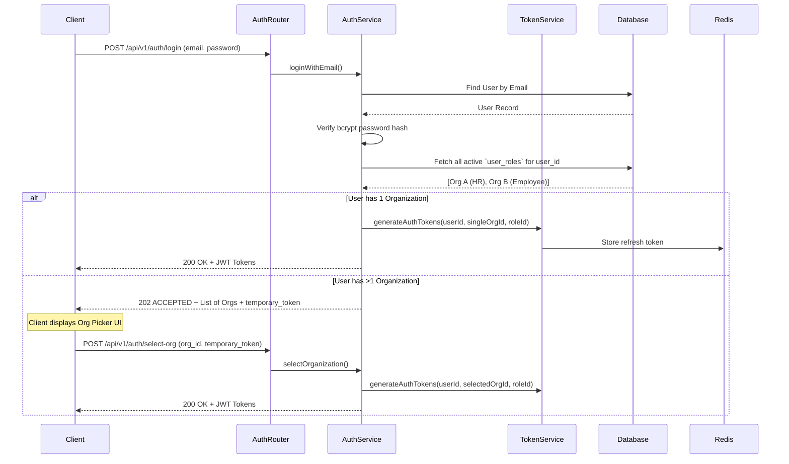

# Authentication & Multi-Tenancy Workflow

## Overview
The HRMS is a multi-tenant system where a single "User" can belong to multiple "Organizations" under different roles (e.g., HR in Org A, Employee in Org B). This document explains the core authentication flow, tenant isolation, and session management.

## Key Files & Implementation Locations
- **Routes**: `src/modules/auth/routes/auth.routes.js`
- **Controller**: `src/modules/auth/controllers/auth.controller.js`
- **Services**: `src/modules/auth/services/auth.service.js`, `src/modules/auth/services/token.service.js`
- **Middleware**: `src/common/middlewares/auth.middleware.js`
- **Models**: `src/modules/auth/models/users.model.js`, `src/modules/auth/models/roles.model.js`, `src/modules/organization/models/user_roles.model.js`

## 1. Global Authentication vs. Tenant Authorization

### The Invariant
> A `users` record represents a global identity (identified by `email`). It has NO concept of an organization. Tenancy is completely managed by the `user_roles` associative table which maps `(user_id, role_id, org_id)`.

When a user logs in, the system must determine *which* organization context they are entering.

## 2. The Login Data Flow (Sequence Diagram)



## 3. The `authMiddleware` (Tenant Isolation)

Every protected route uses the `verifyToken` and `requireRole` middleware.

**How it works internally:**
1. **Extraction**: Reads the `Authorization: Bearer <token>` header.
2. **Verification**: Uses `jwt.verify()` with `JWT_SECRET`.
3. **Payload Inspection**: The JWT payload contains `{ userId, orgId, roleId }`.
4. **Blacklist Check**: Queries Redis (`blacklist:<token>`). If found, throws `401 Unauthorized`.
5. **Context Injection**: Attaches the decoded payload to `req.user`.

```javascript
// Critical Isolation Boundary
// Any controller downstream MUST use req.user.orgId in its queries.
req.user = {
  id: decoded.userId,
  orgId: decoded.orgId,
  roleId: decoded.roleId
};
```

## 4. Business Rules & State Changes

### Registration
- **Trigger**: `POST /api/v1/auth/signup`
- **State Changes**: Creates a `users` record with `status = 'pending_verification'`.
- **Side Effects**: Generates an OTP, stores it in Redis (`otp:<email>`), and dispatches an email via Brevo.
- **Rule**: A user cannot log in while in `pending_verification` state.

### Multi-Tenant Switching
- **Trigger**: A user currently logged into Org A wants to switch to Org B.
- **Flow**: The client calls `POST /api/v1/auth/switch-org`. The server validates that the user possesses an active `user_roles` entry for Org B.
- **Side Effect**: The old JWT is immediately written to Redis as blacklisted. A fresh JWT with the new `orgId` is issued.

## 5. Security & Failure Scenarios

| Scenario | Code Behavior |
| :--- | :--- |
| **Invalid Credentials** | Returns `401 INVALID_CREDENTIALS`. Uses generic error messages to prevent email enumeration. |
| **Token Expiry** | JWT verification fails. Middleware catches `TokenExpiredError` and returns `401 TOKEN_EXPIRED`. Client must use the refresh token route. |
| **Revoked Access** | If an HR Admin deletes or deactivates a user in an organization, the `user_roles` row is soft-deleted or marked `is_active = false`. For any request carrying an `orgId`, the `authMiddleware` **validates membership against the DB on every request** — it loads the `user_roles` row (with its `organization`) and rejects with `403 ORG_ACCESS_DEACTIVATED` if the row is missing, inactive, or soft-deleted. Revocation therefore takes effect immediately, at the cost of one indexed lookup per authenticated request (an accepted trade-off: correctness over the marginal performance saving of trusting the token until it expires). |
| **Redis Outage** | If Redis is down, the system **fails closed**. Token blacklist checks will throw a `500` error, preventing access. |

## 6. Critical Invariants (Do Not Break)
- **Token Injection**: You must *never* trust an `org_id` passed in a JSON body or Query string if the API modifies data. You must always extract `org_id` strictly from `req.user.orgId`.
- **Password Storage**: Passwords must never be logged or stored in plain text. They must pass through the `bcrypt` hashing utility before touching the repository layer.
