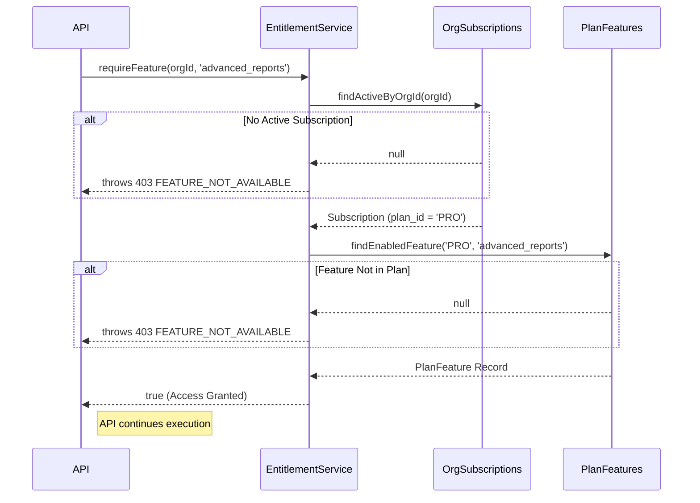

# Billing & Feature Entitlements Workflow

## Overview
The Billing module controls access to various capabilities within the HRMS. It is responsible for Razorpay subscription integration, tracking limits (e.g., maximum employees), and gating premium features behind specific pricing tiers.

## Key Files & Implementation Locations
- **Controller**: `src/modules/organization/controllers/onboarding.controller.js` (Free Plan Registration), Razorpay Webhooks (Implied).
- **Service**: `src/modules/billing/services/entitlement.service.js`
- **Models**: `org_subscriptions.model.js`, `features.model.js`, `plan_features.model.js`.

## 1. The Entitlement Architecture (Data Flow)

The `entitlement.service.js` acts as a gatekeeper. Before an Organization can execute a premium action (like adding more than 10 employees, or generating a specific report), a check must occur.

## 2. Business Rules & Registration Logic

### Free Plan Provisioning
When a user registers a new organization (`POST /api/v1/organization/register`):
1. The `organizations` row is created.
2. The user is assigned the `hr` role in `user_roles`.
3. A Free Tier subscription is instantly provisioned in `org_subscriptions` to allow immediate onboarding. 
4. The transaction commits.

### Employee Limits (Invitation Checks)
When an HR attempts to invite an employee:
1. The `invite_employee` logic counts the current number of active `user_roles` for that organization.
2. It fetches the `max_employees` limit from the active `subscription_plans`.
3. If `current_count >= max_employees`, the API throws a `403` and prevents the invitation email from being sent via Brevo.

## 3. Webhook Idempotency (Razorpay)

When a payment succeeds, Razorpay hits a webhook route. 
- **Signature Verification**: The webhook payload is hashed using `RAZORPAY_KEY_SECRET`. If it doesn't match the signature header, it throws `401 Unauthorized`.
- **Idempotency**: Webhooks can be fired multiple times by payment gateways. The controller must check if the transaction ID already exists in `transactions.model.js`. If it does, the backend ignores the duplicate and returns `200 OK`.

## 4. Security Invariants
- The system defaults to **Fail Closed**. If the `entitlement.service.js` encounters a database error while checking a feature flag, it catches the error, logs it, and returns `false` (access denied) rather than crashing or accidentally granting access.
- Subscriptions are strongly bound to `org_id`. A user who is an HR Admin in "Org A" (Pro Plan) and "Org B" (Free Plan) will lose access to premium features when they switch their token context to Org B.
