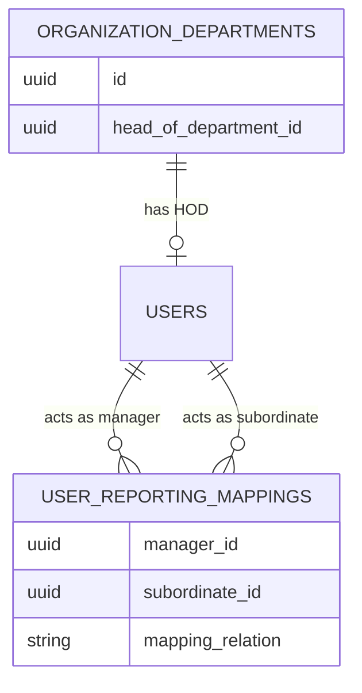
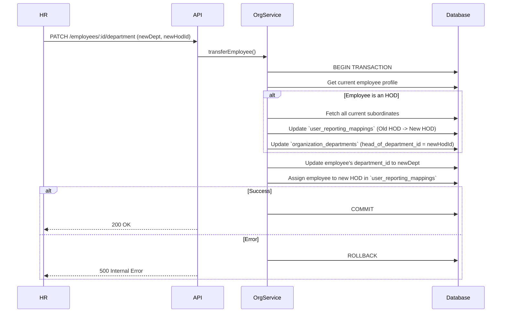

# Employee Hierarchy & Department Transfers

## Overview
The Organization module is responsible for maintaining the physical and logical structure of the company. The most complex workflow in this module is managing the reporting hierarchy (who manages whom) and what happens when an employee or a Head of Department (HOD) is transferred.

## Key Files & Implementation Locations
- **Controller**: `src/modules/organization/controllers/organization_employee.controller.js`
- **Service**: `src/modules/organization/services/organization.service.js`
- **Models**: `organization_departments.model.js`, `user_reporting_mappings.model.js`

## 1. The Database Model (Reporting Hierarchy)

The `user_reporting_mappings` table is the backbone of the entire approval system in the Attendance module.

### Structure
- `manager_id`: The ID of the approver.
- `subordinate_id`: The ID of the employee.
- `mapping_relation`: Enum (`employee_to_manager`, `manager_to_hr`).

## 2. Department Transfer Workflow (The "HOD Swap")

The most dangerous and complex operation in the system is `PATCH /api/v1/organization/employees/:id/department`. 

**Why is it complex?**
If the user being transferred is currently an HOD, the system cannot simply change their `department_id`. It must atomically rewire the entire hierarchy. All of their subordinates must be transferred to the *new* HOD.

### Sequence Diagram

## 3. Business Rules & Invariants

- **No Self-Management**: A user cannot be their own manager. The system explicitly validates `manager_id !== subordinate_id`.
- **Atomic Operations**: Department transfers **must** be wrapped in a `sequelize.transaction()`. If the system crashes halfway through reassigning subordinates, the hierarchy will be irreversibly corrupted, stranding employees without a manager.
- **Cascading HOD Validation**: If an HOD is removed, a replacement HOD *must* be provided in the same API payload. The system does not allow a department to exist without an HOD if it currently has active employees.

## 4. Side Effects & Cross-Module Impact

When the hierarchy changes in the Organization module, it immediately impacts the **Attendance Module**:
1. **Approval Visibility**: Managers use `manager_attendance.controller.js` to fetch pending requests. This controller queries `user_reporting_mappings`. If the mappings are corrupted, managers cannot see their team's leave requests.
2. **Geofencing**: Transferring a department usually entails a location change in the `employee_profile`. The Attendance geofencing engine uses `location_id` to validate GPS coordinates during Clock In. 

## 5. Failure Scenarios & Error Handling

- **Transaction Rollback**: If a database lock occurs during the massive rewrite of `user_reporting_mappings`, Sequelize throws a deadlock exception. The outer `catch` block catches this and executes `await t.rollback()`. 
- **Missing Profiles**: If the system attempts to transfer an employee but their `employee_profiles` row is missing, it throws `404 PROFILE_NOT_FOUND` and immediately aborts the transaction.
