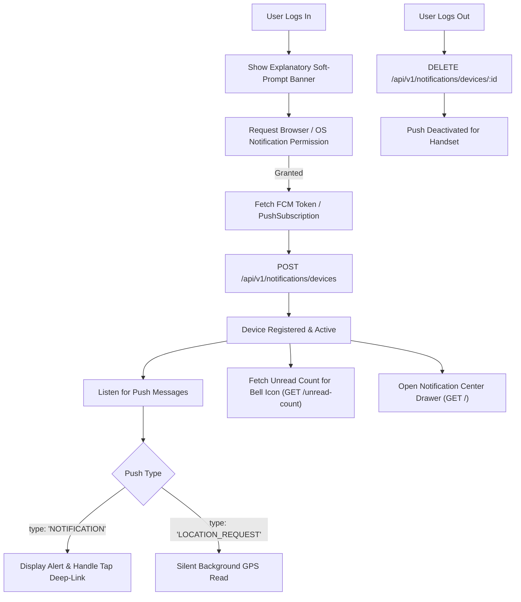
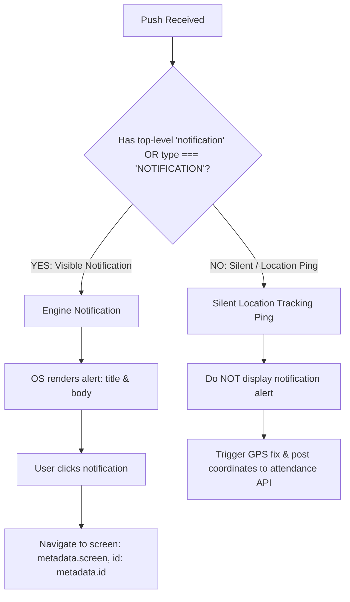

# Frontend FCM & Notification Engine Integration Guide
**Applies to:** Web (React / Vue / Next.js / PWA) & Mobile (React Native / Flutter / Android / iOS)  
**Base API URL:** `/api/v1/notifications`  
**Authentication:** `Authorization: Bearer <access_token>` (Must be authenticated with active `orgId`)  
**Version:** 2026-10-24  

---

## 1. Overview & High-Level Architecture

The HRMS notification system is a unified multi-channel engine supporting:
1. **Push Notifications (FCM / Web Push):** Real-time nudges to mobile devices and web browsers.
2. **In-App Notification Center / Inbox:** Durable, filterable, and paginated feed of notifications (Leave, Attendance, Payroll, Task, etc.) with an unread badge counter.
3. **On-Demand Location Tracking (Silent Push):** Background location ping requested by authorized managers/HR.



---

## 2. Notification Permission Flow ("Ask for Notification Allow")

### 2.1 UX Best Practice: The Two-Step "Soft-Prompt"
> [!IMPORTANT]
> **Never trigger the native browser or OS permission prompt immediately on app splash or unauthenticated landing pages.**
> - Users reject unprompted permission requests at a high rate (over 70%).
> - In modern browsers (Chrome/Safari/Firefox), once a user clicks "Block", your web app cannot re-prompt them; they must manually go into browser site settings.
> - **Recommended Pattern:** Show an in-app explanatory modal/banner *after* successful login or when visiting the Dashboard/Attendance screen:  
>   *"Allow HRMS notifications to get instant alerts on leave approvals, payslips, and shift updates."*  
>   When the user clicks *"Allow Notifications"*, immediately call the system permission API.

---

### 2.2 Web Browser Permission Request
In your client-side JavaScript / React / Vue component:

```javascript
/**
 * Prompts user for browser notification permission.
 * Call this upon clicking an 'Enable Notifications' button or banner.
 */
async function requestWebNotificationPermission() {
  if (!('Notification' in window) || !('serviceWorker' in navigator)) {
    console.warn('Push messaging is not supported in this browser environment.');
    return 'unsupported';
  }

  // Check current permission state
  let permission = Notification.permission;
  if (permission === 'default') {
    permission = await Notification.requestPermission();
  }

  if (permission === 'granted') {
    console.log('Notification permission granted.');
    await initAndRegisterWebPush();
  } else if (permission === 'denied') {
    console.warn('User blocked notifications.');
  }

  return permission;
}
```

---

### 2.3 Mobile Permission Request (React Native)
For Android 13+ (API level 33+) and iOS, explicit runtime permission is required:

```javascript
import messaging from '@react-native-firebase/messaging';
import { PermissionsAndroid, Platform } from 'react-native';

export async function requestMobileNotificationPermission() {
  try {
    // 1. Android 13+ runtime POST_NOTIFICATIONS permission
    if (Platform.OS === 'android' && Platform.Version >= 33) {
      const granted = await PermissionsAndroid.request(
        PermissionsAndroid.PERMISSIONS.POST_NOTIFICATIONS
      );
      if (granted !== PermissionsAndroid.RESULTS.GRANTED) {
        console.warn('Android POST_NOTIFICATIONS permission denied');
        return false;
      }
    }

    // 2. iOS APNs & FCM Permission Request
    const authStatus = await messaging().requestPermission({
      alert: true,
      badge: true,
      sound: true,
      provisional: false,
    });

    const enabled =
      authStatus === messaging.AuthorizationStatus.AUTHORIZED ||
      authStatus === messaging.AuthorizationStatus.PROVISIONAL;

    if (enabled) {
      console.log('Mobile notification permission granted:', authStatus);
      await registerMobileDeviceToken();
      return true;
    } else {
      console.warn('Mobile notification permission denied');
      return false;
    }
  } catch (err) {
    console.error('Error requesting notification permission:', err);
    return false;
  }
}
```

---

### 2.4 Mobile Permission Request (Flutter)

```dart
import 'package:firebase_messaging/firebase_messaging.dart';

Future<bool> requestFlutterNotificationPermission() async {
  FirebaseMessaging messaging = FirebaseMessaging.instance;

  NotificationSettings settings = await messaging.requestPermission(
    alert: true,
    badge: true,
    sound: true,
    provisional: false,
  );

  if (settings.authorizationStatus == AuthorizationStatus.authorized) {
    print('User granted notification permission');
    await registerFlutterDeviceToken();
    return true;
  } else {
    print('User declined or has not accepted permission');
    return false;
  }
}
```

---

## 3. Registering the Device Token with the Backend

Once permission is granted, obtain the device token and register it with the backend device registry.

### 3.1 Endpoint Specification

`POST /api/v1/notifications/devices`

#### Headers
```http
Authorization: Bearer <access_token>
Content-Type: application/json
```

#### Request Body
| Field | Type | Required | Description |
|---|---|---|---|
| `platform` | `string` | **Yes** | Must be one of: `"android"`, `"ios"`, `"web"` |
| `push_token` | `string` | **Yes** | FCM registration token (mobile/web) OR stringified `PushSubscription` JSON (web) |
| `device_name` | `string` | No | Human-readable name (e.g. `"Pixel 7"`, `"iPhone 14 Pro"`, `"Chrome MacOS"`) |
| `app_version` | `string` | No | Semantic app version (e.g. `"1.4.2"`) |

#### Example Request (Mobile FCM Token)
```json
{
  "platform": "android",
  "push_token": "fX4b9Lm...c8-10zWq",
  "device_name": "Samsung Galaxy S22",
  "app_version": "1.4.0"
}
```

#### Example Request (Web Push PushSubscription JSON)
```json
{
  "platform": "web",
  "push_token": "{\"endpoint\":\"https://fcm.googleapis.com/fcm/send/...\",\"keys\":{\"p256dh\":\"BIP...\",\"auth\":\"7S...\"}}",
  "device_name": "Chrome on Windows",
  "app_version": "2.1.0"
}
```

#### Success Response (`201 Created`)
```json
{
  "success": true,
  "message": "Device registered",
  "data": {
    "id": "7f2a1b94-811c-4b53-bcf2-11100234a991",
    "platform": "android",
    "device_name": "Samsung Galaxy S22",
    "app_version": "1.4.0",
    "is_active": true,
    "last_seen_at": "2026-10-24T10:00:00.000Z",
    "created_at": "2026-10-24T10:00:00.000Z"
  }
}
```
> [!TIP]
> **Store `data.id` locally in `AsyncStorage` or `localStorage`!** You will need this `id` to unregister the device upon logout.

---

### 3.2 Token Refresh Handling
FCM tokens can periodically rotate (app re-install, token invalidation, OS clearing cache). The client must listen to token refresh events and sync with the backend:

- **React Native:** `messaging().onTokenRefresh(newToken => registerDevice(newToken))`
- **Flutter:** `FirebaseMessaging.instance.onTokenRefresh.listen(registerDevice)`
- **Web:** Firebase JS SDK `onMessage` or service worker lifecycle.

---

## 4. Session Lifecycle & Logout De-registration (CRITICAL)

> [!CAUTION]
> **You MUST de-register the device token when the user logs out!**  
> If an employee signs out of a company phone or shared tablet and a second employee logs in, failing to de-register the token means the previous employee's notifications and location pings could be sent to the device.

### Endpoint: Unregister Device
`DELETE /api/v1/notifications/devices/:id`

- `:id`: The UUID received when `POST /devices` was registered.
- **Headers:** `Authorization: Bearer <access_token>`

#### Response (`200 OK`)
```json
{
  "success": true,
  "message": "Device removed",
  "data": {
    "id": "7f2a1b94-811c-4b53-bcf2-11100234a991",
    "is_active": false
  }
}
```

#### Logout Flow Implementation:
```javascript
async function handleUserLogout() {
  const registeredDeviceId = localStorage.getItem('hrms_device_id');
  if (registeredDeviceId) {
    try {
      await fetch(`/api/v1/notifications/devices/${registeredDeviceId}`, {
        method: 'DELETE',
        headers: { Authorization: `Bearer ${getAuthToken()}` }
      });
    } catch (e) {
      console.warn('Failed to unregister push device during logout:', e);
    } finally {
      localStorage.removeItem('hrms_device_id');
    }
  }

  // Proceed with normal session clear and redirect to login
  clearSessionAuth();
}
```

---

## 5. Handling Incoming Push Notifications & Deep Links

The backend transports emit two distinct payload shapes. Clients **must branch** based on the message content:



---

### 5.1 Push Payloads Comparison

#### Shape A: Visible Notification Alert (From Notification Engine)
- **Web Push:**
  ```json
  {
    "type": "NOTIFICATION",
    "notification": {
      "title": "Leave approved",
      "body": "Your leave was approved."
    },
    "screen": "LeaveDetails",
    "id": "L1",
    "event_key": "leave.approved"
  }
  ```
- **Mobile FCM:**
  - Top-level `notification`: `{ title: "Leave approved", body: "Your leave was approved." }`
  - Custom `data`: `{ screen: "LeaveDetails", id: "L1", event_key: "leave.approved" }`
  - Action: The OS displays the banner. On tap, your app router reads `data.screen` and navigates to the detail screen.

#### Shape B: Silent Location Request (On-Demand Location Feature)
- **Web Push:** `{ "type": "LOCATION_REQUEST", "requestId": "req_123", "expiresAt": "..." }`
- **Mobile FCM:** Data-only (NO top-level `notification` key).
- Action: **DO NOT display a notification popup!** Wake background service, acquire GPS coordinates, and call `/api/v1/attendance/locations/live/:requestId`.

---

### 5.2 Web Service Worker Implementation (`sw.js`)

```javascript
// public/sw.js (Service Worker)

self.addEventListener('push', function (event) {
  if (!event.data) return;

  const payload = event.data.json();

  // 1. Visible Notification Engine alert
  if (payload.type === 'NOTIFICATION') {
    const title = payload.notification?.title || 'HRMS Notification';
    const options = {
      body: payload.notification?.body || '',
      icon: '/icons/icon-192x192.png',
      badge: '/icons/badge-72x72.png',
      data: {
        screen: payload.screen,
        id: payload.id,
        event_key: payload.event_key
      }
    };
    event.waitUntil(self.registration.showNotification(title, options));
    return;
  }

  // 2. Silent Location Ping
  if (payload.type === 'LOCATION_REQUEST') {
    // DO NOT show a visible notification.
    event.waitUntil(handleSilentLocationRequest(payload));
  }
});

self.addEventListener('notificationclick', function (event) {
  event.notification.close();
  const screen = event.notification.data?.screen;
  const targetId = event.notification.data?.id;

  // Build target URL from screen mapping
  let targetUrl = '/notifications';
  if (screen === 'LeaveDetails' && targetId) targetUrl = `/leaves/${targetId}`;
  if (screen === 'TaskDetails' && targetId) targetUrl = `/tasks/${targetId}`;
  if (screen === 'AttendanceAnomalies') targetUrl = '/attendance/anomalies';

  event.waitUntil(
    clients.matchAll({ type: 'window', includeUncontrolled: true }).then(windowClients => {
      for (const client of windowClients) {
        if (client.url.includes(self.location.origin) && 'focus' in client) {
          client.navigate(targetUrl);
          return client.focus();
        }
      }
      if (clients.openWindow) return clients.openWindow(targetUrl);
    })
  );
});
```

---

### 5.3 Mobile React Native Push & Deep Linking Handler

```javascript
import React, { useEffect } from 'react';
import messaging from '@react-native-firebase/messaging';
import { useNavigation } from '@react-navigation/native';

export function useNotificationHandler() {
  const navigation = useNavigation();

  function routeDeepLink(data) {
    if (!data || !data.screen) return;
    const { screen, id } = data;

    switch (screen) {
      case 'LeaveDetails':
      case 'LeaveRequestDetail':
        navigation.navigate('LeaveDetailScreen', { leaveId: id });
        break;
      case 'AttendanceAnomalies':
        navigation.navigate('AttendanceAnomaliesScreen');
        break;
      case 'TaskDetail':
        navigation.navigate('TaskDetailScreen', { taskId: id });
        break;
      case 'ReimbursementDetail':
        navigation.navigate('ReimbursementDetailScreen', { claimId: id });
        break;
      default:
        navigation.navigate('NotificationInboxScreen');
    }
  }

  useEffect(() => {
    // 1. Foreground Push Listener
    const unsubscribeForeground = messaging().onMessage(async remoteMessage => {
      console.log('Foreground Push Received:', remoteMessage);
      // If notification payload exists, show an in-app banner or toast
      if (remoteMessage.notification) {
        // e.g. showToast(remoteMessage.notification.title, remoteMessage.notification.body)
      }
    });

    // 2. Notification opened when app was in background
    messaging().onNotificationOpenedApp(remoteMessage => {
      console.log('Notification tapped from background:', remoteMessage);
      routeDeepLink(remoteMessage.data);
    });

    // 3. Notification opened when app was completely closed/quit
    messaging()
      .getInitialNotification()
      .then(remoteMessage => {
        if (remoteMessage) {
          console.log('Notification opened from quit state:', remoteMessage);
          routeDeepLink(remoteMessage.data);
        }
      });

    return unsubscribeForeground;
  }, []);
}
```

---

## 6. In-App Notification Center & Badge REST APIs

In addition to push alerts, the frontend must render the In-App Notification Drawer and Bell Badge.

### 6.1 `GET /api/v1/notifications/unread-count` (Bell Badge)
Call this on initial login and poll periodically (e.g. every 60s) or upon receiving a foreground push.

#### Response (`200 OK`)
```json
{
  "success": true,
  "message": "Unread count fetched",
  "data": {
    "unread_count": 5,
    "is_capped": false
  }
}
```
> [!NOTE]
> If `is_capped` is `true`, render the badge as `"99+"` or `"100+"` rather than the raw number.

---

### 6.2 `GET /api/v1/notifications` (Inbox Feed)
Fetches the user's notifications, ordered newest first (`created_at DESC`).

#### Query Parameters (All optional):
| Param | Type | Default | Options |
|---|---|---|---|
| `page` | `integer` | `1` | Page number (min: 1) |
| `limit` | `integer` | `20` | Items per page (min: 1, max: 50) |
| `is_read` | `boolean` | (omitted) | `true` (read only), `false` (unread only), omitted (both) |
| `category` | `string` | (omitted) | One of: `leave`, `attendance`, `payroll`, `task`, `document`, `shift`, `employee`, `system` |

#### Response (`200 OK`)
```json
{
  "success": true,
  "message": "Notifications fetched",
  "data": {
    "items": [
      {
        "id": "e2f12c19-74e1-4c62-84b2-4d1a382e70c1",
        "event_key": "leave.approved",
        "category": "leave",
        "title": "Leave approved",
        "message": "Your Sick Leave from 2026-10-25 to 2026-10-26 was approved by Priya Nair.",
        "actor_name": "Priya Nair",
        "metadata": {
          "event_key": "leave.approved",
          "screen": "LeaveDetails",
          "id": "c1092b31-291c-4b52-9b21-4f112028ab91",
          "actor_name": "Priya Nair"
        },
        "is_read": false,
        "read_at": null,
        "created_at": "2026-10-24T09:30:00.000Z"
      }
    ],
    "pagination": {
      "page": 1,
      "limit": 20,
      "total": 45,
      "total_pages": 3
    }
  }
}
```

---

### 6.3 `PATCH /api/v1/notifications/:id/read` (Mark One Read)
Call this when the user clicks or taps on a notification card.
- **Request Body:** Must be empty `{}` (sending unrecognized keys returns 400).

#### Response (`200 OK`)
```json
{
  "success": true,
  "message": "Notification marked read",
  "data": {
    "id": "e2f12c19-74e1-4c62-84b2-4d1a382e70c1",
    "is_read": true
  }
}
```

---

### 6.4 `PATCH /api/v1/notifications/mark-all-read` (Mark All Read)
Call this when user clicks *"Mark all as read"* at the top of the notification drawer.
- **Request Body:** Must be empty `{}`.

#### Response (`200 OK`)
```json
{
  "success": true,
  "message": "All notifications marked read",
  "data": {
    "updated_count": 8
  }
}
```

---

### 6.5 `DELETE /api/v1/notifications/:id` (Dismiss / Delete)
Call this when user swipes to dismiss or clicks the delete icon on a notification.
- **Response (`200 OK`)**: `{ "success": true, "message": "Notification dismissed", "data": { "id": "...", "dismissed": true } }`

---

## 7. Graceful Handling of the 503 Kill Switch

The entire notification engine is behind an environment kill switch (`NOTIFICATION_ENGINE_ENABLED`).  
When the engine is **switched off**:
- All `/api/v1/notifications/*` endpoints return **`503 Service Unavailable`** with:
  ```json
  {
    "success": false,
    "message": "Notifications are currently unavailable",
    "errorCode": "FEATURE_DISABLED"
  }
  ```

> [!TIP]
> **Frontend Behavior:**
> When receiving `errorCode === 'FEATURE_DISABLED'`, **gracefully hide the bell icon and suppress error toast popups**. Do not crash or show full-screen errors to the user.

---

## 8. Summary Checklist for Frontend Teams

- [ ] Add post-login soft-prompt explaining why notifications are requested.
- [ ] Implement permission trigger for Web (`Notification.requestPermission`) and Mobile (`messaging().requestPermission`).
- [ ] On permission granted, call `POST /api/v1/notifications/devices` with `push_token`, `platform`, `device_name`, `app_version`.
- [ ] Store registered `device_id` locally and call `DELETE /api/v1/notifications/devices/:id` on user logout.
- [ ] Update Service Worker / Background Push Handler:
  - Branch on `type === 'NOTIFICATION'` to display alerts with deep links.
  - Branch on `type === 'LOCATION_REQUEST'` for silent background location pings (NO visible banner).
- [ ] Wire up Top Bar Bell Icon with `GET /api/v1/notifications/unread-count`.
- [ ] Build Notification Drawer using `GET /api/v1/notifications`, `PATCH /:id/read`, and `PATCH /mark-all-read`.
- [ ] Add `503 FEATURE_DISABLED` guard to gracefully hide notification elements when disabled.
