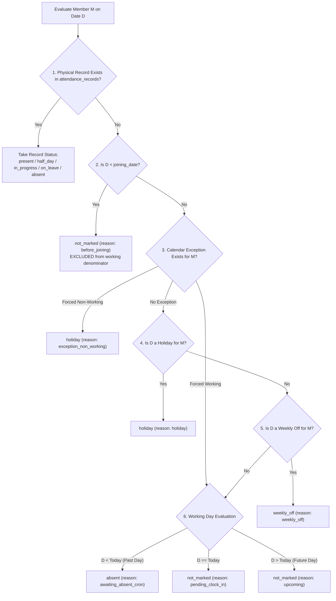

# Canonical Source of Truth: Attendance & Leave Calculation Engine

**Module:** Attendance Engine (`src/modules/attendance/`) & Leave Engine (`src/modules/leave/`)  
**Domain:** Human Resource Management System (HRMS)  
**Status:** Living Standard / Authoritative Specification  
**Last Updated:** 2026-10-04  
**Audience:** Backend Engineers, System Architects, QA Engineers, Frontend Engineers  

---

## 1. Executive Purpose & Architectural Principles

This document is the **absolute, authoritative specification** for how attendance, leaves, weekly offs, holidays, working days, and status provenance are calculated across the HRMS platform.

Attendance systems must maintain strict mathematical consistency across multiple viewing planes (Employee, Manager, and HR). A failure in calculation logic leads to severe real-world problems: skewed payroll calculations, legal non-compliance, inaccurate dashboards, and employee distrust.

### The 4 Non-Negotiable Golden Rules
1. **Conservation of Headcount (The Fundamental Invariant):**  
   For any organization or team with $N_D$ eligible members on date $D$, every single member belongs to **exactly one mutually exclusive status bucket**. At no point may the sum of present, absent, and leave counts exceed $N_D$ or drop below $N_D$.
2. **Physical Record Dominance (Action Trumps Schedule):**  
   If an employee clocks in and works on a scheduled weekly off or an official holiday, their physical record (`present`, `half_day`, or `in_progress`) **supersedes the non-working schedule**. They are counted as **Present**, and **MUST NOT** be counted as Weekly Off or Holiday.
3. **Tenure Bounding (Joining & Separation Guard):**  
   An employee who has not yet joined on date $D$ ($D < \text{joining\_date}$) or who was deactivated prior to date $D$ was not employed on date $D$. They **must never** be counted as absent, holiday, or weekly off for that date.
4. **Zero-Drift Multi-Plane Parity:**  
   The HR live dashboard (`/hr/dashboard/live`), monthly graph (`/hr/dashboard/graph-data`), manager team summary (`/manager/team/summary`), and individual employee records (`/history`, `/daily-log`) must evaluate dates through the **exact same precedence rules** and produce identical classifications.

---

## 2. Core Taxonomy & Status Machine

### 2.1 The Two Layers: Physical Records vs Virtual (Derived) States

| Layer | Where it Lives | Description |
|---|---|---|
| **Physical Record** (`status_source: "record"`) | PostgreSQL table `attendance_records` | Created when an employee clocks in (`present`, `half_day`, `in_progress`), an approved leave request syncs (`on_leave`), or the auto-absent cron / HR admin marks them (`absent`). |
| **Virtual / Derived State** (`status_source: "derived"`) | Computed on read (No DB row) | Evaluated on the fly when **no record exists** for a member on a date. Determines whether the day was a Holiday, a Weekly Off, or an Unclocked Working Day. |

### 2.2 Status Codes & Meaning

| Status Code | Meaning | Classification Bucket | Expected to Work? |
|---|---|---|---|
| `present` | Clocked in and fulfilled full-day working hours | **Final Present** | Yes (Worked) |
| `half_day` | Clocked in and fulfilled half-day threshold | **Final Present** | Yes (Worked) |
| `in_progress` | Currently clocked in and working (Today only) | **Final Present** | Yes (Worked) |
| `on_leave` | Approved leave request (Casual, Sick, Earned, etc.) | **Final Leave** | No (Excused) |
| `weekly_off` | Scheduled rest day per weekly off policy or shift | **Final Leave** | No (Excused) |
| `holiday` | Public, religious, or company holiday | **Final Leave** | No (Excused) |
| `absent` | Scheduled working day, but employee did not clock in | **Final Absent** | Yes (Unexcused) |
| `not_marked` | Unclocked day awaiting clock-in or cron processing | **Contextual** | Pending / Pre-joining |

---

## 3. The Canonical Precedence Engine

When evaluating the attendance state of Member $M$ on Date $D$, the system evaluates conditions in **strict sequential order**. Once a rule matches, evaluation halts:



### Detailed Precedence Walkthrough:

1. **Step 1: Check Physical Record (`attendance_records`)**
   * If a row exists with status `present`, `half_day`, or `in_progress`, the employee worked. They belong in the **Present** bucket regardless of what the calendar says.
   * If a row exists with status `on_leave`, an approved leave request is active.
   * If a row exists with status `absent`, an absence has already been persisted.
2. **Step 2: Joining Date Boundary Check**
   * If $D < \text{joining\_date}$, the member was not employed yet. Status is `not_marked` (`status_reason: "before_joining"`).
   * **Rule:** Pre-joining members are **never** marked absent and **never** granted paid holidays/weekly offs they were not employed to take.
3. **Step 3: Calendar Exceptions (`attendance_calendar_exceptions`)**
   * Checks for targeted overrides:
     - `working_day`: Forces a weekend/holiday to become a mandatory working day.
     - `non_working_day`: Forces a declared closure/extra day off.
   * Specificity matrix breaks ties: User-targeted (3) > Department/Location-targeted (2) > Org-wide (1).
4. **Step 4: Holiday Evaluation (`attendance_holidays`)**
   * Matches active holidays where date $= D$.
   * Filters targeting: `excluded_users`, `included_users`, `target_departments`, `target_locations`.
5. **Step 5: Weekly Off Rules (`attendance_weekly_off_rules`)**
   * Matches active rules where $D \in [\text{effective\_from}, \text{effective\_to}]$.
   * Matches targeting predicates: `target_users`, `target_departments`, `target_locations`, `target_shifts`, `target_employment_types`, `target_job_statuses`.
   * **Priority Unioning Rule:** Rules are sorted by `priority DESC`. All rules tied at the highest priority tier are **unioned** (`OR` condition). A strictly higher priority rule overrides lower ones.
   * If the day of week (0=Sun, 6=Sat) matches the rule's `days_of_week`, the day is `weekly_off`.
6. **Step 6: Working Day Fallback (Unclocked)**
   * If none of the above match, date $D$ was an ordinary working day, but the employee has no punch:
     - **Past Date ($D < \text{Today}$):** The employee did not show up. Derived status is `absent` (`status_reason: "awaiting_absent_cron"`).
     - **Current Date ($D == \text{Today}$):** The shift is ongoing or awaiting punch. Derived status is `not_marked` (`status_reason: "pending_clock_in"`).
     - **Future Date ($D > \text{Today}$):** Nothing is owed yet. Derived status is `not_marked` (`status_reason: "upcoming"`).

---

## 4. Mathematical Invariants & Aggregation Formulas

For any given date $D$, let:
* $N_D = \text{Total Active Employees Employed on Date } D \quad (\{u \in \text{OrgUsers} \mid \text{joining\_date}_u \le D\})$

### 4.1 The Three Fundamental Bars

$$\mathbf{final\_present\_count} = \text{present\_count} + \text{half\_day\_count} + \text{in\_progress\_count}$$

$$\mathbf{final\_leave\_count} = \text{on\_leave\_count} + \text{weekly\_off\_count} + \text{holiday\_count}$$

$$\mathbf{final\_absent\_count} = \text{absent\_count} + \text{unclocked\_working\_count}$$

### 4.2 The Headcount Conservation Identity
$$\mathbf{final\_present\_count} + \mathbf{final\_absent\_count} + \mathbf{final\_leave\_count} \equiv N_D$$

*Under no circumstances may the sum of these three metrics deviate from $N_D$.*

### 4.3 Expected Working Headcount & Attendance Percentage

$$\mathbf{total\_expected\_working} = N_D - \mathbf{final\_leave\_count}$$

$$\mathbf{attendance\_percentage} = \begin{cases} 
\text{round}\left(\frac{\mathbf{final\_present\_count}}{\mathbf{total\_expected\_working}} \times 100, 2\right) & \text{if } \mathbf{total\_expected\_working} > 0 \\ 
100.00 & \text{if } \mathbf{total\_expected\_working} = 0 \text{ and } \mathbf{final\_present\_count} = 0 \\
100.00 & \text{if } \mathbf{total\_expected\_working} = 0 \text{ and } \mathbf{final\_present\_count} > 0 \text{ (Duty on Off-Day)}
\end{cases}$$

### 4.4 On-Time Arrival Percentage

$$\mathbf{on\_time\_present} = \mathbf{final\_present\_count} - \text{late\_count}$$

$$\mathbf{on\_time\_percentage} = \begin{cases}
\text{round}\left(\frac{\mathbf{on\_time\_present}}{\mathbf{final\_present\_count}} \times 100, 2\right) & \text{if } \mathbf{final\_present\_count} > 0 \\
0.00 & \text{if } \mathbf{final\_present\_count} = 0
\end{cases}$$

---

## 5. Specification of All HR Attendance APIs

### 5.1 Real-Time Dashboard: `GET /api/v1/attendance/hr/dashboard/live`
* **Purpose:** Single-date live operational pulse for the entire organization (default: today).
* **Target Audience:** HR Executives, Leadership.
* **Calculation Contract:**
  1. Denominator $N_D$: All active members in the organization where $\text{joining\_date} \le \text{targetDate}$.
  2. Queries `attendance_records` for `targetDate`.
  3. For every member without a record, calls `clockService.resolveDerivedDayStatus`.
  4. Yields the top-level metrics:
     - `total_employees`: $N_D$
     - `final_present_count`: $\text{present} + \text{half\_day} + \text{in\_progress}$
     - `final_leave_count`: $\text{holiday} + \text{weekly\_off} + \text{on\_leave}$
     - `final_absent_count`: $\text{absent} + (\text{not\_marked if today or past})$
     - `counts`: Full breakdown object containing individual bucket tallies.

### 5.2 Time-Series Graph: `GET /api/v1/attendance/hr/dashboard/graph-data`
* **Purpose:** Multi-day historical and current-month attendance trend chart.
* **Query Parameters:** `month`, `year` OR `from`, `to` (ISO dates). Clamped to $\le \text{today}$.
* **Calculation Contract:**
  1. Must execute in **$O(1)$ batch queries** (Max 5 DB calls across the entire date span).
  2. Enumerates every calendar day from `from` to `to`.
  3. Evaluates each employee's status for each date using in-memory calendar classification:
     - If employee clocked in on a Saturday/Sunday/Holiday: Increment `present_count` (or `half_day_count` / `in_progress_count`). **Do not increment `weekly_off_count` or `holiday_count` for this employee.**
     - If employee did not clock in on a Saturday/Sunday/Holiday: Increment `weekly_off_count` or `holiday_count`.
     - If employee did not clock in on a working day: Increment `absent_count`.
  4. Returns:
     ```json
     {
       "overall_summary": {
         "avg_attendance_percentage": 94.5,
         "avg_hours_per_day": 8.1,
         "total_late_incidents": 4,
         "total_overtime_hours": 12.5
       },
       "daily": [
         {
           "date": "2026-10-03",
           "is_working_day": true,
           "present_count": 8,
           "half_day_count": 1,
           "late_count": 2,
           "in_progress_count": 0,
           "absent_count": 0,
           "on_leave_count": 0,
           "weekly_off_count": 1,
           "holiday_count": 0,
           "avg_effective_hours": 8.34,
           "total_overtime_minutes": 0,
           "attendance_percentage": 100,
           "final_present_count": 9,
           "final_absent_count": 0,
           "final_leave_count": 1
         }
       ]
     }
     ```

### 5.3 Department Breakdown: `GET /api/v1/attendance/hr/dashboard/department-summary`
* **Purpose:** Attendance performance segmented by canonical organization departments.
* **Calculation Contract:**
  1. Department membership determined by `department_id` on the member's profile + Head of Department assignments.
  2. Working days for each department must be calculated based on **that department's weekly off rules** (e.g. Sales working Saturdays with Wednesday off vs Engineering having Saturday off).
  3. Output guarantees: $\text{final\_present\_count} + \text{final\_absent\_count} \le \text{total\_employees} \times \text{working\_days}$.

### 5.4 Daily Attendance Rosters
* **Endpoints:**
  - `GET /api/v1/attendance/hr/employees/attendance`
  - `GET /api/v1/attendance/hr/managers/attendance`
  - `GET /api/v1/attendance/hr/hrs/attendance`
* **Calculation Contract:**
  1. Single-date roster: Every member gets a row. Real record takes precedence; unclocked members are dynamically synthesized via `resolveDerivedDayStatus`.
  2. Every row returns the provenance metadata:
     - `status`: String enum
     - `status_source`: `"record"` \| `"derived"`
     - `status_reason`: `"record"` \| `"before_joining"` \| `"holiday"` \| `"weekly_off"` \| `"awaiting_absent_cron"` \| `"pending_clock_in"`
     - `is_provisional`: Boolean (`true` if status can still change today or via cron).

### 5.5 Member Dense History
* **Endpoints:**
  - `GET /api/v1/attendance/hr/employees/:userId/attendance`
  - `GET /api/v1/attendance/hr/managers/:userId/attendance`
  - `GET /api/v1/attendance/hr/hrs/:userId/attendance`
* **Calculation Contract:**
  1. Evaluates all calendar dates in `[fromDate, toDate]`.
  2. Uses [dense_history.utils.js](file:///c:/Users/91930/Desktop/Vs_Code/HRMS/src/modules/attendance/utilities/dense_history.utils.js).
  3. Every calendar day has a record (either real or derived with null clock times). No days are omitted.

### 5.6 Member Daily Log (Detail View)
* **Endpoints:**
  - `GET /api/v1/attendance/hr/employees/:userId/daily-log`
  - `GET /api/v1/attendance/hr/managers/:userId/daily-log`
  - `GET /api/v1/attendance/hr/hrs/:userId/daily-log`
* **Calculation Contract:**
  1. Returns `status_context`:
     - `holiday`: `{ id, name, type }`
     - `weekly_off`: `{ id, name, days_of_week }`
     - `shift`: `{ id, name, start_time, end_time, type }`

### 5.7 Member Monthly Summary
* **Endpoints:**
  - `GET /api/v1/attendance/hr/employees/:userId/summary`
  - `GET /api/v1/attendance/hr/managers/:userId/summary`
  - `GET /api/v1/attendance/hr/hrs/:userId/summary`
* **Calculation Contract:**
  1. Reuses [user_attendance_read.service.js:getGraphData](file:///c:/Users/91930/Desktop/Vs_Code/HRMS/src/modules/attendance/services/user_attendance_read.service.js#L114).
  2. Returns distinct day buckets for the month:
     - `present_days`: Days worked full day or in progress.
     - `half_days`: Half-day attendance.
     - `absent_days`: Days absent (unexcused).
     - `on_leave_days`: Approved leaves.
     - `weekly_off_days`: Scheduled weekly offs where member did not work.
     - `holiday_days`: Holidays where member did not work.

---

## 6. Edge Cases & Complex Scenarios

### Scenario 1: Clock-In on a Weekly Off or Holiday (Weekend Duty)
* **Fact:** An employee is assigned to a shift with Sunday off. On Sunday, they clock in and work 8 hours.
* **Correct Handling:**
  - `attendance_records` stores a row with `status: 'present'`.
  - The employee is counted in `present_count` and `final_present_count`.
  - The employee **IS NOT** counted in `weekly_off_count`.
  - **Result:** Weekly off count for that day reflects only those members who *did not work*. Total headcount remains strictly $N_D$.

### Scenario 2: Different Weekly Offs across Departments
* **Fact:** Sales department has Wednesday off; Corporate/Tech has Saturday off.
* **Correct Handling:**
  - On Wednesday: Sales employees without a record receive `weekly_off`. Tech employees without a record receive `absent` (if past) or `not_marked` (if today).
  - On Saturday: Tech employees without a record receive `weekly_off`. Sales employees who work receive `present`.
  - `is_working_day` for the organization is `true` on both Wednesday and Saturday because a portion of the organization is scheduled to work.

### Scenario 3: Employee Mid-Month Joinee
* **Fact:** Employee joins on October 15th. Monthly report queried for October 1st – October 31st.
* **Correct Handling:**
  - From Oct 1st to Oct 14th: Employee status is `not_marked` (`status_reason: "before_joining"`).
  - On Oct 2nd (Gandhi Jayanti Holiday): Employee **does not** receive a holiday count.
  - In daily dashboard calculations for Oct 1st – Oct 14th, the employee is **excluded from $N_D$**.
  - From Oct 15th onward, employee is included in $N_D$.

### Scenario 4: Mid-Period Deactivation / Resignation
* **Fact:** Employee is deactivated on October 10th.
* **Correct Handling:**
  - For historical register queries ($D \le \text{Oct 10}$), real earned punches remain visible and count toward payroll reconciliation.
  - For $D > \text{Oct 10}$, the employee is excluded from the active roster and is never synthesized as absent or on leave.

---

## 7. Performance & Scalability Architecture: The 5-Query Batch Pattern

To compute time-series graph data for up to 1,000 employees over 31 days without blocking the Node.js event loop or issuing 31,000 queries ($N \times D$), the service implements the **5-Query Batch Strategy**:

1. **Query 1 (Users):** `userRepository.findAllActiveUsers(orgId)` — Loads active users with role profiles (`joining_date`, `department_id`, `work_location_id`, `employment_type`, `job_status`).
2. **Query 2 (Attendance Records):** `recordRepository.findAllInDateRange(orgId, null, from, to)` — Loads all existing records across the organization for the month. Indexed into a hash map by `userId_dateStr`.
3. **Query 3 (Holidays):** `holidayRepository.findAll({ where: { org_id, is_active: true, date: { [Op.between]: [from, to] } } })` — Loads active holidays for the span.
4. **Query 4 (Weekly Off Rules):** `weeklyOffRepository.findAll({ where: { org_id, is_active: true } })` — Loads active weekly-off rules.
5. **Query 5 (Calendar Exceptions):** `calendarExceptionRepository.findAll({ where: { org_id, date: { [Op.between]: [from, to] } } })` — Loads date exceptions for the span.

### In-Memory Complexity:
* **Time Complexity:** $O(N \times D)$ where $N \le 1000$ and $D \le 31$ ($\approx 31,000$ quick in-memory iterations, completing in $< 15\text{ms}$).
* **Database Load:** Exactly 5 indexed queries. Zero N+1 query vulnerability.
