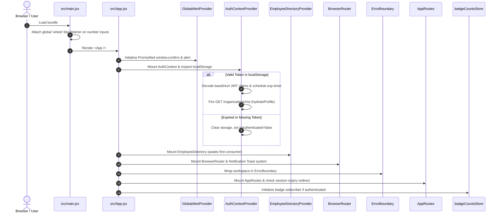
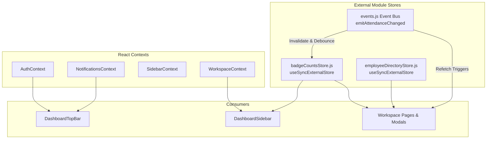
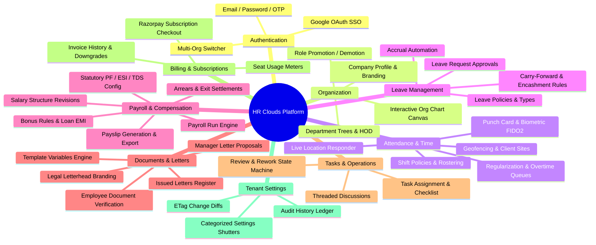
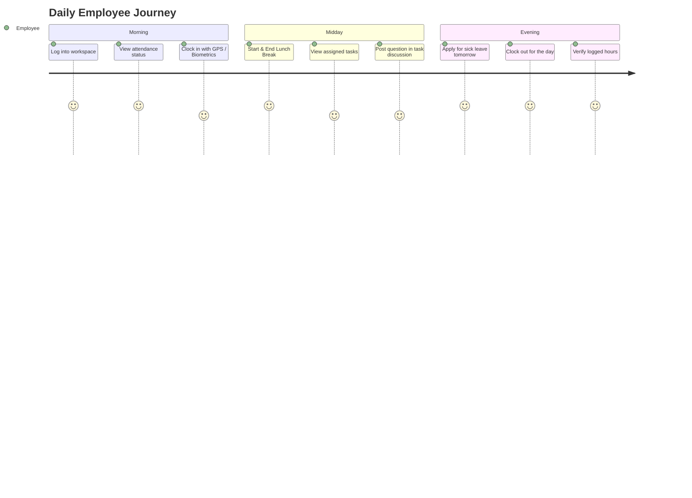
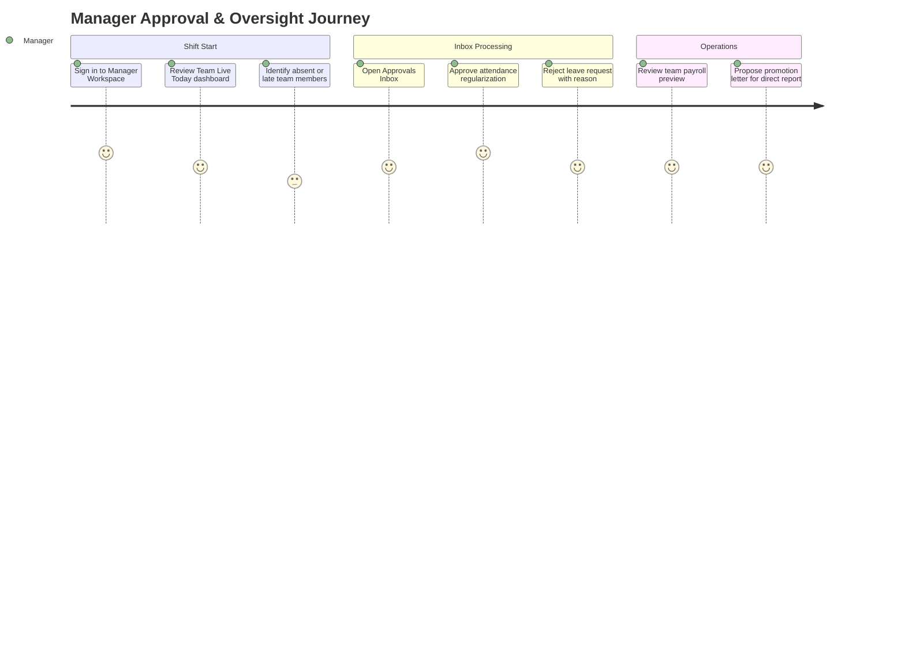
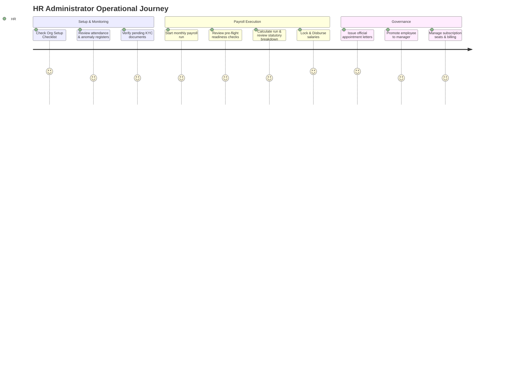

# Senior Frontend Engineering, Architecture & Codebase Discovery Report: HR Clouds Web

**Document Title:** Frontend Architecture, System Design & Codebase Discovery Report
**Author/Role:** Senior Frontend Engineer, Frontend Architect & UI/UX Designer
**Scope/Boundary:** `/home/rishi_ganeshe/Desktop/vs_code/HR-Clouds-Web`
**Target Environment:** Production Web Platform (`hrclouds-web`)
**Status:** Baseline Established — Architectural Source of Truth

---

## Table of Contents
1. [Project Overview](#1-project-overview)
2. [Technology Stack](#2-technology-stack)
3. [Directory Structure and Architecture](#3-directory-structure-and-architecture)
4. [Application Initialization Flow](#4-application-initialization-flow)
5. [Routing Architecture](#5-routing-architecture)
6. [Authentication and Authorization Flow](#6-authentication-and-authorization-flow)
7. [State Management Architecture](#7-state-management-architecture)
8. [API Integration Architecture](#8-api-integration-architecture)
9. [Shared Component Inventory](#9-shared-component-inventory)
10. [Feature & Module Inventory](#10-feature--module-inventory)
11. [UI/UX and Design System Analysis](#11-uiux-and-design-system-analysis)
12. [Role-Based User Journeys](#12-role-based-user-journeys)
13. [Important Business Workflows](#13-important-business-workflows)
14. [Responsive Design Implementation](#14-responsive-design-implementation)
15. [Existing Technical Debt](#15-existing-technical-debt)
16. [Identified Bugs and Risks](#16-identified-bugs-and-risks)
17. [Performance Observations](#17-performance-observations)
18. [Security Observations](#18-security-observations)
19. [Architectural Improvement Opportunities](#19-architectural-improvement-opportunities)
20. [Open Questions and Assumptions Requiring Validation](#20-open-questions-and-assumptions-requiring-validation)

---

## 1. Project Overview

**HR Clouds Web** (`hrclouds-web`) is a modern enterprise Human Resources Information System (HRIS), Payroll, Attendance, and Document Lifecycle Management Single-Page Application (SPA).

The platform is designed to support multi-tenant organizations across four distinct workspace shells:
- **HR Administrator Workspace (`/dashboard/hr/*`)**: Complete tenant governance, organizational structure, employee onboarding and offboarding, shift and policy rostering, attendance regularizations, leave assignments, monthly payroll run execution, legal letter minting, document compliance, billing subscriptions, and organization-wide configurations.
- **Manager Workspace (`/dashboard/manager/*`)**: Direct-report oversight, team attendance tracking, regularization and overtime approvals, leave request decisions, team payroll previews, and letter proposals.
- **Employee Workspace (`/dashboard/employee/*`)**: Self-service timekeeping (clock-in, clock-out, break tracking), attendance regularization and anomaly disputes, leave applications and balance monitoring, payslip viewing and downloads, salary loan applications, tax declarations, task execution, and company document acknowledgments.
- **Guest / Tenant Onboarding Workspace (`/onboarding`, `/setup-organization`, `/register-organization`, `/dashboard/guest`)**: Pre-tenant registration, subscription tier selection, Razorpay payment gateway integration, initial administrator profiling, and onboarding checklist completion.

In addition to tenant workspaces, the application features a public-facing corporate website (`/`, `/about`, `/services`, `/pricing`, `/contact`), comprehensive legal compliance documentation (`/legal/*`), and **Maya**—an intelligent, context-aware AI assistant powered by DocMind and voice synthesis.

---

## 2. Technology Stack

| Layer / Concern | Technology | Version | Purpose / Architectural Implementation |
|---|---|---|---|
| **Core Framework** | React | `^18.3.1` | Concurrent mode enabled, StrictMode wrapped in `src/main.jsx`. |
| **DOM Renderer** | React DOM | `^18.3.1` | Client-side root rendering via `createRoot(document.getElementById('root'))`. |
| **Routing** | React Router DOM | `^7.6.1` | Declarative client-side routing, route-based code-splitting, role gating, and query-state synchronization. |
| **Build & Bundler** | Vite | `^6.0.5` | Fast ESM development server, rollup production bundling with build-time exclusion plugin for `public/ref docs/` (`vite.config.js`). |
| **Styling & CSS** | Tailwind CSS | `^3.4.17` | Utility-first CSS, monochromatic purple theme system, custom breakpoints, scroll utilities, PostCSS + Autoprefixer. |
| **Typography** | Google Fonts | CDN | `Manrope` (primary sans font) and `Poppins` via `src/index.css`. |
| **Iconography** | React Icons | `^5.4.0` | Exclusively Heroicons v1 (`react-icons/hi`) across the entire workspace; `react-icons/hi2` in Maya widget. |
| **Charts & Visualizations** | Recharts | `^3.10.1` | Attendance trends, overtime charts, pay mix breakdown, and leave utilization donuts. |
| **Motion & Animation** | In-House Motion | Custom | Custom primitives in `src/shared/motion/`; external animation engines (Framer Motion, GSAP) are strictly forbidden by architectural rule. |
| **Avatars** | react-nice-avatar | `^1.5.0` | Procedural SVG avatar generation fallback for employees without uploaded photos. |
| **Time & Clock Picker** | react-time-picker, react-clock | `^8.1.0`, `^6.0.0` | Shift timing and punch time selection avoiding fragile native `<input type="time">`. |
| **Markdown Rendering** | react-markdown, remark-gfm | `^10.1.0`, `^4.0.1` | Lazily loaded inside `src/shared/components/ChatbotWidget.jsx` for Maya AI responses. |
| **OAuth** | @react-oauth/google | `^0.13.5` | Google Identity Services OAuth 2.0 token acquisition for SSO. |
| **Emoji** | @twemoji/api | `^17.0.3` | Consistent cross-platform emoji rendering across operating systems. |
| **HTTP Client** | Native `fetch` wrapper | ES2020 | Central client (`src/shared/api/client.js`) with 110s timeout, in-flight GET sharing, and JWT handling. |
| **Linter & Formatting** | ESLint 9 (flat), Prettier | `^9.17.0`, `^3.4.2` | Enforces React hooks rules and custom AST restriction forbidding un-awaited `window.confirm`. |

---

## 3. Directory Structure and Architecture

The codebase spans 609 source files partitioned cleanly by domain boundary and role visibility:

```text
HR-Clouds-Web/
├── .agents/                        # House rules, frontend-backend request protocols
├── docs/                           # Role switching specs, CI/CD and deployment guides
├── public/                         # Static assets, logos, and 6MB API contract documentation (ref docs)
├── src/
│   ├── assets/                     # Feature graphics, testimonials, social vectors
│   ├── auth/                       # Auth pages (Login, Register, OTP, Forgot Password, Select Org)
│   ├── config/                     # Centralized validated environment config (env.js)
│   ├── landing/                    # Public marketing site, pricing, contact, legal documents
│   ├── roles/                      # Role-specific workspaces
│   │   ├── employee/               # Self-service screens (attendance, leave, payroll, cards)
│   │   ├── manager/                # Manager hierarchy views (queues, team roster, approvals)
│   │   ├── hr/                     # HR administration screens (setup, directory, payroll runs, docs)
│   │   ├── guest/                  # Onboarding dashboards for tenant registration
│   │   └── DashboardPage.jsx       # Auth router landing trampoline
│   ├── routes/                     # Central router (AppRoutes.jsx)
│   └── shared/                     # Cross-role components, services, and domain logic
│       ├── api/                    # Central fetch client and domain API modules (*.api.js)
│       ├── attendance/             # Punch calculation, policy evaluation, geo/device logic
│       ├── auth/                   # Role priority matrices, permission helpers
│       ├── components/             # Enterprise shared UI (DetailDialog, Sidebar, TopBar, Skeletons)
│       ├── config/                 # Terminology dictionary, status maps
│       ├── contexts/               # External stores (BadgeCounts, EmployeeDirectory) and React Contexts
│       ├── documents/              # Letter issuing, document verification, template builders
│       ├── fieldHelp/              # 301KB field-help metadata and Ask Maya wiring
│       ├── hooks/                  # Custom React hooks (DocMind, Popover, Badges, Plans)
│       ├── layouts/                # DashboardLayout, LandingLayout, AuthLayout
│       ├── leaves/                 # Policy assignment and customization dialogs
│       ├── maya/                   # Maya AI bridge, Speech-to-Text, Hinglish translator
│       ├── motion/                 # In-house performant CSS/Observer animation engine
│       ├── notifications/          # In-app feed, Push VAPID alerts, location responder
│       ├── organization/           # Org chart canvas, profile setup, department transfers
│       ├── pdf/                    # Server-side PDF rendering status monitor, preview dialogs
│       ├── settings/               # Tenant configuration shutters, save dock, history
│       ├── tasks/                  # Task assignment, discussion threads, submission reviews
│       └── utils/                  # Domain error decoders, formatters, promise pools, geocoders
```

---

## 4. Application Initialization Flow



### Entry Details:
1. **Global Wheel Interception** (`src/main.jsx`): Prevents trackpad or mouse wheel scroll gestures from accidentally mutating numerical inputs across the application.
2. **Alert Promisification** (`src/shared/components/GlobalAlertProvider.jsx`): Replaces blocking browser `window.confirm` with a non-blocking in-app modal returning `Promise<boolean>` with accidental double-click protection (400ms threshold).
3. **Chunk Load Guard** (`src/shared/components/ErrorBoundary.jsx`): Intercepts dynamic `import()` chunk loading failures after production deployments and triggers an automatic single-reload via `sessionStorage` guard.

---

## 5. Routing Architecture

Routing is declared centrally in `src/routes/AppRoutes.jsx`:

```text
/ (LandingLayout)
├── "" -> Home
├── "about" -> About
├── "services" -> Services
├── "pricing" -> PricingPage
├── "contact" -> Contact
└── "legal/*" -> (privacy, terms, cookies, statutory, account-deletion)

/auth (AuthLayout)
├── "login" -> LoginPage
├── "register" -> RegisterPage
├── "otp" -> OtpPage
├── "forgot-password" -> ForgotPasswordPage
└── "select-org" -> SelectOrgPage

/dashboard (ProtectedRoute - Trampoline)
├── redirects to /dashboard/{workspace} via permissions.dashboardPathForRole()

/dashboard/hr/* (ProtectedRoute workspace="hr" -> DashboardLayout role="hr")
├── /dashboard/hr (Dashboard home)
├── /dashboard/hr/employees (Employee directory & profiles)
├── /dashboard/hr/attendance/* (Policies, shifts, rosters, locations, lock periods, devices)
├── /dashboard/hr/leaves/* (Types, policies, assignments, automation, requests)
├── /dashboard/hr/payroll/* (Runs, structures, components, statutory, arrears, tax, exits)
├── /dashboard/hr/documents/* (Verification, templates, letters, compliance, requests)
├── /dashboard/hr/settings/* (Tenant configuration groups & audit history)
└── /dashboard/hr/billing/* (Plan overview & Razorpay checkout)

/dashboard/manager/* (ProtectedRoute workspace="manager" -> DashboardLayout role="manager")
├── /dashboard/manager (Manager dashboard)
├── /dashboard/manager/requests/* (Regularizations, comp-offs, overtime, leaves)
├── /dashboard/manager/team/* (Team roster, live today, anomalies, history)
├── /dashboard/manager/payroll/* (Team salary structures, payslips, reimbursements)
└── /dashboard/manager/documents/* (Team compliance, requests, proposals)

/dashboard/employee/* (ProtectedRoute workspace="employee" -> DashboardLayout role="employee")
├── /dashboard/employee (Employee dashboard & punch card)
├── /dashboard/employee/attendance/* (Logs, regularizations, anomalies, overtime)
├── /dashboard/employee/leaves (Leave balances & applications)
├── /dashboard/employee/payroll/* (My salary, payslips, loans, tax declarations)
├── /dashboard/employee/documents/* (Issued letters, document requests, forms)
└── /dashboard/employee/tasks/* (My assigned work & discussion threads)
```

### Route Isolation & Parity Rules:
- **Exact Match Gate**: `src/shared/auth/permissions.js` fails closed. An HR user cannot access `/dashboard/employee/*` or `/dashboard/manager/*`, even though backend self-service endpoints accept any authenticated tenant member.
- **Smart Equivalence Forwarding**: When an HR admin or Manager clicks an employee-targeted email link (e.g. `/dashboard/employee/company-documents/:id`), `AppRoutes.jsx` intercepts the 403 bounce and translates the path to the user's native workspace equivalent (`/dashboard/hr/company-documents/:id`).

---

## 6. Authentication and Authorization Flow

### Authentication Mechanics:
1. **Token Persistence**: Tokens are stored in `localStorage` (`hrclouds_token` and `hrclouds_refresh_token`).
2. **Safe Decoding**: `src/shared/api/client.js` parses the JWT payload using `TextDecoder` over a sanitized base64url string to prevent UTF-8 encoding corruption on multi-byte international names.
3. **Session Expiry & Sync**:
   - Tab visibility changes trigger `isExpired` token validations.
   - Cross-tab login/logout events are synchronized via `window.addEventListener('storage')`.
   - Any API response with `401 Unauthorized` (excluding non-session codes such as `INVALID_CREDENTIALS`, `LOGIN_NOT_ALLOWED`, or `UNAUTHORIZED_DEVICE`) broadcasts `SESSION_EXPIRED_EVENT`.
4. **Multi-Tenant Org Selection**: If a user belongs to multiple organizations, `/api/v1/auth/login` returns a temporary `selectionToken` and an array of organizations, navigating to `/auth/select-org` before full session initialization.
5. **Secure Sign-Out**: On logout, `src/shared/contexts/AuthContext.jsx` triggers `releasePushDevice()` to delete the browser's Web Push registration from the server before purging client tokens, preventing post-logout leak of push alerts on shared hardware.

### Authorization Hierarchy:
Defined in `src/shared/auth/permissions.js`:
$$\text{super-admin (0)} < \text{admin (1)} < \text{hr (2)} < \text{manager (3)} < \text{employee (4)} < \text{guest (9)}$$
- Privilege escalation guard forbids inviters or managers from creating users with equal or higher roles (`canInviteRole`).
- Only `manager`, `hr`, `admin`, and `super-admin` are eligible to be assigned as Head of Department (HOD) or reporting managers (`canBeHOD`).

---

## 7. State Management Architecture

HR Clouds Web avoids monolithic global stores in favor of **specialized, domain-driven external module stores synchronized via React 18's `useSyncExternalStore`**:



1. **`badgeCountsStore.js`** (`src/shared/contexts/badgeCountsStore.js`):
   - Single poller querying `GET /inbox/badges` once per minute while the browser tab is focused.
   - Automatically pauses polling when `document.visibilityState === 'hidden'`.
   - Listens to the `events.js` bus and executes a debounced (600ms), rate-floor protected (5000ms) count refresh upon any approval, rejection, or cancellation action.
2. **`employeeDirectoryStore.js`** (`src/shared/contexts/employeeDirectoryStore.js`):
   - Reads `GET /organizations/employees?purpose=emp_report&include_inactive=true` across all pages.
   - Manages AWS S3 presigned avatar URLs with a 4-minute time-to-live (`PHOTO_TTL_MS`), auto-refreshing stale URLs without re-fetching employee metadata.
3. **App-wide Event Bus** (`src/shared/attendance/events.js`):
   - Decoupled observer pattern emitting 15 distinct mutation event kinds (`PUNCH`, `REGULARIZATION`, `OVERTIME`, `COMPOFF`, `LEAVE`, `CLAIM`, `LOAN`, `SALARY_PROPOSAL`, `DOCUMENT_VERIFICATION`, etc.).

---

## 8. API Integration Architecture

The API communication layer is governed by `src/shared/api/client.js` and exported via `src/shared/api/index.js`.

### Key Architectural Traits:
1. **Network Timeout Preemption**: Timeout set to 110,000ms (`REQUEST_TIMEOUT_MS = 110_000`) with `AbortController`, ensuring the frontend generates its own recoverable HTTP 408 error before production nginx terminates the connection at 120s with an unparseable HTML 504.
2. **In-Flight Request Deduplication**:
   ```javascript
   const inFlightReads = new Map();
   ```
   Identical concurrent GET requests share the exact same network promise. The cache entry is dropped the moment the promise settles.
3. **Write-Invalidation Guarantee**:
   Any mutation (`POST`, `PUT`, `PATCH`, `DELETE`) immediately clears `inFlightReads`, guaranteeing that post-write reads retrieve fresh server state.
4. **Header Handling**: Automatic injection of `Authorization: Bearer <token>` and `Content-Type: application/json`.
5. **Rate-Limit Propagation**: Intercepts HTTP 429 `Retry-After` headers and passes the wait time directly onto the rejected error object (`error.retryAfter`).
6. **File Downloads**: Binary assets (PDF payslips, Excel/CSV exports, ZIP files) intentionally bypass `request()` and are piped through `src/shared/utils/download.js` using blob URLs.

---

## 9. Shared Component Inventory

| Component Name | File Location | Responsibility & State | Usages & Dependencies |
|---|---|---|---|
| `DetailDialog` | `src/shared/components/DetailDialog.jsx` | Standard record-inspector overlay; provides `DetailSection`, `DetailGrid`, `DetailStats`, `DetailTable`, `DetailText`, and `rowPreviewProps`. Manages keyboard traps and body scroll lock. | Used across all workspaces for inspection of punch logs, claims, tasks, letters, policies, and structures. |
| `DashboardSidebar` | `src/shared/components/DashboardSidebar.jsx` | Enterprise navigation drawer supporting 4 workspaces, collapsible sections, badge counts, org switcher, and active route matching. | Embedded in `DashboardLayout`; consumes `useBadgeCounts`, `useAuth`, and `useSidebar`. |
| `DashboardTopBar` | `src/shared/components/DashboardTopBar.jsx` | Top bar containing page title, notification bell count, Maya trigger, org switch menu, and user profile avatar. | Present on all dashboard screens. |
| `PersonPicker` | `src/shared/components/PersonPicker.jsx` | Provides `PersonSelect` and `PersonMultiSelect` dropdowns with avatar rendering, active status indicators, and keyboard search. | Forms, task assignments, letter generation, reporting line transfers. Consumes `useEmployeeDirectory`. |
| `GenderAvatar` | `src/shared/components/GenderAvatar.jsx` | Unified user avatar. Renders user image URL; on error/absence, falls back to `react-nice-avatar` configured by gender or user initials. | Roster tables, profile headers, comment threads, top bar. |
| `FieldHelp` | `src/shared/fieldHelp/FieldHelp.jsx` | Contextual ⓘ tooltip and "Ask Maya" question launcher. Renders through a floating portal without causing layout shift. | Forms, headers, table columns, settings cards. Reads `src/shared/fieldHelp/fieldHelp.json`. |
| `Skeleton` | `src/shared/components/Skeleton.jsx` | Provides `app`, `table`, `card`, and `detail` pulse placeholders. Prevents layout shifts during data hydration. | Router fallback, page initial loads, table pagination transitions. |
| `TimeField` | `src/shared/components/TimeField.jsx` | Custom 12h/24h time input with custom increment/decrement controls, avoiding browser-inconsistent `<input type="time">`. | Shift definitions, attendance regularization forms, policy builders. |
| `ProfileTabStrip` | `src/shared/components/ProfileTabStrip.jsx` | Horizontally scrollable navigation strip with arrow affordances, edge fades, and active tab auto-scrolling. | Shared by HR and Manager employee profile inspection screens. |
| `ChatbotWidget` | `src/shared/components/ChatbotWidget.jsx` | Draggable, expandable Maya AI assistant widget with streaming markdown, speech-to-text, and question routing. | Global overlay mounted in `App.jsx`. Lazily loads `react-markdown`. |

---

## 10. Feature & Module Inventory



### Module Breakdown:
1. **Authentication & Multi-Tenancy**: Organization selection, invite acceptances, password resets, and session recovery.
2. **Organization & Staffing**: Directory rosters, company profiles, department headship transfers, and role switching (`employee` $\leftrightarrow$ `manager` $\leftrightarrow$ `hr`).
3. **Attendance & Geofencing**: Geofenced GPS validation, office radius checks, WebAuthn biometric passkey signing, shift rostering, overtime tracking, comp-off credits, and anomaly logs.
4. **Leave Management**: Entitlement engines, leave encashment calculations, policy assignments, and hierarchy-scoped approval workflows.
5. **Payroll Engine**: Run cycles (`draft` $\to$ `calculated` $\to$ `approved` $\to$ `locked` $\to$ `disbursed`), statutory PF/ESI/PT/TDS deduction breakdowns, bonus distributions, salary loans with EMI amortization, arrear settlements, and full-and-final exit payouts.
6. **Documents & Letters**: Verification of KYC uploads (Aadhaar, PAN, degree), letterhead branding, dynamic PDF letter generation with preview watermarks and idempotency protection.
7. **Task Operations**: Task delegation, priority tiers, proof-of-work file uploads, threaded discussions, and reviewer approval/rework loops.
8. **Billing & Subscriptions**: Plan tier catalog, seat capacity enforcement, prorated upgrades, and Razorpay gateway settlements.
9. **Tenant Settings**: Deep configuration shutters across 12 distinct functional categories with granular reset-to-default and audit logging.

---

## 11. UI/UX and Design System Analysis

### Visual Language & Identity:
- **Strict Monochromatic Purple Theme**: Governed by house rule in `.agents/rules/uirule.md` and `CLAUDE.md`.
  - Standard Green/Emerald/Teal/Lime are mapped to **Violet** (Success).
  - Amber/Yellow/Orange/Pink are mapped to **Fuchsia** (Warning/Pending).
  - Sky/Blue/Cyan are mapped to **Indigo** (Informational).
  - **Rose/Red** are preserved strictly for destructive actions, validation errors, and attendance lateness.
- **Typography**: Clean, professional sans-serif hierarchy built on Google Font `Manrope`. Labels use uppercase tracking (`text-xs font-bold text-slate-600 uppercase tracking-wider`).
- **No Hyphens / Empty Values**: Unknown or empty values must render as `"N/A"` (via `displayValue()` in `DetailDialog.jsx`), never `"—"` or `"-"`.
- **Form Design Standard**: Forms with 4 or more fields adopt wide layouts (`max-w-3xl` to `max-w-5xl`) with two-column responsive grids (`sm:grid-cols-2`) to avoid vertical scrolling. Buttons remain enabled; pressing the button executes validation, flips the `attempted` flag, reddens invalid controls, and scrolls the user to the first problem via `focusFirstProblem()`.
- **Skeleton Standard**: Blank screens during data fetching are forbidden; pages render structured pulse skeletons (`Skeleton.jsx`).
- **No Raw IDs**: UUIDs, database keys, and unformatted enums are completely masked from UI presentation using helpers (`personName()`, `nameOf()`, `humanize()`, `prettifyCode()`).

---

## 12. Role-Based User Journeys







---

## 13. Important Business Workflows

### A. Attendance Punch with Device Trust & Geofencing
1. User presses "Clock In" on `AttendanceCard.jsx`.
2. Browser location resolved via `navigator.geolocation` (`geolocation.js`).
3. If Device Trust is enabled for the tenant, `punchWithDeviceTrust()` requests a WebAuthn cryptographic assertion from the browser's biometric authenticator.
4. Payload dispatched to `POST /api/v1/attendance/clock-in`.
5. Upon 200 OK, `emitAttendanceChanged(ATTENDANCE_EVENTS.PUNCH)` fires.
6. Badge store and dashboard components reactively update active shift status without page reload.

### B. Monthly Payroll Run Processing
1. HR admin opens `PayrollRunDashboard.jsx` and clicks "Start Payroll Run".
2. System calls `GET /api/v1/payroll/runs/eligibility` to verify prerequisites (missing salary structures, unfinalized exit dates, attendance lock periods, tax table availability).
3. HR selects run type (`regular`, `off_cycle`, or `final_settlement`) and submits `POST /api/v1/payroll/runs`.
4. Run enters `draft` state. HR initiates calculation (`POST /api/v1/payroll/runs/:id/calculate`).
5. Run enters `calculated`. HR inspects employee line items, adjustments, arrears, and statutory liabilities.
6. HR locks the run (`POST /api/v1/payroll/runs/:id/lock`) and authorizes disbursement (`POST /api/v1/payroll/runs/:id/disburse`).
7. Payslips become immediately accessible to employees in their self-service portal.

### C. Formal Letter Issuance
1. HR navigates to `LetterTemplatesPage.jsx` and triggers "Issue Letter".
2. Selects letter template and target recipient via `PersonSelect`.
3. System prefills known employee facts (designation, salary, joining date) as read-only fields.
4. HR inputs custom overrides; `IssueLetterDialog.jsx` validates all required placeholders.
5. HR triggers "Preview Letter", which requests a watermarked preview PDF via `POST /api/v1/documents/letters/preview`.
6. HR clicks "Issue Letter". A unique UUIDv4 idempotency key is generated and submitted via `POST /api/v1/documents/letters/issue`.
7. Backend mints formal legal reference number, renders non-editable PDF, and stores it in S3.
8. Letter appears in employee's `/dashboard/employee/company-documents`.

---

## 14. Responsive Design Implementation

- **Grid-First Philosophy**: Full-width container strategy (`max-w-7xl mx-auto w-full`). Content grids adapt smoothly:
  - Mobile (`<640px`): Single column (`grid-cols-1`).
  - Tablet (`640px - 1024px`): Two columns (`sm:grid-cols-2`).
  - Desktop (`>1024px`): Three or four columns (`lg:grid-cols-3 xl:grid-cols-4`).
- **Sidebar & Shell**:
  - Desktop: Fixed left navigation drawer (260px width) with smooth icon/label collapsing.
  - Mobile: Slide-out drawer with backdrop blur overlay controlled via `SidebarContext.jsx`.
- **Tab Strips**: `ProfileTabStrip.jsx` uses horizontal scrolling with custom arrow controls and gradient fade masks (`.no-scrollbar`), preventing tab wrapping across small desktop/laptop screens.
- **Table Virtualization / Overflow**: Complex tables wrap in `overflow-x-auto` with sticky action columns and touch-friendly cell heights.

---

## 15. Existing Technical Debt

1. **Pre-existing Lint Violations**: As documented in `CLAUDE.md`, legacy files contain unused React imports and raw unescaped apostrophes (`'` vs `’`).
2. **Duplicated / Large Component Files**: Several screen components exceed 800–1000 lines (e.g., `PayrollRunDetailPage.jsx` at 67KB, `IssueLetterDialog.jsx` at 51KB, `DashboardSidebar.jsx` at 52KB).
3. **Heavy Field-Help Metadata File**: `src/shared/fieldHelp/fieldHelp.json` is 301KB of static JSON bundled into the main JavaScript chunk, rather than split by workspace domain.
4. **Committed Distribution Artifacts**: `CLAUDE.md` notes that `dist/` is historically committed in the Git repository for automated deployment pipelines.

---

## 16. Identified Bugs and Operational Risks

| Classification | Issue & Risk | Evidence / Affected Component | Remediation Strategy |
|---|---|---|---|
| **High Risk** | **Missing Node/NPM in Standard Sandbox Path**: Running build/test tasks directly inside default sandbox shell fails with `command not found`. | Shell environment pathing | Node runtime path needs alignment in local development environments. |
| **High Risk** | **Presigned S3 URL Expiration During Idle Sessions**: Document and avatar download links expire in ~5–15 minutes. | `employeeDirectoryStore.js`, `TaskDetailDialog.jsx` | Maintained via auto-refresh logic; any newly added screen displaying attachments must re-sign URLs on click rather than caching them. |
| **Medium Risk** | **Timezone Offsets on Date Calculations**: Direct JavaScript `new Date()` without tenant timezone adjustment could shift attendance records around midnight for remote workers. | `src/shared/attendance/dates.js` | Enforce string-based ISO `YYYY-MM-DD` formatting across all date queries. |
| **Low Risk** | **CSS Margin Injection on Viewport Modals**: Tailwind `.space-y-*` containers inject unwanted `margin-top` onto modal backdrops. | Fixed via `.fixed.inset-0 { margin: 0 !important; }` in `src/index.css` | Preserve the `!important` reset rule; ensure future modals do not bypass this class structure. |

---

## 17. Performance Observations

- **Lazy-Loaded Route Splitting**: Every dashboard route in `AppRoutes.jsx` is wrapped in `React.lazy()`. The public landing page loads instantly without downloading Recharts or admin modules.
- **In-Flight Request Deduplication**: Prevents duplicate HTTP requests when multiple components mount concurrently or when React StrictMode double-invokes effects in development.
- **Zero Heavy Motion Overhead**: In-house CSS and IntersectionObserver primitives (`src/shared/motion/`) avoid the 40KB+ bundle weight of Framer Motion.
- **Smart Polling Suspend**: Polling loops for notifications and badge counts automatically freeze when browser tabs are inactive or hidden.

---

## 18. Security Observations

1. **Role Gating & BOLA/IDOR Defense**:
   - Frontend enforces strict workspace boundaries (`src/shared/auth/permissions.js`).
   - Client never displays actions that 403 on the server.
   - PII filtering: Managers receive sanitized roster projections stripped of PAN, UAN, and home addresses.
2. **Cryptographic Device Verification**: WebAuthn FIDO2 signing verifies physical hardware during punch-ins, preventing clock-in spoofing.
3. **Idempotency Keys**: All critical financial and legal mutations (Razorpay verification, payroll disbursements, formal letter minting) require client-generated UUIDv4 idempotency keys.
4. **Push Token Hygiene**: Device registration is revoked from the server upon sign-out to prevent alert leaks on shared enterprise workstations.

---

## 19. Architectural Improvement Opportunities

1. **Chunk Splitting of `fieldHelp.json`**: Extract the 301KB field-help definitions into dynamic imports split by domain (`fieldHelp.hr.json`, `fieldHelp.payroll.json`, `fieldHelp.attendance.json`) to trim initial bundle size.
2. **Modal Portaling**: Currently, modals render inline inside screen component hierarchies. Moving to `createPortal(..., document.body)` would eliminate CSS stacking context edge cases and isolate backdrop rendering.
3. **Component Decomposition**: Decompose large monolithic screens (such as `PayrollRunDetailPage` and `IssueLetterDialog`) into dedicated domain sub-components to improve testability and maintainability.

---

## 20. Open Questions & Assumptions Requiring Validation

1. **Backend Role Promotion Session Invalidation**: Does the backend automatically terminate existing active JWT tokens via Redis blacklisting immediately when an HR switches a member's role, or must the client explicitly force a re-login?
2. **Live Location Tracking Consent**: In jurisdictions outside India, are there local statutory consent disclosures required before enabling the `LocationRequestResponder` GPS ping?
3. **Offline Punch Queue Support**: Is there a future requirement for offline punch caching via IndexedDB with background service worker synchronization when field workers lose cellular connectivity?

---
*Authored by Senior Frontend Engineering & Architecture. Stored for ongoing development reference in `public/ref docs/md_system/frontend_architecture_and_codebase_discovery.md`.*
