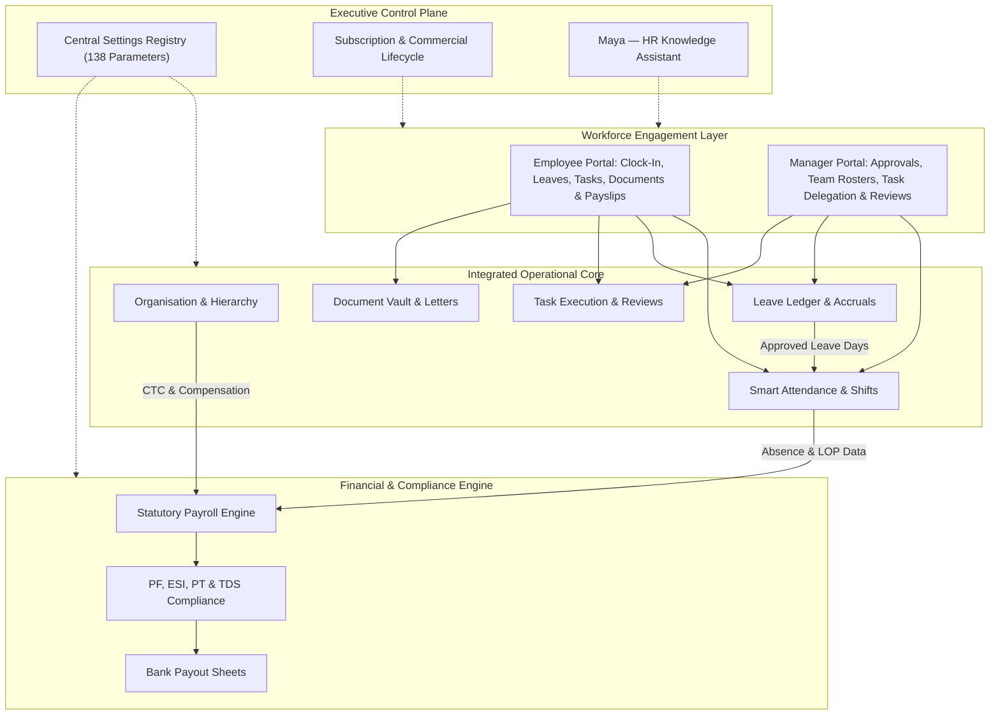
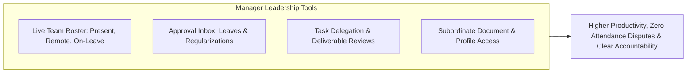
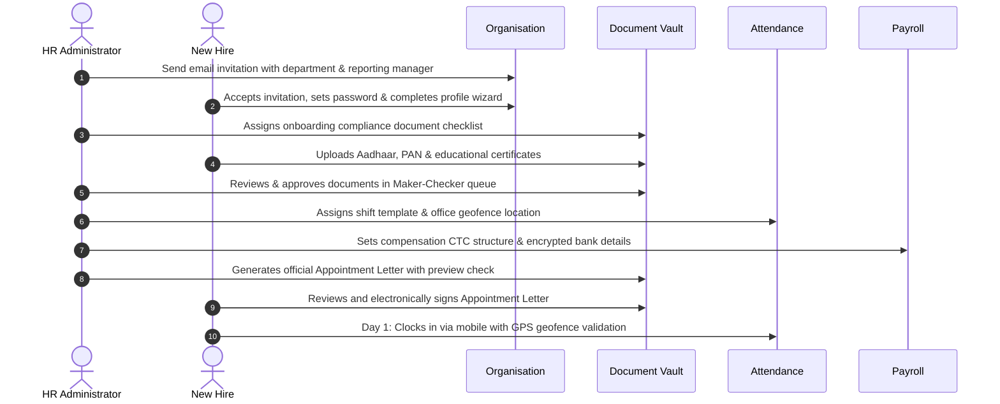
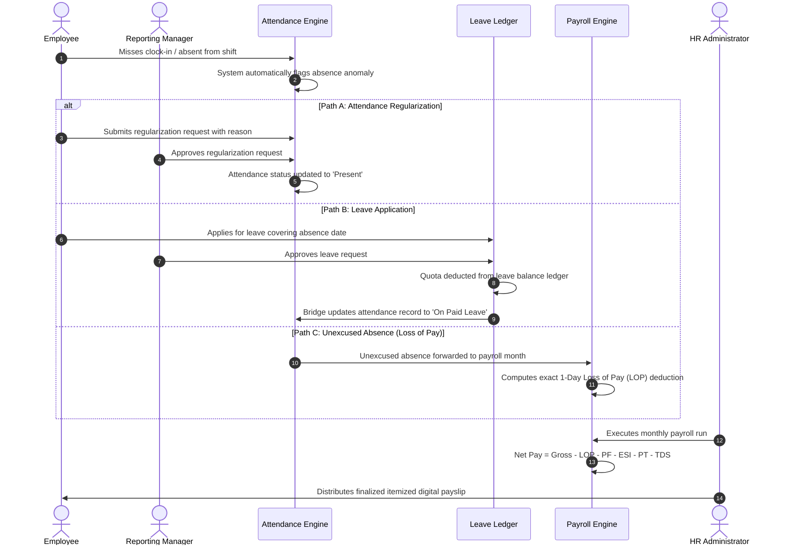

# HR Clouds — Comprehensive Product Features, Capabilities & Commercial Guide

**Document Title:** HR Clouds Comprehensive Product Features, Functional Architecture, Commercial Plans & Business Presentation Guide  
**Document Type:** Business-Oriented Product Feature Specification & Presentation Source  
**Document Version:** 4.0.0 (Executive & Commercial Edition)  
**Publication Date:** October 2026  
**Target Audience:** Business Owners, Managing Directors, Chief Human Resources Officers (CHROs), HR Managers, Operations Executives, Sales Engineers, and B2B SaaS Solution Consultants  
**Classification:** Official Product Capabilities & Commercial Reference  

---

<!-- PAGE BREAK -->

## Table of Contents

1. [Cover Page & Executive Framing](#1-cover-page--executive-framing)
2. [Executive Summary](#2-executive-summary)
3. [Business Challenges Addressed by HR Clouds](#3-business-challenges-addressed-by-hr-clouds)
4. [Introducing HR Clouds: The Unified Workforce Solution](#4-introducing-hr-clouds-the-unified-workforce-solution)
5. [Product Overview & Modular Architecture](#5-product-overview--modular-architecture)
6. [Detailed Module Capabilities](#6-detailed-module-capabilities)
   - [6.1 Organisation & Workplace Structure Management](#61-organisation--workplace-structure-management)
   - [6.2 Identity, Enterprise Security & Role-Based Access Control](#62-identity-enterprise-security--role-based-access-control)
   - [6.3 Smart Attendance Management, Shift Scheduling & Device Security](#63-smart-attendance-management-shift-scheduling--device-security)
   - [6.4 Leave Management & Balance Accounting Ledger](#64-leave-management--balance-accounting-ledger)
   - [6.5 Task Assignment, Delegation & Quality Review Workflows](#65-task-assignment-delegation--quality-review-workflows)
   - [6.6 Document Management, Compliance & Automated Letter Generation](#66-document-management-compliance--automated-letter-generation)
   - [6.7 Payroll Processing, Compensation & Statutory Compliance](#67-payroll-processing-compensation--statutory-compliance)
   - [6.8 Centralised Governance & Enterprise Settings Registry](#68-centralised-governance--enterprise-settings-registry)
   - [6.9 Maya — Conversational HR Knowledge Assistant](#69-maya--conversational-hr-knowledge-assistant)
7. [Employee Experience: Self-Service & Daily Productivity](#7-employee-experience-self-service--daily-productivity)
8. [HR Team Experience: Streamlined Administration & Compliance](#8-hr-team-experience-streamlined-administration--compliance)
9. [Manager Experience: Team Leadership & Operational Oversight](#9-manager-experience-team-leadership--operational-oversight)
10. [Business Owner and Executive Experience: Visibility & Governance](#10-business-owner-and-executive-experience-visibility--governance)
11. [Connected Business Workflows: How Modules Work Together](#11-connected-business-workflows-how-modules-work-together)
12. [Dashboards, Reporting & Business Intelligence](#12-dashboards-reporting--business-intelligence)
13. [Intelligent Automation & Background Operations](#13-intelligent-automation--background-operations)
14. [Enterprise Security, Privacy & Compliance Controls](#14-enterprise-security-privacy--compliance-controls)
15. [Subscription Plans, Pricing & Commercial Terms](#15-subscription-plans-pricing--commercial-terms)
16. [Comprehensive Feature-to-Plan Comparison Matrix](#16-comprehensive-feature-to-plan-comparison-matrix)
17. [Business Value & Strategic Differentiators](#17-business-value--strategic-differentiators)
18. [Real-World Business Scenarios in Action](#18-real-world-business-scenarios-in-action)
19. [Product Demonstration Narrative & Presentation Sequence](#19-product-demonstration-narrative--presentation-sequence)
20. [Business-Focused PowerPoint Slide Deck Blueprint](#20-business-focused-powerpoint-slide-deck-blueprint)
21. [Commercial & Product Clarification Checklist](#21-commercial--product-clarification-checklist)

---

<!-- PAGE BREAK -->

## 1. Cover Page & Executive Framing

### Platform Identity
- **Product Name:** HR Clouds
- **Category:** Unified Cloud Human Resource Management & Payroll System (HRMS)
- **Tagline:** The Intelligent, Ledger-Backed Workforce Operating System for Growing Businesses
- **Core Promise:** Eliminating administrative friction by uniting employee records, geofenced attendance, automated leave accounting, accountable task delivery, compliance documentation, and statutory payroll into a single, cohesive cloud platform.

### Target Market
- **Primary Market:** Fast-growing micro, small, and mid-sized enterprises (1 to 300+ employees) in India and global business markets seeking statutory rigor, automated operations, and complete employee self-service.
- **Workforce Models Supported:** In-office physical branches, multi-city operations, remote knowledge workers, field sales teams, and rotating-shift manufacturing operations.

---

<!-- PAGE BREAK -->

## 2. Executive Summary

**HR Clouds** is a modern, cloud-native Human Resource Management System designed to centralise and automate the complete employee journey—from initial recruitment offer and digital onboarding through daily time tracking, leave approvals, operational task delegation, document compliance verification, statutory payroll disbursement, and full-and-final exit settlements.

### What HR Clouds Delivers
Rather than forcing growing businesses to juggle disconnected software applications for attendance tracking, manual leave spreadsheets, email-based task management, word-processed employment letters, and external payroll bureaus, HR Clouds delivers a **single, secure source of operational truth**.

```
┌────────────────────────────────────────────────────────────────────────┐
│                   THE HR CLOUDS VALUE ECOSYSTEM                        │
├────────────────────────────────────────────────────────────────────────┤
│  EMPLOYEE SELF-SERVICE  │  Transparent punch, leave wallet, payslips  │
│  MANAGER LEADERSHIP     │  Rosters, regularizations, task reviews      │
│  HR COMMAND CENTER      │  Statutory payroll, letters, compliance     │
│  EXECUTIVE GOVERNANCE   │  Company-wide visibility, budgets & audits  │
└────────────────────────────────────────────────────────────────────────┘
```

### Core Business Pillars
1. **Double-Entry Operational Integrity:** Attendance records, leave balances, and financial compensation operate on transactional ledger principles. Leave days cannot be double-spent, attendance anomalies are automatically converted to loss-of-pay deductions, and loan repayments are deducted directly from salary without manual formula intervention.
2. **True Tenant Data Isolation:** Each customer organisation operates within a logically isolated workspace. Proprietary corporate records, employee financial details, and salary disbursements remain completely secure and strictly segregated.
3. **Out-of-the-Box Indian Statutory Compliance:** Pre-configured calculation engines for Provident Fund (PF), Employees' State Insurance (ESI), Professional Tax (PT) across regional state slabs, and Income Tax withholding (TDS) under both Old and New Tax Regimes.
4. **Zero-Friction Self-Service:** Intuitive web and mobile interfaces empower employees to clock in with GPS geofence verification, track leave balances, review assigned tasks, sign company policies electronically, and download digital payslips without administrative back-and-forth.
5. **Predictable, Headcount-Aligned Pricing:** Transparent subscription plans starting at ₹0 for micro teams, scaling affordably through monthly and yearly options with automated self-service upgrades and no hidden onboarding fees.

---

<!-- PAGE BREAK -->

## 3. Business Challenges Addressed by HR Clouds

Modern organisations frequently encounter administrative hurdles that drain productive hours, expose companies to compliance penalties, and frustrate employees. HR Clouds directly addresses these common operational pain points:

| Traditional Business Challenge | Operational Consequence | HR Clouds Solution |
|---|---|---|
| **Fragmented HR Tools & Spreadsheets** | Employee data is scattered across files, resulting in conflicting records, duplicate data entry, and lost time. | A single, unified cloud database connecting employee records, attendance, leave, tasks, documents, and payroll. |
| **Attendance Fraud & Time Theft** | "Buddy punching", inaccurate paper timesheets, and unverifiable remote hours inflate payroll expenses. | Multi-mode clocking with GPS geofencing, trusted device browser binding, and biometric hardware integration. |
| **Leave Discrepancies & Accrual Errors** | Manual leave tracking leads to disputes over balances, unearned time-off consumption, and policy friction. | An automated balance ledger with monthly accruals, year-end rollovers, demographic eligibility rules, and sandwich rules. |
| **Manual Payroll Calculation Risks** | Spreadsheet payroll is prone to formula errors, missed loss-of-pay deductions, and statutory compliance penalties. | An automated 5-stage payroll engine that synchronizes attendance absences directly into net salary and tax deductions. |
| **Disorganized Document Management** | Physical paper files and unsecured email attachments create privacy breaches and compliance audit exposures. | Direct, secure cloud document vault with digital signatures, verification workflows, and automated letter generation. |
| **Unaccountable Task Delegation** | Assignments made via chat apps or verbal requests get lost, resulting in missed project deadlines. | Structured task delegation with mandatory deadlines, first-view read receipts, deliverable review loops, and SLA tracking. |
| **Complex Statutory Compliance** | Keeping up with PF wage ceilings, ESI thresholds, varying state Professional Tax slabs, and dual income tax regimes. | Built-in statutory calculation engines that automatically apply correct regional tax rules and compute Form 16 projections. |

---

<!-- PAGE BREAK -->

## 4. Introducing HR Clouds: The Unified Workforce Solution

HR Clouds is built on the philosophy that human resource management should be frictionless, transparent, and mathematically precise. When core operational workflows communicate seamlessly, administrative overhead drops significantly, payroll disputes disappear, and management gains real-time visibility into workforce productivity.

### The Unified Architecture: How Information Flows



### Key Architectural Strengths from a Business Perspective
- **Real-Time Cross-Module Communication:** Attendance data feeds directly into leave calculations; approved leaves protect employees from unexcused absence penalties; unexcused absences automatically flow into payroll as Loss-of-Pay (LOP) deductions.
- **Enterprise-Grade Role Segregation:** Seven distinct user levels ensure that platform administrators, HR managers, team leaders, and employees only see the data and operational actions relevant to their responsibilities.
- **Auditable & Compliant Operations:** Every setting change, leave deduction, regularization approval, and document acknowledgement generates an immutable audit record, providing complete peace of mind during internal and statutory audits.

---

<!-- PAGE BREAK -->

## 5. Product Overview & Modular Architecture

HR Clouds provides eight deeply integrated core modules, an enterprise configuration registry, and an intelligent conversational assistant:

1. **Organisation & Workplace Structure:** Company profile management, branch locations, department hierarchies, Head of Department (HOD) appointments, and interactive visual organisational charts.
2. **Identity, Enterprise Security & Access Control:** Multi-factor authentication via email OTPs, Google Single Sign-On (SSO), multi-organisation context switching, and role-based permissions.
3. **Smart Attendance & Shift Scheduling:** Multi-mode time tracking, GPS geofencing (on-site, remote, hybrid, and field modes), shift templates, night shifts, break tracking, regularization approval workflows, and biometric hardware connectivity.
4. **Leave Management & Balance Accounting:** Master leave catalogs, demographic eligibility rules, pro-rata balance math, automated monthly accruals, year-end carry-forwards, sandwich rules, and loss-of-pay fallbacks.
5. **Task Assignment & Quality Review Workflows:** Structured task delegation, SLA deadline enforcement, first-view read receipts, deliverable submission and review loops, and in-task collaboration feeds.
6. **Document Management & Automated Letter Generation:** Secure cloud storage, Maker-Checker identity verification queues, targeted corporate policy distribution, digital signatures, and automated dynamic PDF letter generation with company letterhead branding.
7. **Payroll Processing & Statutory Compliance:** CTC compensation structures, attendance-driven loss-of-pay deductions, employee loan disbursements, reimbursement claims, multi-state Indian statutory compliance (PF, ESI, PT, TDS), and digital payslip distribution.
8. **Centralised Governance & Settings Registry:** A unified control plane managing 138 configuration parameters across 26 groups with optimistic update safeguards, high-risk mutation warnings, and full audit histories.
9. **Maya — Conversational HR Assistant:** An embedded AI assistant answering workforce questions regarding company policies, leave entitlements, and system navigation in real time.

---

<!-- PAGE BREAK -->

## 6. Detailed Module Capabilities

```
┌────────────────────────────────────────────────────────────────────────┐
│             MODULE 1: ORGANISATION & WORKPLACE STRUCTURE               │
└────────────────────────────────────────────────────────────────────────┘
```

### 6.1 Organisation & Workplace Structure Management

#### Executive Summary
The Organisation module establishes the foundational digital structure of the company. It maps physical branch locations, departmental divisions, leadership roles, and reporting lines into a single, cohesive organisational directory.

#### Business Purpose & Problems Solved
- **Eliminates Structural Ambiguity:** Clarifies who reports to whom, preventing confusion over approval responsibilities and departmental budgets.
- **Supports Multi-Location Operations:** Enables companies operating across multiple cities, branches, or warehouses to manage localized policies within a single platform.
- **Prevents Duplicate Workspaces:** Provides a streamlined setup wizard that guides HR administrators through establishing core company records without requiring complex technical onboarding.

#### Detailed Features & Capabilities
- **Multi-Tenant Workspace Provisioning:** Enables an organisation to establish an isolated corporate workspace with dedicated company settings, corporate branding, and employee directories.
- **Corporate Profile & Statutory Identifiers:** Centralises legal entity details including registered corporate name, trade alias, industry classification, corporate website, physical headquarters address, company PAN, and Goods & Services Tax Identification Number (GSTIN).
- **Secure Corporate Asset Management:** Direct cloud storage for company logos and branding collateral, automatically verifying file formats and dimensions for high-resolution display across web portals and official PDF documents.
- **Multi-Branch Office Locations:** Supports unlimited office locations with individualized address records, local business hours, timezones, and GPS coordinates for geofenced attendance verification.
- **Department Structuring & Leadership:** Hierarchical departmental setup with formal Head of Department (HOD) appointments, ensuring departmental budgets, approvals, and team rosters remain cleanly organized.
- **Interactive Visual Organisational Chart:** Live, automatically calculated organisational tree displaying multi-tier management reporting lines from executive leadership down to individual team contributors.
- **Employee Directory with Privacy Protection:** Centralised company directory searchable by name, department, or job title. Sensitive personal information (such as personal phone numbers, bank details, and PAN) is automatically masked to protect employee privacy.
- **Guided HR Setup Wizard:** An administrative checklist tracking completion across 8 essential profile fields (joining date, department, location, job title, employment type, work mode, gender, and marital status), preventing incomplete employee records.

#### Practical Use Cases
- A retail brand opens three new branch locations and instantly configures separate geofenced work zones with local branch managers.
- A growing technology company restructures its engineering teams, reassigning reporting lines that immediately update approval routing across leave and task modules.

#### Benefits by User Role
- **Employees:** Instant clarity on team hierarchy, peer contact information, and departmental structure.
- **Managers:** Clear visibility into direct and indirect team reports.
- **HR Administrators:** Centralised control over corporate entity data, branch profiles, and structural changes.
- **Business Owners:** Complete high-level visibility into company headcount distribution across departments and locations.

#### Important Workflows & Responsibility Routing
1. **Workspace Setup:** HR Administrator registers the organisation, enters statutory identifiers (PAN, GSTIN), and uploads official company logos.
2. **Branch & Department Configuration:** HR creates operational branches and departmental units, assigning designated Heads of Department.
3. **Staff Invitation:** HR sends email invitations with pre-assigned roles, departments, and reporting managers.
4. **Profile Completion:** Employees accept invitations and complete their personal profiles through the guided first-run wizard.

#### Configuration Options & Available Outputs
- **Customer Controls:** Add/modify branch locations, create departments, assign HODs, upload brand assets, and configure work mode defaults.
- **Available Reports & Outputs:** Downloadable organisational directory, department headcount summaries, and visual export of the company reporting hierarchy.

#### Dependencies, Plan Restrictions & Limitations
- Department heads must be active employees assigned to the department they lead.
- Core job profile fields (such as joining date and department) require administrative approval to change once verified.
- **Plan Availability:** Available on all subscription tiers (Free, Starter, Growth, and Internal Unlimited).

```
┌────────────────────────────────────────────────────────────────────────┐
│ PRESENTATION SLIDE BLUEPRINT                                           │
│ Slide Title: Organisational Foundation: Centralised Workplace Structure │
│ Key Talking Points:                                                    │
│ • Unified company directory with multi-branch location management      │
│ • Interactive visual organisational charts depicting live hierarchies  │
│ • Departmental leadership assignments with automated approval routing  │
│ • Guided onboarding wizard preventing incomplete employee records      │
│ Recommended Visual: Interactive Organisational Chart & Location Map    │
└────────────────────────────────────────────────────────────────────────┘
```

---

<!-- PAGE BREAK -->

```
┌────────────────────────────────────────────────────────────────────────┐
│           MODULE 2: IDENTITY, SECURITY & ACCESS CONTROL                │
└────────────────────────────────────────────────────────────────────────┘
```

### 6.2 Identity, Enterprise Security & Role-Based Access Control

#### Executive Summary
This module provides robust identity verification, secure credential management, and role-based operational permissions, ensuring employees and managers only access tools and data appropriate to their corporate responsibilities.

#### Business Purpose & Problems Solved
- **Prevents Unauthorised Data Access:** Ensures sensitive financial, personal, and payroll records cannot be accessed by unauthorized team members.
- **Eliminates Password Fatigue:** Supports modern Google Single Sign-On (SSO) and fast email one-time passwords (OTPs) alongside encrypted password logins.
- **Enables Multi-Entity Management:** Allows consultants, executives, and directors managing multiple sister companies to switch contexts instantly without repeated logins.

#### Detailed Features & Capabilities
- **Multi-Factor Email OTP Verification:** Supports password-less login and high-security account verification using expiring 6-digit numeric codes with automated rate-limiting against unauthorized access attempts.
- **Enterprise Password Encryption:** Protects user credentials using modern cryptographic encryption, safeguarding accounts against credential theft.
- **Google Single Sign-On (SSO):** One-click authentication using verified Google Workspace accounts, seamlessly matching corporate email domains to employee profiles.
- **Multi-Organisation Context Switching:** Enables users associated with multiple corporate entities to switch active workspaces with a single click, automatically reloading appropriate permissions and data views.
- **Granular 7-Tier Operational Role Hierarchy:**
  - *Super Admin & System Administrator:* Platform maintenance and technical health monitoring (strictly barred from viewing customer financial or document data).
  - *Worker:* Automated background process execution.
  - *HR Administrator:* Full administrative authority over company profile, employee records, leave rules, document templates, and payroll processing.
  - *Manager:* Team-level authority over direct reports, leave decisions, attendance regularizations, and task delegation.
  - *Employee:* Self-service access to personal profile, attendance clocking, leave requests, task execution, document uploads, and payslips.
  - *Guest:* Pre-onboarding or self-registration status with access limited to workspace registration and plan selection.
- **Secure Session Management:** Issues expiring digital access tokens and automatically rotating session keys, protecting against hijacked logins.

#### Practical Use Cases
- A group director overseeing two subsidiary companies switches between company portals in seconds without logging out.
- A newly hired staff member logs into their employee portal using Google Workspace SSO on their first day with zero setup delay.

#### Benefits by User Role
- **Employees:** Simple, secure access using work credentials; immediate access to self-service features.
- **Managers:** Focused view restricted strictly to their direct and indirect reports.
- **HR Administrators:** Complete administrative governance without the risk of unauthorized employee access to sensitive files.
- **Business Owners:** Total confidence that proprietary corporate and payroll information is protected.

#### Important Workflows & Responsibility Routing
1. **User Sign-In:** User enters work email and credentials, or authenticates via Google SSO.
2. **Context Determination:** If the user belongs to multiple organisations, an organisation selection screen displays available workspaces.
3. **Workspace Entry:** The user selects the intended organisation; the system immediately applies role-appropriate access permissions.

#### Configuration Options & Available Outputs
- **Customer Controls:** Choose authentication methods (Password + OTP or Google SSO), manage user role assignments, and deactivate departing staff accounts.
- **Available Reports & Outputs:** Active user session logs, role allocation rosters, and login security audit trails.

#### Dependencies, Plan Restrictions & Limitations
- Multi-organisation switching requires the same verified work email address across workspaces.
- Platform administrators cannot view confidential tenant data, maintaining strict customer privacy.
- **Plan Availability:** Available across all subscription tiers (Free, Starter, Growth, and Internal Unlimited).

```
┌────────────────────────────────────────────────────────────────────────┐
│ PRESENTATION SLIDE BLUEPRINT                                           │
│ Slide Title: Enterprise Identity & Security: Role-Based Governance     │
│ Key Talking Points:                                                    │
│ • 7 distinct operational roles protecting sensitive business data      │
│ • Frictionless access via Google Single Sign-On and email OTPs         │
│ • One-click context switching for multi-company business owners        │
│ • Industry-standard cryptographic encryption and automated safeguards  │
│ Recommended Visual: 7-Tier Role Permission Grid & Context Switcher UI  │
└────────────────────────────────────────────────────────────────────────┘
```

---

<!-- PAGE BREAK -->

```
┌────────────────────────────────────────────────────────────────────────┐
│            MODULE 3: SMART ATTENDANCE & SHIFT SCHEDULING               │
└────────────────────────────────────────────────────────────────────────┘
```

### 6.3 Smart Attendance Management, Shift Scheduling & Device Security

#### Executive Summary
The Attendance module automates working hour capture, validates physical presence through GPS geofencing and hardware integration, schedules rotating shifts, tracks breaks, and streamlines missed-punch regularization workflows.

#### Business Purpose & Problems Solved
- **Eliminates Time Theft & Buddy Punching:** Prevents employees from clocking in on behalf of absent colleagues through GPS location checks and trusted browser binding.
- **Accommodates Diverse Work Models:** Supports office workers, remote staff, hybrid teams, and mobile field personnel with customized location rules.
- **Replaces Manual Timesheets:** Removes the administrative burden of manually collecting and verifying paper or spreadsheet attendance at month-end.

#### Detailed Features & Capabilities
- **Flexible Multi-Mode Clock-In & Clock-Out:** Self-service punch recording through modern web browsers, mobile interfaces, and integrated biometric terminals.
- **Intelligent GPS Geofencing & Work Modes:**
  - *On-Site Mode:* Enforces GPS coordinate verification against registered office premises within a configurable radius (e.g., 50m to 200m).
  - *Remote Mode:* Permits punches from any location without geofence boundaries for telecommuting employees.
  - *Hybrid Mode:* Dynamically allows remote punches on authorized home days while enforcing geofences on designated office days.
  - *Field Mode:* Validates punches against dynamic client sites and project field locations for sales agents and service engineers.
- **Comprehensive Shift Management:**
  - Configurable shift templates with customized start times, end times, grace arrival periods, and half-day thresholds.
  - Seamless overnight shift support handling shifts that cross midnight without recording split days.
  - Shift rotation patterns allowing scheduled assignment of teams to alternating day and night shifts.
- **Real-Time Break Session Tracking:** Detailed logging of lunch and operational breaks throughout the workday to calculate net productive hours versus gross shift duration.
- **Self-Service Regularization Approval Loop:** Allows employees to submit regularization requests with documented reasons for missed punches, automatically updating attendance upon managerial approval.
- **Overtime Tracking & Automated Compensatory-Off (Comp-Off):** Tracks approved overtime hours and automatically credits earned comp-off days to the employee's leave wallet when working on weekends or public holidays.
- **Attendance Lock Periods:** Enables HR administrators to freeze attendance records for specific date windows, blocking retroactive modifications prior to payroll processing.
- **Trusted Device Browser Binding:** Eliminates proxy logins by registering trusted employee browsers and mobile hardware using unique hardware fingerprints.
- **Biometric Hardware Terminal Integration:** Ingests live attendance events directly from physical fingerprint, facial recognition, and RFID hardware terminals via secure cloud webhooks.

#### Practical Use Cases
- A logistics firm requires 40 field drivers to punch in only when physically present within assigned warehouse hubs.
- A 24/7 customer support center manages three daily shifts, automatically calculating night-shift premiums and overtime hours.

#### Benefits by User Role
- **Employees:** Simple mobile clock-in, instant visibility into daily work hours, and fast regularization requests.
- **Managers:** Live team presence dashboard; fast one-click review of late arrivals and regularization requests.
- **HR Administrators:** Automated attendance rosters, zero manual timesheet chasing, and locked data ready for payroll.
- **Business Owners:** Accurate tracking of labor costs, elimination of buddy punching, and verified field attendance.

#### Important Workflows & Responsibility Routing
1. **Daily Punch:** Employee clocks in via mobile or desktop. The system verifies work mode, shifts, and GPS coordinates.
2. **Anomaly Flagging:** If an employee is late or misses a punch, the system flags the anomaly on manager and employee dashboards.
3. **Regularization Submission:** Employee submits a regularization request with an explanatory note.
4. **Manager Decision:** Reporting manager reviews and approves the request; attendance status updates immediately to "Present".

#### Configuration Options & Available Outputs
- **Customer Controls:** Define shift hours, grace arrival windows, geofence radius distances, break policies, and attendance lock dates.
- **Available Reports & Outputs:** Daily attendance summaries, monthly muster rolls, shift rosters, overtime summaries, and regularization history.

#### Dependencies, Plan Restrictions & Limitations
- GPS geofencing requires mobile location services enabled on employee devices.
- **Plan Availability:** Standard web/browser attendance, shift scheduling, and regularizations are included in all tiers. Advanced GPS Geofencing and Field Radius verification are included in the **Growth** and **Internal Unlimited** plans.

```
┌────────────────────────────────────────────────────────────────────────┐
│ PRESENTATION SLIDE BLUEPRINT                                           │
│ Slide Title: Smart Attendance & Shifts: Geofenced Time Intelligence    │
│ Key Talking Points:                                                    │
│ • Multi-mode clocking: On-Site, Remote, Hybrid, and Mobile Field       │
│ • GPS geofence validation preventing time theft and proxy punches      │
│ • 24/7 rotating shifts, midnight spans, and break tracking             │
│ • Seamless regularization approvals and biometric hardware integration  │
│ Recommended Visual: Geofence Mobile Map Mockup & Shift Rotation Grid   │
└────────────────────────────────────────────────────────────────────────┘
```

---

<!-- PAGE BREAK -->

```
┌────────────────────────────────────────────────────────────────────────┐
│             MODULE 4: LEAVE MANAGEMENT & BALANCE LEDGER                │
└────────────────────────────────────────────────────────────────────────┘
```

### 6.4 Leave Management & Balance Accounting Ledger

#### Executive Summary
The Leave module operates an automated, rules-based engine for managing paid time-off, statutory leave entitlements, balance accruals, approval workflows, and year-end carry-forwards.

#### Business Purpose & Problems Solved
- **Eliminates Manual Balance Tracking:** Replaces messy spreadsheets with an automated, double-entry leave ledger that updates in real time.
- **Prevents Leave Over-Consumption:** Built-in safeguards stop employees from applying for more leave than their earned entitlement.
- **Enforces Company Time-Off Policies Automatically:** Built-in rules handle complex policies like sandwich rules, notice period caps, and demographic restrictions without manual scrutiny.

#### Detailed Features & Capabilities
- **Master Leave Type Catalog:** Supports standard and custom leave categories, including Casual Leave (CL), Sick Leave (SL), Earned/Privilege Leave (EL/PL), Maternity Leave, Paternity Leave, Comp-Offs, and Bereavement Leave.
- **Demographic & Policy Eligibility Rules:** Restricts specific leave types based on employee gender (e.g., Maternity Leave reserved for female staff) or marital status.
- **Notice Period Leave Safeguards:** Configurable controls to restrict or prohibit the consumption of paid leave days while an employee is serving a resignation notice period.
- **Mathematical Balance Ledger:** Double-entry ledger tracking accrued, consumed, pending, and remaining balances, including pro-rated allocations for mid-year joiners.
- **Automated Accruals & Rollovers:**
  - *Monthly Accrual Automation:* Automatically credits fractional leave quotas on the 1st of every month for monthly accrual policies.
  - *Year-End Rollover Automation:* Automatically calculates carry-forward limits, lapses expired balances, and allocates new annual quotas on January 1st.
- **Sandwich Rule Enforcement:** Identifies when an employee takes leave on both the working day before and after a weekend or public holiday, treating bridging non-working days as consumed leaves according to company policy.
- **Phantom Hold Balance Protection:** Places requested leave days in a reserved "pending hold" status immediately upon application, preventing employees from submitting overlapping requests.
- **Automatic Loss-of-Pay (LOP) Fallback:** Automatically splits leave requests into paid and unpaid days when an employee's requested time-off exceeds their available balance.
- **Centralised Policy Assignment Roster:** Enables HR teams to preview and execute bulk policy assignments across departments with clear coverage indicators (`on_policy`, `legacy`, `none`).

#### Practical Use Cases
- A new employee joining mid-year automatically receives a pro-rated leave balance based on remaining months in the calendar year.
- A staff member requests 5 days off with only 3 days of paid leave remaining; the system approves 3 days as paid and automatically routes 2 days as unpaid Loss-of-Pay (LOP) to payroll.

#### Benefits by User Role
- **Employees:** Real-time visibility into leave wallets, clear holiday calendars, and simple mobile application submission.
- **Managers:** Instant visibility into team leave schedules to prevent understaffing before approving requests.
- **HR Administrators:** Completely automated accruals and rollovers with zero spreadsheet calculations.
- **Business Owners:** Consistent, transparent policy enforcement across the entire company.

#### Important Workflows & Responsibility Routing
1. **Leave Application:** Employee views real-time leave balances and submits an application across selected dates.
2. **Policy Verification:** The system automatically checks eligibility, sandwich rules, and balance availability.
3. **Manager Review:** Direct manager receives an alert and reviews team coverage before approving or rejecting.
4. **Ledger Update:** Upon approval, days are debited from the balance ledger; if rejected, held balances are immediately released.

#### Configuration Options & Available Outputs
- **Customer Controls:** Define annual quotas, monthly accrual rates, carry-forward caps, sandwich rule toggles, and document attachment thresholds (e.g., medical certificates for sick leaves exceeding 2 days).
- **Available Reports & Outputs:** Individual leave balance statements, team leave calendars, year-end carry-forward reports, and unpaid leave deduction summaries.

#### Dependencies, Plan Restrictions & Limitations
- Managers cannot approve their own leave requests; self-approvals are strictly blocked and routed to higher leadership.
- Active leave policies cannot be deleted while employees remain assigned to them.
- **Plan Availability:** Available across all subscription tiers (Free, Starter, Growth, and Internal Unlimited).

```
┌────────────────────────────────────────────────────────────────────────┐
│ PRESENTATION SLIDE BLUEPRINT                                           │
│ Slide Title: Precision Leave Governance: Rules-Based Balance Engine    │
│ Key Talking Points:                                                    │
│ • Real-time leave balance ledger with pro-rated mid-year allocations   │
│ • Automated monthly accruals, year-end rollovers, and lapse management │
│ • Intelligent policy rules: Sandwich rules, demographic gating, LOP    │
│ • Self-service employee applications with conflict-free manager inbox  │
│ Recommended Visual: Leave Wallet Dashboard & Sandwich Rule Diagram    │
└────────────────────────────────────────────────────────────────────────┘
```

---

<!-- PAGE BREAK -->

```
┌────────────────────────────────────────────────────────────────────────┐
│               MODULE 5: TASK ASSIGNMENT & QUALITY REVIEWS              │
└────────────────────────────────────────────────────────────────────────┘
```

### 6.5 Task Assignment, Delegation & Quality Review Workflows

#### Executive Summary
The Task module provides structured work delegation, deliverable tracking, peer-to-peer task discussions, and managerial review workflows across teams.

#### Business Purpose & Problems Solved
- **Eliminates Lost Tasks & Unclear Ownership:** Moves task delegation out of chat channels and email threads into an accountable, auditable system.
- **Tracks Quality and Rework:** Introduces a formal review-and-reopen loop that tracks deliverable quality rather than simply marking tasks as finished.
- **Verifies Accountability with Read Receipts:** Automatically records when an employee first views an assigned task, removing "I didn't see the assignment" excuses.

#### Detailed Features & Capabilities
- **Role-Based Task Portals:** Dedicated views for Assignee Worklists, Managerial Delegation, and HR Cross-Department Governance.
- **Hierarchy-Enforced Delegation:** Managers assign tasks directly to team members within their reporting tree, while HR administrators can delegate cross-departmental assignments.
- **Zero Self-Assignment Policy:** Strict operational guard ensuring managers delegate work to team members rather than creating self-assigned clutter.
- **Task Priorities & SLA Deadline Controls:** Enables task classification by urgency (`low`, `medium`, `high`, `urgent`), category labels, and mandatory future deadlines.
- **First-View Timestamp Tracking:** Automatically records an immutable read receipt when an employee opens an assigned task, providing full transparency to managers.
- **Deliverable Submission Workflow:** Team members transition tasks from execution into review by attaching completed files, deliverables, and completion notes.
- **Maker-Checker Review & Reopen Loop:** Managers evaluate submitted work, either approving it as completed (recording on-time SLA metrics) or reopening it with documented feedback, tracking rework iterations.
- **In-Task Collaboration Feed:** Threaded discussion feed on every task allowing managers and assignees to share progress updates, clarifications, and file attachments.
- **Concurrent Edit Protection:** Built-in safeguards ensure that simultaneous updates by managers and assignees do not overwrite one another.

#### Practical Use Cases
- A marketing manager assigns website redesign deliverables to three team members with individual deadlines, monitoring submission files and approving completion.
- An operations lead reopens a submitted quality report with specific revision requests, maintaining a transparent audit trail of rework counts.

#### Benefits by User Role
- **Employees:** Clear, prioritized task list with transparent deadlines and a direct channel for questions and deliverables.
- **Managers:** Complete oversight of delegated assignments, first-view read receipts, and structured review controls.
- **HR Administrators:** Cross-department task visibility and team workload distribution insights.
- **Business Owners:** Measurable accountability, clear deliverable tracking, and objective performance metrics.

#### Important Workflows & Responsibility Routing
1. **Task Delegation:** Manager creates a task specifying assignee, priority, description, checklist items, and deadline.
2. **Acknowledgment:** Employee opens the task; the system records an immutable first-view timestamp.
3. **Execution & Submission:** Employee updates progress, posts discussion notes, attaches deliverables, and submits for review.
4. **Manager Evaluation:** Manager reviews deliverables and either marks the task completed or reopens it with revision feedback.

#### Configuration Options & Available Outputs
- **Customer Controls:** Define task categories, priority levels, default turnaround SLAs, and attachment size allowances.
- **Available Reports & Outputs:** Team task completion reports, overdue task summaries, rework frequency analysis, and individual on-time delivery rates.

#### Dependencies, Plan Restrictions & Limitations
- Tasks can only be delegated downward within the active reporting hierarchy or assigned globally by HR administrators.
- **Plan Availability:** Available across all subscription tiers (Free, Starter, Growth, and Internal Unlimited).

```
┌────────────────────────────────────────────────────────────────────────┐
│ PRESENTATION SLIDE BLUEPRINT                                           │
│ Slide Title: Accountable Work Execution: Task Delegation & Review Loops│
│ Key Talking Points:                                                    │
│ • Structured managerial delegation based on active reporting tree      │
│ • Immutable first-view read receipts verifying assignment awareness    │
│ • Deliverable submission with structured review, approve, or reopen    │
│ • Contextual discussion threads keeping project files organized        │
│ Recommended Visual: Task Kanban Board & Maker-Checker Review Lifecycle │
└────────────────────────────────────────────────────────────────────────┘
```

---

<!-- PAGE BREAK -->

```
┌────────────────────────────────────────────────────────────────────────┐
│             MODULE 6: DOCUMENT VAULT & LETTER GENERATION               │
└────────────────────────────────────────────────────────────────────────┘
```

### 6.6 Document Management, Compliance & Automated Letter Generation

#### Executive Summary
This module provides a secure digital document repository, Maker-Checker compliance verification queues, targeted corporate policy distribution, digital signature acknowledgements, and automated PDF letter generation.

#### Business Purpose & Problems Solved
- **Eliminates Paper Folders & Compliance Risks:** Centralises mandatory employee identity proofs, tax records, and educational certificates in a secure cloud repository.
- **Speeds Up Official Letter Issuance:** Replaces manual word-processing of offer letters, appointment letters, and increment letters with automated, dynamic templates.
- **Guarantees Policy Acknowledgement:** Ensures employees review and digitally sign company handbooks and compliance codes with full legal audit logging.

#### Detailed Features & Capabilities
- **Direct Secure Cloud Uploads:** File uploads and downloads transfer directly between employee browsers and secure cloud storage, ensuring sensitive files bypass intermediate servers.
- **Master Document Type Catalog:** Pre-configured catalog of standard employee documents (Aadhaar, PAN, Passport, Educational Degrees, Relieving Letters) that HR teams can customize.
- **Maker-Checker Verification Queue:** Administrative verification inbox where HR reviews uploaded identity and educational proofs, approving valid documents or rejecting invalid files with feedback.
- **Targeted Corporate Policy Distribution:** Publish employee handbooks, travel policies, and conduct guidelines targeted by department, location, employment type, or specific individuals.
- **Legally Binding Electronic Acknowledgements:** Captures digital signatures and click-through acknowledgements with complete forensic audit logs (IP address, timestamps, device information).
- **Onboarding & Offboarding Document Checklists:** Automatically assigns required document checklists to new hires, and executes clean document archiving upon employee exit.
- **Centralised Corporate Branding & Letterheads:** Configure official company branding, including logos, authorized digital signatory signatures, corporate registration numbers (CIN, GSTIN), and corporate brand colors.
- **Dynamic Letter Template Engine:** Generates personalized letters (Offer Letters, Appointment Letters, Experience Certificates, Promotion Letters) populated automatically with employee master data (joining date, CTC, designation, manager name).
- **Live Real-Subject In-Browser Preview:** Allows HR teams to generate an instant in-browser watermarked preview of any letter using actual employee data before final issuance.
- **Bulk Letter Issuance Batches:** Enables mass letter generation (such as annual salary increments or bonus letters) with background processing and error reporting.

#### Practical Use Cases
- HR uploads a revised code of conduct, requiring all 150 employees to review and digitally sign the policy within 7 days, tracking signatures on a real-time dashboard.
- HR issues 50 annual increment letters in a single batch, automatically pulling individual salary increases and generating personalized PDFs.

#### Benefits by User Role
- **Employees:** Secure self-service document vault; instant access to signed company letters and policies from anywhere.
- **Managers:** Fast verification of team compliance status and access to non-confidential team documents.
- **HR Administrators:** Zero manual letter drafting; complete document verification workflow with audit trails.
- **Business Owners:** Total compliance readiness for statutory audits; complete elimination of lost physical documents.

#### Important Workflows & Responsibility Routing
1. **Document Request:** System or HR requests specific onboarding documents from a newly hired employee.
2. **Employee Upload:** Employee uploads digital copies directly to the secure cloud repository.
3. **HR Verification:** HR reviews documents in the verification queue, marking them approved or requesting re-upload.
4. **Letter Generation:** HR selects a template, reviews a real-subject preview, and issues the official letter with a unique reference number.

#### Configuration Options & Available Outputs
- **Customer Controls:** Add custom document types, customize letterhead branding, upload authorized digital signatures, and create personalized letter templates.
- **Available Reports & Outputs:** Document collection status reports, policy signature audit logs, issued letter registers, and downloadable PDF letter archives.

#### Dependencies, Plan Restrictions & Limitations
- Generated letters require configured corporate letterhead assets and authorized signatory signatures.
- **Plan Availability:** Available across all subscription tiers (Free, Starter, Growth, and Internal Unlimited).

```
┌────────────────────────────────────────────────────────────────────────┐
│ PRESENTATION SLIDE BLUEPRINT                                           │
│ Slide Title: Document Vault & Letter Automation: Compliance Readiness │
│ Key Talking Points:                                                    │
│ • Secure cloud document vault with Maker-Checker verification queues   │
│ • Targeted policy publishing with legally binding digital signatures   │
│ • Dynamic letter generation: Offer, Appointment, and Increment letters │
│ • Instant real-subject in-browser previews and bulk batch distribution  │
│ Recommended Visual: Letterhead Customizer UI & Digital Signature Flow  │
└────────────────────────────────────────────────────────────────────────┘
```

---

<!-- PAGE BREAK -->

```
┌────────────────────────────────────────────────────────────────────────┐
│            MODULE 7: PAYROLL, COMPENSATION & STATUTORY COMPLIANCE      │
└────────────────────────────────────────────────────────────────────────┘
```

### 6.7 Payroll Processing, Compensation & Statutory Compliance

#### Executive Summary
The Payroll module automates gross-to-net salary computations, attendance-driven loss-of-pay deductions, loan EMI repayments, reimbursement payouts, Indian statutory compliance (PF, ESI, PT, TDS), and payslip distribution.

#### Business Purpose & Problems Solved
- **Eliminates Costly Payroll Calculation Errors:** Automates complex calculations, ensuring staff are paid accurately on time, every month.
- **Automatically Reconciles Attendance with Pay:** Seamlessly deducts unexcused absences and unpaid leaves directly from gross pay without manual spreadsheet cross-checks.
- **Ensures Indian Statutory Tax Compliance:** Automatically calculates Provident Fund, ESI, state-specific Professional Tax slabs, and Income Tax TDS, avoiding regulatory fines.

#### Detailed Features & Capabilities
- **Flexible Compensation Structure Templates:** Design customized Cost-to-Company (CTC) templates broken down into earnings (Basic, HRA, Conveyance, Special Allowance) and deductions.
- **Encrypted Bank Detail Management:** Protects sensitive employee bank account numbers and IFSC codes with industry-standard cryptographic encryption at rest.
- **Automated Loss of Pay (LOP) Integration:** Automatically cross-references attendance records, unpaid leaves, and unexcused absences, calculating exact per-day salary deductions.
- **Company Loan & Advance Management:** Disburses company loans, tracks installment schedules, and automatically deducts monthly EMIs during payroll runs.
- **Expense Reimbursement Lifecycle:** Employee expense claim submission with attached receipts, multi-level approvals, and automated addition to monthly salary payouts.
- **Compensatory-Off Encashment:** Converts approved compensatory off balances into gross salary earnings based on the employee's standard daily wage rate.
- **Structured 5-Stage Payroll Execution Workflow:** Controlled administrative stages: `Draft` -> `Processing` -> `Calculated` -> `Approved` -> `Paid`, allowing thorough review before disbursement.
- **Bank Disbursement Advice Sheets:** Generates bank-compliant payout CSV files alongside official signed covering documents with masked account numbers for secure bank transfers.
- **Built-In Indian Statutory Compliance Engines:**
  - *Provident Fund (PF):* Automated employee and employer contributions with statutory ceiling limits.
  - *Employees' State Insurance (ESI):* Wage ceiling evaluations and statutory deduction calculations.
  - *Professional Tax (PT):* Built-in multi-state slab calculation engines supporting regional tax rules across Indian states.
  - *Income Tax TDS Projections:* Evaluates Old and New Tax Regimes, incorporating employee investment declarations to project annual income tax withholdings.
- **Full & Final (F&F) Exit Settlements:** Generates comprehensive exit settlements balancing notice period pay/recovery, accrued leave encashment, and outstanding loan balances.
- **Digital Payslips with Inline Browser Preview:** Generates professional, itemized PDF payslips that employees can view directly in their browser or download securely.

#### Practical Use Cases
- An organization processes monthly payroll for 120 employees in under 15 minutes, automatically incorporating attendance LOP deductions and reimbursing approved travel claims.
- A resigning employee's exit settlement is calculated instantly, balancing 15 days of notice period recovery against 10 days of earned leave encashment.

#### Benefits by User Role
- **Employees:** On-time salary disbursement, transparent itemized payslips, and instant access to annual tax computation summaries.
- **Managers:** Visibility into approved team expense claims and attendance inputs affecting payroll.
- **HR Administrators:** Dramatic reduction in payroll processing time; elimination of manual spreadsheet formulas.
- **Business Owners:** Complete statutory compliance protection, transparent labor cost reporting, and encrypted banking security.

#### Important Workflows & Responsibility Routing
1. **Attendance Cutoff:** HR locks attendance for the payroll month to prevent retroactive timestamp alterations.
2. **Draft Initialization:** HR creates a monthly payroll draft. The system retrieves active salary structures and computes attendance LOP days.
3. **Adjustments:** System applies approved reimbursements, performance bonuses, and scheduled loan EMI deductions.
4. **Tax & Net Pay Calculation:** Statutory engines compute PF, ESI, PT, and TDS deductions. HR reviews variance reports against the previous month.
5. **Approval & Disbursement:** HR approves the run, downloads the bank disbursement sheet, marks the run paid, and automatically distributes digital payslips.

#### Configuration Options & Available Outputs
- **Customer Controls:** Customize salary components, configure CTC templates, set statutory contribution ceilings, and define payroll processing calendars.
- **Available Reports & Outputs:** Monthly salary registers, bank advice transfer sheets, statutory PF/ESI/PT deduction summaries, tax projection reports, and individual digital payslips.

#### Dependencies, Plan Restrictions & Limitations
- Bank disbursements require valid employee bank account details and IFSC codes.
- **Plan Availability:** Available across all subscription tiers (Free, Starter, Growth, and Internal Unlimited).

```
┌────────────────────────────────────────────────────────────────────────┐
│ PRESENTATION SLIDE BLUEPRINT                                           │
│ Slide Title: Precision Payroll & Statutory Compliance Engine           │
│ Key Talking Points:                                                    │
│ • Automated attendance-driven Loss of Pay (LOP) salary deductions      │
│ • Out-of-the-box Indian statutory compliance: PF, ESI, PT, and TDS    │
│ • Loan EMI deductions, expense reimbursements, and comp-off encashment │
│ • 5-stage approval workflow with bank payout sheets and digital slips   │
│ Recommended Visual: Gross-to-Net Calculation Flowchart & Sample Payslip│
└────────────────────────────────────────────────────────────────────────┘
```

---

<!-- PAGE BREAK -->

```
┌────────────────────────────────────────────────────────────────────────┐
│             MODULE 8: CENTRALISED GOVERNANCE & SETTINGS                │
└────────────────────────────────────────────────────────────────────────┘
```

### 6.8 Centralised Governance & Enterprise Settings Registry

#### Executive Summary
The Settings module acts as the central administrative control plane of HR Clouds. Rather than scattering configuration toggles across multiple screens, it unifies 138 configuration parameters into 26 structured governance groups.

#### Business Purpose & Problems Solved
- **Eliminates Configuration Chaos:** Centralises all operational, attendance, leave, document, and payroll policies into a single, structured control room.
- **Prevents Accidental Overwrites:** Protects against conflicting administrative edits when multiple HR administrators update settings simultaneously.
- **Safeguards High-Risk Modifications:** Enforces formal justification notes and explicit confirmation prompts before allowing changes to critical statutory or legal retention rules.

#### Detailed Features & Capabilities
- **Unified 138-Parameter System Registry:** Covers 26 functional groups, including attendance rules, leave accrual schedules, document letterhead branding, and payroll statutory percentages.
- **Strict Role-Based Governance:** Restricts setting modifications exclusively to authorized HR administrators, providing managers with read-only visibility into operational policies.
- **Optimistic Concurrency Protection:** Detects if another administrator has updated a setting in the background, preventing stale overwrites and data drift.
- **High-Risk Safeguards:** Critical changes—such as altering statutory tax percentages or modifying document retention periods—require a formal written business justification and explicit confirmation.
- **Comprehensive Change History:** Complete audit trail tracking every configuration change across the system, detailing who changed what setting, previous values, new values, timestamps, and stated reasons.

#### Practical Use Cases
- An HR Director updates the company's annual leave carry-forward limit, providing a mandatory business justification that is permanently recorded in the audit history.
- Two HR administrators simultaneously review attendance policies; the system prevents one administrator from inadvertently overwriting changes made by the other.

#### Benefits by User Role
- **HR Administrators:** A single, transparent control room to manage organizational policies without technical assistance.
- **Business Owners & Auditors:** Complete visibility into corporate policy changes and historical audit logs.

#### Dependencies, Plan Restrictions & Limitations
- Modifying high-risk settings mandates documented business justifications.
- **Plan Availability:** Available across all subscription tiers (Free, Starter, Growth, and Internal Unlimited).

```
┌────────────────────────────────────────────────────────────────────────┐
│ PRESENTATION SLIDE BLUEPRINT                                           │
│ Slide Title: Centralised Governance: Unified Settings Control Plane    │
│ Key Talking Points:                                                    │
│ • 138 system parameters organized across 26 functional categories      │
│ • Concurrency safeguards preventing accidental administrative overwrites│
│ • Mandatory business justification logs for high-risk policy changes   │
│ • Complete historical change audit trails for regulatory compliance    │
│ Recommended Visual: Settings Registry Category Grid & Audit History UI │
└────────────────────────────────────────────────────────────────────────┘
```

---

<!-- PAGE BREAK -->

```
┌────────────────────────────────────────────────────────────────────────┐
│              MODULE 9: MAYA — CONVERSATIONAL HR ASSISTANT              │
└────────────────────────────────────────────────────────────────────────┘
```

### 6.9 Maya — Conversational HR Knowledge Assistant

#### Executive Summary
"Maya" is an intelligent, floating conversational assistant embedded directly within the HR Clouds portal. Powered by structured organizational knowledge, Maya provides employees with instant answers to policy questions and guidance on platform navigation.

#### Business Purpose & Problems Solved
- **Reduces Repetitive HR Inquiries:** Answers common employee questions regarding leave balances, holiday schedules, and expense rules, freeing HR teams for strategic work.
- **Accelerates Employee Onboarding:** Guides new hires through company policies, document submissions, and profile completion in an interactive conversational format.

#### Detailed Features & Capabilities
- **Instant Policy Knowledge Retrieval:** Interprets natural language questions and provides accurate answers based on company handbooks, leave rules, and holiday calendars.
- **Navigation Assistance:** Guides employees directly to the appropriate self-service screens for clocking in, applying for leave, uploading proofs, or downloading payslips.
- **Floating Desktop & Mobile Widget:** Accessible from any screen within the application with a single click.

```
┌────────────────────────────────────────────────────────────────────────┐
│ PRESENTATION SLIDE BLUEPRINT                                           │
│ Slide Title: AI Workforce Support: Maya Conversational HR Assistant    │
│ Key Talking Points:                                                    │
│ • 24/7 instant answers to employee company policy and leave inquiries  │
│ • Reduces repetitive routine HR support tickets and email inquiries    │
│ • Context-aware guidance directing employees to self-service actions   │
│ Recommended Visual: Embedded Maya Chat Widget Interface Mockup         │
└────────────────────────────────────────────────────────────────────────┘
```

---

<!-- PAGE BREAK -->

## 7. Employee Experience: Self-Service & Daily Productivity

HR Clouds provides employees with an intuitive self-service portal designed to simplify their daily work life and provide immediate transparency into their employment records:

```
┌────────────────────────────────────────────────────────────────────────┐
│                 EMPLOYEE SELF-SERVICE EXPERIENCE                       │
├────────────────────────────────────────────────────────────────────────┤
│  DAILY ATTENDANCE     │ One-click web/mobile clock-in with GPS check   │
│  LEAVE WALLET         │ Real-time balances, holiday calendar & apply   │
│  WORK DELIVERABLES    │ Priority task list, discussions & attachments  │
│  DOCUMENT VAULT       │ Upload proofs, view signed letters & policies  │
│  FINANCIAL TRANSPARENCY│ Itemized digital payslips & tax projections   │
│  PROFILE MANAGEMENT   │ Update personal contact info and addresses     │
└────────────────────────────────────────────────────────────────────────┘
```

### Key Employee Capabilities
- **Effortless Clock-In & Time Tracking:** Punch in from web or mobile with automatic shift detection and clear feedback on on-time arrival.
- **Real-Time Leave Balances:** Check available casual, sick, and earned leave balances before applying; receive immediate notifications upon manager approval.
- **Clear Task Priorities:** View assigned tasks sorted by urgency and deadline, attach deliverables, and collaborate via task discussion feeds.
- **Digital Document Access:** Review and electronically sign official company policies, upload verification documents, and download employment letters on demand.
- **Confidential Payslip Access:** Inspect interactive digital payslips directly in-browser or download official PDFs with complete earnings and deduction breakdowns.

---

<!-- PAGE BREAK -->

## 8. HR Team Experience: Streamlined Administration & Compliance

For HR professionals, HR Clouds transforms time-consuming manual coordination into an automated, error-free operational workflow:

### Day-to-Day HR Superpowers
- **Automated Employee Onboarding:** Track new hire progress across mandatory profile fields and compliance document checklists.
- **Visual Workplace Administration:** Update department structures, assign branch locations, and maintain accurate reporting trees with zero IT intervention.
- **Automated Leave Administration:** Eliminate manual spreadsheets; system automatically calculates pro-rated allocations, monthly accruals, and year-end carry-forwards.
- **Document Verification Inbox:** Maker-Checker queue to inspect and verify uploaded employee identity proofs with single-click approval or rejection.
- **Automated Letter Generation:** Issue official offer, appointment, and increment letters populated with live employee data and company letterhead branding.
- **Fast, Stress-Free Payroll Processing:** Execute gross-to-net payroll in five structured stages with automatic attendance LOP deductions and statutory tax compliance.
- **Centralised Policy Governance:** Manage 138 organizational settings with built-in audit histories and safeguards against accidental overwrites.

---

<!-- PAGE BREAK -->

## 9. Manager Experience: Team Leadership & Operational Oversight

HR Clouds equips team leads and department managers with the operational tools required to manage their teams effectively without administrative friction:



### Key Managerial Capabilities
- **Live Team Presence Roster:** Real-time visibility into who is working on-site, working remotely, on leave, or absent.
- **Streamlined Approvals Inbox:** Review and approve incoming leave applications and attendance regularizations in seconds with clear context on team coverage.
- **Accountable Task Delegation:** Assign tasks directly to team members with clear deliverables, mandatory deadlines, and automatic first-view read receipts.
- **Quality Review Loops:** Inspect submitted deliverables, approve completed work, or reopen tasks with specific revision instructions to maintain quality standards.
- **Team Document Access:** View non-confidential employee records and propose official letters for team members subject to HR review.

---

<!-- PAGE BREAK -->

## 10. Business Owner and Executive Experience: Visibility & Governance

For company founders, managing directors, and executive leadership, HR Clouds provides strategic oversight and complete peace of mind:

### Executive Value Drivers
- **Complete Operational Transparency:** Executive dashboards provide real-time visibility into company headcount, department distributions, attendance trends, and payroll commitments.
- **Elimination of Labor Cost Leakage:** Enforces accurate time tracking and automatically reconciles unexcused absences into payroll loss-of-pay deductions, eliminating unearned compensation.
- **Statutory Audit Protection:** Standardized Indian statutory compliance (PF, ESI, Professional Tax, and Income Tax TDS) protects the company from regulatory non-compliance penalties.
- **Enterprise-Grade Data Security:** Strict tenant isolation, encrypted bank details, and role-based permissions safeguard proprietary corporate data.
- **Predictable, Scalable Software Investment:** Transparent headcount-based pricing that scales cleanly with business growth without unexpected licensing fees.

---

<!-- PAGE BREAK -->

## 11. Connected Business Workflows: How Modules Work Together

The true power of HR Clouds lies in the seamless interconnection of its modules. Below are four core cross-module business journeys:

### Workflow 1: New Hire Onboarding to Day-1 Productivity


---

### Workflow 2: Attendance-to-Leave-to-Payroll Bridge


---

### Workflow 3: Task Delegation, Review & Quality Assurance Loop
```mermaid
sequenceDiagram
    autonumber
    actor Mgr as Reporting Manager
    actor Emp as Assignee Team Member
    participant Task as Task Engine

    Mgr->>Task: Creates task with deadline, priority & deliverable requirements
    Emp->>Task: Opens task; system records immutable first-view read receipt
    Emp->>Task: Executes work, posts discussion updates & attaches deliverables
    Emp->>Task: Submits task for managerial review
    alt Work Meets Standards
        Mgr->>Task: Approves deliverable; task marked 'Completed' with SLA metric
    else Work Requires Revision
        Mgr->>Task: Reopens task with specific revision feedback
        Task->>Task: Increments rework count & alerts assignee
        Emp->>Task: Modifies deliverable and resubmits for approval
    end
```

---

### Workflow 4: Resignation, Notice Period & Full and Final (F&F) Settlement
```mermaid
sequenceDiagram
    autonumber
    actor Emp as Resigning Employee
    actor HR as HR Administrator
    participant Leave as Leave Ledger
    participant Doc as Document Vault
    participant Pay as Payroll Engine

    Emp->>HR: Submits formal resignation; notice period begins
    Leave->>Leave: Enforces notice period leave restriction rules
    HR->>Doc: Initiates offboarding checklist; archives document vaults
    HR->>Pay: Generates Full & Final (F&F) settlement statement
    Pay->>Pay: Balances notice recovery against earned leave encashment
    Pay->>Pay: Deducts outstanding loan balances & computes final net payout
    HR->>Doc: Issues Relieving & Experience Letters with live letterhead
    Emp->>Doc: Downloads official exit letters and final settlement payslip
```

---

<!-- PAGE BREAK -->

## 12. Dashboards, Reporting & Business Intelligence

HR Clouds delivers purpose-built visibility tailored to each operational role:

### 1. Employee Self-Service Dashboard
- **Today's Attendance Status:** Live punch status, clock-in timestamp, total active working hours, and current break duration.
- **Leave Wallet Snapshot:** Real-time quota meters displaying available Casual, Sick, and Earned Leave balances.
- **Active Task Cards:** Prioritized list of assigned tasks, approaching deadlines, and unread discussion notes.
- **Quick Action Bar:** Single-click clock-out, fast leave application, and latest payslip download.

### 2. Manager Leadership Dashboard
- **Team Presence Counter:** Real-time tally of present, absent, remote, and on-leave team members.
- **Actionable Approvals Inbox:** Consolidated cards highlighting pending leave applications, attendance regularizations, and comp-off claims.
- **Team Task Performance:** Summary of assigned tasks, completion rates, overdue deliverables, and active rework loops.

### 3. HR Executive Command Center
- **Workforce Demographics:** Live headcount distribution by branch location, department, employment type, and gender ratio.
- **Payroll Disbursement Summary:** Active payroll status, gross salary commitments, and loan recovery balances.
- **Compliance Health Meter:** Real-time tracking of mandatory document collection and policy signature acknowledgements.
- **System Audit Log:** Comprehensive feed tracking sensitive administrative events, role changes, and policy modifications.

### Reporting & Data Export Catalog
- **Attendance Muster Rolls:** Comprehensive monthly attendance matrices downloadable in spreadsheet-ready format.
- **Bank Disbursement Advice:** Bank-compliant payout sheets (CSV and signed covering PDF) with masked account numbers for secure wire transfers.
- **Statutory Deduction Summaries:** Monthly PF, ESI, and Professional Tax reports formatted for regulatory portal filings.
- **Income Tax Projection Sheets:** Detailed Form 16 preparation summaries comparing Old vs. New Tax Regimes.

---

<!-- PAGE BREAK -->

## 13. Intelligent Automation & Background Operations

HR Clouds features an automated background operations engine that runs continuously to handle routine administrative tasks without human intervention:

```
┌────────────────────────────────────────────────────────────────────────┐
│                   INTELLIGENT BACKGROUND AUTOMATION                    │
├────────────────────────────────────────────────────────────────────────┤
│ ATTENDANCE & SHIFTS    │ Auto-clock-out for unclosed shifts            │
│                        │ Automated absence detection & marking         │
│                        │ 90-day compensatory-off expiry sync           │
│                        │ Device pairing security challenge cleanup     │
├────────────────────────┼───────────────────────────────────────────────┤
│ LEAVE ACCOUNTING       │ Automated 1st-of-month leave quota accruals   │
│                        │ Jan 1st year-end carry-forward & rollover     │
├────────────────────────┼───────────────────────────────────────────────┤
│ TASK MANAGEMENT        │ Real-time overdue task flagging & SLA alerts  │
│                        │ Queued notification dispatch                  │
├────────────────────────┼───────────────────────────────────────────────┤
│ DOCUMENT LIFECYCLE     │ Document expiration monitoring & alerts       │
│                        │ Automated policy signature reminders          │
│                        │ Automatic policy assignment to new joiners    │
│                        │ Offboarding document archiving                │
├────────────────────────┼───────────────────────────────────────────────┤
│ PAYROLL & STATUTORY    │ Automated monthly draft payroll generation    │
│                        │ Cutoff and payment date reminders             │
│                        │ Automated encrypted payslip email delivery    │
├────────────────────────┼───────────────────────────────────────────────┤
│ COMMERCIAL BILLING     │ Subscription grace period monitoring          │
│                        │ Payment gateway reconciliation                │
└────────────────────────┴───────────────────────────────────────────────┘
```

---

<!-- PAGE BREAK -->

## 14. Enterprise Security, Privacy & Compliance Controls

HR Clouds implements rigorous security controls designed to safeguard corporate and personal data:

- **Logical Tenant Data Isolation:** Robust boundaries ensure that an organisation's data cannot be viewed or accessed by other tenants.
- **Protected Object-Level Authorization:** Built-in safeguards prevent managers or users from accessing records outside their authorized reporting tree.
- **Cryptographic Financial Security:** Employee bank account numbers and IFSC details are stored using authenticated encryption at rest; unauthenticated services receive masked numbers only (`XXXX` + last 4 digits).
- **Safe Document Cloud Transfers:** Employee documents upload and download directly between client browsers and secure cloud storage, ensuring binary payloads never traverse web application servers.
- **Formula-Injection Safe Data Exports:** All spreadsheet reports automatically neutralize spreadsheet formula injection vulnerabilities, protecting administrative computers.
- **Transactional Ledger Locks:** Critical operations—such as leave deductions, payment settlements, and task state changes—use transactional database locks to prevent race conditions or duplicate spending.
- **Audit Logging:** Comprehensive, searchable change logs record who made every configuration modification, previous values, new values, and stated business reasons.

---

<!-- PAGE BREAK -->

## 15. Subscription Plans, Pricing & Commercial Terms

HR Clouds offers transparent, predictable subscription tiers designed to scale affordably with organizational headcount growth:

### Commercial Foundation
- **Billing Currency:** Indian Rupee (`INR` / `₹`).
- **Pricing Structure:** All listed prices are **tax-inclusive** (GST is recorded at a 0.00% baseline in the current phase with extensible invoice breakdown schemas).
- **Billing Cycles Available:** Lifetime Free, Monthly Recurring, and Yearly Recurring.
- **Annual Savings Benefit:** Yearly plans include an automatic **17% discount** compared to 12 months of standard monthly billing.
- **Seat Allocation Governance:** Headcount caps for Employees, Managers, and HR Administrators are frozen at the time of subscription purchase.

---

### Official Subscription Plans Overview

| Plan Attribute | Free Plan | Starter Monthly | Starter Yearly | Growth Monthly | Growth Yearly | Internal Unlimited |
|---|:---:|:---:|:---:|:---:|:---:|:---:|
| **Plan Identifier** | `free` | `starter_monthly` | `starter_yearly` | `growth_monthly` | `growth_yearly` | `internal_unlimited` |
| **Target Customer** | Micro teams & trial setups | Growing businesses | Growing businesses (Best Value) | Established organisations | Scaled enterprises | Internal testing & enterprise partners |
| **Price (INR)** | **₹0.00** | **₹49.00** | **₹500.00** | **₹99.00** | **₹990.00** | **₹0.00** |
| **Billing Cycle** | Perpetual Free | Monthly | Yearly (Save 17%) | Monthly | Yearly (Save 17%) | Lifetime (Private) |
| **Employee Capacity** | **10** | **20** | **20** | **300** | **300** | **Unlimited** |
| **Manager Capacity** | **2** | **5** | **5** | **10** | **10** | **Unlimited** |
| **HR Admin Capacity** | **1** | **2** | **2** | **5** | **5** | **Unlimited** |
| **Grace Period** | 3 Days | 3 Days | 3 Days | 3 Days | 3 Days | 0 Days |
| **Catalogue Status** | Public Self-Service | Public Self-Service | Public Self-Service | Public Self-Service | Public Self-Service | **Private / Enterprise** |
| **Included Capabilities** | Core Modules | Core Modules | Core Modules | Core Modules + GPS Geofencing | Core Modules + GPS Geofencing | All Capabilities Unlocked |

---

### Subscription Lifecycle & Commercial Terms
- **Instant Prorated Upgrades:** Upgrading to a higher tier credits unused days on the current plan toward the new subscription, charging only the net prorated difference immediately.
- **Scheduled Cycle-End Downgrades:** Downgrading to a lower plan takes effect at the end of the active billing period, ensuring uninterrupted service while checking that active headcount fits within target plan limits.
- **3-Day Renewal Grace Period:** If a payment method fails at renewal, the organisation enters a 3-day grace period with full service continuity while automated notifications prompt renewal.
- **Cancellation Terms:** Users may cancel subscriptions at any time; access remains fully active until the conclusion of the paid billing period.
- **Gapless GST Tax Invoicing:** Every completed payment generates a legally compliant, sequentially numbered GST tax invoice (`INV-YYYY-YY-XXXXXX`) downloadable directly from the billing portal.

---

<!-- PAGE BREAK -->

## 16. Comprehensive Feature-to-Plan Comparison Matrix

The table below provides a clear, presentation-ready comparison of software capabilities across subscription plans:

| Feature / Functional Capability | Free Plan (₹0) | Starter Plans (₹49/mo · ₹500/yr) | Growth Plans (₹99/mo · ₹990/yr) | Internal Unlimited |
|---|:---:|:---:|:---:|:---:|
| **Maximum Employee Seats** | 10 Seats | 20 Seats | 300 Seats | Unlimited |
| **Maximum Manager Seats** | 2 Seats | 5 Seats | 10 Seats | Unlimited |
| **Maximum HR Admin Seats** | 1 Seat | 2 Seats | 5 Seats | Unlimited |
| **Organisation & Branch Management** | Included | Included | Included | Included |
| **Department & HOD Setup** | Included | Included | Included | Included |
| **Interactive Visual Org Chart** | Included | Included | Included | Included |
| **Standard Web & Browser Clocking** | Included | Included | Included | Included |
| **Shift Management & Rotations** | Included | Included | Included | Included |
| **Break Tracking & Net Hours** | Included | Included | Included | Included |
| **Attendance Regularization Approvals** | Included | Included | Included | Included |
| **Overtime & Comp-Off Tracking** | Included | Included | Included | Included |
| **Trusted Device Browser Binding** | Included | Included | Included | Included |
| **Biometric Hardware Webhook** | Included | Included | Included | Included |
| **GPS Geofencing & Field Radius** | **Not Included** | **Not Included** | **Included** | **Included** |
| **Leave Management & Balances** | Included | Included | Included | Included |
| **Sandwich Rules & Pro-Rata Math** | Included | Included | Included | Included |
| **Automated Monthly Leave Accruals** | Included | Included | Included | Included |
| **Task Delegation & SLA Tracking** | Included | Included | Included | Included |
| **Deliverable Reviews & Discussions** | Included | Included | Included | Included |
| **Document Vault & S3 Storage** | Included | Included | Included | Included |
| **Digital Signatures & Policy Publishing**| Included | Included | Included | Included |
| **Dynamic Letter Generation & Preview** | Included | Included | Included | Included |
| **Bulk Letter Issuance Batches** | Included | Included | Included | Included |
| **CTC Compensation Structures** | Included | Included | Included | Included |
| **Attendance-Driven LOP Deductions** | Included | Included | Included | Included |
| **Indian Statutory Compliance (PF/ESI/PT)**| Included | Included | Included | Included |
| **Income Tax TDS (Old & New Regimes)**| Included | Included | Included | Included |
| **Bank Advice Sheets (CSV & PDF)** | Included | Included | Included | Included |
| **Full & Final (F&F) Settlements** | Included | Included | Included | Included |
| **Centralised Settings Registry (138)** | Included | Included | Included | Included |
| **Maya — Conversational HR Assistant** | Included | Included | Included | Included |
| **Recruitment (ATS)** | Roadmap | Roadmap | **Entitled (Roadmap)** | **Entitled (Roadmap)** |
| **Performance Appraisals & OKRs** | Roadmap | Roadmap | Roadmap | Roadmap |

---

<!-- PAGE BREAK -->

## 17. Business Value & Strategic Differentiators

Organizations choose HR Clouds for five strategic reasons:

1. **A Single Unified Platform vs. Disconnected Point Solutions:** Rather than purchasing separate software for attendance, leave tracking, project tasks, document storage, and payroll, HR Clouds consolidates the entire workforce lifecycle into one cohesive platform, reducing total software costs and eliminating duplicate data entry.
2. **Attendance-Synchronized Payroll Accuracy:** Unlike traditional payroll tools that rely on manual spreadsheet imports, HR Clouds directly converts attendance logs, approved leaves, and unexcused absences into mathematically exact loss-of-pay deductions, eliminating payroll calculation errors.
3. **Double-Entry Ledger Integrity:** Leave balances and financial compensations are tracked with mathematical ledger precision, preventing double-spending of leave quotas and ensuring audit-proof financial records.
4. **Native Indian Statutory Readiness:** Out-of-the-box support for regional state Professional Tax slabs, PF wage ceilings, ESI thresholds, and dual-regime Income Tax TDS computations ensures immediate compliance without expensive consultant configurations.
5. **Modern, Responsive Cloud Architecture:** Built on high-performance cloud technologies delivering sub-second response times, zero software bloat, and an intuitive user experience on both desktop and mobile devices.

---

<!-- PAGE BREAK -->

## 18. Real-World Business Scenarios in Action

### Scenario 1: Fast-Growing IT Consulting Firm (Scaling from 15 to 75 Employees)
- **Challenge:** The company was managing attendance through chat messages, tracking leaves in spreadsheets, and manually drafting appointment and increment letters in Microsoft Word.
- **HR Clouds Implementation:**
  - Upgraded from the Starter tier to the **Growth Plan**.
  - Configured standardized CTC structures and automated monthly leave accruals.
  - Used the dynamic letter engine to issue branded appointment letters and annual increment letters in bulk.
- **Business Outcome:** Eliminated manual letter drafting, achieved 100% on-time payroll processing, and provided new hires with a professional digital onboarding experience.

### Scenario 2: Logistics & Field Services Company (50 Field Agents Across 4 Cities)
- **Challenge:** Remote field agents were manually submitting paper timesheets, resulting in frequent attendance disputes, proxy clocking, and delayed travel reimbursement payouts.
- **HR Clouds Implementation:**
  - Deployed the **Growth Plan** with GPS Geofencing and Field Radius validation.
  - Configured client warehouse hubs as authorized field locations.
  - Enabled mobile expense reimbursement submissions with attached photo receipts.
- **Business Outcome:** Eliminated proxy clocking, automated field presence verification, and seamlessly merged approved travel expenses directly into monthly payroll disbursements.

### Scenario 3: 24/7 Manufacturing Facility (Rotating Shifts & Overtime)
- **Challenge:** The factory struggled with tracking complex three-shift rotations, midnight-spanning shifts, and manually calculating compensatory offs for weekend overtime.
- **HR Clouds Implementation:**
  - Configured rotating shift templates with automated midnight span handling.
  - Integrated on-premise biometric hardware terminals with cloud webhooks.
  - Enabled automated compensatory-off crediting for holiday overtime.
- **Business Outcome:** Automated shift management, accurate overtime tracking, and automatic crediting of earned comp-off days to employee leave wallets without administrative disputes.

---

<!-- PAGE BREAK -->

## 19. Product Demonstration Narrative & Presentation Sequence

For sales engineers, product consultants, and executive demonstrators, the following **30-minute structured presentation flow** delivers a compelling overview of HR Clouds:

```
┌────────────────────────────────────────────────────────────────────────┐
│                   RECOMMENDED 30-MINUTE DEMO TIMELINE                  │
├───────────┬────────────────────────────────────────────────────────────┤
│ 00–05 MIN │ Executive Overview & Workspace Hierarchy                   │
│           │ • Showcase multi-tier org tree, branches & company profile │
│           │ • Emphasize single source of truth and data isolation      │
├───────────┼────────────────────────────────────────────────────────────┤
│ 05–10 MIN │ Employee Self-Service & Smart Attendance                   │
│           │ • Demo mobile clock-in with GPS geofence radius check      │
│           │ • Showcase leave balance wallet and instant application    │
├───────────┼────────────────────────────────────────────────────────────┤
│ 10–15 MIN │ Manager Leadership Portal & Task Delegation                │
│           │ • Review live team presence and approve regularizations    │
│           │ • Delegate a task, show read-receipt & review deliverable  │
├───────────┼────────────────────────────────────────────────────────────┤
│ 15–20 MIN │ Document Vault & Live Letterhead Automation                │
│           │ • Inspect Maker-Checker document verification queue        │
│           │ • Preview live appointment letter and issue branded PDF    │
├───────────┼────────────────────────────────────────────────────────────┤
│ 20–25 MIN │ Full 5-Stage Payroll Execution & Statutory Compliance      │
│           │ • Demonstrate automatic attendance LOP deduction sync      │
│           │ • Show PF/ESI/PT/TDS calculation & generate payslips       │
├───────────┼────────────────────────────────────────────────────────────┤
│ 25–30 MIN │ Commercial Plans, Self-Service Billing & Executive Q&A     │
│           │ • Walk through transparent pricing plans (Free to Growth)  │
│           │ • Highlight instant upgrades, GST invoicing, and next steps│
└───────────┴────────────────────────────────────────────────────────────┘
```

---

<!-- PAGE BREAK -->

## 20. Business-Focused PowerPoint Slide Deck Blueprint

The following 14-slide blueprint provides presentation-ready slide titles, core messages, supporting talking points, and recommended visual layouts for creating professional business PowerPoint presentations:

### Slide 1: Title & Vision
- **Slide Title:** HR Clouds: The Intelligent Workforce Operating System
- **Core Message:** Unifying employee records, smart attendance, leave accounting, task delivery, and statutory payroll into a single cloud ecosystem.
- **Supporting Points:**
  - Designed for modern growing businesses (1 to 300+ employees)
  - Eliminates administrative silos and manual spreadsheets
  - Real-time operational visibility across desktop and mobile
- **Recommended Visual:** High-resolution platform overview mockup displaying desktop and mobile dashboards.

### Slide 2: The Core Business Challenge
- **Slide Title:** The Cost of Fragmented HR Operations
- **Core Message:** Disconnected tools and manual processes create administrative friction, payroll errors, and compliance vulnerabilities.
- **Supporting Points:**
  - Attendance fraud and buddy punching inflate labor expenses
  - Spreadsheet leave tracking causes balance disputes and unearned time-off
  - Disconnected payroll calculations result in costly statutory errors and audit penalties
  - Scattered employee files expose companies to data privacy risks
- **Recommended Visual:** Split-screen comparison: "Fragmented Chaos (5 Disconnected Tools)" vs. "HR Clouds Unified Harmony".

### Slide 3: The Unified Solution Architecture
- **Slide Title:** An Integrated Platform from Onboarding to Payroll
- **Core Message:** A single database architecture where attendance, leave, tasks, documents, and payroll communicate in real time.
- **Supporting Points:**
  - True multi-tenant data isolation protecting corporate privacy
  - Double-entry ledger integrity across leaves and financial records
  - Seven-tier role hierarchy ensuring appropriate data access
- **Recommended Visual:** Architectural ecosystem diagram showing data flowing from Employee Self-Service into Payroll and Compliance.

### Slide 4: Workplace Hierarchy & Structure
- **Slide Title:** Organisational Foundation: Multi-Branch & Department Management
- **Core Message:** Establish clear reporting hierarchies and multi-location branch structures with zero IT complexity.
- **Supporting Points:**
  - Centralised corporate profile with statutory identifiers (PAN, GSTIN)
  - Multi-branch location management with individual timezones and coordinates
  - Interactive, automatically rendered visual organisational charts
  - Guided HR setup wizard ensuring complete employee records
- **Recommended Visual:** Interactive organizational tree screenshot alongside multi-location branch cards.

### Slide 5: Smart Attendance & Shift Intelligence
- **Slide Title:** Smart Attendance: Geofenced Time & Schedule Intelligence
- **Core Message:** Accurate working hour capture across office, remote, hybrid, and mobile field teams.
- **Supporting Points:**
  - GPS geofencing radius validation eliminating buddy punching
  - 24/7 flexible shift templates with seamless overnight midnight-span handling
  - Self-service missed punch regularizations with fast manager approvals
  - Trusted device browser binding and biometric hardware integration
- **Recommended Visual:** Mobile smartphone mockups showing GPS geofence clock-in and shift rotation schedule.

### Slide 6: Precision Leave Governance
- **Slide Title:** Automated Leave Governance: Rules-Based Balance Engine
- **Core Message:** Transparent leave management with mathematical balance ledgers and automated policy enforcement.
- **Supporting Points:**
  - Real-time leave wallet balances with pro-rated mid-year allocations
  - Automated monthly accruals, year-end carry-forwards, and lapse rules
  - Built-in policy rules: Sandwich rules, demographic gating, and notice period restrictions
  - Automatic Loss-of-Pay (LOP) fallback when time-off exceeds available quotas
- **Recommended Visual:** Employee leave wallet dashboard showing circular balance meters and sandwich rule diagram.

### Slide 7: Accountable Task Delegation & Quality
- **Slide Title:** Accountable Work Execution: Task Delegation & Review Loops
- **Core Message:** Drive team execution with structured task delegation, mandatory deadlines, and quality review loops.
- **Supporting Points:**
  - Hierarchical delegation aligned with company reporting trees
  - Immutable first-view read receipts verifying assignment awareness
  - Maker-Checker review workflow: Approve deliverables or reopen with revision notes
  - Threaded in-task collaboration feeds keeping files and discussions organized
- **Recommended Visual:** Task Kanban board showing review states and first-view timestamp badge.

### Slide 8: Document Vault & Letter Automation
- **Slide Title:** Document Lifecycle & Letter Automation: Compliance Readiness
- **Core Message:** Secure digital employee vaults, Maker-Checker verification, and automated branded letter generation.
- **Supporting Points:**
  - Direct cloud storage transfers ensuring sensitive files bypass intermediate servers
  - Maker-Checker verification queue for employee identity and educational proofs
  - Targeted corporate policy publishing with legally binding digital signatures
  - Automated letter generation: Instant real-subject previews and bulk PDF issuance
- **Recommended Visual:** Letterhead branding customizer UI alongside a sample generated appointment letter.

### Slide 9: Precision Payroll & Statutory Compliance
- **Slide Title:** Precision Payroll: Attendance-Driven Statutory Compliance
- **Core Message:** Automated gross-to-net salary computation with seamless attendance LOP integration and Indian tax compliance.
- **Supporting Points:**
  - Attendance-integrated Loss of Pay (LOP) calculations eliminating manual cross-checks
  - Native Indian statutory compliance: PF, ESI, multi-state Professional Tax, and Income Tax TDS
  - Loan EMI recovery, expense reimbursements, and comp-off encashments
  - 5-stage approval workflow with bank-compliant transfer advice sheets and digital payslips
- **Recommended Visual:** Gross-to-net calculation breakdown flowchart alongside a modern sample payslip.

### Slide 10: Centralised Governance & Control Plane
- **Slide Title:** Centralised Governance: Unified Settings Control Plane
- **Core Message:** Complete operational control across 138 system parameters with strict audit histories.
- **Supporting Points:**
  - 138 system parameters organized into 26 clear functional categories
  - Optimistic concurrency protection preventing conflicting administrative edits
  - Mandatory written business justification notes for high-risk policy changes
  - Comprehensive historical audit trails ensuring regulatory compliance readiness
- **Recommended Visual:** Category grid of settings groups with an overlay of the historical change audit feed.

### Slide 11: Transparent Commercial Plans
- **Slide Title:** Transparent Commercial Plans: Scalable Headcount Pricing
- **Core Message:** Predictable subscription pricing aligned with headcount growth—starting at ₹0 with no hidden fees.
- **Supporting Points:**
  - **Free Plan (₹0):** Up to 10 employees, ideal for micro teams and startup trials
  - **Starter Plan (₹49/mo · ₹500/yr):** Up to 20 employees, full core module access
  - **Growth Plan (₹99/mo · ₹990/yr):** Up to 300 employees, adds advanced GPS Geofencing
  - 17% savings on annual subscriptions; instant prorated upgrades with gapless GST invoicing
- **Recommended Visual:** Clean 3-tier pricing card comparison table with highlighted "Best Value" annual badges.

### Slide 12: Comprehensive Plan Feature Matrix
- **Slide Title:** Plan Comparison: Features Tailored to Every Stage
- **Core Message:** Full functional transparency showing capabilities included across subscription tiers.
- **Supporting Points:**
  - Core modules included across all paid and free tiers
  - Advanced GPS geofencing and field radius validation unlocked in Growth tier
  - Generous manager and HR administrator seat allocations on every plan
  - Smooth self-service upgrade path as employee headcount expands
- **Recommended Visual:** Feature-by-feature matrix table with green checkmarks across tiers.

### Slide 13: Measurable Business Impact
- **Slide Title:** Strategic Business Value: The HR Clouds Advantage
- **Core Message:** Transforming human resources from an administrative overhead into an efficient, compliant business driver.
- **Supporting Points:**
  - Significant reduction in manual payroll and attendance administrative hours
  - Elimination of time theft and buddy punching through GPS and device verification
  - 100% compliance accuracy across Indian statutory tax deductions (PF/ESI/PT/TDS)
  - Higher employee satisfaction through modern, transparent self-service portals
- **Recommended Visual:** Key business metric cards: "Zero Spreadsheet Payroll", "100% Statutory Accuracy", "Single Source of Truth".

### Slide 14: Getting Started & Next Steps
- **Slide Title:** Transform Your Workforce Operations Today
- **Core Message:** Onboard your organization in minutes with self-service setup and dedicated support.
- **Supporting Points:**
  - Instant self-service workspace registration
  - Guided HR setup wizard ensuring rapid Day-1 readiness
  - Easy employee roster import and customizable policy configuration
  - Dedicated customer success and enterprise onboarding support
- **Recommended Visual:** Call-to-action layout featuring "Start Free Today" and customer onboarding contact details.

---

<!-- PAGE BREAK -->

## 21. Commercial & Product Clarification Checklist

To ensure complete alignment during commercial discussions, technical evaluations, and customer proposals, the following checklist highlights verified capabilities, configuration prerequisites, and roadmap boundaries:

### Verified Commercial & Technical Prerequisites
- [x] **GST Tax Invoicing:** All subscription prices are currently configured as tax-inclusive with a baseline 0.00% GST recording in Phase 1 billing. Organizations requiring itemized 18% GST breakdowns can activate standard tax invoicing rules in the billing configuration.
- [x] **Payment Gateway Activation:** Paid self-service subscriptions utilize Razorpay integration; deployment requires active payment credentials in the production environment.
- [x] **Secure Cloud Storage Configuration:** Direct S3 document and logo uploads require an active cloud object storage bucket with appropriate cross-origin (CORS) rules configured.
- [x] **PDF Document Generation Service:** The dynamic letter generator and payslip engine require connectivity to the headless rendering microservice.
- [x] **Transactional Email Gateway:** Automated email notifications, verification OTPs, and payslip deliveries require active AWS SES or SMTP gateway credentials.

### Clear Roadmap Boundaries (Distinguishing Production vs. Roadmap)
- [x] **Production Ready Today:** Organisation & Workplace Hierarchy, User Authentication & 7-Tier RBAC, Smart Attendance & Shift Scheduling, Leave Management & Ledger, Task Delegation & Review Loops, Document Vault & Dynamic Letters, Statutory Payroll & Tax Compliance, Central Settings Registry (138 parameters), and 26 Background Automations.
- [x] **Roadmap / Future Modules:**
  - *Recruitment & Applicant Tracking System (ATS):* Feature entitlement keys are seeded in the database (`recruitment.access`); full job posting and candidate pipeline workflows are scheduled for future product releases.
  - *Performance Appraisals & OKRs:* Conceptual designs and roadmap specifications are documented; formal 360-degree review cycles and objective tracking are slated for upcoming platform updates.

---

*End of Official Specification — HR Clouds Product Strategy, Architecture & Presentation Blueprint.*
