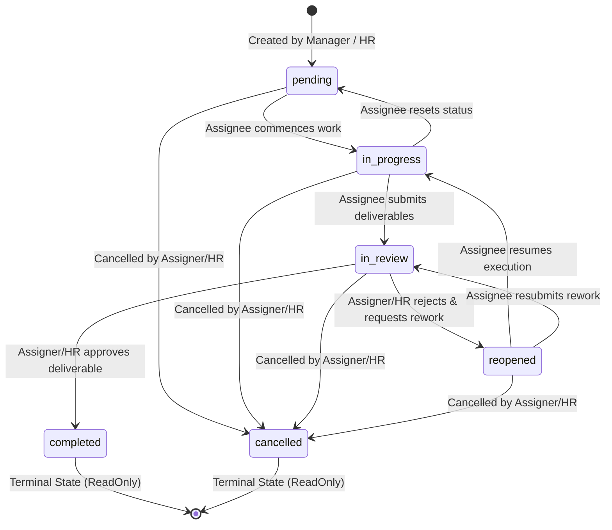
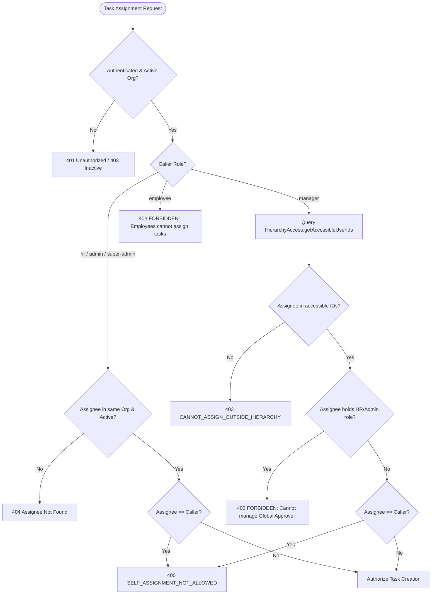
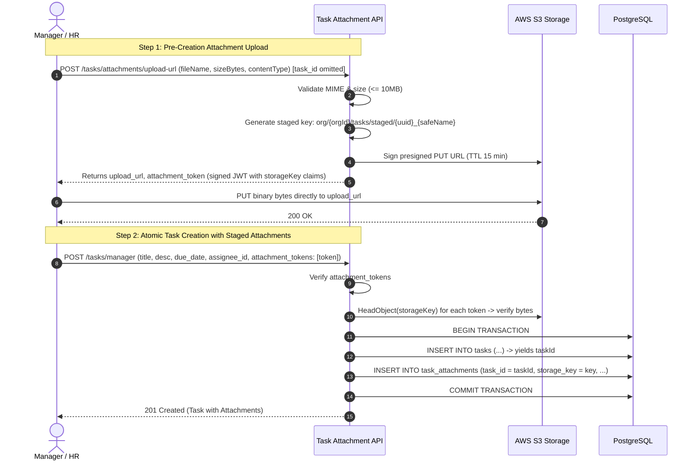

# Task Assignment Module — Production Implementation Plan

> **STATUS:** **APPROVED ARCHITECTURAL PLAN — Senior Engineering Review Passed.**  
> **AUTHOR:** Senior/Principal Backend Engineer & System Architect  
> **DATE:** 2026-10-12 (Updated following Deep Architecture Review)  
> **SCOPE:** Full Task Assignment Subsystem (`src/modules/task/`), spanning Employee Panel (Self-Service Execution), Manager Panel (Team Delegation & Review), and HR/Admin Panel (Organization-wide Task Governance).  
> **AUTHORITATIVE SOURCE OF TRUTH:** [`C:\Users\91930\Desktop\Vs_Code\HRMS\review\2026-10-12-for_cc_task_assignment_module_functionalities_SOT.md`](file:///C:/Users/91930/Desktop/Vs_Code/HRMS/review/2026-10-12-for_cc_task_assignment_module_functionalities_SOT.md)  
> **PRECEDENTS & STANDARDS:**
> - `public/md_leave/implementation_plan.md` — Edge-case register depth & cross-module integration.
> - `public/md_payrolls/implementation_plan.md` — Phasing discipline, deterministic snapshots & financial/operational auditing.
> - `public/md_pdf-generation/implementation_plan.md` — Storage keys, presigned URLs, MIME validation, and queue/drain outbox.
> - `public/md_settings/implementation_plan.md` — Catalog parity, optimistic concurrency (`If-Match`), and multi-tenant scoping.

---

## Table of Contents

0. [How to Use This Document](#0-how-to-use-this-document)
1. [Scope & Requirements Traceability](#1-scope--requirements-traceability)
2. [Verified Current-State Facts This Plan Depends On](#2-verified-current-state-facts-this-plan-depends-on)
3. [Binding Architectural Decisions](#3-binding-architectural-decisions)
4. [Database Design & Migration Specification](#4-database-design--migration-specification)
5. [Task Lifecycle & State Machine Specification](#5-task-lifecycle--state-machine-specification)
6. [Hierarchical Authorization & Delegation Mechanics](#6-hierarchical-authorization--delegation-mechanics)
7. [API Surface & Endpoint Registry](#7-api-surface--endpoint-registry)
8. [File Storage, Attachments & External References](#8-file-storage-attachments--external-references)
9. [Visibility Tracking ("Read Receipt") & Discussion Feeds](#9-visibility-tracking-read-receipt--discussion-feeds)
10. [Asynchronous Outbox Notification Engine](#10-asynchronous-outbox-notification-engine)
11. [Comprehensive Edge Case & Defensive Engineering Register](#11-comprehensive-edge-case--defensive-engineering-register)
12. [Phased Implementation Roadmap](#12-phased-implementation-roadmap)
13. [Testing, Verification & Quality Assurance Strategy](#13-testing-verification--quality-assurance-strategy)
14. [Settings Catalog Integration & Drift Guard](#14-settings-catalog-integration--drift-guard)
15. [Senior Review Findings & Resolution Changelog](#15-senior-review-findings--resolution-changelog)
16. [Sign-Off & Pre-Implementation Checklist](#16-sign-off--pre-implementation-checklist)

---

## 0. How to Use This Document

This document is the **single technical source of truth** for implementing the Task Assignment Module across its entire development lifecycle.

1. **Pre-Implementation Rule:**
   - No code may be written that contradicts or extends beyond the approved Functional SOT ([`2026-10-12-for_cc_task_assignment_module_functionalities_SOT.md`](file:///C:/Users/91930/Desktop/Vs_Code/HRMS/review/2026-10-12-for_cc_task_assignment_module_functionalities_SOT.md)).
   - Do not invent speculative abstractions, multi-assignee graphs, or real-time WebSockets in Phase 1.
2. **Registry Maintenance Discipline:**
   - **API Registry:** New endpoints documented in §7 are assigned identifiers starting from **#249** (continuing from `#248` in [`public/md_system/api_registry.md`](file:///C:/Users/91930/Desktop/Vs_Code/HRMS/public/md_system/api_registry.md#L1040-L1050)).
   - **Settings Registry:** Org-configurable task knobs are assigned identifiers continuing in [`public/md_settings/org_settings_registry.md`](file:///C:/Users/91930/Desktop/Vs_Code/HRMS/public/md_settings/org_settings_registry.md).
   - **Frontend Updates:** In compliance with project master rules, every phase introducing wire changes affecting the frontend must generate a dated `.md` record in `public/md_updates/`.
3. **Phase Progression Invariant:**
   - A phase must be implemented, statically verified, and unit tested before proceeding to the subsequent phase.
   - Database migrations and models must be committed before writing domain services and HTTP controllers.

---

## 1. Scope & Requirements Traceability

### 1.1 Traceability Matrix from Functional SOT

| # | Requirement Category | Detailed Capability | SOT Reference | Target Phase |
|---|---|---|---|---|
| **REQ-1** | **Hierarchical Delegation** | HR/Admin assigns to anyone; Manager assigns strictly to direct reports via `user_reporting_mappings`. | SOT §3.1, §5.1 | **Phase 2** |
| **REQ-2** | **Task Specification** | Title, category, rich description (5k chars), priority (`low`, `medium`, `high`, `urgent`), UTC due date. | SOT §3.2 | **Phase 1, 2** |
| **REQ-3** | **External Links** | Whitelisted, validated `https://` reference URLs with sanitized labels. | SOT §3.2, §3.3 | **Phase 1, 2** |
| **REQ-4** | **File Attachments** | S3-backed binary uploads (PDF, DOCX, XLSX, Images), max 10MB, max 5/upload, max 20/task. Staged tokens for pre-creation. | SOT §3.3 | **Phase 3** |
| **REQ-5** | **Visibility Tracking** | Immutable `first_viewed_at` timestamp on first assignee detail fetch; `is_viewed` boolean. | SOT §3.4 | **Phase 2, 4** |
| **REQ-6** | **Status Lifecycle** | State machine: `pending` → `in_progress` → `in_review` → `completed`, `reopened`, `cancelled`. | SOT §3.5, §6.1 | **Phase 2, 3** |
| **REQ-7** | **Review & Reopening Gate** | Assignee submits deliverables; Assigner/HR accepts (`completed`) or reopens with mandatory feedback. | SOT §3.5, §4.4 | **Phase 3** |
| **REQ-8** | **In-Task Discussions** | Chronological, immutable comment thread; author scoping (Assignee, Assigner, HR); rate limited. | SOT §3.6 | **Phase 4** |
| **REQ-9** | **Asynchronous Outbox** | Transactional `task_notifications` outbox with DB `dedupe_key`; cron sweep; AWS SES email templates. | SOT §3.7, §10.1 | **Phase 5** |
| **REQ-10** | **Temporal Overdue Engine** | Dynamic `is_overdue` query evaluation; background hourly sweeper enqueuing overdue notices. | SOT §6.1, §7.2 | **Phase 2, 5** |
| **REQ-11** | **Task Reassignment** | Assigner/HR hands task to new eligible report; preserves history; resets `first_viewed_at`. | SOT §4.5, §7.1 | **Phase 3** |
| **REQ-12** | **Task Cancellation** | Assigner/HR cancels task with mandatory rationale; locks task into terminal read-only state. | SOT §4.5, §6.3 | **Phase 3** |
| **REQ-13** | **Activity Audit Logging** | Immutable `task_audit_logs` tracking every state change, handoff, and due date extension. | SOT §2.2, §8.1 | **Phase 1, 4** |
| **REQ-14** | **Optimistic Locking** | Concurrency control via `If-Match` header on status transitions and revisions. | SOT §7.4 | **Phase 3** |
| **REQ-15** | **Future Performance Bridge** | `original_due_date`, `extension_count`, and `is_completed_on_time` columns for Module 6 analytics. | SOT §9.2 | **Phase 1, 2** |

### 1.2 Boundary Demarcation: Explicitly Deferred vs. Module 6 Demarcation

```
┌────────────────────────────────────────────────────────────────────────┐
│                        SCOPE DEMARCATION MATRIX                        │
├───────────────────────────────────┬────────────────────────────────────┤
│  IN-SCOPE (Task Module)           │  EXPLICITLY OUT OF SCOPE           │
├───────────────────────────────────┼────────────────────────────────────┤
│ • Single primary assignee         │ • Multi-assignee collaborative work│
│ • Direct manager / HR delegation  │ • Subtask / WBS dependency trees   │
│ • Daily/weekly operational scope  │ • Gantt charts & Kanban visualizers│
│ • Operational deliverable review  │ • Recurring cron task templates    │
│ • Transactional notification outbox│ • Real-time WebSockets / typing   │
│ • Immutable in-task comment feed  │ • Mobile push notifications (FCM)  │
├───────────────────────────────────┴────────────────────────────────────┤
│  STRATEGIC BOUNDARY: MODULE 6 (PERFORMANCE & APPRAISAL)                │
├────────────────────────────────────────────────────────────────────────┤
│ • OKRs, KPIs, and goal percentage weightings                           │
│ • Annual/quarterly appraisal cycles (self, manager, HR normalization)  │
│ • 360-degree feedback radar charts                                     │
│ • Compensation, bonus, and salary increment tie-ins                    │
│ • 9-box talent matrix & leadership succession planning                 │
│ • Historical performance trend graphs                                  │
└────────────────────────────────────────────────────────────────────────┘
```

---

## 2. Verified Current-State Facts This Plan Depends On

Every fact below was verified directly from the live codebase on **2026-10-12**:

| Subsystem | Verified Codebase Fact | Architectural Consequence for Task Module |
|---|---|---|
| **Directory Scaffold** | No `src/modules/task/` exists in the repository. | Clean greenfield implementation within `src/modules/task/`. |
| **Migrations** | 75 migrations exist, up to `00074-create-system-error-logs.js`. | Next migration file is strictly **`00075-create-task-assignment-module.js`**. |
| **Seeders** | 13 seeders exist, up to `013-seed-default-comp-off-leave-types.js`. | Next seeder file is strictly **`014-seed-task-feature.js`** (seeding `tasks.access`). |
| **Model Autoloading** | [`models.index.js:10-23`](file:///C:/Users/91930/Desktop/Vs_Code/HRMS/src/infrastructure/postgres-sql/models.index.js#L10-L23) reads `MODEL_ROOTS`. | **Must add `path.join(__dirname, '../../modules/task/models')`** or models silently vanish. |
| **Route Mounting** | [`src/app.js:79-86`](file:///C:/Users/91930/Desktop/Vs_Code/HRMS/src/app.js#L79-L86) requires each module index. | Must register `require('./modules/task/task.index')(app)`. |
| **Auth Context** | [`auth.middleware.js:71-80`](file:///C:/Users/91930/Desktop/Vs_Code/HRMS/src/common/middlewares/auth.middleware.js#L71-L80) freezes `req.user` with `{ id, role, orgId, orgStatus }`. | Org ID is accessed via `req.user.orgId` (camelCase). Token role is `req.user.role`. |
| **Hierarchy Resolution** | [`hierarchy_access.utils.js:21-66`](file:///C:/Users/91930/Desktop/Vs_Code/HRMS/src/common/utilities/hierarchy_access.utils.js#L21-L66) (`HierarchyAccess`). | `getAccessibleUserIds(orgId, req.user)` returns: `null` (HR/Admin global), `[]` (plain employee), `[ids]` (active direct reports). Reused directly. |
| **Reporting Table** | [`user_reporting_mappings.model.js:21-44`](file:///C:/Users/91930/Desktop/Vs_Code/HRMS/src/modules/organization/models/user_reporting_mappings.model.js#L21-L44) is the authoritative hierarchy store. | Never query denormalized profile fields (`reporting_person`, `manager_id`). Query `user_reporting_mappings` only. |
| **Storage Utilities** | [`object_storage.utils.js:3-124`](file:///C:/Users/91930/Desktop/Vs_Code/HRMS/src/common/utilities/object_storage.utils.js#L3-L124). | Reuses `buildObjectKey`, `sanitizeFileName`, `isAllowedContentType`, `isSafeReferenceUrl`. Storage keys format: `org/{orgId}/tasks/{taskId}/{uuid}_{fileName}`. |
| **Email Utility** | [`email.utils.js:5-60`](file:///C:/Users/91930/Desktop/Vs_Code/HRMS/src/common/utilities/email.utils.js#L5-L60) maintains `TEMPLATE_MAP` and delegates to AWS SES. | Must add task email definitions to `TEMPLATE_MAP` and create HTML templates in `src/common/templates/`. |
| **Error Contract** | [`appError.utils.js`](file:///C:/Users/91930/Desktop/Vs_Code/HRMS/src/common/utilities/appError.utils.js) and [`error.middleware.js`](file:///C:/Users/91930/Desktop/Vs_Code/HRMS/src/common/middlewares/error.middleware.js). | All errors thrown via `new AppError(status, message, errorCode)`. Standard envelope: `{ success: false, message, errorCode }`. |
| **Validation Pattern** | [`validator.utils.js`](file:///C:/Users/91930/Desktop/Vs_Code/HRMS/src/common/utilities/validator.utils.js) provides `validateOrThrow(schema, data)`. | Express 5 `req.query` is getter-only; route-level `validate(schema, 'query')` throws. Validate query strings inside controllers using `validateOrThrow`. |
| **Date & Timezone** | Dayjs with `utc` and `timezone` plugins loaded in [`src/app.js:62-63`](file:///C:/Users/91930/Desktop/Vs_Code/HRMS/src/app.js#L62-L63). | Database timestamps stored strictly in UTC. Client inputs parsed via `dayjs.utc()`. |
| **Transactions** | Sequelize unmanaged transactions: `const t = await db.sequelize.transaction()`. | Multi-table mutations (task + attachments + outbox + audit) must be committed atomically. |

---

## 3. Binding Architectural Decisions

### D-T1: Unified Three-Plane Route Architecture Mounted by Prefix
Mirroring the established pattern in Leave and Payroll:
- `task_self.routes.js` mounted at `/api/v1/tasks/me` — Protected by `[authenticate, requireActiveOrg, requireFeature('tasks.access')]`. No role restriction. Serves the authenticated user acting on tasks assigned to them (`assignee_id = req.user.id`).
- `task_manager.routes.js` mounted at `/api/v1/tasks/manager` — Protected by `[authenticate, requireActiveOrg, requireFeature('tasks.access'), authorize(['manager', 'hr'])]`. Scoped dynamically to direct subordinates via `HierarchyAccess.getAccessibleUserIds()`.
- `task_hr.routes.js` mounted at `/api/v1/tasks/hr` — Protected by `[authenticate, requireActiveOrg, requireFeature('tasks.access'), authorize(['hr', 'admin', 'super-admin'])]`. Holds global tenant-wide governance authority, aligning with SOT §5.2 permission matrix.

### D-T2: Hierarchy Resolution Exclusively from `user_reporting_mappings`
The system strictly prohibits checking denormalized `employee_profiles.reporting_person`. Manager assignment validation calls `HierarchyAccess.getAccessibleUserIds(orgId, req.user)`. If `subordinateIds` is empty or does not include the target `assignee_id`, the request fails with `403 CANNOT_ASSIGN_OUTSIDE_HIERARCHY`. Furthermore, a manager can **never** assign a task to a subordinate who holds a global approver role (`hr`, `admin`, `super-admin`).

### D-T3: Prevention of Self-Delegation
Tasks represent hierarchical managerial delegation and operational accountability. An assigner cannot assign a task to themselves (`assigner_id !== assignee_id`). Self-assignment requests fail immediately with `400 SELF_ASSIGNMENT_NOT_ALLOWED`.

### D-T4: Non-Repudiable "First View" Tracking Stamped Atomically
The first time the assignee fetches task details via `GET /api/v1/tasks/me/:id`, the repository executes an atomic update:
`UPDATE tasks SET is_viewed = true, first_viewed_at = CURRENT_TIMESTAMP, last_viewed_at = CURRENT_TIMESTAMP WHERE id = :id AND assignee_id = :userId AND is_viewed = false`.
`first_viewed_at` is permanently immutable thereafter. Views by managers, HR, or administrators do not touch `first_viewed_at`.

### D-T5: Dynamic Temporal Evaluation of Overdue State
`overdue` is **never stored as a static enum value** in `tasks.status`. Storing overdue in the database introduces race conditions, stale rows, and requires continuous database polling. Instead, a task is temporally overdue if `due_date < NOW() AND status NOT IN ('completed', 'cancelled')`. The API projects `is_overdue: boolean` dynamically on all read models.

### D-T6: Mandatory Review Gate with Reopening Feedback
When an assignee finishes work, they call `POST /tasks/me/:id/submit`, which transitions the task to `in_review`. The task enters `completed` **only** when accepted by the assigner or HR via `POST /tasks/{manager|hr}/:id/approve`. If the deliverable is deficient, the assigner calls `POST /tasks/{manager|hr}/:id/reopen` with a mandatory `reopen_reason` (min 10 characters), transitioning status to `reopened` and incrementing `rework_count`.

### D-T7: Two-Mode Presigned S3 Attachment Architecture (Resolving Pre-Creation Chicken-and-Egg)
To allow briefing attachments to be uploaded **before** a task exists, the upload handshake operates in two distinct, elegant modes:
- **Mode A (Pre-Creation Staging):** The client requests an upload token without a `task_id` (`POST /tasks/attachments/upload-url` with `{ file_name, content_type, size_bytes }`). The server signs an S3 PUT URL for a staged key (`org/{orgId}/tasks/staged/{uuid}_{safeName}`) and returns a cryptographically signed, short-lived JWT `attachment_token` containing the metadata. When calling `POST /tasks`, the client provides `attachment_tokens: [token1, token2]`. The task creation transaction atomically commits the task, binds the attachments to `task.id`, and updates their permanent key.
- **Mode B (Post-Creation / In-Task Uploads):** For deliverable submissions or conversation comments on an existing task, the client passes `task_id`. The server validates authorization on the task, signs the S3 PUT URL under `org/{orgId}/tasks/{taskId}/{uuid}_{safeName}`, and confirms it directly into `task_attachments`.

### D-T8: Optimistic Concurrency Control via `If-Match`
State transitions (`submit`, `approve`, `reopen`, `cancel`, `reassign`, `extend-due-date`) require an `If-Match` HTTP header matching the task's current `updated_at` ISO string (or integer `version`). A stale token yields `412 PRECONDITION_FAILED`, preventing lost updates when managers and assignees act concurrently.

### D-T9: Idempotency Key via Redis
State mutations and comment submissions accept an optional `Idempotency-Key` header. Keys are cached in Redis (`idemp:tasks:{orgId}:{key}`) for 120 seconds. Duplicate requests return the cached response, preventing double submissions.

### D-T10: Reliable Transactional Outbox with DB Deduplication
All task notifications (`TASK_ASSIGNED`, `TASK_SUBMITTED`, `TASK_REOPENED`, `TASK_COMPLETED`, `TASK_COMMENT_ADDED`, `TASK_OVERDUE`, `TASK_CANCELLED`) are written to `task_notifications` **within the primary Sequelize transaction**. To eliminate duplicate notification emails on rapid resubmissions or network retries, `task_notifications` enforces a unique index on `(org_id, dedupe_key)`.

### D-T11: Future-Proof Analytics Bridge for Module 6 (Performance & Appraisal)
To allow downstream Module 6 to compute precise operational metrics without costly JSONB audit log deserialization:
- `original_due_date` is stamped at creation and is permanently immutable.
- `extension_count` tracks how many times the deadline was extended.
- `is_completed_on_time` is automatically stamped as `(completed_at <= due_date)` upon completion.
- `category` (`operational`, `compliance`, `onboarding`, `administrative`, `general`) provides taxonomy for departmental task analytics.

---

## 4. Database Design & Migration Specification

### 4.1 Migration File: `00075-create-task-assignment-module.js`

```
┌────────────────────────────────────────────────────────────────────────┐
│                     DATABASE ENTITY RELATIONSHIP                       │
├────────────────────────────────────────────────────────────────────────┤
│                                                                        │
│   ORGANIZATIONS (Existing)                 USERS (Existing)            │
│         │                                        │                     │
│         ├──────────────────────┬─────────────────┤                     │
│         │ 1:N                  │ 1:N             │ 1:N                 │
│         ▼                      ▼                 ▼                     │
│   ┌───────────────┐     assigner_id         assignee_id                │
│   │     TASKS     │◄───────────┴─────────────────┘                     │
│   └───────┬───────┘                                                    │
│           │ 1:N                                                        │
│           ├────────────────────────┬────────────────────────┐          │
│           ▼                        ▼                        ▼          │
│   ┌───────────────┐        ┌───────────────┐        ┌───────────────┐  │
│   │  ATTACHMENTS  │        │   COMMENTS    │        │  AUDIT LOGS   │  │
│   └───────────────┘        └───────────────┘        └───────────────┘  │
│                                                                        │
│   ┌────────────────────────────────────────────────────────────────┐   │
│   │                      TASK_NOTIFICATIONS                        │   │
│   │        (Transactional Outbox Ledger with Dedupe Key)           │   │
│   └────────────────────────────────────────────────────────────────┘   │
└────────────────────────────────────────────────────────────────────────┘
```

#### Table 1: `tasks`
The primary operational record for delegated work.

| Column | Type | Constraints / Default | Description |
|---|---|---|---|
| `id` | `UUID` | Primary Key, `defaultValue: gen_random_uuid()` | Cryptographically secure task identifier. |
| `org_id` | `UUID` | `NOT NULL`, FK → `organizations.id` ON DELETE CASCADE | Tenant isolation scoping. |
| `title` | `VARCHAR(200)` | `NOT NULL` | Concise task title (1–200 characters). |
| `category` | `VARCHAR(50)` | `NOT NULL`, Default `'operational'` | Taxonomy (`operational`, `compliance`, `onboarding`, `administrative`, `general`). |
| `description` | `TEXT` | `NOT NULL` | Rich instructions and deliverables (up to 5,000 chars). |
| `priority` | `VARCHAR(20)` | `NOT NULL`, Default `'medium'` (`low`, `medium`, `high`, `urgent`) | Operational priority. |
| `status` | `VARCHAR(30)` | `NOT NULL`, Default `'pending'` (`pending`, `in_progress`, `in_review`, `reopened`, `completed`, `cancelled`) | Lifecycle state machine status. |
| `due_date` | `TIMESTAMPTZ` | `NOT NULL` | Current active deadline in UTC. |
| `original_due_date` | `TIMESTAMPTZ` | `NOT NULL` | Immutable deadline set at task creation (for Module 6 on-time metrics). |
| `extension_count` | `INTEGER` | `NOT NULL`, Default `0` | Counter tracking total due date extensions granted. |
| `assigner_id` | `UUID` | `NOT NULL`, FK → `users.id` | User who created/delegated the task. |
| `assignee_id` | `UUID` | `NOT NULL`, FK → `users.id` | User designated to execute the task. |
| `is_viewed` | `BOOLEAN` | `NOT NULL`, Default `false` | Read receipt indicator. |
| `first_viewed_at` | `TIMESTAMPTZ` | `NULL` | Immutable timestamp when assignee first opened details. |
| `last_viewed_at` | `TIMESTAMPTZ` | `NULL` | Most recent timestamp when assignee inspected details. |
| `external_links` | `JSONB` | `NOT NULL`, Default `'[]'` | Array of validated `{ url, label }` objects. |
| `rework_count` | `INTEGER` | `NOT NULL`, Default `0` | Number of times the task was rejected and reopened. |
| `reassignment_count` | `INTEGER` | `NOT NULL`, Default `0` | Number of times the task was reassigned. |
| `submitted_at` | `TIMESTAMPTZ` | `NULL` | Timestamp when assignee submitted for review. |
| `completed_at` | `TIMESTAMPTZ` | `NULL` | Timestamp when assigner/HR accepted completion. |
| `completed_by` | `UUID` | `NULL`, FK → `users.id` | User who approved completion. |
| `is_completed_on_time` | `BOOLEAN` | `NULL` | Computed flag `(completed_at <= due_date)` for Module 6 analytics. |
| `cancelled_at` | `TIMESTAMPTZ` | `NULL` | Timestamp of cancellation. |
| `cancelled_by` | `UUID` | `NULL`, FK → `users.id` | User who cancelled the task. |
| `cancellation_reason`| `VARCHAR(500)` | `NULL` | Mandatory reason when status becomes `cancelled`. |
| `version` | `INTEGER` | `NOT NULL`, Default `1` | Optimistic concurrency revision counter. |
| `created_at` | `TIMESTAMPTZ` | `NOT NULL`, Default `NOW()` | Audit timestamp (UTC). |
| `updated_at` | `TIMESTAMPTZ` | `NOT NULL`, Default `NOW()` | Audit timestamp (UTC). |
| `deleted_at` | `TIMESTAMPTZ` | `NULL` | Soft-delete timestamp (`paranoid: true`). |

**Indexes on `tasks`:**
- `tasks_org_id_status_idx` on `(org_id, status)`
- `tasks_org_id_assignee_id_status_idx` on `(org_id, assignee_id, status)`
- `tasks_org_id_assigner_id_idx` on `(org_id, assigner_id)`
- `tasks_org_id_due_date_idx` on `(org_id, due_date)`
- `tasks_org_id_category_idx` on `(org_id, category)`
- `tasks_overdue_sweep_idx` on `(org_id, due_date, status)` WHERE `deleted_at IS NULL AND status NOT IN ('completed', 'cancelled')`

---

#### Table 2: `task_attachments`
Uploaded file deliverables and task briefing materials.

| Column | Type | Constraints / Default | Description |
|---|---|---|---|
| `id` | `UUID` | Primary Key, `defaultValue: gen_random_uuid()` | Attachment identifier. |
| `org_id` | `UUID` | `NOT NULL`, FK → `organizations.id` ON DELETE CASCADE | Tenant isolation scoping. |
| `task_id` | `UUID` | `NOT NULL`, FK → `tasks.id` ON DELETE CASCADE | Parent task reference. |
| `uploader_id` | `UUID` | `NOT NULL`, FK → `users.id` | User who uploaded the attachment. |
| `storage_key` | `VARCHAR(500)` | `NOT NULL` | S3 object key (`org/{orgId}/tasks/{taskId}/...`). |
| `file_name` | `VARCHAR(255)` | `NOT NULL` | Original sanitized file name. |
| `file_size_bytes` | `INTEGER` | `NOT NULL` | Verified file size (max 10,485,760 bytes). |
| `content_type` | `VARCHAR(100)` | `NOT NULL` | Whitelisted MIME type. |
| `attachment_context` | `VARCHAR(30)` | `NOT NULL`, Default `'briefing'` (`briefing`, `submission`, `comment`) | Stage where file was attached. |
| `created_at` | `TIMESTAMPTZ` | `NOT NULL`, Default `NOW()` | Upload timestamp (UTC). |
| `updated_at` | `TIMESTAMPTZ` | `NOT NULL`, Default `NOW()` | Timestamp (UTC). |
| `deleted_at` | `TIMESTAMPTZ` | `NULL` | Soft-delete timestamp. |

**Indexes on `task_attachments`:**
- `task_attachments_task_id_idx` on `(task_id)`
- `task_attachments_org_id_uploader_id_idx` on `(org_id, uploader_id)`

---

#### Table 3: `task_comments`
Chronological discussion messages directly anchored to a task.

| Column | Type | Constraints / Default | Description |
|---|---|---|---|
| `id` | `UUID` | Primary Key, `defaultValue: gen_random_uuid()` | Comment identifier. |
| `org_id` | `UUID` | `NOT NULL`, FK → `organizations.id` ON DELETE CASCADE | Tenant isolation scoping. |
| `task_id` | `UUID` | `NOT NULL`, FK → `tasks.id` ON DELETE CASCADE | Parent task reference. |
| `author_id` | `UUID` | `NOT NULL`, FK → `users.id` | Message author. |
| `message` | `TEXT` | `NOT NULL` | Comment body (1–2,000 characters). |
| `is_progress_update`| `BOOLEAN` | `NOT NULL`, Default `false` | True if posted as a progress status update. |
| `system_generated` | `BOOLEAN` | `NOT NULL`, Default `false` | True if generated by system (e.g. reopen note). |
| `external_links` | `JSONB` | `NOT NULL`, Default `'[]'` | Optional `{ url, label }` references. |
| `attachment_ids` | `JSONB` | `NOT NULL`, Default `'[]'` | Array of UUIDs from `task_attachments`. |
| `created_at` | `TIMESTAMPTZ` | `NOT NULL`, Default `NOW()` | Post timestamp (UTC). |
| `updated_at` | `TIMESTAMPTZ` | `NOT NULL`, Default `NOW()` | Timestamp (UTC). |
| `deleted_at` | `TIMESTAMPTZ` | `NULL` | Soft-delete timestamp. |

**Indexes on `task_comments`:**
- `task_comments_task_id_created_at_idx` on `(task_id, created_at ASC)`

---

#### Table 4: `task_audit_logs`
Immutable audit ledger capturing all lifecycle transitions and administrative changes.

| Column | Type | Constraints / Default | Description |
|---|---|---|---|
| `id` | `UUID` | Primary Key, `defaultValue: gen_random_uuid()` | Audit log identifier. |
| `org_id` | `UUID` | `NOT NULL`, FK → `organizations.id` ON DELETE CASCADE | Tenant isolation scoping. |
| `task_id` | `UUID` | `NOT NULL`, FK → `tasks.id` ON DELETE CASCADE | Target task identifier. |
| `actor_id` | `UUID` | `NOT NULL`, FK → `users.id` | User executing the action. |
| `action` | `VARCHAR(50)` | `NOT NULL` (`CREATED`, `FIRST_VIEWED`, `STATUS_CHANGED`, `SUBMITTED`, `COMPLETED`, `REOPENED`, `REASSIGNED`, `CANCELLED`, `DUE_DATE_EXTENDED`) | Action key. |
| `from_status` | `VARCHAR(30)` | `NULL` | Previous lifecycle state. |
| `to_status` | `VARCHAR(30)` | `NULL` | Resulting lifecycle state. |
| `details` | `JSONB` | `NOT NULL`, Default `'{}'` | Snapshot of before/after fields, reasons, or notes. |
| `ip_address` | `VARCHAR(45)` | `NULL` | Client IP address. |
| `user_agent` | `VARCHAR(255)` | `NULL` | Client user agent string. |
| `created_at` | `TIMESTAMPTZ` | `NOT NULL`, Default `NOW()` | Immutability timestamp (UTC). |

**Indexes on `task_audit_logs`:**
- `task_audit_logs_task_id_created_at_idx` on `(task_id, created_at DESC)`
- `task_audit_logs_org_id_action_idx` on `(org_id, action)`

---

#### Table 5: `task_notifications`
Transactional outbox ledger with built-in deduplication.

| Column | Type | Constraints / Default | Description |
|---|---|---|---|
| `id` | `UUID` | Primary Key, `defaultValue: gen_random_uuid()` | Notification queue item identifier. |
| `org_id` | `UUID` | `NOT NULL`, FK → `organizations.id` ON DELETE CASCADE | Tenant isolation scoping. |
| `task_id` | `UUID` | `NOT NULL`, FK → `tasks.id` ON DELETE CASCADE | Related task identifier. |
| `recipient_id` | `UUID` | `NOT NULL`, FK → `users.id` | User to be notified. |
| `event_type` | `VARCHAR(50)` | `NOT NULL` (`TASK_ASSIGNED`, `TASK_SUBMITTED`, `TASK_REOPENED`, `TASK_COMPLETED`, `TASK_COMMENT_ADDED`, `TASK_OVERDUE`, `TASK_CANCELLED`) | Notification event identifier. |
| `dedupe_key` | `VARCHAR(200)` | `NOT NULL` | Natural deduplication key (`task_assigned:{id}:{recipient}`). |
| `status` | `VARCHAR(30)` | `NOT NULL`, Default `'pending'` (`pending`, `processing`, `sent`, `failed`) | Outbox dispatch status. |
| `payload` | `JSONB` | `NOT NULL`, Default `'{}'` | Contextual email payload (task title, cta_url, etc.). |
| `attempts` | `INTEGER` | `NOT NULL`, Default `0` | Retry counter. |
| `max_attempts` | `INTEGER` | `NOT NULL`, Default `3` | Maximum retry threshold before moving to `failed`. |
| `last_error` | `TEXT` | `NULL` | Captured error string on delivery failure. |
| `next_retry_at` | `TIMESTAMPTZ` | `NOT NULL`, Default `NOW()` | Exponential backoff scheduling timestamp. |
| `sent_at` | `TIMESTAMPTZ` | `NULL` | Successful dispatch timestamp. |
| `created_at` | `TIMESTAMPTZ` | `NOT NULL`, Default `NOW()` | Enqueue timestamp. |
| `updated_at` | `TIMESTAMPTZ` | `NOT NULL`, Default `NOW()` | Timestamp. |

**Indexes on `task_notifications`:**
- `task_notifications_org_id_dedupe_key_uidx` UNIQUE on `(org_id, dedupe_key)`
- `task_notifications_drain_idx` on `(status, next_retry_at)` WHERE `status IN ('pending', 'processing')`
- `task_notifications_org_id_recipient_idx` on `(org_id, recipient_id)`

---

### 4.2 Seeder File: `014-seed-task-feature.js`
Seeds the entitlement feature key `tasks.access` and maps it across all plans (`basic`, `professional`, `growth_monthly`, `enterprise`) in `plan_features`, adhering to the pattern established in `007-seed-leave-feature.js`.

---

## 5. Task Lifecycle & State Machine Specification

### 5.1 State Machine Graph



### 5.2 Transition Invariants & Guardrails

| Current Status | Target Status | Authorized Actor | Preconditions & Validation | DB Mutations & Side Effects |
|---|---|---|---|---|
| `*` | `pending` | Assigner, HR | Task creation; `due_date >= NOW() + 15m`; valid subordinate. | Inserts row; sets `original_due_date = due_date`; `is_viewed=false`; writes outbox `TASK_ASSIGNED`. |
| `pending` | `in_progress` | Assignee only | Must be current assignee; `status == 'pending'`. | Sets `status='in_progress'`; auto-stamps `is_viewed=true` if false. |
| `in_progress` | `in_review` | Assignee only | `submission_note` required (min 10 chars); attachments optional. | Sets `status='in_review'`, `submitted_at=NOW()`; writes outbox `TASK_SUBMITTED`. |
| `in_progress` | `pending` | Assignee only | Allows assignee to reset work flag. | Sets `status='pending'`; logs audit trail. |
| `in_review` | `completed` | Assigner, HR | Deliverables reviewed; optional remarks. | Sets `status='completed'`, `completed_at=NOW()`, `completed_by=actorId`, `is_completed_on_time=(NOW() <= due_date)`; writes outbox `TASK_COMPLETED`. |
| `in_review` | `reopened` | Assigner, HR | Deliverables rejected; `reopen_reason` mandatory (min 10 chars). | Sets `status='reopened'`, increments `rework_count`; injects system comment; writes outbox `TASK_REOPENED`. |
| `reopened` | `in_progress` | Assignee only | Assignee acknowledges rework. | Sets `status='in_progress'`; logs audit trail. |
| `reopened` | `in_review` | Assignee only | `resubmission_note` required (min 10 chars). | Sets `status='in_review'`, `submitted_at=NOW()`; writes outbox `TASK_SUBMITTED`. |
| Any active state | `cancelled` | Assigner, HR | Task obsolete; `cancellation_reason` mandatory (min 10 chars); cannot cancel if already `completed`. | Sets `status='cancelled'`, `cancelled_at=NOW()`, `cancelled_by=actorId`; writes outbox `TASK_CANCELLED`. |

---

## 6. Hierarchical Authorization & Delegation Mechanics



### Delegation Validation Algorithm
1. Extract `orgId = req.user.orgId`, `requesterUser = req.user`.
2. Ensure `assignee_id !== requesterUser.id` (Enforces D-T3).
3. If `GLOBAL_APPROVER_ROLES.includes(requesterUser.role)`:
   - Query `db.UserRole.findOne({ where: { user_id: assignee_id, org_id: orgId, is_active: true } })`.
   - If not found or inactive, throw `AppError(404, 'Assignee not found in this organization', 'ASSIGNEE_NOT_FOUND')`.
   - Permitted globally.
4. If `requesterUser.role === 'manager'`:
   - Call `accessibleIds = await hierarchyAccess.getAccessibleUserIds(orgId, requesterUser)`.
   - If `!accessibleIds.includes(assignee_id)`, throw `AppError(403, 'You can only assign tasks to your direct active subordinates', 'CANNOT_ASSIGN_OUTSIDE_HIERARCHY')`.
   - Permitted.
5. If `requesterUser.role === 'employee'`:
   - Throw `AppError(403, 'Employees do not have delegation permissions', 'FORBIDDEN')`.

---

## 7. API Surface & Endpoint Registry

All endpoints are assigned continuous identifiers continuing from **#249** in [`public/md_system/api_registry.md`](file:///C:/Users/91930/Desktop/Vs_Code/HRMS/public/md_system/api_registry.md).

| # | Endpoint | Method | Allowed Roles | Dashboard | Description | Controller & Service |
|---|---|---|---|---|---|---|
| **249** | `/api/v1/tasks/me` | GET | All Org Roles | employee, manager, hr | List tasks assigned to the caller (`assignee_id = me`). Supports `status`, `priority`, `category`, `is_viewed`, `is_overdue`, pagination. | `user_task.controller.js` → `task.service.js` |
| **250** | `/api/v1/tasks/me/:id` | GET | All Org Roles | employee, manager, hr | Retrieve task detail. **Atomically stamps `first_viewed_at`** if unviewed. | `user_task.controller.js` → `task.service.js` |
| **251** | `/api/v1/tasks/me/:id/status` | PATCH | All Org Roles | employee, manager, hr | Transition status between `pending` and `in_progress`. Requires `If-Match`. | `user_task.controller.js` → `task.service.js` |
| **252** | `/api/v1/tasks/me/:id/submit` | POST | All Org Roles | employee, manager, hr | Submit deliverables for review (`status → in_review`). Requires `submission_note` and `If-Match`. | `user_task.controller.js` → `task.service.js` |
| **253** | `/api/v1/tasks/me/:id/comments` | POST | All Org Roles | employee, manager, hr | Post a message or progress update to the in-task discussion thread. | `user_task.controller.js` → `task_comment.service.js` |
| **254** | `/api/v1/tasks/me/:id/comments` | GET | All Org Roles | employee, manager, hr | Get paginated chronological comment feed for assigned task. | `user_task.controller.js` → `task_comment.service.js` |
| **255** | `/api/v1/tasks/manager` | POST | `manager`, `hr` | manager, hr | Create and assign a task to a direct subordinate. Supports optional pre-staged `attachment_tokens`. | `manager_task.controller.js` → `task.service.js` |
| **256** | `/api/v1/tasks/manager/assigned-by-me`| GET | `manager`, `hr` | manager, hr | List tasks delegated by the caller (`assigner_id = me`). Supports filters & pagination. | `manager_task.controller.js` → `task.service.js` |
| **257** | `/api/v1/tasks/manager/team-tasks` | GET | `manager`, `hr` | manager, hr | List tasks across all direct subordinates. Supports `subordinate_id`, `category`, `status`, pagination. | `manager_task.controller.js` → `task.service.js` |
| **258** | `/api/v1/tasks/manager/:id` | GET | `manager`, `hr` | manager, hr | Retrieve task detail for a subordinate's task. Does **not** mutate `first_viewed_at`. | `manager_task.controller.js` → `task.service.js` |
| **259** | `/api/v1/tasks/manager/:id/approve` | POST | `manager`, `hr` | manager, hr | Approve deliverable (`status → completed`). Requires `If-Match`. | `manager_task.controller.js` → `task.service.js` |
| **260** | `/api/v1/tasks/manager/:id/reopen` | POST | `manager`, `hr` | manager, hr | Reject deliverable and request rework (`status → reopened`). Requires `reopen_reason` and `If-Match`. | `manager_task.controller.js` → `task.service.js` |
| **261** | `/api/v1/tasks/manager/:id/reassign` | POST | `manager`, `hr` | manager, hr | Reassign task to another eligible report. Resets `first_viewed_at`. Requires `reason` and `If-Match`. Requires `new_due_date` if task is overdue. | `manager_task.controller.js` → `task.service.js` |
| **262** | `/api/v1/tasks/manager/:id/cancel` | POST | `manager`, `hr` | manager, hr | Cancel active task. Requires `cancellation_reason` and `If-Match`. | `manager_task.controller.js` → `task.service.js` |
| **263** | `/api/v1/tasks/manager/:id/extend-due-date` | PATCH | `manager`, `hr` | manager, hr | Extend due date with mandatory `reason`. Increments `extension_count`. Requires `If-Match`. | `manager_task.controller.js` → `task.service.js` |
| **264** | `/api/v1/tasks/manager/:id/comments` | POST | `manager`, `hr` | manager, hr | Post a managerial message or feedback to the task comment thread. | `manager_task.controller.js` → `task_comment.service.js` |
| **265** | `/api/v1/tasks/hr` | POST | `hr`, `admin`, `super-admin` | hr | Org-wide task assignment to any employee or manager in the tenant. Supports pre-staged attachments. | `hr_task.controller.js` → `task.service.js` |
| **266** | `/api/v1/tasks/hr` | GET | `hr`, `admin`, `super-admin` | hr | Org-wide task registry. Comprehensive filters (department, category, assigner, assignee, status, overdue). | `hr_task.controller.js` → `task.service.js` |
| **267** | `/api/v1/tasks/hr/:id` | GET | `hr`, `admin`, `super-admin` | hr | Org-wide detail view. Includes complete audit log and notification history. | `hr_task.controller.js` → `task.service.js` |
| **268** | `/api/v1/tasks/attachments/upload-url` | POST | All Org Roles | employee, manager, hr | Step 1 of upload handshake: returns presigned S3 PUT URL and signed `attachment_token`. Accepts optional `task_id`. | `user_task.controller.js` → `task_attachment.service.js` |
| **269** | `/api/v1/tasks/attachments/confirm` | POST | All Org Roles | employee, manager, hr | Step 2 of upload handshake: verifies HeadObject in S3 and persists record for an existing task. | `user_task.controller.js` → `task_attachment.service.js` |
| **270** | `/api/v1/tasks/attachments/:attachmentId/download-url` | GET | All Org Roles | employee, manager, hr | Generates 15-minute presigned GET download URL after verifying task authorization (BOLA guard). | `user_task.controller.js` → `task_attachment.service.js` |

---

## 8. File Storage, Attachments & External References

### 8.1 S3 Storage Handshake Architecture (Resolving Pre-Creation Staging)
To allow briefing attachments to be attached seamlessly at task creation without a chicken-and-egg dilemma:



### 8.2 Security Rules for Attachments & Links
- **MIME Whitelist:** `application/pdf`, `image/jpeg`, `image/png`, `image/webp`, `application/msword`, `application/vnd.openxmlformats-officedocument.wordprocessingml.document`, `application/vnd.openxmlformats-officedocument.spreadsheetml.sheet`.
- **File Name Sanitization:** Handled by `sanitizeFileName(fileName)`: strips control characters, backslashes, double quotes, and limits length to 200 characters.
- **Quota Enforcements:**
  - Maximum 10MB (`10,485,760` bytes) per file.
  - Maximum 5 attachments confirmed in a single batch.
  - Maximum 20 active attachments per task across its lifecycle.
- **External URL Validation:**
  - Handled by `isSafeReferenceUrl(url)`: protocol must strictly be `https:`, max 1000 characters, no whitespace or control characters, valid hostname.
- **BOLA Protection on Downloads (#270):**
  - Download URL generator verifies `attachment.org_id === req.user.orgId`.
  - Service resolves parent `tasks` row and checks authorization:
    - If caller is `assignee_id`: Allowed.
    - If caller is `assigner_id`: Allowed.
    - If caller holds `['hr', 'admin', 'super-admin']`: Allowed.
    - If caller is `manager`: Must be in `HierarchyAccess.getAccessibleUserIds()` for the `assignee_id`.
    - Otherwise: `403 FORBIDDEN`.

---

## 9. Visibility Tracking ("Read Receipt") & Discussion Feeds

### 9.1 Read Receipt Mechanics
1. When a task is created, `is_viewed = false` and `first_viewed_at = null`.
2. When the assignee issues `GET /api/v1/tasks/me/:id`, the service checks if `is_viewed === false`.
3. If `false`, it executes an atomic SQL update:
   ```sql
   UPDATE tasks 
   SET is_viewed = true, 
       first_viewed_at = CURRENT_TIMESTAMP, 
       last_viewed_at = CURRENT_TIMESTAMP,
       updated_at = CURRENT_TIMESTAMP
   WHERE id = :taskId AND org_id = :orgId AND assignee_id = :userId AND is_viewed = false;
   ```
4. If row was updated, write an audit log entry: `action: 'FIRST_VIEWED'`.
5. If `is_viewed` is already `true`, it simply updates `last_viewed_at = CURRENT_TIMESTAMP`.
6. Managers and HR viewing the task via `/manager/:id` or `/hr/:id` never update `first_viewed_at` or `last_viewed_at`.

### 9.2 Contextual Discussion Feed & Rate Limiting
- **Comment Insertion:** `POST /api/v1/tasks/{me|manager}/:id/comments` validates message (1–2,000 characters), optional attachments (verified UUIDs), and optional HTTPS links.
- **Lifecycle Block:** If `task.status === 'cancelled'`, posting comments is prohibited (`409 TASK_TERMINATED`).
- **Spam Guard:** Uses Redis to enforce a sliding window rate limit: max 30 comments per user per task per hour (`rate:task_comment:{taskId}:{userId}`). Exceeding the cap returns `429 TOO_MANY_REQUESTS`.
- **System Comments:** When an assigner reopens a task, the service injects a system-generated comment (`system_generated = true`, `author_id = assigner_id`, `message = "TASK REOPENED: " + reason`) so rework instructions are preserved chronologically inside the conversation thread.

---

## 10. Asynchronous Outbox Notification Engine

### 10.1 Outbox Transactional Contract with Deduplication
When a domain event occurs, the notification record is written to `task_notifications` **inside the same database transaction** using a deterministic `dedupe_key`:

```javascript
// Example: Inside task.service.js
await db.sequelize.transaction(async (t) => {
  const task = await taskRepo.create(taskData, { transaction: t });
  await taskAuditRepo.record({ taskId: task.id, action: 'CREATED', ... }, { transaction: t });
  
  const dedupeKey = `task_assigned:${task.id}:${task.assignee_id}`;
  await taskNotificationRepo.enqueue({
    orgId: task.org_id,
    taskId: task.id,
    recipientId: task.assignee_id,
    eventType: 'TASK_ASSIGNED',
    dedupeKey,
    payload: {
      task_title: task.title,
      assigner_name: requesterUser.name,
      due_date: task.due_date,
      priority: task.priority
    }
  }, { transaction: t });
});
```

### 10.2 Outbox Drain Worker & Scheduled Sweeper
1. **Cron Schedule:** Registered in `src/cron-jobs/task_notification_dispatch.cron.js` running every **60 seconds** on Linux environments (`* * * * *`).
2. **Claim Pattern:**
   ```sql
   SELECT * FROM task_notifications 
   WHERE status IN ('pending', 'processing') 
     AND next_retry_at <= NOW() 
     AND attempts < max_attempts
   ORDER BY created_at ASC 
   LIMIT 50 
   FOR UPDATE SKIP LOCKED;
   ```
3. **Dispatch:**
   - Worker builds email template via `emailUtils.sendTemplatedEmail()`.
   - On success: updates `status = 'sent'`, `sent_at = NOW()`.
   - On failure: increments `attempts`, sets `last_error = err.message`, computes exponential backoff `next_retry_at = NOW() + INTERVAL '1 minute' * POWER(2, attempts)`. If `attempts >= max_attempts`, sets `status = 'failed'`.
4. **Overdue Sweeper Cron:** `src/cron-jobs/task_overdue_sweeper.cron.js` runs every **hour** (`0 * * * *`). Queries active tasks past due date with no overdue notification enqueued in the last 24 hours (enforcing dedupe key `task_overdue:{taskId}:{YYYY-MM-DD}`), and enqueues `TASK_OVERDUE` alerts.

---

## 11. Comprehensive Edge Case & Defensive Engineering Register

| # | Edge Case / Failure Scenario | Concrete Technical Fix |
|---|---|---|
| **EC-T1** | **Manager Department Transfer / HOD Swap Mid-Task** | When a manager transfers departments in `user_reporting_mappings`, tasks assigned by them do not orphan. The task remains assigned to the employee. The employee's *new* manager automatically inherits visibility and approval authority via `HierarchyAccess.getAccessibleUserIds()`. The original `assigner_id` remains immutable for audit integrity. |
| **EC-T2** | **Assignee Offboarding / Inactivation Mid-Task** | When an employee is deactivated/soft-deleted in `users`, active tasks (`pending`, `in_progress`, `reopened`) are not deleted. A post-deactivation hook flags active tasks with a warning banner, and the assigner receives a high-priority notification to reassign or cancel the task. |
| **EC-T3** | **Assigner Offboarding / Inactivation Mid-Task** | If an assigner leaves the company, tasks assigned to their reports remain valid. The department HOD or any HR user can approve, reopen, reassign, or cancel the task using HR governance routes (`/api/v1/tasks/hr`). |
| **EC-T4** | **Concurrent Status Mutation Collision (Race Condition)** | Two actors mutate task status simultaneously (e.g. Assignee submits while Manager cancels). All state transition endpoints enforce the `If-Match` header against `updated_at`. If the timestamp does not match, the second request fails with `412 PRECONDITION_FAILED`. |
| **EC-T5** | **Rapid Double-Click Form Submission** | Client sends duplicate `POST /tasks` or `POST /comments`. Endpoints check `Idempotency-Key` header cached in Redis for 120s. Duplicate submissions return the identical cached JSON response with `reused: true`. |
| **EC-T6** | **Past Due Date Creation Attempt** | Validator checks `due_date >= dayjs().utc().add(15, 'minute').toISOString()`. Creation with past or immediate due date is rejected with `400 INVALID_DUE_DATE`. |
| **EC-T7** | **Reassigning an Overdue Task** | When a task is overdue (`due_date < NOW()`) and reassigned, the assigner **must** provide `new_due_date` in the future (`due_date > NOW()`). If the task is not overdue, `new_due_date` is optional. |
| **EC-T8** | **Reopening a Completed Task (Privileged Override)** | Only `hr`, `admin`, or `super-admin` can reopen a task that has already reached `completed` status. Requires `privileged_reopen_reason` (min 15 chars) and logs a critical audit entry. |
| **EC-T9** | **Orphaned S3 File Uploads** | Client requests presigned upload URL but never completes PUT or confirm. S3 lifecycle policy automatically purges unconfirmed objects in `org/{orgId}/tasks/staged/` after 24 hours. `task_attachments` table only records objects after successful confirmation. |
| **EC-T10** | **MIME Type Spoofing / Malicious Executables** | Client renames `malware.exe` to `report.pdf`. The upload handshake strictly validates declared MIME. In addition, Phase 3 incorporates magic-byte validation on the confirmed S3 object buffer during `HeadObject`/sample check. |
| **EC-T11** | **Server-Side Request Forgery (SSRF) via External Links** | Malicious external link pointing to internal cloud metadata (e.g., `https://169.254.169.254/`). `isSafeReferenceUrl` rejects private IPs, loopbacks, internal DNS suffixes, and non-HTTPS protocols. |
| **EC-T12** | **Comment Flooding / DoS Attack** | Malicious script attempts to flood discussion thread with 10,000 comments. Enforced via Redis sliding window rate limiter: maximum 30 comments per user per task per hour (`429 TOO_MANY_COMMENTS`). |
| **EC-T13** | **Express 5 Getter-Only `req.query` Crash** | In Express 5, `req.query` is a getter property. Calling `validate(schema, 'query')` at the route middleware layer throws a runtime exception. All query string validations must occur inside controllers via `validateOrThrow(schema, req.query)`. |
| **EC-T14** | **Subordinate Promoted to Manager Mid-Task** | An employee executing a task is promoted to `manager`. The task remains valid in their `/me` self-service dashboard. Their role promotion does not alter historical assignments. |
| **EC-T15** | **Excessive Rework Loop (Poison Task)** | If a task is reopened more than 5 times (`rework_count >= 5`), the system auto-notifies the Department HOD and HR to intervene and mediate the deliverable expectations. |
| **EC-T16** | **Cross-Tenant IDOR Attempt** | User attempts to access a task from another organization by guessing UUID. All repository queries enforce `where: { id: taskId, org_id: req.user.orgId }`. Cross-tenant requests return `404 TASK_NOT_FOUND` (uniform denial, leaking zero tenancy information). |
| **EC-T17** | **Timezone Offset Discrepancies** | Client in IST (+05:30) selects 11:59 PM. Server converts input to UTC before saving. When returning timestamps, UTC ISO 8601 strings are provided. Presentations convert to local time via Dayjs. |
| **EC-T18** | **Soft-Deleted Task Access** | All models define `paranoid: true`. Queries automatically exclude `deleted_at IS NOT NULL`. Calling endpoints on soft-deleted tasks returns `404 TASK_NOT_FOUND`. |
| **EC-T19** | **Email Provider (SES) Temporary Outage** | Outbox worker fails to send email due to SES rate limit or network glitch. Worker increments `attempts`, logs `last_error`, applies exponential backoff, and leaves status as `processing`. Failsafe prevents blocking business transactions. |
| **EC-T20** | **Massive Attachment Quota Exhaustion** | Assignee attempts to upload 50 files. Service enforces maximum 20 attachments per task. Attempting to attach more returns `409 ATTACHMENT_LIMIT_EXCEEDED`. |
| **EC-T21** | **PostgreSQL ENUM Migration Rollback Trap** | Standard Sequelize ENUMs create raw PostgreSQL types in `pg_catalog` that fail to drop cleanly on `down()`. Migration `00075` defines VARCHAR columns with explicit Joi schema & model constraints, avoiding database-level type mutation traps. |
| **EC-T22** | **Broken Object Level Authorization (BOLA) on Attachments** | Attacker calls `GET /tasks/attachments/:attachmentId/download-url` with guessed ID. Service strictly verifies caller is assigned to, created, or manages the parent task's assignee before signing S3 URL. |

---

## 12. Phased Implementation Roadmap

```
┌────────────────────────────────────────────────────────────────────────┐
│                     PHASED IMPLEMENTATION TIMELINE                     │
├────────────────────────────────────────────────────────────────────────┤
│  PHASE 1: Foundation, Data Models, Migrations & Seeders                │
│  [Tables, Sequelize Models, Repositories, Feature Flags]               │
│                                                                        │
│  PHASE 2: Core Task Delegation, Hierarchy Engine & Self-Service Views  │
│  [Create, Assign, List, Detail, First-View Tracking, Statuses]         │
│                                                                        │
│  PHASE 3: Task Execution Lifecycle, Review Gate & Attachments Handshake│
│  [Submit, Approve, Reopen, Reassign, Cancel, S3 Presigned Handshake]   │
│                                                                        │
│  PHASE 4: Contextual Discussions, Audit Trail & Concurrency Controls   │
│  [Comments Thread, Rate Limiting, Audit Logs, If-Match Concurrency]    │
│                                                                        │
│  PHASE 5: Notification Outbox, Email Templates & Background Crons      │
│  [Outbox Table, SES Email Dispatch, Overdue Sweeper, Settings Catalog] │
└────────────────────────────────────────────────────────────────────────┘
```

---

### Phase 1: Foundation, Data Models, Migrations & Seeders

#### 1. Objectives & Deliverables
- Scaffold `src/modules/task/` directory structure.
- Create migration `00075-create-task-assignment-module.js` creating all 5 tables: `tasks`, `task_attachments`, `task_comments`, `task_audit_logs`, `task_notifications`.
- Create seeder `014-seed-task-feature.js` seeding `tasks.access`.
- Define Sequelize models in `src/modules/task/models/`.
- Update `src/infrastructure/postgres-sql/models.index.js` to register `src/modules/task/models`.
- Build core database repositories: `task.repository.js`, `task_attachment.repository.js`, `task_comment.repository.js`, `task_audit.repository.js`, `task_notification.repository.js`.

#### 2. Files to Create / Modify
- **Create:** `src/infrastructure/postgres-sql/migrations/00075-create-task-assignment-module.js`
- **Create:** `src/infrastructure/postgres-sql/seeders/014-seed-task-feature.js`
- **Create:** `src/modules/task/models/tasks.model.js`
- **Create:** `src/modules/task/models/task_attachments.model.js`
- **Create:** `src/modules/task/models/task_comments.model.js`
- **Create:** `src/modules/task/models/task_audit_logs.model.js`
- **Create:** `src/modules/task/models/task_notifications.model.js`
- **Modify:** `src/infrastructure/postgres-sql/models.index.js` (Add `path.join(__dirname, '../../modules/task/models')` to `MODEL_ROOTS`)
- **Create:** `src/modules/task/repositories/task.repository.js`
- **Create:** `src/modules/task/repositories/task_attachment.repository.js`
- **Create:** `src/modules/task/repositories/task_comment.repository.js`
- **Create:** `src/modules/task/repositories/task_audit.repository.js`
- **Create:** `src/modules/task/repositories/task_notification.repository.js`

#### 3. Verification & Acceptance Criteria
- Run `npx sequelize-cli db:migrate` → Migration `00075` applies cleanly.
- Run `npx sequelize-cli db:seed --seed 014-seed-task-feature.js` → Feature `tasks.access` inserted and mapped to all plans.
- Node process starts without `Duplicate model detected` errors.
- Unit tests verify repository CRUD operations with transactions.

---

### Phase 2: Core Task Delegation, Hierarchy Engine & Self-Service Views

#### 1. Objectives & Deliverables
- Implement `task.service.js` with hierarchy validation via `HierarchyAccess.getAccessibleUserIds()`.
- Implement `user_task.controller.js` and `user_task.routes.js` (Endpoints #249, #250, #251).
- Implement `manager_task.controller.js` and `manager_task.routes.js` (Endpoints #255, #256, #257, #258).
- Implement `hr_task.controller.js` and `hr_task.routes.js` (Endpoints #265, #266, #267).
- Implement Joi validators: `user_task.validator.js`, `manager_task.validator.js`, `hr_task.validator.js`.
- Wire router mount in `src/modules/task/task.index.js` and register in `src/app.js`.
- Implement atomic first-view tracking (`is_viewed = true`, `first_viewed_at = NOW()`) on `#250`.

#### 2. Files to Create / Modify
- **Create:** `src/modules/task/task.index.js`
- **Modify:** `src/app.js` (Register `require('./modules/task/task.index')(app)`)
- **Create:** `src/modules/task/validators/user_task.validator.js`
- **Create:** `src/modules/task/validators/manager_task.validator.js`
- **Create:** `src/modules/task/validators/hr_task.validator.js`
- **Create:** `src/modules/task/services/task.service.js`
- **Create:** `src/modules/task/controllers/user_task.controller.js`
- **Create:** `src/modules/task/controllers/manager_task.controller.js`
- **Create:** `src/modules/task/controllers/hr_task.controller.js`
- **Create:** `src/modules/task/routes/user_task.routes.js`
- **Create:** `src/modules/task/routes/manager_task.routes.js`
- **Create:** `src/modules/task/routes/hr_task.routes.js`

#### 3. Verification & Acceptance Criteria
- Manager can assign task to their direct subordinate (`201 Created`).
- Manager attempting to assign task to non-subordinate receives `403 CANNOT_ASSIGN_OUTSIDE_HIERARCHY`.
- Self-assignment attempt receives `400 SELF_ASSIGNMENT_NOT_ALLOWED`.
- Assignee calling `GET /api/v1/tasks/me/:id` receives details and sets `is_viewed = true` and `first_viewed_at`.
- Subsequent calls to `GET /api/v1/tasks/me/:id` do not overwrite `first_viewed_at`.
- Manager/HR viewing the task detail does not alter `first_viewed_at`.

---

### Phase 3: Task Execution Lifecycle, Review Gate & Attachments Handshake

#### 1. Objectives & Deliverables
- Implement task submission workflow (`submitTask` → `status: 'in_review'`) on `#252`.
- Implement review gate:
  - Assigner/HR approval (`approveTask` → `status: 'completed'`) on `#259`.
  - Assigner/HR rework request (`reopenTask` → `status: 'reopened'`) on `#260`.
- Implement task reassignment (`reassignTask`) on `#261` (resets `is_viewed`, increments `reassignment_count`).
- Implement task cancellation (`cancelTask`) on `#262` (requires `cancellation_reason`).
- Implement due date extension (`extendDueDate`) on `#263` (requires `reason`, increments `extension_count`).
- Implement S3 attachment upload handshake with pre-creation staging tokens:
  - Presigned upload URL (`POST /tasks/attachments/upload-url`) on `#268`.
  - Confirm upload (`POST /tasks/attachments/confirm`) on `#269`.
  - Presigned download URL (`GET /tasks/attachments/:attachmentId/download-url`) on `#270` with BOLA security check.
- Implement optimistic concurrency locking (`If-Match`) on all state transitions.

#### 2. Files to Create / Modify
- **Create:** `src/modules/task/services/task_attachment.service.js`
- **Modify:** `src/modules/task/services/task.service.js` (Add submission, review, reopening, reassignment, cancellation logic)
- **Modify:** `src/modules/task/controllers/user_task.controller.js`
- **Modify:** `src/modules/task/controllers/manager_task.controller.js`
- **Modify:** `src/modules/task/controllers/hr_task.controller.js`

#### 3. Verification & Acceptance Criteria
- Assignee moves task `in_progress` → `in_review` with submission note (`200 OK`).
- Direct transition `in_progress` → `completed` by assignee is rejected (`400 INVALID_STATE_TRANSITION`).
- Manager rejects deliverable with `reopen_reason` → task transitions to `reopened` and increments `rework_count`.
- Reopening without `reopen_reason` fails Joi validation (`400 VALIDATION_ERROR`).
- Concurrent update with mismatched `If-Match` header yields `412 PRECONDITION_FAILED`.
- Binary file upload completes via presigned S3 handshake and verifies byte length.

---

### Phase 4: Contextual Discussions, Audit Trail & Concurrency Controls

#### 1. Objectives & Deliverables
- Implement in-task discussion service `task_comment.service.js`.
- Add comment posting & feed endpoints (`#253`, `#254`, `#264`).
- Implement Redis sliding window rate limiting (max 30 comments/user/task/hour).
- Wire comprehensive audit logging for all actions in `task_audit.service.js`.
- Record system-generated comments for reopens and cancellations.
- Expose audit history in HR detail view (`#267`).

#### 2. Files to Create / Modify
- **Create:** `src/modules/task/services/task_comment.service.js`
- **Create:** `src/modules/task/services/task_audit.service.js`
- **Modify:** `src/modules/task/controllers/user_task.controller.js`
- **Modify:** `src/modules/task/controllers/manager_task.controller.js`
- **Modify:** `src/modules/task/controllers/hr_task.controller.js`

#### 3. Verification & Acceptance Criteria
- Assignee, Assigner, and HR can post messages to the task conversation thread.
- Third-party employees attempting to post receive `403 FORBIDDEN`.
- Exceeding 30 comments within an hour triggers `429 TOO_MANY_REQUESTS`.
- Reopening a task automatically injects a system-generated comment with the rework reason.
- `task_audit_logs` records all mutations with accurate `from_status` and `to_status`.

---

### Phase 5: Notification Outbox, Email Templates & Background Crons

#### 1. Objectives & Deliverables
- Implement `task_notification.service.js` managing the transactional outbox with `dedupe_key` enforcement.
- Add task email definitions to `TEMPLATE_MAP` in `src/common/utilities/email.utils.js`:
  - `task_assigned`: "You have been assigned a new task"
  - `task_submitted`: "A task deliverable has been submitted for your review"
  - `task_reopened`: "Your task deliverable requires revisions"
  - `task_completed`: "Your task deliverable has been approved"
  - `task_overdue`: "Task deadline has passed"
- Create HTML email template: `src/common/templates/task_notification.html`.
- Create cron worker: `src/cron-jobs/task_notification_dispatch.cron.js` (runs every 60 seconds).
- Create cron sweeper: `src/cron-jobs/task_overdue_sweeper.cron.js` (runs every hour).
- Register crons in `src/server.js`.
- Register task settings in `src/modules/settings/catalog/`.

#### 2. Files to Create / Modify
- **Create:** `src/modules/task/services/task_notification.service.js`
- **Create:** `src/common/templates/task_notification.html`
- **Modify:** `src/common/utilities/email.utils.js` (Register task events in `TEMPLATE_MAP`)
- **Create:** `src/cron-jobs/task_notification_dispatch.cron.js`
- **Create:** `src/cron-jobs/task_overdue_sweeper.cron.js`
- **Modify:** `src/server.js` (Register both cron jobs conditionally for Linux)
- **Modify:** `src/modules/settings/catalog/groups.js` & create `task.catalog.js`

#### 3. Verification & Acceptance Criteria
- Enqueued outbox items are picked up by the 60s cron, dispatched, and marked `sent`.
- Email send failure triggers exponential backoff without corrupting database state.
- Overdue cron identifies overdue tasks and enqueues alerts.
- Settings catalog parity test passes without drift.

---

## 13. Testing, Verification & Quality Assurance Strategy

### 13.1 Automated Testing via `node:test` (Zero New Dependencies)
In accordance with Decision D-10 and project guidelines, tests are authored using Node.js built-in `node:test` and `node:assert`:

```
tests/unit/task/
├── task_hierarchy.test.js      # Verifies assignment rules across roles & subordinates
├── task_lifecycle.test.js      # Verifies state machine transitions & invariants
├── task_visibility.test.js     # Verifies first_viewed_at immutability
├── task_attachments.test.js    # Verifies MIME validation & key sanitization
└── task_outbox.test.js         # Verifies outbox enqueue & retry backoff calculations
```

### 13.2 Key Test Scenarios Matrix

| Test Suite | Scenario | Expected Behavior |
|---|---|---|
| **Hierarchy** | HR assigns to any valid employee in org | Returns `201 Created`. |
| **Hierarchy** | Manager assigns to verified active subordinate | Returns `201 Created`. |
| **Hierarchy** | Manager assigns to peer manager or superior | Throws `403 CANNOT_ASSIGN_OUTSIDE_HIERARCHY`. |
| **Hierarchy** | Manager assigns to subordinate who holds `hr` role | Throws `403 FORBIDDEN` (Global Approver Guard). |
| **Hierarchy** | Employee attempts to create a task | Throws `403 FORBIDDEN`. |
| **Hierarchy** | Assigner attempts self-assignment | Throws `400 SELF_ASSIGNMENT_NOT_ALLOWED`. |
| **Visibility** | Assignee fetches task detail first time | Stamped `is_viewed = true` and `first_viewed_at = NOW()`. |
| **Visibility** | Assignee fetches task detail second time | `first_viewed_at` remains unchanged; `last_viewed_at` updates. |
| **Visibility** | Manager fetches task detail | `first_viewed_at` remains null. |
| **Lifecycle** | Assignee transitions `pending` → `in_progress` | Returns `200 OK`. |
| **Lifecycle** | Assignee transitions `in_progress` → `in_review` | Requires `submission_note`; sets `submitted_at`. |
| **Lifecycle** | Assignee attempts direct `in_progress` → `completed` | Throws `400 INVALID_STATE_TRANSITION`. |
| **Lifecycle** | Assigner approves deliverable | Sets `status = 'completed'`, stamps `completed_by`. |
| **Lifecycle** | Assigner reopens deliverable without reason | Throws `400 VALIDATION_ERROR`. |
| **Lifecycle** | Assigner reopens deliverable with reason | Sets `status = 'reopened'`, increments `rework_count`. |
| **Concurrency**| Status update with stale `If-Match` header | Throws `412 PRECONDITION_FAILED`. |
| **Attachments**| Upload file exceeding 10MB | Throws `400 FILE_TOO_LARGE`. |
| **Attachments**| Upload disallowed file extension (.exe) | Throws `400 UNSUPPORTED_FILE_TYPE`. |
| **Discussion** | User exceeds 30 comments in an hour | Throws `429 TOO_MANY_REQUESTS`. |
| **Tenancy**    | Fetch task belonging to another tenant org | Returns `404 TASK_NOT_FOUND`. |

---

## 14. Settings Catalog Integration & Drift Guard

To maintain full compliance with **Settings Catalog Parity (Rule 11 / T-S2)**, the following task configuration knobs are registered in `src/modules/settings/catalog/task.catalog.js`:

| Setting Key | Type | Default | Risk | Description |
|---|---|---|---|---|
| `task_max_attachments_per_task` | `INTEGER` | `20` | `low` | Maximum total active attachments allowed on a task. |
| `task_max_attachment_size_mb` | `INTEGER` | `10` | `low` | Maximum file size allowed for individual task attachments. |
| `task_overdue_reminder_hours` | `INTEGER` | `24` | `low` | Hours between recurring overdue notification reminders. |
| `task_notify_email_on_assignment`| `BOOLEAN` | `true`| `low` | Toggle enabling email notifications on task assignment. |
| `task_notify_email_on_reopen` | `BOOLEAN` | `true`| `low` | Toggle enabling email notifications on rework requests. |
| `task_notify_email_on_overdue` | `BOOLEAN` | `true`| `low` | Toggle enabling email notifications when task passes due date. |

---

## 15. Senior Review Findings & Resolution Changelog

During the senior engineering review of the initial plan, seven critical architectural improvements were identified and incorporated:

1. **Pre-Creation Attachment Chicken-and-Egg Resolved (D-T7, §8.1):** Separated upload handshake into Staged Mode (for briefing attachments prior to task creation) and Direct Mode (for existing tasks).
2. **Future-Proof Performance & Appraisal Bridge (D-T11, §4.1):** Added `original_due_date`, `extension_count`, `category`, and `is_completed_on_time` to enable zero-overhead analytical queries for Module 6.
3. **RBAC Alignment on HR Routes (D-T1, §7):** Expanded `task_hr.routes.js` allowed roles to `['hr', 'admin', 'super-admin']`, matching the SOT §5.2 permission matrix.
4. **PostgreSQL Schema Stability (EC-T21, §4.1):** Shifted away from native PostgreSQL enum migration traps to `VARCHAR` with Joi and model validation.
5. **Outbox Deduplication & Duplicate Email Prevention (D-T10, §4.1):** Added `dedupe_key` column with a unique index `(org_id, dedupe_key)` on `task_notifications`.
6. **BOLA Security Guard on Attachment Presigned Downloads (§8.2, EC-T22):** Documented strict authorization checks on parent task permissions prior to signing S3 GET URLs.
7. **Overdue Task Reassignment Rule (EC-T7, §7 #261):** Enforced that reassigning an already overdue task requires an explicit new future `due_date`.

---

## 16. Sign-Off & Pre-Implementation Checklist

Before generating the Phase 1 code, the implementation agent or developer must verify:

- [x] Functional SOT reviewed and verified as single source of truth.
- [x] Senior review amendments fully incorporated into the implementation plan.
- [x] Migration numbering confirmed: next is `00075-create-task-assignment-module.js`.
- [x] Seeder numbering confirmed: next is `014-seed-task-feature.js`.
- [x] API Registry range confirmed: endpoints **#249 through #270**.
- [x] Model autoloading path verified for `models.index.js`.
- [x] Express 5 query string validation rule enforced (`validateOrThrow` inside controllers).
- [x] Tenant plane boundary honored (`org_id` on all 5 tables).
- [x] Zero external npm runtime dependencies added.
- [x] Output file saved to [`C:\Users\91930\Desktop\Vs_Code\HRMS\public\md_task-assignment\implementation_plan.md`](file:///C:/Users/91930/Desktop/Vs_Code/HRMS/public/md_task-assignment/implementation_plan.md).
