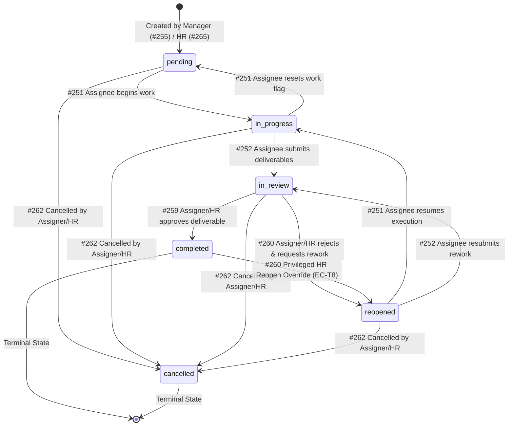

# Phase 3 — Task Assignment Module: Task Execution Lifecycle, Review Gate & Attachments Handshake
*(Production-Grade Implementation Plan)*

> **Parent document:** [implementation_plan.md](public/md_task-assignment/implementation_plan.md) — the module's single source of truth. Every architectural and design decision below implements decisions recorded there (`D-T1` … `D-T11`) and respects the functional Source of Truth (`review/2026-10-12-for_cc_task_assignment_module_functionalities_SOT.md`). **If this plan and the parent ever disagree, the parent wins and this file must be corrected.**  
> **Predecessors:**  
> - [phase1_implementation_plan.md](public/md_task-assignment/phases/phase1_implementation_plan.md) — **COMPLETED & VERIFIED** (Database migrations `00075`, feature seeder `014`, models, repositories, and test suites active on disk).  
> - [phase2_implementation_plan.md](public/md_task-assignment/phases/phase2_implementation_plan.md) — **COMPLETED & VERIFIED** (Core delegation, hierarchy resolution, self-service views, read receipts, and OCC status transitions active on disk; 28 passing unit tests).  
> **Status:** Ready for Implementation.  
> **Depends on:** Phase 1 (`tasks`, `task_attachments`, `task_comments`, `task_audit_logs`, `task_notifications` models and repositories), Phase 2 (`task.service.js`, `task_formatter.utils.js`, `task_idempotency.utils.js`, user/manager/hr controllers and routers), Platform Utilities (`auth.middleware.js`, `require_feature.middleware.js`, `hierarchy_access.utils.js`, `if_match.utils.js`, `object_storage.utils.js`, `jwt.utils.js`, `aws-s3.provider.js`, `appError.utils.js`, `api-response.util.js`).

---

## 1. Goal & Boundary

### 1.0 Goal
Deliver the complete **execution lifecycle, review and approval gates, task administration (reassignment, cancellation, deadline extension), and secure S3 file attachment handshake** across the Employee Self-Service, Managerial Oversight, and HR Governance planes:

1. **Deliverable Submission & Review Gate** — Enable employees to submit completed work with submission notes and deliverables (`in_progress` / `reopened` $\rightarrow$ `in_review` on `#252`). Enable managers and HR to either accept deliverables into the terminal `completed` state (`#259`) or reject with mandatory rework justification into `reopened` (`#260`), incrementing rework counters and capturing system feedback.
2. **Administrative Task Governance** — Enable managers and HR to reassign tasks to new eligible team members (`#261`), cancel obsolete tasks with mandatory reasons into terminal `cancelled` (`#262`), and grant deadline extensions (`#263`) while preserving the immutable baseline deadline.
3. **Two-Mode S3 Attachment Handshake (D-T7)** — Implement presigned S3 upload URLs and download streams:
   - **Mode A (Pre-Creation Staging):** Enable clients to stage file attachments before a task exists via signed, short-lived JWT staging tokens, binding them atomically inside the task creation transaction (`#268`, `#255`, `#265`).
   - **Mode B (Post-Creation / In-Task Uploads):** Enable assignees and managers to attach files directly to existing tasks for deliverable submission or briefing updates (`#268`, `#269`).
   - **Secure BOLA-Protected Downloads:** Generate time-limited presigned GET download URLs guarded by strict task relationship authorization (`#270`).

Phase 3 transitions the Task Assignment Module into a complete operational execution engine (**Endpoints #252, #259–#263, and #268–#270**), adding 9 new public HTTP APIs.

---

### 1.1 Explicitly in Scope for Phase 3

- **9 New API Endpoints (#252, #259–#263, #268–#270)**:
  - **Employee Self-Service Execution Plane (`/api/v1/tasks/me`)**:
    - `#252` `POST /api/v1/tasks/me/:id/submit` — Submit deliverables for manager review (`status → in_review`). Requires `submission_note` (min 10 chars), optional `attachment_ids`, optional `external_links`, and optimistic concurrency guard (`If-Match`).
  - **Managerial & HR Governance Plane (`/api/v1/tasks/manager`)**:
    - `#259` `POST /api/v1/tasks/manager/:id/approve` — Approve deliverable (`status → completed`). Sets `completed_at`, `completed_by`, computes `is_completed_on_time = (NOW() <= due_date)`. Guarded by `If-Match`.
    - `#260` `POST /api/v1/tasks/manager/:id/reopen` — Reject deliverable and request rework (`status → reopened`). Mandatory `reopen_reason` (min 10 chars), increments `rework_count`, injects system comment, enforces poison task guard (EC-T15). Guarded by `If-Match`.
    - `#261` `POST /api/v1/tasks/manager/:id/reassign` — Reassign task to an eligible subordinate (manager) or active org user (HR). Resets read receipt (`first_viewed_at = null`, `is_viewed = false`), increments `reassignment_count`, mandates `new_due_date` if task is overdue (EC-T7). Guarded by `If-Match`.
    - `#262` `POST /api/v1/tasks/manager/:id/cancel` — Cancel active task (`status → cancelled`). Mandatory `cancellation_reason` (min 10 chars). Guarded by `If-Match`.
    - `#263` `PATCH /api/v1/tasks/manager/:id/extend-due-date` — Extend due date. Mandatory `reason`, enforces `new_due_date > current due_date` and `> NOW() + 15m`. Increments `extension_count`. Guarded by `If-Match`.
  - **Task File Attachment Plane (`/api/v1/tasks/attachments`)**:
    - `#268` `POST /api/v1/tasks/attachments/upload-url` — Step 1 of upload handshake. Returns presigned S3 PUT URL and signed JWT `attachment_token`. Supports Mode A (`task_id` omitted) and Mode B (`task_id` provided with BOLA check and quota validation).
    - `#269` `POST /api/v1/tasks/attachments/confirm` — Step 2 of upload handshake. Verifies S3 `HeadObject` bytes and commits record to `task_attachments`.
    - `#270` `GET /api/v1/tasks/attachments/:attachmentId/download-url` — Generates 15-minute presigned GET download URL after verifying task relationship authorization (BOLA prevention).
- **Extension of Task Creation (#255, #265) in `task.service.js`**:
  - Accept `attachment_tokens` in `createTask`, verify JWT claims, and bind staged attachments atomically inside the task creation transaction via `taskAttachmentRepo.bindStagedAttachments()`.
- **New Attachment Service Layer (`src/modules/task/services/task_attachment.service.js`)**:
  - Encapsulates S3 presigning, JWT token signing/verification, MIME/size validation, quota enforcement, and BOLA download authorization.
- **New Attachment Controller, Router & Joi Validator**:
  - `task_attachment.controller.js`, `task_attachment.routes.js`, `task_attachment.validator.js`.
  - Router mounted at `/api/v1/tasks/attachments` in `task.index.js`.
- **Unit & Integration Test Suite (`tests/unit/task/task_phase3_lifecycle_and_attachments.test.js`)**:
  - Comprehensive coverage for submit, approve, reopen, reassign, cancel, extend due date, S3 upload handshake, token verification, and BOLA security.

---

### 1.2 Explicitly NOT in Scope (Deferred to Later Phases)

| Capability / Responsibility | Owning Phase | Rationale |
|---|---|---|
| In-Task Discussion Feeds (`#253`, `#254`, `#264`) | **Phase 4** | Comment threading, discussion controllers, and Redis sliding-window comment rate limiters belong to Phase 4. *(Note: Phase 3 injects system-generated comments for reopens directly into `task_comments` via `taskCommentRepo`, but public comment APIs belong to Phase 4).* |
| Redis Sliding-Window Comment Rate Limiter | **Phase 4** | Specific to interactive comment submissions. |
| Comprehensive Audit History API Endpoints | **Phase 4** | Audit records are written continuously by Phase 1–3 mutations, but dedicated audit query views belong to Phase 4. |
| Notification Outbox Cron Worker & SES Email Dispatch | **Phase 5** | `task_notification_dispatch.cron.js`, retry backoff engine, and AWS SES templates belong to Phase 5. Phase 3 enqueues outbox records transactionally. |
| Hourly Overdue Sweeper Cron | **Phase 5** | `task_overdue_sweeper.cron.js` and automated daily overdue alerts belong to Phase 5. Phase 3 evaluates overdue states dynamically. |
| Settings Catalog Integration & Org Knobs | **Phase 5** | Configuration catalog keys (`tasks.max_attachments`, `tasks.reopen_limit`) belong to Phase 5. |
| Module 6 Performance Analytics Aggregations | **Module 6** | Phase 3 populates `is_completed_on_time`, `rework_count`, and `extension_count`, but analytical reporting belongs to Module 6. |

---

## 2. Pre-Flight Checks & Codebase Grounding

Every condition below represents a verified state in the active codebase:

1. **Phase 1 & Phase 2 Complete & Verified (Zero Code Drift):**
   - 28 unit tests are passing with zero failures (`node --test tests/unit/task/task_phase2_service_and_api.test.js tests/unit/task/task_models_and_repos.test.js`).
   - All 5 models (`Task`, `TaskAttachment`, `TaskComment`, `TaskAuditLog`, `TaskNotification`) and 5 repositories are active in `src/modules/task/`.
2. **Database Migration Status (Zero Pending Migrations for Phase 3):**
   - Migration `00075-create-task-assignment-module.js` created the full schema in PostgreSQL.
   - `tasks` table already contains: `submitted_at`, `completed_at`, `completed_by`, `is_completed_on_time`, `cancelled_at`, `cancelled_by`, `cancellation_reason`, `rework_count`, `reassignment_count`, `extension_count`, `original_due_date`, `version`.
   - `task_attachments` table already defines `task_id UUID NULL` (allowing Mode A staging), `file_name`, `file_size_bytes`, `content_type`, `attachment_context`, `storage_key`.
   - **There are ZERO new database migrations required for Phase 3.**
3. **AWS S3 Provider Available & Operational:**
   - `src/infrastructure/aws-s3/aws-s3.provider.js` provides `getUploadUrl`, `getViewUrl`, `headObject`, `deleteObject`, and `StorageUnavailableError`.
   - Reuses existing environment configuration (`AWS_S3_BUCKET`, `AWS_REGION`, etc.).
4. **Object Storage Utilities Available:**
   - `src/common/utilities/object_storage.utils.js` provides `ALLOWED_CONTENT_TYPES`, `isAllowedContentType`, `buildObjectKey`, `sanitizeFileName`, `buildContentDisposition`, `isSafeReferenceUrl`.
5. **JWT Token Signing for Mode A Staging Tokens:**
   - `src/common/utilities/jwt.utils.js` exposes `verifyToken` and is configured with `ACCESS_TOKEN_SECRET`.
   - A dedicated purpose-scoped generator `generateTaskAttachmentToken(payload)` will be established.
6. **Optimistic Concurrency Control (OCC):**
   - Phase 2 established OCC checking in `task.service.js` using `If-Match` against integer `version` or ISO 8601 `updated_at`.
   - Phase 3 applies this identical pattern across all 6 mutating endpoints (`#252`, `#259`, `#260`, `#261`, `#262`, `#263`).
7. **Express 5 Getter-Only `req.query` Invariant:**
   - Any query validations must occur inside controllers via `validateOrThrow(schema, req.query)`.
8. **Hierarchy Access Enforcement:**
   - `HierarchyAccess.getAccessibleUserIds(orgId, req.user)` is used for reassignment and detail authorization.

---

## 3. Scope Reconstruction: Completed vs. Remaining

```
┌────────────────────────────────────────────────────────────────────────┐
│                        SCOPE RECONSTRUCTION MATRIX                     │
├───────────────────────────────────┬────────────────────────────────────┤
│  PHASES 1 & 2 (COMPLETED)         │  PHASE 3 (ACTUAL REMAINING SCOPE)  │
├───────────────────────────────────┼────────────────────────────────────┤
│ • PostgreSQL Schema & Migration   │ • #252: POST /tasks/me/:id/submit  │
│ • Sequelize Models (5 tables)     │ • #259: POST /tasks/manager/:id/   │
│ • Repositories (22 SPI methods)   │         approve                    │
│ • Seeder 014 (tasks.access flag)  │ • #260: POST /tasks/manager/:id/   │
│ • #249: GET /tasks/me (List)      │         reopen                     │
│ • #250: GET /tasks/me/:id (Detail │ • #261: POST /tasks/manager/:id/   │
│         + First-View Read Receipt)│         reassign                   │
│ • #251: PATCH /tasks/me/:id/status│ • #262: POST /tasks/manager/:id/   │
│         (pending ↔ in_progress)   │         cancel                     │
│ • #255: POST /tasks/manager       │ • #263: PATCH /tasks/manager/:id/  │
│ • #256: GET /tasks/manager/       │         extend-due-date            │
│         assigned-by-me            │ • #268: POST /tasks/attachments/   │
│ • #257: GET /tasks/manager/       │         upload-url (Mode A & B)    │
│         team-tasks                │ • #269: POST /tasks/attachments/   │
│ • #258: GET /tasks/manager/:id    │         confirm                    │
│ • #265: POST /tasks/hr            │ • #270: GET /tasks/attachments/    │
│ • #266: GET /tasks/hr             │         :attachmentId/download-url │
│ • #267: GET /tasks/hr/:id         │ • Bind staged attachments in       │
│ • Task DTO & Overdue Formatter    │   createTask (#255, #265)          │
│ • Redis Idempotency Guard (120s)  │ • Poison Task Alert Guard (EC-T15) │
└───────────────────────────────────┴────────────────────────────────────┘
```

---

## 4. Directory Structure & File Manifest

### 4.1 New Files Created in Phase 3
```text
src/
└── modules/
    └── task/
        ├── controllers/
        │   └── task_attachment.controller.js              ← Controller for attachment handshake (#268, #269, #270)
        ├── routes/
        │   └── task_attachment.routes.js                  ← Router mounted at /api/v1/tasks/attachments
        ├── services/
        │   └── task_attachment.service.js                 ← S3 presigning, token signing/verification, BOLA check
        └── validators/
            └── task_attachment.validator.js              ← Joi validation schemas for upload-url, confirm, download

tests/
└── unit/
    └── task/
        └── task_phase3_lifecycle_and_attachments.test.js  ← Unit test suite for Phase 3 endpoints & services
```

### 4.2 Existing Files Modified / Extended in Phase 3
```text
src/
├── common/
│   └── utilities/
│       └── jwt.utils.js                                   ← Add generateTaskAttachmentToken helper
└── modules/
    └── task/
        ├── task.index.js                                  ← Mount /api/v1/tasks/attachments router
        ├── services/
        │   └── task.service.js                            ← Add submitTask, approveTask, reopenTask, reassignTask,
        │                                                     cancelTask, extendDueDate, and staged attachment binding
        ├── controllers/
        │   ├── user_task.controller.js                    ← Add submitTask handler (#252)
        │   └── manager_task.controller.js                 ← Add approveTask, reopenTask, reassignTask,
        │                                                     cancelTask, extendDueDate handlers (#259-#263)
        ├── routes/
        │   ├── user_task.routes.js                        ← Add POST /:id/submit route (#252)
        │   └── manager_task.routes.js                     ← Add approve, reopen, reassign, cancel, extend-due-date routes
        └── validators/
            ├── user_task.validator.js                     ← Add submitTaskSchema
            └── manager_task.validator.js                  ← Add approveTaskSchema, reopenTaskSchema, reassignTaskSchema,
                                                              cancelTaskSchema, extendDueDateSchema
```

---

## 5. Task Lifecycle State Machine & Transition Rules

### 5.1 State Transition Matrix



### 5.2 Transition Rules, Guardrails & Side Effects

| From State | To State | Action / Endpoint | Permitted Caller | Validation & Invariants | Side Effects & DB Mutations |
|---|---|---|---|---|---|
| `in_progress`, `reopened` | `in_review` | `#252` Submit Deliverables | Current Assignee only | `submission_note` (10–2000 chars); optional attachments & links; `If-Match` matches version. Cannot submit from `pending` (must start work first) or terminal states. | Sets `status='in_review'`, `submitted_at=NOW()`; increments `version`; logs audit `SUBMITTED`; enqueues outbox `TASK_SUBMITTED`. |
| `in_review` | `completed` | `#259` Approve Deliverables | Assigner or HR / Admin | Task must be `in_review`; caller must be assigner or direct manager of assignee (or HR); `If-Match` matches version. Optional `approval_note`. | Sets `status='completed'`, `completed_at=NOW()`, `completed_by=caller.id`, `is_completed_on_time=(NOW() <= due_date)`; increments `version`; logs audit `COMPLETED`; enqueues outbox `TASK_COMPLETED`. |
| `in_review` | `reopened` | `#260` Request Rework | Assigner or HR / Admin | Task must be `in_review`; caller must be assigner or manager (or HR); `reopen_reason` (10–2000 chars) mandatory; `If-Match` matches version. | Sets `status='reopened'`, increments `rework_count = rework_count + 1`; injects system comment into `task_comments`; increments `version`; logs audit `REOPENED`; enqueues outbox `TASK_REOPENED`. Poison task check: if `rework_count >= 5`, triggers alert banner. |
| `completed` | `reopened` | `#260` Privileged Reopen (EC-T8) | **HR / Admin ONLY** | Plain manager rejected (`409 TASK_TERMINATED`). HR must provide `privileged_reopen_reason` (min 15 chars). `If-Match` matches version. | Sets `status='reopened'`, increments `rework_count`; resets `completed_at=null`, `completed_by=null`, `is_completed_on_time=null`; injects system comment; increments `version`; logs high-priority audit `PRIVILEGED_REOPEN`. |
| Active states (`pending`, `in_progress`, `in_review`, `reopened`) | Any active state | `#261` Reassign Task | Assigner or HR / Admin | Cannot reassign terminal tasks; cannot self-assign; `new_assignee_id !== current assignee_id`; target must be direct subordinate (manager) or active org user (HR). **If task is overdue, `new_due_date` is mandatory and must be in future (EC-T7).** | Sets `assignee_id=new_assignee_id`, resets `is_viewed=false`, `first_viewed_at=null`, `last_viewed_at=null`; increments `reassignment_count = reassignment_count + 1`; if `new_due_date` supplied, updates `due_date` and increments `extension_count`; if `status === 'in_review'`, resets to `in_progress`; increments `version`; logs audit `REASSIGNED`; enqueues outbox `TASK_ASSIGNED`. |
| Active states | `cancelled` | `#262` Cancel Task | Assigner or HR / Admin | Cannot cancel `completed` (`409 TASK_COMPLETED`) or `cancelled` (`409 TASK_TERMINATED`); `cancellation_reason` (10–500 chars) mandatory; `If-Match` matches version. | Sets `status='cancelled'`, `cancelled_at=NOW()`, `cancelled_by=caller.id`, `cancellation_reason`; increments `version`; logs audit `CANCELLED`; enqueues outbox `TASK_CANCELLED`. |
| Active states | Same active state | `#263` Extend Due Date | Assigner or HR / Admin | Cannot extend terminal tasks; `new_due_date > current due_date` and `> NOW() + 15m`; `reason` (10–500 chars) mandatory; `If-Match` matches version. | Sets `due_date=new_due_date`, increments `extension_count = extension_count + 1`; `original_due_date` stays permanently immutable; increments `version`; logs audit `DUE_DATE_EXTENDED`; enqueues outbox `TASK_DUE_DATE_EXTENDED`. |

---

## 6. Two-Mode S3 Attachment Handshake & Security Architecture

### 6.1 Handshake Sequence Flow

```
┌────────────────────────────────────────────────────────────────────────┐
│             TWO-MODE S3 ATTACHMENT HANDSHAKE ARCHITECTURE              │
├────────────────────────────────────────────────────────────────────────┤
│                                                                        │
│  MODE A: PRE-CREATION BRIEFING STAGING (Task does not exist yet)       │
│  ───────────────────────────────────────────────────────────────       │
│  1. Assigner calls POST /api/v1/tasks/attachments/upload-url           │
│     (file_name, content_type, file_size_bytes, context: 'briefing')    │
│  2. Server generates staged S3 key: org/{orgId}/tasks/staged/{uuid}_.. │
│  3. Server signs S3 PUT URL (15m) + signs JWT attachment_token         │
│  4. Assigner uploads binary directly to S3 via PUT                     │
│  5. Assigner calls POST /api/v1/tasks/manager (or /hr)                 │
│     with attachment_tokens: [token1, token2]                           │
│  6. Server verifies tokens, calls S3 HeadObject to verify bytes,       │
│     creates Task, and commits TaskAttachment rows bound to task.id     │
│     inside the primary transaction.                                    │
│                                                                        │
│  MODE B: IN-TASK / DELIVERABLE SUBMISSION UPLOAD (Task exists)         │
│  ────────────────────────────────────────────────────────────          │
│  1. Assignee/Assigner calls POST /tasks/attachments/upload-url         │
│     with task_id: UUID                                                 │
│  2. Server verifies caller relationship on task + checks quota (< 20)  │
│  3. Server generates S3 key: org/{orgId}/tasks/{taskId}/{uuid}_..      │
│  4. Server signs S3 PUT URL + signs JWT attachment_token               │
│  5. Client uploads binary directly to S3 via PUT                       │
│  6. Client calls POST /api/v1/tasks/attachments/confirm                │
│     with attachment_token                                              │
│  7. Server verifies HeadObject in S3, inserts row into task_attachments│
│                                                                        │
│  SECURE DOWNLOAD STREAM (BOLA-Protected)                               │
│  ───────────────────────────────────────                               │
│  1. User calls GET /api/v1/tasks/attachments/:attachmentId/download-url│
│  2. Server checks attachment.org_id === req.user.orgId                 │
│  3. Server checks task relationship: Assignee, Assigner, Manager of    │
│     Assignee, or HR/Admin. (Unauthorized → 403 FORBIDDEN).             │
│  4. Server signs S3 GET URL with Content-Disposition: attachment       │
│                                                                        │
└────────────────────────────────────────────────────────────────────────┘
```

### 6.2 Attachment Security & Validation Guardrails
1. **MIME Whitelist:** Strictly restricted to `image/jpeg`, `image/png`, `image/webp`, `application/pdf`, `application/msword`, `application/vnd.openxmlformats-officedocument.wordprocessingml.document`, `application/vnd.openxmlformats-officedocument.spreadsheetml.sheet`.
2. **File Size Quota:** Maximum 10MB (`10,485,760` bytes) per file. Validated both at presign and via S3 `HeadObject` during confirm.
3. **Per-Task Attachment Quota (EC-T20):** Maximum 20 active attachments per task across its lifecycle. Attempting to upload when task has $\ge 20$ attachments returns `409 ATTACHMENT_LIMIT_EXCEEDED`.
4. **File Name Sanitization:** Handled by `sanitizeFileName`: strips control characters, path separators (`/`, `\`), double quotes, and caps length at 200 chars.
5. **JWT Staging Token Payload (`attachment_token`):**
   ```javascript
   {
     sub: uploaderId,
     org_id: orgId,
     task_id: taskId || null,
     storage_key: storageKey,
     file_name: safeFileName,
     file_size_bytes: fileSizeBytes,
     content_type: contentType,
     attachment_context: context,
     purpose: 'task_attachment_upload',
     exp: Math.floor(Date.now() / 1000) + 900 // 15 minutes
   }
   ```
6. **BOLA Prevention on Downloads (#270):**
   - Must match `org_id`.
   - If bound to `task_id`: Caller must be `task.assignee_id`, `task.assigner_id`, an active manager of the assignee (via `HierarchyAccess`), or hold `GLOBAL_APPROVER_ROLES` (`['hr', 'admin', 'super-admin']`). Unauthorized callers receive `403 FORBIDDEN`.
   - If staged (`task_id === null`): Caller must be `uploader_id` or HR.

---

## 7. API Surface & Detailed Endpoint Contracts

### 7.1 Overview Matrix

| # | Endpoint | Method | Allowed Roles | Description | Controller & Service |
|---|---|---|---|---|---|
| **252** | `/api/v1/tasks/me/:id/submit` | POST | All Org Roles | Submit deliverables for review (`status → in_review`). Requires `submission_note`, optional `attachment_ids`, optional `external_links`, and `If-Match`. | `user_task.controller.js` $\rightarrow$ `task.service.js` |
| **259** | `/api/v1/tasks/manager/:id/approve` | POST | `manager`, `hr`, `admin`, `super-admin` | Approve deliverable (`status → completed`). Computes `is_completed_on_time`. Requires `If-Match`. | `manager_task.controller.js` $\rightarrow$ `task.service.js` |
| **260** | `/api/v1/tasks/manager/:id/reopen` | POST | `manager`, `hr`, `admin`, `super-admin` | Reject deliverable and request rework (`status → reopened`). Mandatory `reopen_reason`. Injects system comment. Requires `If-Match`. | `manager_task.controller.js` $\rightarrow$ `task.service.js` |
| **261** | `/api/v1/tasks/manager/:id/reassign` | POST | `manager`, `hr`, `admin`, `super-admin` | Reassign task to another eligible report. Resets read receipts. Mandates `new_due_date` if overdue. Requires `reason` and `If-Match`. | `manager_task.controller.js` $\rightarrow$ `task.service.js` |
| **262** | `/api/v1/tasks/manager/:id/cancel` | POST | `manager`, `hr`, `admin`, `super-admin` | Cancel active task (`status → cancelled`). Mandatory `cancellation_reason`. Requires `If-Match`. | `manager_task.controller.js` $\rightarrow$ `task.service.js` |
| **263** | `/api/v1/tasks/manager/:id/extend-due-date` | PATCH | `manager`, `hr`, `admin`, `super-admin` | Extend due date. Mandatory `reason` and `new_due_date > due_date`. Increments `extension_count`. Requires `If-Match`. | `manager_task.controller.js` $\rightarrow$ `task.service.js` |
| **268** | `/api/v1/tasks/attachments/upload-url` | POST | All Org Roles | Step 1: Generates presigned S3 PUT URL and signed JWT `attachment_token`. Supports Mode A (staged) and Mode B (in-task). | `task_attachment.controller.js` $\rightarrow$ `task_attachment.service.js` |
| **269** | `/api/v1/tasks/attachments/confirm` | POST | All Org Roles | Step 2: Confirms upload via S3 `HeadObject` and persists `task_attachments` record. | `task_attachment.controller.js` $\rightarrow$ `task_attachment.service.js` |
| **270** | `/api/v1/tasks/attachments/:attachmentId/download-url` | GET | All Org Roles | Step 3: Generates 15-minute presigned GET download URL with BOLA security check. | `task_attachment.controller.js` $\rightarrow$ `task_attachment.service.js` |

---

### 7.2 Detailed Endpoint Specifications

#### 252. POST `/api/v1/tasks/me/:id/submit`
* **Purpose:** Allows the assignee to submit work for managerial or HR review.
* **Headers:** `Authorization: Bearer <JWT>`, `If-Match: <version|ISO>` (Required).
* **Path Parameters:** `id` (UUID, Required) — Task identifier.
* **Request Body:**
  ```json
  {
    "submission_note": "Completed the regional revenue analysis including variance tables.",
    "attachment_ids": ["3fa85f64-5717-4562-b3fc-2c963f66afa6"],
    "external_links": [
      {
        "label": "Final Deliverable Dashboard",
        "url": "https://analytics.company.com/reports/q3"
      }
    ]
  }
  ```
* **Validations:**
  - `submission_note`: String, required, min 10 characters, max 2000 characters.
  - `attachment_ids`: Array of UUIDs, optional, max 10 items.
  - `external_links`: Array of `{ label, url }`, optional, max 5 items. URLs must pass `isSafeReferenceUrl`.
  - Task status must be `in_progress` or `reopened`.
  - Caller must be `assignee_id`.
  - `If-Match` must match current task `version` or `updated_at`.
* **Success Response (200 OK):** Returns updated formatted Task DTO with `status: 'in_review'` and `submitted_at`.
* **Errors:** `400 VALIDATION_ERROR`, `404 TASK_NOT_FOUND`, `409 INVALID_STATUS_TRANSITION`, `412 PRECONDITION_FAILED`.

---

#### 259. POST `/api/v1/tasks/manager/:id/approve`
* **Purpose:** Assigner or HR accepts the deliverable, transitioning the task into terminal `completed`.
* **Headers:** `Authorization: Bearer <JWT>`, `If-Match: <version|ISO>` (Required).
* **Path Parameters:** `id` (UUID, Required).
* **Request Body:**
  ```json
  {
    "approval_note": "Deliverables meet all acceptance criteria. Excellent work."
  }
  ```
* **Validations:**
  - `approval_note`: String, optional, max 1000 characters.
  - Task status must strictly be `in_review`.
  - Caller must be `assigner_id` OR direct manager of assignee OR hold `['hr', 'admin', 'super-admin']`.
  - `If-Match` must match current task `version` or `updated_at`.
* **Business Logic:**
  - Sets `status = 'completed'`, `completed_at = NOW()`, `completed_by = req.user.id`.
  - Statically stamps `is_completed_on_time = (dayjs().isBefore(task.due_date) || dayjs().isSame(task.due_date))`.
  - Increments `version`.
  - Records audit `COMPLETED` and enqueues outbox `TASK_COMPLETED`.
* **Success Response (200 OK):** Returns formatted Task DTO.
* **Errors:** `400 VALIDATION_ERROR`, `403 FORBIDDEN`, `404 TASK_NOT_FOUND`, `409 INVALID_STATUS_TRANSITION`, `412 PRECONDITION_FAILED`.

---

#### 260. POST `/api/v1/tasks/manager/:id/reopen`
* **Purpose:** Assigner or HR rejects deliverable and requests rework, providing mandatory feedback.
* **Headers:** `Authorization: Bearer <JWT>`, `If-Match: <version|ISO>` (Required).
* **Path Parameters:** `id` (UUID, Required).
* **Request Body:**
  ```json
  {
    "reopen_reason": "Variance figures for the Northwest region do not match the GL dump. Please recalculate."
  }
  ```
* **Validations:**
  - `reopen_reason`: String, required, min 10 characters, max 2000 characters.
  - Normal transition: Task status must be `in_review`.
  - Privileged HR Override (EC-T8): If task status is `completed`, caller **must** hold `['hr', 'admin', 'super-admin']`, and `reopen_reason` must be at least 15 characters. Plain managers attempting to reopen a completed task receive `409 TASK_TERMINATED`.
* **Business Logic:**
  - Sets `status = 'reopened'`, increments `rework_count = rework_count + 1`.
  - Injects a system-generated comment into `task_comments` table:
    `{ task_id, org_id, author_id: req.user.id, message: "REWORK REQUESTED: " + reopen_reason, system_generated: true }`.
  - Increments `version`.
  - If `rework_count >= 5` (EC-T15), logs high-priority warning flag in audit log details `{ excessive_rework_alert: true }`.
  - Records audit `REOPENED` and enqueues outbox `TASK_REOPENED`.
* **Success Response (200 OK):** Returns formatted Task DTO.
* **Errors:** `400 VALIDATION_ERROR`, `403 FORBIDDEN`, `404 TASK_NOT_FOUND`, `409 INVALID_STATUS_TRANSITION`, `412 PRECONDITION_FAILED`.

---

#### 261. POST `/api/v1/tasks/manager/:id/reassign`
* **Purpose:** Transfers ownership of an active task to another employee.
* **Headers:** `Authorization: Bearer <JWT>`, `If-Match: <version|ISO>` (Required).
* **Path Parameters:** `id` (UUID, Required).
* **Request Body:**
  ```json
  {
    "new_assignee_id": "8a9b0c1d-2e3f-4a5b-6c7d-8e9f0a1b2c3d",
    "reason": "Original assignee has gone on medical leave. Work reassigned for continuity.",
    "new_due_date": "2026-10-20T18:00:00.000Z"
  }
  ```
* **Validations:**
  - `new_assignee_id`: UUID, required. Must exist and be active in org. Cannot equal caller (`SELF_ASSIGNMENT_NOT_ALLOWED`). Cannot equal current `task.assignee_id`.
  - `reason`: String, required, min 10 characters, max 1000 characters.
  - `new_due_date`: ISO string. **Mandatory if `dayjs().isAfter(task.due_date)` (EC-T7).** If supplied, must be `> NOW() + 15m`.
  - Manager hierarchy check: Manager can only reassign to an employee in their `HierarchyAccess.getAccessibleUserIds()`. HR can reassign to anyone in tenant.
  - Task must not be in terminal state (`completed`, `cancelled`).
* **Business Logic:**
  - Updates `assignee_id = new_assignee_id`.
  - Resets read receipt: `is_viewed = false`, `first_viewed_at = null`, `last_viewed_at = null`.
  - Increments `reassignment_count = reassignment_count + 1`.
  - If `new_due_date` supplied: updates `due_date = new_due_date`, increments `extension_count = extension_count + 1`.
  - If task was `in_review`: resets `status = 'in_progress'` so new assignee can complete work.
  - Increments `version`.
  - Records audit `REASSIGNED` and enqueues outbox `TASK_ASSIGNED` for new assignee.
* **Success Response (200 OK):** Returns formatted Task DTO.
* **Errors:** `400 VALIDATION_ERROR`, `400 SELF_ASSIGNMENT_NOT_ALLOWED`, `400 OVERDUE_REASSIGNMENT_REQUIRES_NEW_DUE_DATE`, `403 FORBIDDEN`, `404 TASK_NOT_FOUND`, `409 TASK_TERMINATED`, `412 PRECONDITION_FAILED`.

---

#### 262. POST `/api/v1/tasks/manager/:id/cancel`
* **Purpose:** Terminates an active task that is no longer required.
* **Headers:** `Authorization: Bearer <JWT>`, `If-Match: <version|ISO>` (Required).
* **Path Parameters:** `id` (UUID, Required).
* **Request Body:**
  ```json
  {
    "cancellation_reason": "Project budget was frozen by leadership; deliverable no longer needed."
  }
  ```
* **Validations:**
  - `cancellation_reason`: String, required, min 10 characters, max 500 characters.
  - Cannot cancel if status is `completed` (`409 TASK_COMPLETED`).
  - Cannot cancel if status is already `cancelled` (`409 TASK_TERMINATED`).
  - Caller must be assigner or direct manager of assignee (or HR).
* **Business Logic:**
  - Sets `status = 'cancelled'`, `cancelled_at = NOW()`, `cancelled_by = req.user.id`, `cancellation_reason`.
  - Increments `version`.
  - Records audit `CANCELLED` and enqueues outbox `TASK_CANCELLED`.
* **Success Response (200 OK):** Returns formatted Task DTO.
* **Errors:** `400 VALIDATION_ERROR`, `403 FORBIDDEN`, `404 TASK_NOT_FOUND`, `409 TASK_COMPLETED`, `412 PRECONDITION_FAILED`.

---

#### 263. PATCH `/api/v1/tasks/manager/:id/extend-due-date`
* **Purpose:** Extends the active deadline of a task while preserving the immutable original baseline deadline.
* **Headers:** `Authorization: Bearer <JWT>`, `If-Match: <version|ISO>` (Required).
* **Path Parameters:** `id` (UUID, Required).
* **Request Body:**
  ```json
  {
    "new_due_date": "2026-10-25T18:00:00.000Z",
    "reason": "Client delayed data feed delivery by 5 business days."
  }
  ```
* **Validations:**
  - `new_due_date`: ISO string, required. Must be strictly after current `task.due_date` AND at least 15 minutes after current server time (`NOW() + 15m`).
  - `reason`: String, required, min 10 characters, max 500 characters.
  - Task must not be `completed` or `cancelled`.
  - Caller must be assigner or direct manager of assignee (or HR).
* **Business Logic:**
  - Updates `due_date = new_due_date`.
  - `original_due_date` remains strictly **unchanged**.
  - Increments `extension_count = extension_count + 1`.
  - Increments `version`.
  - Records audit `DUE_DATE_EXTENDED` and enqueues outbox `TASK_DUE_DATE_EXTENDED`.
* **Success Response (200 OK):** Returns formatted Task DTO.
* **Errors:** `400 VALIDATION_ERROR`, `400 INVALID_DUE_DATE`, `403 FORBIDDEN`, `404 TASK_NOT_FOUND`, `409 TASK_TERMINATED`, `412 PRECONDITION_FAILED`.

---

#### 268. POST `/api/v1/tasks/attachments/upload-url`
* **Purpose:** Step 1 of upload handshake. Generates presigned S3 PUT URL and signed JWT `attachment_token`.
* **Headers:** `Authorization: Bearer <JWT>`
* **Request Body:**
  ```json
  {
    "file_name": "q3_revenue_breakdown.xlsx",
    "content_type": "application/vnd.openxmlformats-officedocument.spreadsheetml.sheet",
    "file_size_bytes": 1048576,
    "attachment_context": "briefing",
    "task_id": "3fa85f64-5717-4562-b3fc-2c963f66afa6"
  }
  ```
* **Validations:**
  - `file_name`: String, required, sanitized via `sanitizeFileName`.
  - `content_type`: String, required, must be in `ALLOWED_CONTENT_TYPES`.
  - `file_size_bytes`: Integer, required, between 1 and 10,485,760 bytes (10MB).
  - `attachment_context`: String, optional, allowed: `'briefing'`, `'submission'`, `'comment'`. Default `'briefing'`.
  - `task_id`: UUID, optional.
    - If provided (Mode B): Task must exist in org. Caller must be assignee, assigner, or manager/HR. Task must not be cancelled. Active attachments on task must be $< 20$.
    - If omitted (Mode A): Staging mode for pre-creation.
* **Success Response (200 OK):**
  ```json
  {
    "success": true,
    "message": "Upload URL generated successfully",
    "data": {
      "upload_url": "https://s3.amazonaws.com/bucket/org/...?signature=...",
      "attachment_token": "eyJhbGciOiJIUzI1NiIsInR5cCI6IkpXVCJ9...",
      "expires_in_seconds": 900,
      "storage_key": "org/7ca642c2-.../tasks/staged/uuid_name.xlsx",
      "required_headers": {
        "Content-Type": "application/vnd.openxmlformats-officedocument.spreadsheetml.sheet",
        "Content-Length": "1048576"
      }
    }
  }
  ```

---

#### 269. POST `/api/v1/tasks/attachments/confirm`
* **Purpose:** Step 2 of upload handshake. Verifies uploaded binary via S3 `HeadObject` and persists record into `task_attachments`.
* **Headers:** `Authorization: Bearer <JWT>`
* **Request Body:**
  ```json
  {
    "attachment_token": "eyJhbGciOiJIUzI1NiIsInR5cCI6IkpXVCJ9..."
  }
  ```
* **Validations:**
  - `attachment_token`: String, required. Cryptographically verified using `jwt.utils.verifyToken`.
  - Token claims must have `purpose === 'task_attachment_upload'` and `org_id === req.user.orgId`.
* **Business Logic:**
  - Calls `aws-s3.provider.headObject({ key: storage_key })`.
  - Throws `400 ATTACHMENT_NOT_FOUND_IN_STORAGE` if S3 returns null / 404.
  - Verifies S3 `contentLength` matches token `file_size_bytes` (or within 5%).
  - Creates row in `task_attachments` table with `org_id`, `task_id` (null if Mode A), `uploader_id`, `storage_key`, `file_name`, `file_size_bytes`, `content_type`, `attachment_context`.
* **Success Response (201 Created):**
  ```json
  {
    "success": true,
    "message": "Attachment confirmed successfully",
    "data": {
      "attachment": {
        "id": "7fa85f64-5717-4562-b3fc-2c963f66afa6",
        "org_id": "7ca642c2-8097-40c2-9013-176313ef0101",
        "task_id": "3fa85f64-5717-4562-b3fc-2c963f66afa6",
        "uploader_id": "a1b2c3d4-e5f6-7a8b-9c0d-1e2f3a4b5c6d",
        "file_name": "q3_revenue_breakdown.xlsx",
        "file_size_bytes": 1048576,
        "content_type": "application/vnd.openxmlformats-officedocument.spreadsheetml.sheet",
        "attachment_context": "briefing",
        "created_at": "2026-10-13T03:00:00.000Z"
      }
    }
  }
  ```

---

#### 270. GET `/api/v1/tasks/attachments/:attachmentId/download-url`
* **Purpose:** Step 3 of upload handshake. Generates a time-limited 15-minute presigned GET download URL after verifying task relationship authorization (BOLA prevention).
* **Headers:** `Authorization: Bearer <JWT>`
* **Path Parameters:** `attachmentId` (UUID, Required).
* **Validations:**
  - Attachment must exist in caller's `org_id` and not be soft-deleted.
  - BOLA check:
    - If `task_id` populated: Caller must be `task.assignee_id`, `task.assigner_id`, an active manager of the assignee (via `HierarchyAccess`), or hold `GLOBAL_APPROVER_ROLES` (`['hr', 'admin', 'super-admin']`). Unauthorized callers receive `403 FORBIDDEN`.
    - If `task_id` null (staged): Caller must be `uploader_id` or HR.
* **Business Logic:**
  - Computes `contentDisposition = buildContentDisposition('attachment', attachment.file_name, attachment.content_type)`.
  - Calls `aws-s3.provider.getViewUrl({ key: attachment.storage_key, contentType: attachment.content_type, contentDisposition, ttlSeconds: 900 })`.
* **Success Response (200 OK):**
  ```json
  {
    "success": true,
    "message": "Download URL generated successfully",
    "data": {
      "download_url": "https://s3.amazonaws.com/bucket/org/...?signature=...",
      "expires_in_seconds": 900,
      "file_name": "q3_revenue_breakdown.xlsx",
      "content_type": "application/vnd.openxmlformats-officedocument.spreadsheetml.sheet",
      "file_size_bytes": 1048576
    }
  }
  ```

---

## 8. Service & Repository Implementation Specifications

### 8.1 Methods Added to `task.service.js`

```javascript
/**
 * Submits task deliverables for review (#252).
 * @param {string} orgId
 * @param {string} taskId
 * @param {string} userId - Authenticated assignee
 * @param {Object} payload - { submission_note, attachment_ids, external_links }
 * @param {string} ifMatchHeader
 * @param {Object} meta - { ipAddress, userAgent }
 */
async submitTask(orgId, taskId, userId, payload, ifMatchHeader, meta = {})

/**
 * Approves task deliverable into completed status (#259).
 * @param {string} orgId
 * @param {string} taskId
 * @param {Object} requesterUser - Assigner or Manager or HR
 * @param {Object} payload - { approval_note }
 * @param {string} ifMatchHeader
 * @param {Object} meta
 */
async approveTask(orgId, taskId, requesterUser, payload, ifMatchHeader, meta = {})

/**
 * Rejects deliverable and requests rework with feedback (#260).
 * Handles normal review rework and privileged HR reopen of completed tasks (EC-T8).
 * @param {string} orgId
 * @param {string} taskId
 * @param {Object} requesterUser
 * @param {Object} payload - { reopen_reason }
 * @param {string} ifMatchHeader
 * @param {Object} meta
 */
async reopenTask(orgId, taskId, requesterUser, payload, ifMatchHeader, meta = {})

/**
 * Reassigns task to a new eligible assignee (#261).
 * Enforces future due date if overdue (EC-T7).
 * @param {string} orgId
 * @param {string} taskId
 * @param {Object} requesterUser
 * @param {Object} payload - { new_assignee_id, reason, new_due_date }
 * @param {string} ifMatchHeader
 * @param {Object} meta
 */
async reassignTask(orgId, taskId, requesterUser, payload, ifMatchHeader, meta = {})

/**
 * Cancels active task (#262).
 * @param {string} orgId
 * @param {string} taskId
 * @param {Object} requesterUser
 * @param {Object} payload - { cancellation_reason }
 * @param {string} ifMatchHeader
 * @param {Object} meta
 */
async cancelTask(orgId, taskId, requesterUser, payload, ifMatchHeader, meta = {})

/**
 * Extends task due date while preserving original_due_date (#263).
 * @param {string} orgId
 * @param {string} taskId
 * @param {Object} requesterUser
 * @param {Object} payload - { new_due_date, reason }
 * @param {string} ifMatchHeader
 * @param {Object} meta
 */
async extendDueDate(orgId, taskId, requesterUser, payload, ifMatchHeader, meta = {})
```

### 8.2 New Service: `task_attachment.service.js`

```javascript
class TaskAttachmentService {
  /**
   * Generates presigned S3 upload URL and signed JWT staging token (#268).
   */
  async generateUploadUrl(orgId, userId, payload)

  /**
   * Confirms S3 upload via HeadObject and commits to task_attachments (#269).
   */
  async confirmUpload(orgId, userId, attachmentToken)

  /**
   * Generates presigned S3 download URL after verifying BOLA authorization (#270).
   */
  async generateDownloadUrl(orgId, requesterUser, attachmentId)

  /**
   * Validates and binds staged attachment tokens inside task creation.
   */
  async bindStagedTokens(orgId, taskId, uploaderId, tokens, transaction)
}
```

---

## 9. Validation Schemas (Joi) Specification

### 9.1 `user_task.validator.js` Extensions
```javascript
const submitTaskSchema = Joi.object({
  submission_note: Joi.string().trim().min(10).max(2000).required().messages({
    'string.empty': 'Submission note is required',
    'string.min': 'Submission note must be at least 10 characters long',
    'string.max': 'Submission note cannot exceed 2000 characters'
  }),
  attachment_ids: Joi.array().items(Joi.string().uuid()).max(10).default([]),
  external_links: Joi.array().items(
    Joi.object({
      label: Joi.string().trim().min(1).max(100).required(),
      url: Joi.string().trim().uri({ scheme: ['https'] }).max(1000).required()
    })
  ).max(5).default([])
}).required()
```

### 9.2 `manager_task.validator.js` Extensions
```javascript
const approveTaskSchema = Joi.object({
  approval_note: Joi.string().trim().max(1000).allow('', null).optional()
})

const reopenTaskSchema = Joi.object({
  reopen_reason: Joi.string().trim().min(10).max(2000).required().messages({
    'string.empty': 'Reopen reason is required',
    'string.min': 'Reopen reason must be at least 10 characters long'
  })
})

const reassignTaskSchema = Joi.object({
  new_assignee_id: Joi.string().uuid().required().messages({
    'string.empty': 'New assignee ID is required'
  }),
  reason: Joi.string().trim().min(10).max(1000).required().messages({
    'string.empty': 'Reassignment reason is required',
    'string.min': 'Reassignment reason must be at least 10 characters long'
  }),
  new_due_date: Joi.string().isoDate().optional()
})

const cancelTaskSchema = Joi.object({
  cancellation_reason: Joi.string().trim().min(10).max(500).required().messages({
    'string.empty': 'Cancellation reason is required',
    'string.min': 'Cancellation reason must be at least 10 characters long'
  })
})

const extendDueDateSchema = Joi.object({
  new_due_date: Joi.string().isoDate().required().messages({
    'string.empty': 'New due date is required'
  }),
  reason: Joi.string().trim().min(10).max(500).required().messages({
    'string.empty': 'Reason for extension is required',
    'string.min': 'Extension reason must be at least 10 characters long'
  })
})
```

### 9.3 `task_attachment.validator.js`
```javascript
const uploadUrlSchema = Joi.object({
  file_name: Joi.string().trim().min(1).max(255).required(),
  content_type: Joi.string().trim().valid(...ALLOWED_CONTENT_TYPES).required(),
  file_size_bytes: Joi.number().integer().min(1).max(10485760).required(),
  attachment_context: Joi.string().valid('briefing', 'submission', 'comment').default('briefing'),
  task_id: Joi.string().uuid().optional()
})

const confirmUploadSchema = Joi.object({
  attachment_token: Joi.string().trim().required()
})
```

---

## 10. Concurrency, OCC (`If-Match`) & Idempotency Controls

### 10.1 Optimistic Concurrency Control (OCC) Standard
Every state transition endpoint (`submit`, `approve`, `reopen`, `reassign`, `cancel`, `extend-due-date`) enforces OCC:
1. Client passes `If-Match: "1"` (integer version) or `If-Match: "2026-10-12T10:00:00.000Z"` (ISO string).
2. Sanitized via stripping weak prefixes: `trimmedMatch = String(header).trim().replace(/^W\/"|"$/g, '')`.
3. Checked against `task.version` and `task.updated_at`.
4. Mismatch triggers:
   ```json
   {
     "success": false,
     "message": "Task was modified by another request. Please reload and retry.",
     "errorCode": "PRECONDITION_FAILED",
     "details": {
       "current_version": 2,
       "current_updated_at": "2026-10-12T10:15:00.000Z"
     }
   }
   ```
5. Database update includes `expectedVersion` in the `WHERE` clause: `WHERE id = :id AND org_id = :orgId AND version = :expectedVersion`, guaranteeing zero lost updates under race conditions.

---

## 11. Transaction Boundaries, Outbox Notification Events & Audit Logging

Every mutating lifecycle operation executes inside an atomic Sequelize database transaction:

```
BEGIN TRANSACTION;
  1. UPDATE tasks (mutate state, bump version, stamp timestamps)
  2. INSERT INTO task_audit_logs (record action, actor, from_status, to_status, details)
  3. INSERT INTO task_notifications (enqueue event with deterministic dedupe_key)
  4. (Optional) INSERT INTO task_comments (inject system-generated rework note)
  5. (Optional) INSERT/UPDATE task_attachments (bind attachments)
COMMIT;
```

### Notification Outbox Deduplication Keys (D-T10)

| Event Type | Recipient | Deduplication Key Pattern |
|---|---|---|
| `TASK_SUBMITTED` | Assigner | `task_submitted:${task.id}:${task.version}` |
| `TASK_COMPLETED` | Assignee | `task_completed:${task.id}:${task.version}` |
| `TASK_REOPENED` | Assignee | `task_reopened:${task.id}:${task.rework_count}` |
| `TASK_ASSIGNED` (Reassign) | New Assignee | `task_assigned:${task.id}:${new_assignee_id}` |
| `TASK_CANCELLED` | Assignee | `task_cancelled:${task.id}:${task.version}` |
| `TASK_DUE_DATE_EXTENDED`| Assignee | `task_extended:${task.id}:${task.extension_count}` |

---

## 12. Comprehensive Edge Cases & Defensive Engineering Register

| # | Edge Case / Production Failure Mode | Concrete Technical Defense |
|---|---|---|
| **EC-T4** | **Simultaneous Submit & Cancel Collision (Race Condition)** | Both endpoints enforce `If-Match`. The first request updates `version: 1 → 2`. The second request detects version mismatch and throws `412 PRECONDITION_FAILED`. |
| **EC-T7** | **Reassigning an Overdue Task Without Extending Deadline** | Service checks `isTaskOverdue(task)`. If true, `new_due_date` is mandatory and must be in future (`> NOW() + 15m`). If missing or past, throws `400 OVERDUE_REASSIGNMENT_REQUIRES_NEW_DUE_DATE`. |
| **EC-T8** | **Reopening a Completed Task** | Plain managers are rejected with `409 TASK_TERMINATED`. Only HR/Admin can reopen a completed task, requiring `reopen_reason` $\ge 15$ chars, and logging high-severity audit `PRIVILEGED_REOPEN`. |
| **EC-T9** | **Orphaned S3 File Uploads** | Files uploaded to S3 without calling confirm remain in `org/{orgId}/tasks/staged/`. S3 lifecycle rules automatically purge unconfirmed staged files after 24h. No ghost records in PostgreSQL. |
| **EC-T10** | **MIME Spoofing / Malicious Executable Renaming** | Server validates declared MIME against `ALLOWED_CONTENT_TYPES`. S3 presigned URL requires matching `Content-Type` header. S3 `HeadObject` validates actual byte size before confirmation. |
| **EC-T15** | **Excessive Rework Loop ("Poison Task")** | When `rework_count >= 5`, service injects warning into audit details `{ excessive_rework_alert: true }` and flags outbox payload for management intervention. |
| **EC-T20** | **Attachment Quota Exhaustion (DoS Attempt)** | Upload-URL checks count of existing attachments for `task_id`. If count $\ge 20$, rejects with `409 ATTACHMENT_LIMIT_EXCEEDED`. |
| **EC-T22** | **Broken Object Level Authorization (BOLA) on Downloads** | Download URL generator verifies `attachment.org_id === req.user.orgId` AND checks task relationship. Unrelated users receive `403 FORBIDDEN`. |
| **EC-T25** | **Direct Submit from `pending` Without Starting Work** | State machine requires assignee to acknowledge task by starting work (`in_progress`). Attempting to submit from `pending` is rejected with `409 INVALID_STATUS_TRANSITION`. |
| **EC-T26** | **Retroactive Baseline Deadline Tampering** | When extending due date (#263), only `due_date` is updated. `original_due_date` is permanently immutable, ensuring Module 6 performance metrics cannot be gamed. |

---

## 13. Implementation Sequence & Dependency Order

To ensure uninterrupted development and green tests at every milestone:

```
Step 1: JWT Attachment Token Helper
        └── Add generateTaskAttachmentToken to src/common/utilities/jwt.utils.js

Step 2: Joi Validation Schemas
        ├── Create src/modules/task/validators/task_attachment.validator.js
        ├── Extend src/modules/task/validators/user_task.validator.js (submitTaskSchema)
        └── Extend src/modules/task/validators/manager_task.validator.js (approve, reopen, reassign, cancel, extend)

Step 3: Task Attachment Domain Service
        └── Create src/modules/task/services/task_attachment.service.js
            (S3 presigned PUT/GET, HeadObject check, JWT verify, BOLA auth)

Step 4: Task Attachment Controller & Router
        ├── Create src/modules/task/controllers/task_attachment.controller.js
        ├── Create src/modules/task/routes/task_attachment.routes.js
        └── Mount at /api/v1/tasks/attachments in src/modules/task/task.index.js

Step 5: Task Service Lifecycle Extensions
        └── Add submitTask, approveTask, reopenTask, reassignTask, cancelTask,
            extendDueDate, and staged attachment binding to src/modules/task/services/task.service.js

Step 6: User & Manager Controller & Route Additions
        ├── Extend src/modules/task/controllers/user_task.controller.js & user_task.routes.js (#252)
        └── Extend src/modules/task/controllers/manager_task.controller.js & manager_task.routes.js (#259-#263)

Step 7: Unit & Integration Test Suite
        └── Create tests/unit/task/task_phase3_lifecycle_and_attachments.test.js
            Verify 100% passing across Phase 1, Phase 2, and Phase 3 suites.
```

---

## 14. Testing & Verification Strategy

### 14.1 Unit Test Coverage Target (`task_phase3_lifecycle_and_attachments.test.js`)
- **T-P3-1:** `submitTask` successfully transitions task `in_progress` $\rightarrow$ `in_review` with submission note and audit log.
- **T-P3-2:** `submitTask` rejects submission from `pending` status (`409 INVALID_STATUS_TRANSITION`).
- **T-P3-3:** `approveTask` transitions `in_review` $\rightarrow$ `completed` and accurately computes `is_completed_on_time`.
- **T-P3-4:** `reopenTask` transitions `in_review` $\rightarrow$ `reopened`, increments `rework_count`, and injects system comment.
- **T-P3-5:** `reopenTask` on `completed` task rejects plain manager (`409`) but permits HR with privileged reason (EC-T8).
- **T-P3-6:** `reassignTask` updates `assignee_id`, resets `is_viewed` and `first_viewed_at`, and increments `reassignment_count`.
- **T-P3-7:** `reassignTask` on overdue task enforces mandatory future `new_due_date` (EC-T7).
- **T-P3-8:** `cancelTask` transitions active task to `cancelled` with reason; rejects cancellation of `completed` task.
- **T-P3-9:** `extendDueDate` updates `due_date`, increments `extension_count`, and preserves immutable `original_due_date`.
- **T-P3-10:** Optimistic concurrency control rejects stale `If-Match` with `412 PRECONDITION_FAILED` across all actions.
- **T-P3-11:** `upload-url` generates valid presigned URL and signed JWT `attachment_token` for Mode A and Mode B.
- **T-P3-12:** `upload-url` rejects file exceeding 10MB or disallowed MIME type.
- **T-P3-13:** `upload-url` enforces 20-attachment quota limit per task (EC-T20).
- **T-P3-14:** `confirm` verifies token claims, checks S3 `HeadObject`, and commits row to `task_attachments`.
- **T-P3-15:** `download-url` enforces BOLA protection, granting access to assignee/manager/HR and rejecting third parties.

---

## 15. Production Readiness & Sign-Off Checklist

- [ ] Zero database migration changes needed (Migration `00075` is fully sufficient).
- [ ] All 9 new API endpoints (#252, #259–#263, #268–#270) implemented and documented.
- [ ] Mode A staged attachments binding in `createTask` verified.
- [ ] Optimistic concurrency control (`If-Match`) enforced on all mutating transitions.
- [ ] Mandatory feedback/reasons enforced on rework, cancellation, and due date extensions.
- [ ] BOLA security enforced on attachment downloads.
- [ ] Express 5 getter-only `req.query` invariant respected.
- [ ] Semicolon-free StandardJS styling strictly preserved.
- [ ] All test suites (`task_models_and_repos.test.js`, `task_phase2_service_and_api.test.js`, `task_phase3_lifecycle_and_attachments.test.js`) pass with 0 failures.
