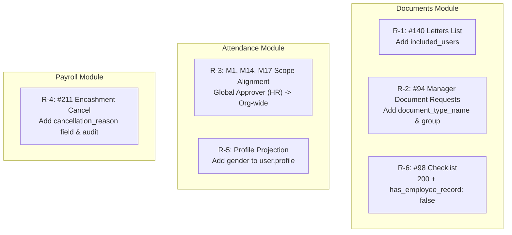

# Implementation Plan: 28 Sep 2026 Frontend Review Fixes

**Target:** Antigravity AI & Backend Engineering Team  
**Date:** 29 September 2026  
**Status:** Ready for Review & Execution  
**Source Specification:** [`public/md_updates/2026-09-28_frontend_requests_to_backend.md`](file:///c:/Users/91930/Desktop/Vs_Code/HRMS/public/md_updates/2026-09-28_frontend_requests_to_backend.md)  
**Modules Affected:** `document`, `attendance`, `payroll`, `common`

---

## 1. Overview & Architectural Principles

During the 28 Sep 2026 end-to-end UI review of `https://development.hrclouds.in`, the frontend team identified **six (6) operational gaps** across the HR, Manager, and Employee workspaces. 

All 6 requests are **strictly additive**—they augment existing API response envelopes or align internal authorization scopes without modifying the semantics of existing fields, preserving full backward compatibility.

### Guiding Principles:
1. **Strict Layer Separation:** Controllers remain thin; business rules reside in Services; database interactions and associations reside in Repositories.
2. **Zero Extra DB Queries (N+1 Prevention):** All added data (e.g., recipient UUIDs, document type names, gender) must be fetched using existing projections, SQL joins, or batch lookups.
3. **Single Source of Truth for Hierarchy:** All manager scope evaluations must strictly utilize `src/common/utilities/hierarchy_access.utils.js`.
4. **Full Audit Logging:** State-changing operations (such as encashment cancellation with a reason) must write atomic entries to the audit ledger.

---

## 2. Requirement-by-Requirement Implementation Plan



---

### R-1 · Letters Register: Include Recipient in List Items
* **Priority:** High
* **API:** `GET /api/v1/documents/hr/letters` (Registry #140)
* **Actor / Role:** `hr`

#### Problem & Root Cause:
In [`src/modules/document/services/document_letter.service.js:715`](file:///c:/Users/91930/Desktop/Vs_Code/HRMS/src/modules/document/services/document_letter.service.js#L715), the `_letterListView` projection omits `included_users`. However, the repository [`src/modules/document/repositories/org_document.repository.js`](file:///c:/Users/91930/Desktop/Vs_Code/HRMS/src/modules/document/repositories/org_document.repository.js#L25) already includes `included_users` in `LIST_ATTRIBUTES`. Therefore, the data is already being retrieved from PostgreSQL; it was simply scrubbed out during serialization.

#### Proposed Changes:
1. **Service Layer (`src/modules/document/services/document_letter.service.js`):**
   * In `_letterListView(row)`, add:
     ```javascript
     included_users: Array.isArray(plain.included_users) ? plain.included_users : []
     ```
   * Ensures identical shape to the single-letter detail view (#141).
2. **Documentation (`public/md_pdf-generation/phases/phase2_api_analysis.md`):**
   * Update the #140 response example to show `included_users: ["<uuid>"]`.

#### Risk & Performance:
* **Zero DB impact:** `included_users` is already fetched by `OrgDocument.findAndCountAll`.
* **Zero breaking changes:** Pure addition to the list item payload.

---

### R-2 · Manager Document Requests: Embed Document Type Name & Group
* **Priority:** High
* **API:** `GET /api/v1/documents/manager/document-requests` (Registry #94) & Detail Endpoints (#95)
* **Actor / Role:** `manager`, `hr`

#### Problem & Root Cause:
Requests in [`src/modules/document/repositories/document_request.repository.js`](file:///c:/Users/91930/Desktop/Vs_Code/HRMS/src/modules/document/repositories/document_request.repository.js#L70) are fetched from `document_requests` without joining `document_types`. Furthermore, [`serializeRequest`](file:///c:/Users/91930/Desktop/Vs_Code/HRMS/src/modules/document/services/document_request.service.js#L497) does not project type metadata. Because managers can only view catalog types where `manager_can_view = true` when querying `/types` (#25), any request created by HR for other documents (e.g. Aadhaar Card) cannot be resolved by the frontend, showing as `"A document"`.

#### Proposed Changes:
1. **Repository Layer (`src/modules/document/repositories/document_request.repository.js`):**
   * In `findList(orgId, ...)` and `findById(orgId, ...)`, add an eager-loading association:
     ```javascript
     include: [{
       model: db.DocumentType,
       as: 'documentType',
       attributes: ['id', 'name', 'group'],
       required: false
     }]
     ```
2. **Service Layer (`src/modules/document/services/document_request.service.js`):**
   * In `serializeRequest(row, { plane, todayIst })`:
     ```javascript
     const typeName = p.documentType ? p.documentType.name : (p.document_type_name || null)
     const typeGroup = p.documentType ? p.documentType.group : (p.document_type_group || null)

     out.document_type_name = typeName
     out.document_type_group = typeGroup
     ```
   * Applied across HR, manager, and self views consistently.

#### Risk & Performance:
* Joined on foreign key `document_type_id = document_types.id` (indexed, primary key lookup). Negligible latency overhead.

---

### R-3 · Align Scope across Manager Attendance Endpoints
* **Priority:** Medium
* **APIs:**
  - `GET /api/v1/attendance/manager/team/today` (M1)
  - `GET /api/v1/attendance/manager/team/summary` (M14)
  - `GET /api/v1/attendance/manager/team/graph-data` (M17)
* **Actor / Role:** `manager`, `hr`, `admin`, `super-admin`

#### Problem & Root Cause:
In [`src/common/utilities/hierarchy_access.utils.js:35`](file:///c:/Users/91930/Desktop/Vs_Code/HRMS/src/common/utilities/hierarchy_access.utils.js#L35), for global approvers (`hr`, `admin`, `super-admin`), `getAccessibleUserIds()` returns `null` (representing no hierarchy restriction, i.e., organization-wide).
* **In M1 (`team.service.js:20`):**
  ```javascript
  if (allowedUserIds === null) {
    allowedUserIds = await userRoleRepository.findEmployeeIds(orgId)
  }
  ```
  It correctly expands `null` to all active employee IDs in the org.
* **In M14 & M17 (`manager_attendance_read.service.js:21, 269`):**
  ```javascript
  if (!allowedUserIds || allowedUserIds.length === 0) {
    return { ... empty data ... }
  }
  ```
  Because `allowedUserIds === null`, `!allowedUserIds` evaluates to `true`, causing M14 and M17 to return empty lists for any caller with an HR or Admin role.

#### Proposed Changes:
1. **Service Layer (`src/modules/attendance/services/manager_attendance_read.service.js`):**
   * In both `getTeamSummary` (M14) and `getTeamGraphData` (M17), replicate M1's global-approver expansion before checking for emptiness:
     ```javascript
     let allowedUserIds = await accessControl.getAccessibleUserIds(orgId, requesterUser)
     if (allowedUserIds === null) {
       allowedUserIds = await userRoleRepository.findEmployeeIds(orgId)
     }
     if (!allowedUserIds || allowedUserIds.length === 0) {
       // Return empty structure
     }
     ```
   * Ensure `userRoleRepository` is imported in `manager_attendance_read.service.js`.

#### Hierarchy Verification for Managers:
* For a regular `manager`, `allowedUserIds` returns an array of subordinate IDs from `user_reporting_mappings`. In that case, `allowedUserIds !== null`, so M1, M14, and M17 will consistently filter to the manager's exact reporting hierarchy.

---

### R-4 · Encashment Cancel: Accept & Store `cancellation_reason`
* **Priority:** Medium
* **API:** `POST /api/v1/payroll/hr/encashments/:id/cancel` (Registry #211)
* **Actor / Role:** `hr`

#### Problem & Root Cause:
Currently, the route only validates URL params (`idParamSchema`) and the controller ignores `req.body`. In `comp_off_encashments`, there is a `rejection_reason` column for #210, but no `cancellation_reason` column for #211. When HR cancels an encashment, their typed cancellation reason is lost.

#### Proposed Changes:
1. **Database Migration (`src/infrastructure/postgres-sql/migrations/`):**
   * Add a nullable text column: `cancellation_reason` to `comp_off_encashments`.
2. **Sequelize Model (`src/modules/payroll/models/comp_off_encashment.model.js`):**
   * Declare attribute:
     ```javascript
     cancellation_reason: { type: DataTypes.TEXT, allowNull: true }
     ```
3. **Validator (`src/modules/payroll/validators/payroll_hr.validator.js`):**
   * Define `cancelEncashmentSchema`:
     ```javascript
     const cancelEncashmentSchema = Joi.object({
       cancellation_reason: Joi.string().trim().min(1).max(1000).allow(null, '')
     }).unknown(false)
     ```
4. **Controller (`src/modules/payroll/controllers/payroll_hr.controller.js`):**
   * Parse `const { cancellation_reason } = validateOrThrow(schemas.cancelEncashmentSchema, req.body)`
   * Pass `cancellation_reason` into `encashmentService.cancel(orgId, id, req.user, actorContext(req), cancellation_reason)`.
5. **Service Layer (`src/modules/payroll/services/encashment.service.js`):**
   * In `cancel(...)`:
     * When updating `status: 'cancelled'`, save `cancellation_reason: cancellationReason || null`.
     * Write `reason: cancellationReason` into `payrollAuditService.record(...)`.
   * Return the updated row (which includes `cancellation_reason`).

---

### R-5 · Person Profile Embed: Add `gender`
* **Priority:** Low
* **APIs:**
  - Attendance M1: `GET /api/v1/attendance/manager/team/today`
  - Attendance M3: `GET /api/v1/attendance/manager/team/anomalies`
  - Attendance M11: `GET /api/v1/attendance/manager/comp-offs/pending`
  - Attendance HR #37: `GET /api/v1/attendance/hr/comp-offs`

#### Problem & Root Cause:
In PostgreSQL, `gender` is stored in `employee_profiles.gender`, `manager_profiles.gender`, and `hr_profiles.gender`. However:
1. Repository queries across `attendance_records.repository.js`, `attendance_anomalies.repository.js`, and `attendance_comp_offs.repository.js` omit `'gender'` from the `attributes` list of `employee_profile`, `manager_profile`, and `hr_profile`.
2. [`src/common/utilities/profile.utils.js`](file:///c:/Users/91930/Desktop/Vs_Code/HRMS/src/common/utilities/profile.utils.js) does not extract or project `gender`.

#### Proposed Changes:
1. **Utility Layer (`src/common/utilities/profile.utils.js`):**
   * In `formatUserProfile(user)`:
     ```javascript
     const gender = roleProfile.gender || user.profile?.gender || null
     return {
       ...
       gender
     }
     ```
2. **Repository Layer (`src/modules/attendance/repositories/`):**
   * In `attendance_records.repository.js`:
     * Add `'gender'` to `attributes` of `employee_profile`, `manager_profile`, and `hr_profile` in `findUsersWithProfilesForTeam` and `findTeamRecordsWithProfiles`.
   * In `attendance_anomalies.repository.js` & `attendance_comp_offs.repository.js`:
     * Add `'gender'` to the corresponding profile includes.
3. **Response Model Formatter:**
   * Where raw Sequelize rows are returned with nested `user.profile`, attach `gender` to `user.profile` before JSON serialization (or via a clean mapper), so avatars can immediately render the gender-specific illustration without issuing redundant queries to `/organizations/employees`.

---

### R-6 · Document Checklist: Return 200 for Users Without Employee Profiles
* **Priority:** Low
* **API:** `GET /api/v1/documents/me/checklist` (Registry #98)
* **Actor / Role:** Any authenticated tenant user

#### Problem & Root Cause:
In [`src/modules/document/services/document_checklist.service.js:157`](file:///c:/Users/91930/Desktop/Vs_Code/HRMS/src/modules/document/services/document_checklist.service.js#L157):
```javascript
const profileRow = await this._loadProfile(orgId, userId)
if (!profileRow) throw new AppError(404, 'Employee not found', 'USER_NOT_FOUND')
```
If an administrative user (such as HR or a Contractor/Admin) accesses their own checklist via `/documents/me/checklist` but has no row in `employee_profiles`, the service throws a `404 USER_NOT_FOUND` error. This creates noisy error logs in production for a completely benign and expected state.

#### Proposed Changes:
1. **Service Layer (`src/modules/document/services/document_checklist.service.js`):**
   * In `forUser(orgId, userId, { actorId, actorRole, ... })`:
     * When `actorRole === 'self'` and `!profileRow`:
       ```javascript
       if (!profileRow) {
         if (actorRole === 'self') {
           return {
             user_id: userId,
             has_employee_record: false,
             completeness: {
               required: 0,
               satisfied: 0,
               percent: 100,
               threshold: 100,
               meets_threshold: true
             },
             items: []
           }
         }
         throw new AppError(404, 'Employee not found', 'USER_NOT_FOUND')
       }
       ```
     * When `profileRow` exists:
       Add `has_employee_record: true` to the returned result object.
2. **Safety Boundary:**
   * When an HR or Manager user inspects *another* user's checklist (`actorRole === 'hr'` or `'manager'`), a non-existent subject still correctly returns `404 USER_NOT_FOUND`.

---

## 3. Implementation Phases & Execution Order

We will execute the changes in sequential phases to ensure stability:

| Phase | Tasks | Files Modified | Validation |
| :---: | :--- | :--- | :--- |
| **Phase 1** | **R-1 & R-6 (Document Module Low/High Quick Wins)** | • `src/modules/document/services/document_letter.service.js`<br>• `src/modules/document/services/document_checklist.service.js` | Run unit tests for letter list and checklist |
| **Phase 2** | **R-2 (Document Request Eager Loading)** | • `src/modules/document/repositories/document_request.repository.js`<br>• `src/modules/document/services/document_request.service.js` | Verify manager request list returns type name & group |
| **Phase 3** | **R-3 & R-5 (Attendance Scope & Gender Projections)** | • `src/modules/attendance/services/manager_attendance_read.service.js`<br>• `src/common/utilities/profile.utils.js`<br>• `src/modules/attendance/repositories/attendance_records.repository.js`<br>• `src/modules/attendance/repositories/attendance_anomalies.repository.js`<br>• `src/modules/attendance/repositories/attendance_comp_offs.repository.js` | Test M1, M14, M17 with HR token and Manager token; verify `gender` presence |
| **Phase 4** | **R-4 (Payroll Encashment Cancel Reason)** | • Migration file: `add_cancellation_reason_to_comp_off_encashments`<br>• `src/modules/payroll/models/comp_off_encashment.model.js`<br>• `src/modules/payroll/validators/payroll_hr.validator.js`<br>• `src/modules/payroll/controllers/payroll_hr.controller.js`<br>• `src/modules/payroll/services/encashment.service.js` | Test cancellation with and without reason; check DB row and audit log |
| **Phase 5** | **Documentation Updates** | • `public/md_updates/` dated record<br>• `public/md_documents/combined_api_analysis.md`<br>• `public/md_payrolls/` | Synchronize API specs with code changes |

---

## 4. Verification & Testing Matrix

| Request | Test Scenario | Expected Outcome |
| :--- | :--- | :--- |
| **R-1** | Call `GET /api/v1/documents/hr/letters` | Each item in `items` contains `included_users: ["<uuid>"]`. |
| **R-2** | Call `GET /api/v1/documents/manager/document-requests` | Rows carry `document_type_name` and `document_type_group`. |
| **R-3** | Call M1, M14, M17 with HR JWT token | All three endpoints return records for the entire organization. |
| **R-3** | Call M1, M14, M17 with Manager JWT token | All three endpoints return records strictly for the manager's reporting subordinates. |
| **R-4** | Call `POST /api/v1/payroll/hr/encashments/:id/cancel` with `{ "cancellation_reason": "Employee requested rollover" }` | Returns `200`, stores reason in `comp_off_encashments`, and records reason in `payroll_audit_logs`. |
| **R-5** | Call M1 (`team/today`), M3 (`anomalies`), M11, and HR #37 | `user.profile` includes `gender: "male" \| "female" \| "other"`. |
| **R-6** | Call `GET /api/v1/documents/me/checklist` with an HR login without an `employee_profile` | Returns `200 OK` with `{ "has_employee_record": false, "items": [] }`. |
| **R-6** | Call `GET /api/v1/documents/me/checklist` with an employee with a valid profile | Returns `200 OK` with `{ "has_employee_record": true, "items": [...] }`. |
