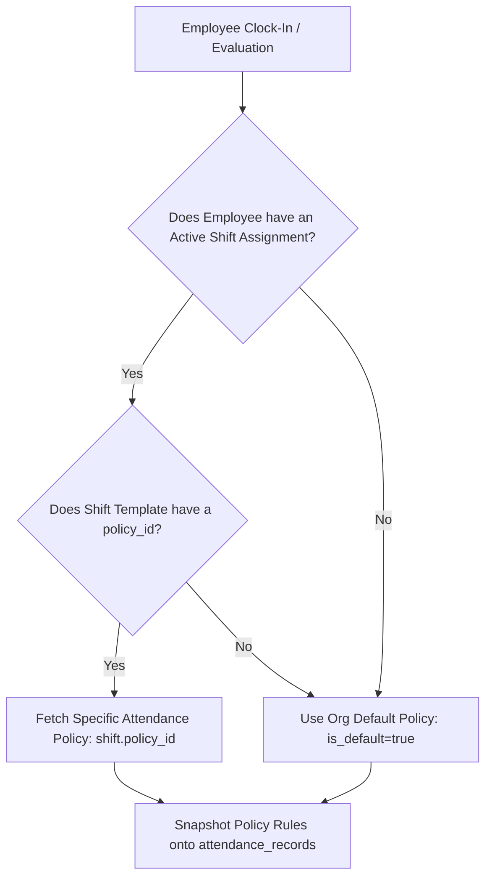

# Frontend Integration & Architecture Guide: Shift Schedule & Attendance Policy Visibility

**Document Version:** 1.0.0  
**Date:** 2026-10-21  
**Author:** Senior Principal Backend Engineer  
**Target Audience:** Frontend Engineering Team (Web & Mobile), Product Managers, UX Designers  
**Module:** Attendance Management (`/src/modules/attendance`)  
**Cross-References:**  
- [`public/md_attendance/3_user_attendance_api.md`](file:///C:/Users/91930/Desktop/Vs_Code/HRMS/public/md_attendance/3_user_attendance_api.md)
- [`public/md_attendance/4_manager_attendance_api.md`](file:///C:/Users/91930/Desktop/Vs_Code/HRMS/public/md_attendance/4_manager_attendance_api.md)
- [`public/md_attendance/5_hr_attendance_api.md`](file:///C:/Users/91930/Desktop/Vs_Code/HRMS/public/md_attendance/5_hr_attendance_api.md)
- [`public/md_system/api_registry.md`](file:///C:/Users/91930/Desktop/Vs_Code/HRMS/public/md_system/api_registry.md)

---

## 1. Executive Summary & Problem Statement

### 1.1 The Problem
In modern HRMS applications, an employee's day-to-day attendance experience is governed by two distinct dimensions:
1. **When should they work?** $\rightarrow$ **Shift Schedule** (e.g. *General Shift: 09:30 AM – 06:30 PM*).
2. **What rules govern their attendance evaluation?** $\rightarrow$ **Attendance Policy** (e.g. *15-minute grace period, 4 hours for Half-Day, 8 hours for Full-Day, 7-day regularization window, 60 minutes max break duration*).

Currently in the application:
- **Employees know their shift timings** (via `GET /api/v1/attendance/shift`), but **have zero visibility into the attendance rules/policy** applied to them.
- If an employee is marked **Late** because they clocked in at 9:46 AM (with a 15-minute grace period ending at 9:45 AM), the UI merely states `"Status: Present (Late: 16m)"`. The employee is left guessing: *"Why was I marked late? Was there a grace period? How much?"*
- If an employee clocks out after working 3 hours and 50 minutes, their attendance is recorded as **Absent**. The employee doesn't know that the policy requires **4.0 hours minimum** for a Half-Day credit.
- If an employee attempts to regularize a date from 10 days ago, the submission fails with `400 INVALID_REGULARIZATION_DATE` (`Cannot regularize dates older than 7 days`). The user was never told that their policy enforces a 7-day retrospective window.
- **Managers reviewing daily attendance** only see the shift name on subordinates' logs, lacking policy context when reviewing anomalies, break overages, or approving overtime/regularizations.

---

## 2. API Mapping in `public/md_attendance` Documentation

The backend endpoints that govern shifts and policies are documented across the following markdown files in `public/md_attendance/`:

| Module Documentation File | Section / API # | Endpoint | Method | Role Scope | Current Functionality & Payload Summary |
| :--- | :--- | :--- | :--- | :--- | :--- |
| **`3_user_attendance_api.md`** | **Section 12** (Line 903) | `/api/v1/attendance/shift` | `GET` | All Roles (`employee`, `manager`, `hr`, `admin`) | Returns caller's active shift assignment, shift template (`id`, `name`, `type`, `start_time`, `end_time`, `policy_id`), rotation pattern, and weekly offs. |
| **`3_user_attendance_api.md`** | **Section 1** (Line 55) | `/api/v1/attendance/today` | `GET` | All Roles | Returns today's active punches, breaks, status, and basic shift summary `{ name, start_time, end_time, type }`. |
| **`4_manager_attendance_api.md`** | **Section 8** (Line 1004) | `/api/v1/attendance/manager/team/member/:userId/daily-log` | `GET` | `manager`, `hr`, `admin` | Fetches single-day log for a subordinate: punches, breaks, sessions, overtime, and `shift: { name, start_time, end_time, type }`. |
| **`5_hr_attendance_api.md`** | **Section 1 (APIs 1–5)** (Line 55) | `/api/v1/attendance/hr/policies`<br>`/api/v1/attendance/hr/policies/:id`<br>`.../deactivate` | `POST`<br>`GET`<br>`PUT`<br>`PATCH` | `hr`, `admin` | Full CRUD for organizational Attendance Policies: grace periods, thresholds, break limits, auto clock-out, regularization windows, comp-off. |
| **`5_hr_attendance_api.md`** | **Section 2 (APIs 6–14)** (Line 338) | `/api/v1/attendance/hr/shifts`<br>`/api/v1/attendance/hr/shifts/:id`<br>`/api/v1/attendance/hr/shifts/assign`<br>`/api/v1/attendance/hr/shifts/assignments` | `POST`<br>`GET`<br>`PUT`<br>`DELETE` | `hr`, `admin` | Full Shift Template CRUD and Employee Shift Assignment Ledger. Each shift links to a `policy_id`. |

---

## 3. Underlying Backend Architecture & How Policies Resolve

To build the frontend correctly, engineers must understand how the backend resolves an attendance policy for any given punch or day:



1. **Assignment is to Shift, not directly to Policy**:
   - HR assigns an employee to a Shift (`POST /api/v1/attendance/hr/shifts/assign`).
   - The Shift Template contains an optional `policy_id` ([shift_templates.model.js:56](file:///C:/Users/91930/Desktop/Vs_Code/HRMS/src/modules/attendance/models/shift_templates.model.js#L56)).
2. **Fallback to Default Policy**:
   - If a shift has `policy_id: null`, or if an employee has no shift assigned, the backend dynamically falls back to the organization's **Default Policy** (`is_default: true, is_active: true`) via [clock.service.js#_resolvePolicyForUser](file:///C:/Users/91930/Desktop/Vs_Code/HRMS/src/modules/attendance/services/clock.service.js#L756).
3. **Audit Snapshotting**:
   - Whenever punches occur or daily calculations run, the evaluated policy rules are frozen into `attendance_records.policy_snapshot` so future policy changes do not mutate historical records.

---

## 4. Why Frontend Visibility is Critical (Use Cases & UX Benefits)

### Use Case 1: Punctuality & Grace Period Awareness
- **Current State:** Employee knows shift starts at 09:30 AM. They punch in at 09:42 AM and see a warning `"Late by 12 minutes"`. They feel frustrated because they were told "we have a grace period".
- **With Policy Visibility:** The clock-in card displays:
  - *Shift:* 09:30 AM – 06:30 PM
  - *Grace Period:* 15 mins (until 09:45 AM).
  - *Status:* On-time (within grace period).

### Use Case 2: Worked Hours vs. Half-Day / Full-Day Thresholds
- **Current State:** Employee works 7 hours 45 minutes, clocks out, and wonders why they didn't get a full present day.
- **With Policy Visibility:** A progress bar shows:
  - `[====== 4h Half-Day ======] ------ [====== 8h Full-Day ======]`
  - Real-time indicator: *"You have completed 7h 45m. 15m remaining for Full-Day credit."*

### Use Case 3: Break Allowances & Over-Break Warnings
- **Current State:** Employee takes two breaks totaling 75 minutes. At month-end, payroll deductions occur due to excessive breaks without any prior alert.
- **With Policy Visibility:** The Break widget clearly reflects policy limits:
  - *Breaks Taken:* 2 of 3 allowed.
  - *Break Duration:* 45m of 60m allowed (15m remaining).

### Use Case 4: Pre-Validating Regularization Requests
- **Current State:** Date picker in Regularization modal allows selecting any past date. Employee picks a date 14 days ago, types a reason, submits, and gets an error toast: `"Cannot regularize dates older than 7 days"`.
- **With Policy Visibility:** The date picker automatically disables dates older than `policy.regularization_window_days` ($D - 7$), eliminating form submission errors.

---

## 5. Backend Contract Recommendation for Frontend

To eliminate the need for frontend clients to perform complex multi-endpoint cross-referencing, the backend will enrich `GET /api/v1/attendance/shift` to return the **fully resolved policy object** alongside the shift.

### Recommended Enriched Payload: `GET /api/v1/attendance/shift`

```json
{
  "success": true,
  "message": "Current shift and policy fetched",
  "data": {
    "assignment": {
      "id": "18a92b3c-...",
      "effective_from": "2026-01-01",
      "effective_to": null
    },
    "shift": {
      "id": "7ca19283-...",
      "name": "General Day Shift",
      "start_time": "09:30:00",
      "end_time": "18:30:00",
      "type": "fixed",
      "timezone": "Asia/Kolkata",
      "is_overnight": false,
      "policy_id": "4b6c8d1e-..."
    },
    "policy": {
      "id": "4b6c8d1e-...",
      "name": "Corporate Standard Attendance Policy",
      "is_default": true,
      "grace_minutes": 15,
      "late_threshold_minutes": 30,
      "half_day_min_hours": 4.00,
      "full_day_min_hours": 8.00,
      "early_exit_threshold_minutes": 15,
      "max_breaks_per_day": 3,
      "max_break_duration_minutes": 60,
      "regularization_allowed": true,
      "regularization_window_days": 7,
      "overtime_enabled": true,
      "overtime_min_minutes": 60,
      "overtime_requires_approval": true,
      "auto_clock_out_enabled": true,
      "auto_clock_out_after_hours": 12.00
    },
    "rotation": null,
    "weekly_offs": [
      {
        "id": "2b3c4d5e-...",
        "days_of_week": [0, 6],
        "effective_from": "2026-01-01",
        "effective_to": null
      }
    ]
  }
}
```

---

## 6. Frontend UI/UX Implementation Guide

### 6.1 Employee Dashboard: "My Schedule & Rules" Card
```
+-----------------------------------------------------------------------+
|  MY WORK SCHEDULE & RULES                              [Active Shift] |
|                                                                       |
|  Shift: General Day Shift (09:30 AM - 06:30 PM)                       |
|  Weekly Offs: Saturday, Sunday                                        |
|                                                                       |
|  POLICY RULES: Corporate Standard Attendance Policy                   |
|  * Grace Period: 15 mins (Punch in before 09:45 AM without penalty)   |
|  * Half-Day Minimum: 4.0 hrs  |  Full-Day Minimum: 8.0 hrs            |
|  * Break Limits: Max 3 breaks / 60 mins cumulative daily             |
|  * Regularization Window: Within 7 days of incident                   |
+-----------------------------------------------------------------------+
```

### 6.2 Clock-In / Punch Widget Dynamic Helpers
- **Pre-Shift / Arrival Badge:**
  - Before Shift Start ($< 09:30$): `"Shift starts at 09:30 AM"` (Neutral).
  - Within Grace Period ($09:30 - 09:45$): `"Grace period active (ends in X mins)"` (Amber).
  - Past Grace Period ($> 09:45$): `"Late Arrival will be recorded"` (Red alert).
- **Working Hours Progress Bar:**
  - Map `effective_hours` against `policy.half_day_min_hours` and `policy.full_day_min_hours`.
  - Provide a visual milestone marker for Half-Day (4h) and Full-Day (8h).

### 6.3 Break Modal / Widget
- Display active count: `Breaks: ${currentBreaksCount} / ${policy.max_breaks_per_day}`.
- Display total duration remaining: `${policy.max_break_duration_minutes - totalBreakMinutes}m remaining`.

### 6.4 Regularization Request Form
- Disable dates older than `policy.regularization_window_days`:
  ```javascript
  const minSelectableDate = dayjs().subtract(policy.regularization_window_days, 'day').format('YYYY-MM-DD');
  // Pass minSelectableDate to DatePicker component (minDate prop)
  ```
- If `policy.regularization_allowed === false`, hide the *"Request Regularization"* action or render a disabled button with tooltip *"Regularization is disabled by your attendance policy."*

### 6.5 Manager & HR Review Views
- When a Manager opens `GET /api/v1/attendance/manager/team/member/:userId/daily-log`, render an expandable **"Policy Rules in Effect"** popover.
- When an employee requests Overtime or Regularization, show the policy threshold next to the requested hours so the manager doesn't have to navigate to settings to check if the request is valid.

---

## 7. Action Items & Next Steps

1. **Backend**:
   - Update [clock.service.js#getMyShift](file:///C:/Users/91930/Desktop/Vs_Code/HRMS/src/modules/attendance/services/clock.service.js#L702) to call `this._resolvePolicyForUser(orgId, assignment.shift)` and include the resolved `policy` object in the response.
   - Update `findDailyLogWithDetails` or `getHrMemberDailyLog` to include `policy` snapshot details for manager/HR views.
2. **Frontend**:
   - Consume `data.policy` from `GET /api/v1/attendance/shift` on the User Dashboard.
   - Bind the Regularization date-picker constraints to `policy.regularization_window_days`.
   - Add grace period, work duration milestones, and break limit chips to the Attendance widget.
