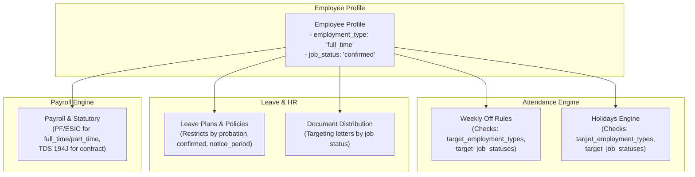

# Employee Profile Enums & Vocabulary Specification

**Document Version:** 1.0.0  
**Effective Date:** 2026-10-22  
**Target Audience:** Frontend Web & Mobile Teams, API Consumers, QA Engineers  
**System Scope:** Core Employee Profile, Attendance Policy Targeting, Leave Assignment, Payroll Aggregation  

---

## 1. Executive Summary & Problem Statement

In an enterprise HRMS, audience targeting (who gets a weekly off, which holiday applies, which leave policy is assigned, and which salary structure is allocated) depends on **strict enum equality** against employee profile attributes.

Previously, in administrative forms or manual DB seeds, arbitrary text strings were occasionally entered—for example:
- Entering `"Active"` or `"Probation"` in weekly off rules when the employee record is `"confirmed"`
- Entering `"Full-time"` (Title Case with hyphen) when the database enum is `"full_time"` (snake_case)

Because the backend evaluator uses strict set membership (`rule.target_job_statuses.includes(profile.jobStatus)`), mismatched strings cause employees to **silently miss out** on assigned weekly offs, leave grants, or holiday credit.

This document serves as the **single source of truth (SSOT)** for all supported enums, machine values, UI labels, color semantics, and drop-in TypeScript constants.

---

## 2. Authoritative Database Enums

All three role-profile tables (`employee_profiles`, `manager_profiles`, `hr_profiles`) share identical PostgreSQL `USER-DEFINED` enum types:

```sql
-- PostgreSQL Enum: Employment Types
CREATE TYPE enum_employee_profiles_employment_type AS ENUM (
  'full_time',
  'part_time',
  'contract',
  'intern'
);

-- PostgreSQL Enum: Job Statuses
CREATE TYPE enum_employee_profiles_job_status AS ENUM (
  'probation',
  'confirmed',
  'notice_period',
  'terminated',
  'trainee',
  'contract',
  'temporary'
);

-- PostgreSQL Enum: Work Modes
CREATE TYPE enum_employee_profiles_work_mode AS ENUM (
  'on-site',
  'remote',
  'hybrid',
  'field'
);

-- PostgreSQL Enum: Gender
CREATE TYPE enum_employee_profiles_gender AS ENUM (
  'male',
  'female',
  'other',
  'prefer_not_to_say'
);
```

---

## 3. Employment Type (`employment_type`)

Defines the worker's legal and contractual arrangement with the organization.

### 3.1 Vocabulary & Semantics

| DB Machine Value (API) | UI Label | Badge Style (Tailwind) | Description & Business Rules |
|---|---|---|---|
| `full_time` | **Full-Time** | `bg-emerald-50 text-emerald-700 border-emerald-200` | Standard permanent/regular employee working the organization's full weekly hours. Entitled to standard leave policies and statutory PF/ESIC. |
| `part_time` | **Part-Time** | `bg-blue-50 text-blue-700 border-blue-200` | Employee working reduced or designated hours. Leave quotas may be prorated. |
| `contract` | **Contract** | `bg-amber-50 text-amber-700 border-amber-200` | Fixed-term contractor or consultant. Usually exempt from PF/ESIC statutory schemes, subject to TDS (194J/194C). |
| `intern` | **Intern** | `bg-purple-50 text-purple-700 border-purple-200` | Student intern or apprentice on a training stipend. May have restricted regularization windows. |

* **Default Value:** `null` (Optional)
* **API Validation:** Strict case-sensitive match against `['full_time', 'part_time', 'contract', 'intern']`.

---

## 4. Job Status (`job_status`)

Defines the employee's operational lifecycle state within the company.

### 4.1 Vocabulary & Semantics

| DB Machine Value (API) | UI Label | Badge Style (Tailwind) | Lifecycle & System Behavior |
|---|---|---|---|
| `confirmed` | **Confirmed** | `bg-emerald-50 text-emerald-700 border-emerald-200` | **System Default.** Permanent, regular staff member with full operational access, leave encashment eligibility, and loan entitlement. |
| `probation` | **Probation** | `bg-sky-50 text-sky-700 border-sky-200` | Newly hired employee under trial period. Certain leave types (e.g. Privilege Leave encashment) or loans may be locked. |
| `trainee` | **Trainee** | `bg-indigo-50 text-indigo-700 border-indigo-200` | Graduate or operational apprentice undergoing structured training. |
| `notice_period` | **Notice Period** | `bg-amber-50 text-amber-700 border-amber-200` | Employee has submitted resignation or received exit notice. Restricts long-term leave requests and blocks advance loan disbursals. Stamped with `notice_period_started_on`. |
| `contract` | **Contractual** | `bg-orange-50 text-orange-700 border-orange-200` | Vendor or agency resource deployed on a contracted statement of work. |
| `temporary` | **Temporary** | `bg-slate-50 text-slate-700 border-slate-200` | Short-term seasonal worker. Excluded from multi-year tenure calculations. |
| `terminated` | **Terminated** | `bg-rose-50 text-rose-700 border-rose-200` | Relieved / exited staff. Auto-absent cron excludes them; forward schedule returns empty lanes; user credentials deactivated. |

* **Default Value in Database:** `'confirmed'`
* **API Validation:** Strict case-sensitive match against `['probation', 'confirmed', 'notice_period', 'terminated', 'trainee', 'contract', 'temporary']`.

---

## 5. Secondary Profile Enums (`work_mode` & `gender`)

These attributes share the same profile creation / edit forms and rule filters:

### 5.1 Work Mode (`work_mode`)

| DB Value (API) | UI Label | Geofencing Behavior |
|---|---|---|
| `on-site` | **On-Site (Office)** | Punching restricted to base branch geofence boundary. |
| `remote` | **Remote (Work from Home)** | Geofencing bypassed; punches allowed from any coordinate. |
| `hybrid` | **Hybrid** | Geofencing enforced on scheduled office days; relaxed on remote days. |
| `field` | **Field / On-Ground** | Continuous GPS logging enabled; geofence enforced per client site. |

> **API Input Alias:** The backend accepts `"office"` as an alias on input, but it is normalized and saved as `"on-site"`. The frontend should always send and render `"on-site"`.

### 5.2 Gender (`gender`)

| DB Value (API) | UI Label | Policy Relevance |
|---|---|---|
| `male` | **Male** | Paternity leave assignment eligibility. |
| `female` | **Female** | Maternity leave assignment and POSH policy eligibility. |
| `other` | **Other** | Universal leave categories. |
| `prefer_not_to_say` | **Prefer Not to Say** | Universal leave categories. |

---

## 6. System Modules & Targeting Rules Matrix

Here is how these enums drive policy resolution across the backend:



---

## 7. Frontend Integration & TypeScript Code Snippets

### 7.1 Constants & Option Arrays (`employee.constants.ts`)

Copy and paste this directly into your frontend repository:

```typescript
/**
 * Authoritative constants matching HRMS Backend PostgreSQL Enums.
 * File: src/constants/employee.constants.ts
 */

export interface SelectOption<T extends string> {
  value: T;
  label: string;
  description?: string;
}

// -----------------------------------------------------------------------------
// 1. Employment Types
// -----------------------------------------------------------------------------
export const EMPLOYMENT_TYPE_OPTIONS: readonly SelectOption<EmploymentType>[] = [
  { value: 'full_time', label: 'Full-Time', description: 'Standard permanent regular employee' },
  { value: 'part_time', label: 'Part-Time', description: 'Reduced hours schedule' },
  { value: 'contract', label: 'Contract', description: 'Fixed-term / 3rd-party contractor' },
  { value: 'intern', label: 'Intern', description: 'Student or apprentice trainee' }
] as const;

export type EmploymentType = 'full_time' | 'part_time' | 'contract' | 'intern';

// -----------------------------------------------------------------------------
// 2. Job Statuses
// -----------------------------------------------------------------------------
export const JOB_STATUS_OPTIONS: readonly SelectOption<JobStatus>[] = [
  { value: 'confirmed', label: 'Confirmed', description: 'Confirmed permanent employee (Default)' },
  { value: 'probation', label: 'Probation', description: 'New hire under evaluation' },
  { value: 'trainee', label: 'Trainee', description: 'Apprentice / technical trainee' },
  { value: 'notice_period', label: 'Notice Period', description: 'Employee serving exit notice' },
  { value: 'contract', label: 'Contractual', description: 'Contract placement' },
  { value: 'temporary', label: 'Temporary', description: 'Short-term / seasonal staff' },
  { value: 'terminated', label: 'Terminated', description: 'Exited staff' }
] as const;

export type JobStatus = 
  | 'probation'
  | 'confirmed'
  | 'notice_period'
  | 'terminated'
  | 'trainee'
  | 'contract'
  | 'temporary';

// -----------------------------------------------------------------------------
// 3. Work Modes
// -----------------------------------------------------------------------------
export const WORK_MODE_OPTIONS: readonly SelectOption<WorkMode>[] = [
  { value: 'on-site', label: 'On-Site (Office)' },
  { value: 'remote', label: 'Remote' },
  { value: 'hybrid', label: 'Hybrid' },
  { value: 'field', label: 'Field' }
] as const;

export type WorkMode = 'on-site' | 'remote' | 'hybrid' | 'field';

// -----------------------------------------------------------------------------
// 4. Gender Options
// -----------------------------------------------------------------------------
export const GENDER_OPTIONS: readonly SelectOption<Gender>[] = [
  { value: 'male', label: 'Male' },
  { value: 'female', label: 'Female' },
  { value: 'other', label: 'Other' },
  { value: 'prefer_not_to_say', label: 'Prefer Not to Say' }
] as const;

export type Gender = 'male' | 'female' | 'other' | 'prefer_not_to_say';
```

---

### 7.2 Reusable React Badge Component (`StatusBadge.tsx`)

```tsx
import React from 'react';
import { JobStatus, EmploymentType } from '../constants/employee.constants';

const JOB_STATUS_STYLES: Record<JobStatus, { bg: string; text: string; label: string }> = {
  confirmed: { bg: 'bg-emerald-50 border-emerald-200', text: 'text-emerald-700', label: 'Confirmed' },
  probation: { bg: 'bg-sky-50 border-sky-200', text: 'text-sky-700', label: 'Probation' },
  trainee: { bg: 'bg-indigo-50 border-indigo-200', text: 'text-indigo-700', label: 'Trainee' },
  notice_period: { bg: 'bg-amber-50 border-amber-200', text: 'text-amber-700', label: 'Notice Period' },
  contract: { bg: 'bg-orange-50 border-orange-200', text: 'text-orange-700', label: 'Contractual' },
  temporary: { bg: 'bg-slate-50 border-slate-200', text: 'text-slate-700', label: 'Temporary' },
  terminated: { bg: 'bg-rose-50 border-rose-200', text: 'text-rose-700', label: 'Terminated' }
};

export const JobStatusBadge: React.FC<{ status: JobStatus | string | null }> = ({ status }) => {
  if (!status || !JOB_STATUS_STYLES[status as JobStatus]) {
    return (
      <span className="inline-flex items-center px-2.5 py-0.5 rounded-full text-xs font-medium bg-gray-100 text-gray-600 border border-gray-200">
        {status || 'Unknown'}
      </span>
    );
  }

  const { bg, text, label } = JOB_STATUS_STYLES[status as JobStatus];

  return (
    <span className={`inline-flex items-center px-2.5 py-0.5 rounded-full text-xs font-semibold border ${bg} ${text}`}>
      {label}
    </span>
  );
};

const EMPLOYMENT_TYPE_STYLES: Record<EmploymentType, { bg: string; text: string; label: string }> = {
  full_time: { bg: 'bg-emerald-50 border-emerald-200', text: 'text-emerald-700', label: 'Full-Time' },
  part_time: { bg: 'bg-blue-50 border-blue-200', text: 'text-blue-700', label: 'Part-Time' },
  contract: { bg: 'bg-amber-50 border-amber-200', text: 'text-amber-700', label: 'Contract' },
  intern: { bg: 'bg-purple-50 border-purple-200', text: 'text-purple-700', label: 'Intern' }
};

export const EmploymentTypeBadge: React.FC<{ type: EmploymentType | string | null }> = ({ type }) => {
  if (!type || !EMPLOYMENT_TYPE_STYLES[type as EmploymentType]) {
    return (
      <span className="inline-flex items-center px-2 py-0.5 rounded text-xs font-medium bg-gray-100 text-gray-600">
        {type || 'Unspecified'}
      </span>
    );
  }

  const { bg, text, label } = EMPLOYMENT_TYPE_STYLES[type as EmploymentType];

  return (
    <span className={`inline-flex items-center px-2 py-0.5 rounded text-xs font-medium border ${bg} ${text}`}>
      {label}
    </span>
  );
};
```

---

## 8. APIs Utilizing These Enums

The following endpoints send or accept these enum values:

| Method | Endpoint | Field Usage |
|---|---|---|
| `GET` | `/api/v1/attendance/schedule/agenda` | Returned inside `data.employee.employment_type` and `data.employee.job_status`. |
| `GET` | `/api/v1/organization/employees` | Filterable by `employment_type` and `job_status`. |
| `PATCH`| `/api/v1/organization/employees/:id` | Updatable by HR/Admin using `employment_type` and `job_status`. |
| `POST` | `/api/v1/organization/invitations` | Sent in request payload for onboarding candidates. |
| `POST` | `/api/v1/attendance/weekly-off-rules` | Sent as arrays in `target_employment_types` and `target_job_statuses`. |
| `POST` | `/api/v1/attendance/holidays` | Sent as arrays in `target_employment_types` and `target_job_statuses`. |

### 8.1 Error Response on Invalid Enum Value

If an invalid or non-canonical enum string (e.g. `"Full-time"` or `"Active"`) is transmitted:

```json
{
  "success": false,
  "message": "\"employment_type\" must be one of [full_time, part_time, contract, intern]",
  "errorCode": "VALIDATION_ERROR"
}
```
