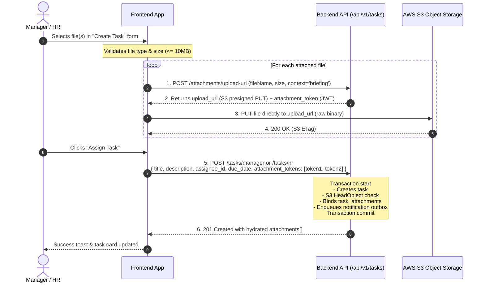

# Task Creation File Attachments — Frontend Integration Guide

**Date:** 2026-10-23  
**Module:** Task Assignment Subsystem (`src/modules/task/`)  
**Scope:** Manager & HR Task Assignment Panels — Briefing File Attachments  
**Authoritative Contracts:**  
- APIs: `#268` (`/upload-url`), `#269` (`/confirm`), `#270` (`/:attachmentId/download-url`), `#250` (`POST /tasks/manager`), `#256` (`POST /tasks/hr`)  
- Specifications: `public/md_task-assignment/implementation_plan.md` (§8, REQ-4)

---

## 1. Executive Summary for the Frontend Team

File attachments during task creation are **already fully implemented, tested, and operational on the backend**. 

If the frontend UI currently lacks a file upload option when assigning a task, this guide provides the exact 3-step integration workflow:
1. **Pre-Staging Upload URL:** Frontend requests a presigned AWS S3 upload URL and a signed JWT staging token.
2. **Direct S3 Upload:** Frontend `PUT`s the binary file directly to S3 (no heavy payload passes through the Node.js API server).
3. **Atomic Task Binding:** Frontend includes the array of staging tokens (`attachment_tokens: [...]`) in the task creation payload (`POST /api/v1/tasks/manager` or `POST /api/v1/tasks/hr`). The backend verifies the files in S3 and binds them to the newly created task atomically inside a single database transaction.

---

## 2. Architecture & Sequence Flow



---

## 3. Upload Constraints & Validation Rules

| Rule | Constraint | Error Code if Violated |
| :--- | :--- | :--- |
| **Max Files per Task** | Maximum **10 attachments** during task creation (`attachment_tokens` max 10; task lifetime cap 20). | `ATTACHMENT_LIMIT_EXCEEDED` / `VALIDATION_ERROR` |
| **Max File Size** | **10 MB** (10,485,760 bytes) per file. | `VALIDATION_ERROR` (`number.max`) |
| **Allowed File Types** | PDF, MS Word, MS Excel, and standard Images (see MIME list below). | `VALIDATION_ERROR` (`any.only`) |
| **Token Validity** | Presigned S3 URL and `attachment_token` expire in **15 minutes** (900 seconds). | `INVALID_ATTACHMENT_TOKEN` |

### Whitelisted MIME Types
- **PDF:** `application/pdf`
- **Images:** `image/jpeg`, `image/png`, `image/webp`
- **Word Documents:** `application/msword` (`.doc`), `application/vnd.openxmlformats-officedocument.wordprocessingml.document` (`.docx`)
- **Excel Spreadsheets:** `application/vnd.openxmlformats-officedocument.spreadsheetml.sheet` (`.xlsx`)

---

## 4. Step-by-Step API Contract

### Step 1: Request Staging Upload URL
Call this endpoint for each file selected by the user.

- **Endpoint:** `POST /api/v1/tasks/attachments/upload-url`
- **Auth:** `Bearer <accessToken>`
- **Headers:** `Content-Type: application/json`

#### Request Body
```json
{
  "file_name": "Q4_Performance_Brief.pdf",
  "content_type": "application/pdf",
  "file_size_bytes": 2048576,
  "attachment_context": "briefing"
}
```
> **Note:** For task creation (pre-staging), **do not send `task_id`**. Omission of `task_id` signals Mode A (pre-creation staging).

#### Response (`200 OK`)
```json
{
  "success": true,
  "message": "Upload URL generated successfully",
  "data": {
    "upload_url": "https://hrms-storage.s3.ap-south-1.amazonaws.com/org/b782fd72.../tasks/staged/7c2a4f..._Q4_Performance_Brief.pdf?X-Amz-Algorithm=AWS4-HMAC-SHA256&X-Amz-Expires=900...",
    "attachment_token": "eyJhbGciOiJIUzI1NiIsInR5cCI6IkpXVCJ9.eyJwdXJwb3NlIjoidGFza19hdHRhY2htZW50X3VwbG9hZCIsIm9yZ19pZCI6ImI3ODJmZDcy...",
    "expires_in_seconds": 900,
    "storage_key": "org/b782fd72.../tasks/staged/7c2a4f..._Q4_Performance_Brief.pdf",
    "required_headers": {
      "Content-Type": "application/pdf",
      "Content-Length": "2048576"
    }
  }
}
```

---

### Step 2: Upload File Directly to S3 (Binary PUT)
Upload the raw binary `File` or `Blob` directly to the `upload_url` received in Step 1.

- **Method:** `PUT`
- **URL:** `data.upload_url`
- **Headers:** `Content-Type: <file.type>` (must match the exact `content_type` declared in Step 1)
- **Body:** Raw binary file

> [!CAUTION]
> **Do NOT send your application's `Authorization: Bearer ...` token to AWS S3!** S3 will reject the request with a signature mismatch error. Use a clean HTTP client instance (or native `fetch()`) without auth interceptors.

---

### Step 3: Create Task with Bound Attachments
Collect all `attachment_token` strings from Step 1 and submit them in `attachment_tokens`.

- **Manager Endpoint:** `POST /api/v1/tasks/manager`
- **HR/Admin Endpoint:** `POST /api/v1/tasks/hr`
- **Auth:** `Bearer <accessToken>`
- **Headers:** `Content-Type: application/json`

#### Request Body
```json
{
  "title": "Conduct Annual Statutory Compliance Audit",
  "description": "Please review the attached audit checklist and statutory guidelines before initiating department interviews.",
  "category": "compliance",
  "priority": "high",
  "due_date": "2026-10-30T17:00:00.000Z",
  "assignee_id": "5a61d281-6477-47e6-b720-bd6deb00123e",
  "external_links": [
    {
      "label": "Audit Guidelines Portal",
      "url": "https://compliance.internal.compunic.com/guidelines"
    }
  ],
  "attachment_tokens": [
    "eyJhbGciOiJIUzI1NiIsInR5cCI6IkpXVCJ9.eyJwdXJwb3NlIjoidGFza19hdHRhY2htZW50X3VwbG9hZCIsIm9yZ19pZCI6ImI3ODJmZDcy...",
    "eyJhbGciOiJIUzI1NiIsInR5cCI6IkpXVCJ9.eyJwdXJwb3NlIjoidGFza19hdHRhY2htZW50X3VwbG9hZCIsIm9yZ19pZCI6ImI3ODJmZDcy..."
  ]
}
```

#### Response (`201 Created`)
```json
{
  "success": true,
  "message": "Task created successfully",
  "data": {
    "id": "a9b8c7d6-1122-3344-5566-778899aabbcc",
    "title": "Conduct Annual Statutory Compliance Audit",
    "description": "Please review the attached audit checklist...",
    "category": "compliance",
    "priority": "high",
    "status": "pending",
    "due_date": "2026-10-30T17:00:00.000Z",
    "assigner_id": "f5ec1234-5678-90ab-cdef-1234567890ab",
    "assignee_id": "5a61d281-6477-47e6-b720-bd6deb00123e",
    "is_viewed": false,
    "first_viewed_at": null,
    "external_links": [
      {
        "label": "Audit Guidelines Portal",
        "url": "https://compliance.internal.compunic.com/guidelines"
      }
    ],
    "attachments": [
      {
        "id": "11223344-5566-7788-99aa-bbccddeeff00",
        "org_id": "b782fd72-493e-415d-8b5b-9194b81d294e",
        "task_id": "a9b8c7d6-1122-3344-5566-778899aabbcc",
        "uploader_id": "f5ec1234-5678-90ab-cdef-1234567890ab",
        "file_name": "Q4_Performance_Brief.pdf",
        "file_size_bytes": 2048576,
        "content_type": "application/pdf",
        "attachment_context": "briefing",
        "created_at": "2026-10-23T03:45:00.000Z"
      }
    ],
    "comments_count": 0,
    "is_overdue": false,
    "assigner": {
      "id": "f5ec1234-5678-90ab-cdef-1234567890ab",
      "name": "Abhishek Ganeshe",
      "email": "abhishek@compunic.com",
      "avatar_url": "https://..."
    },
    "assignee": {
      "id": "5a61d281-6477-47e6-b720-bd6deb00123e",
      "name": "Rishi Ganeshe",
      "email": "rishi@compunic.com",
      "avatar_url": "https://..."
    }
  }
}
```

---

## 5. Downloading / Viewing Attachments Later

When viewing task details (as the assignee, assigner, direct manager, or HR/Admin):

- **Endpoint:** `GET /api/v1/tasks/attachments/:attachmentId/download-url`
- **Auth:** `Bearer <accessToken>`

### Response (`200 OK`)
```json
{
  "success": true,
  "message": "Download URL generated successfully",
  "data": {
    "download_url": "https://hrms-storage.s3.ap-south-1.amazonaws.com/org/...&X-Amz-Signature=...",
    "expires_in_seconds": 900,
    "file_name": "Q4_Performance_Brief.pdf",
    "content_type": "application/pdf",
    "file_size_bytes": 2048576
  }
}
```
**Frontend Action:** Trigger download or open `data.download_url` in a browser tab. The link is a temporary 15-minute capability URL.

---

## 6. Frontend Reference Implementation (React / TypeScript)

Here is a drop-in integration helper using standard `axios`:

```typescript
import axios from 'axios';

interface StagedAttachment {
  file: File;
  attachmentToken: string;
}

// 1. Upload helper for files attached during task creation
export async function uploadTaskBriefingFile(file: File): Promise<string> {
  // Client-side guard rails
  const MAX_SIZE = 10 * 1024 * 1024; // 10MB
  if (file.size > MAX_SIZE) {
    throw new Error(`"${file.name}" exceeds the maximum allowed size of 10MB.`);
  }

  // A. Request Presigned Upload URL & Staging Token from Backend
  const { data: urlRes } = await axios.post('/api/v1/tasks/attachments/upload-url', {
    file_name: file.name,
    content_type: file.type,
    file_size_bytes: file.size,
    attachment_context: 'briefing'
  });

  const { upload_url, attachment_token } = urlRes.data;

  // B. Upload file directly to S3 (Notice: NO Authorization header!)
  await fetch(upload_url, {
    method: 'PUT',
    headers: {
      'Content-Type': file.type
    },
    body: file
  });

  // C. Return the staging JWT token
  return attachment_token;
}

// 2. Task Assignment Form Submission Handler
export async function handleCreateTaskSubmit(formValues: {
  title: string;
  description: string;
  category: string;
  priority: string;
  due_date: string;
  assignee_id: string;
  external_links?: Array<{ label: string; url: string }>;
  selectedFiles: File[];
}) {
  try {
    // Step A: Upload all attached files in parallel and collect tokens
    const attachmentTokens = await Promise.all(
      formValues.selectedFiles.map((file) => uploadTaskBriefingFile(file))
    );

    // Step B: Submit task creation payload
    const payload = {
      title: formValues.title,
      description: formValues.description,
      category: formValues.category,
      priority: formValues.priority,
      due_date: formValues.due_date,
      assignee_id: formValues.assignee_id,
      external_links: formValues.external_links || [],
      attachment_tokens: attachmentTokens // <-- Pass the array of JWT tokens here!
    };

    const response = await axios.post('/api/v1/tasks/manager', payload);
    return response.data;
  } catch (error: any) {
    console.error('Task creation failed:', error?.response?.data || error.message);
    throw error;
  }
}
```

---

## 7. Troubleshooting & Common Pitfalls

| Symptom / Error | Root Cause | Fix |
| :--- | :--- | :--- |
| **S3 returns `403 SignatureDoesNotMatch`** | The frontend sent `Authorization: Bearer ...` header or an extra header to S3 during Step 2. | Use clean `fetch()` or an un-intercepted axios instance for the S3 `PUT`. Only send `Content-Type`. |
| **Backend returns `400 ATTACHMENT_NOT_FOUND_IN_STORAGE`** | Step 3 was submitted before Step 2 finished uploading to S3, or Step 2 failed. | Ensure `await Promise.all()` completes the S3 `PUT` before calling `POST /tasks/manager`. |
| **Backend returns `400 INVALID_ATTACHMENT_TOKEN`** | Staging token has expired (> 15 minutes old) or was malformed. | Generate upload URLs at the moment of file attachment or immediately prior to task submission. |
| **Backend returns `400 Unsupported file content type`** | File extension/type is not in the allowed list (e.g., `.zip`, `.exe`, `.mp4`). | Restrict file picker input to: `accept=".pdf,.doc,.docx,.xlsx,.png,.jpg,.jpeg,.webp"`. |
| **Task created but `attachments` array is empty** | Frontend passed `attachments: [...]` instead of `attachment_tokens: [...]`. | Name the request key **`attachment_tokens`** (array of strings). |
